If you train or serve machine-learning systems on Kubernetes, every meaningful thing you do passes through a small Go program you have probably never looked at. When the scheduler decides which node runs your GPU job, it reads and writes keys in etcd. When a Deployment rolls out a new model server, the desired state lives in etcd. When an operator leader election picks which replica reconciles your custom resource, the lease that decides the winner is an etcd lease. Kubernetes stores the entire cluster state — every Pod, Secret, ConfigMap, and CRD — as keys in etcd, which is why etcd outages take down clusters and why etcd backups are the first thing every serious operator configures.

etcd itself is a CNCF-graduated, distributed key-value store written in Go. Its contract is unusually strict for a database: writes must survive the loss of minority members and never disagree between replicas, even under partitions. To deliver that, etcd replicates every mutation through the Raft consensus algorithm before acknowledging it, persists the Raft log in a write-ahead log, and keeps the actual key-value data in an MVCC (multi-version concurrency control) store where every transaction creates a new global revision. On top of that sits a gRPC API with three killer features: atomic transactions (`Txn`), range queries with history, and low-latency `Watch` streams that push changes instead of forcing clients to poll. The project's own README describes it as simple, secure, fast (benchmarked 10,000 writes/sec), and reliable — a fair summary of what the code actually implements.

For AI infrastructure specifically, etcd is the coordination primitive hiding under everything else. Job queues built on leases, model registries that need strongly consistent metadata, service discovery for inference replicas, distributed locks for training coordination — all of these are tiny protocols layered on etcd's primitives. Reading its source is one of the best ways to understand how a "boring" piece of infrastructure earns the right to be boring. In this tour we walk the [etcd-io/etcd](https://github.com/etcd-io/etcd) repository (branch `main`), from the client stubs to the disk, with every symbol below verified against the real code.

<div style="overflow-x:auto;"></div>

<p><em>The write path at a glance: a gRPC client proposal flows through the Raft loop and the write-ahead log, comes back as a committed entry, and is applied to the MVCC store, which then notifies watchers.</em></p>

Reading the overview from left to right:

- Everything starts with a client. [`clientv3.New, L86`](https://github.com/etcd-io/etcd/blob/main/client/v3/client.go#L86) dials your endpoints and hands out typed interfaces; the [`KV interface, L38`](https://github.com/etcd-io/etcd/blob/main/client/v3/kv.go#L38) defines `Put`, `Get`, and `Txn` in a single screen of code.
- The wire format is defined once in protobuf. The [`service KV, L33`](https://github.com/etcd-io/etcd/blob/main/api/etcdserverpb/rpc.proto#L33) declares `Range`, `Put`, `Txn`, `Watch`, and the lease RPCs that both the client and server compile against.
- On the server, [`EtcdServer.Put, L296`](https://github.com/etcd-io/etcd/blob/main/server/etcdserver/v3_server.go#L296) receives the request and routes it into [`raftRequest, L1014`](https://github.com/etcd-io/etcd/blob/main/server/etcdserver/v3_server.go#L1014), the funnel through which every mutation must pass.
- [`raftNode.start, L174`](https://github.com/etcd-io/etcd/blob/main/server/etcdserver/raft.go#L174) is the beating heart: a loop that ticks the consensus state machine, collects `Ready` batches, and persists them via [`WAL.Save, L1000`](https://github.com/etcd-io/etcd/blob/main/server/storage/wal/wal.go#L1000) before the leader ships messages through [`Transport.Send, L176`](https://github.com/etcd-io/etcd/blob/main/server/etcdserver/api/rafthttp/transport.go#L176).
- Once a majority has persisted an entry, it comes back committed and [`Apply, L27`](https://github.com/etcd-io/etcd/blob/main/server/etcdserver/apply/apply.go#L27) decodes it into an internal request for the applier stack.
- The applier finally touches the store: [`storeTxnWrite.put, L223`](https://github.com/etcd-io/etcd/blob/main/server/storage/mvcc/kvstore_txn.go#L223) stamps the key with a new revision, writes it into the bolt-backed bucket, and updates the in-memory index.
- Reads are different: [`EtcdServer.Range, L107`](https://github.com/etcd-io/etcd/blob/main/server/etcdserver/v3_server.go#L107) never goes through Raft for the data itself; serializable reads hit the local store directly, while linearizable reads use a ReadIndex round to prove the serving node's leadership is still current.
- Every applied change also wakes the watch machinery: [`notify, L470`](https://github.com/etcd-io/etcd/blob/main/server/storage/mvcc/watchable_store.go#L470) pushes events to watchers that are keeping up, and [`syncWatchers, L347`](https://github.com/etcd-io/etcd/blob/main/server/storage/mvcc/watchable_store.go#L347) replays history for those that fell behind.

<div style="overflow-x:auto;"></div>

<p><em>The full detail map: eight subsystems from the clientv3 package down to bolt buckets, leases, and the compaction sweep that keeps history bounded.</em></p>

## Two Roads Through the Server

etcd's elegance comes from treating reads and writes completely differently. A write is a proposal: the server wraps your `PutRequest` inside an [`InternalRaftRequest, L22`](https://github.com/etcd-io/etcd/blob/main/api/etcdserverpb/raft_internal.proto#L22) envelope and calls [`processInternalRaftRequestOnce, L1060`](https://github.com/etcd-io/etcd/blob/main/server/etcdserver/v3_server.go#L1060), which blocks until the proposal is either committed and applied, or times out. There is deliberately no fast path — even a single-node cluster takes the full Raft round trip, because the log *is* the database. The entry, once committed, is handed to [`applyEntries, L1180`](https://github.com/etcd-io/etcd/blob/main/server/etcdserver/server.go#L1180), which feeds each one into the applier.

The applier is a layered decorator chain rather than a switch statement. [`uberApplier.Apply, L82`](https://github.com/etcd-io/etcd/blob/main/server/etcdserver/apply/uber_applier.go#L82) runs the request through corrupt-store and capped-quota wrappers, then auth and quota checks, before [`applierV3backend.Put, L50`](https://github.com/etcd-io/etcd/blob/main/server/etcdserver/apply/backend.go#L50) finally executes the mutation. The dispatch logic itself lives at [`dispatch, L93`](https://github.com/etcd-io/etcd/blob/main/server/etcdserver/apply/uber_applier.go#L93), where the wrapper's non-nil field selects the operation. [`txn.Put, L30`](https://github.com/etcd-io/etcd/blob/main/server/etcdserver/txn/put.go#L30) handles the quirky options (`ignore_value`, `ignore_lease`, `prev_kv` return), and [`txn.Txn, L32`](https://github.com/etcd-io/etcd/blob/main/server/etcdserver/txn/txn.go#L32) evaluates the if/then/else comparison trees that make etcd usable as a distributed lock service. Reads skip all of this: [`txn.Range, L47`](https://github.com/etcd-io/etcd/blob/main/server/etcdserver/txn/range.go#L47) executes against a read view of the store, and only the ReadIndex round in [`requestCurrentIndex, L148`](https://github.com/etcd-io/etcd/blob/main/server/etcdserver/read/read.go#L148) touches consensus — a design that lets reads scale without weakening the consistency contract.

## MVCC: Every Write Is a New Revision

The storage layer is where etcd earns its reliability reputation. The core is the [`store, L53`](https://github.com/etcd-io/etcd/blob/main/server/storage/mvcc/kvstore.go#L53) in `server/storage/mvcc`, which pairs a bolt database on disk with an in-memory `treeIndex`. Writing starts at [`store.Write, L174`](https://github.com/etcd-io/etcd/blob/main/server/storage/mvcc/kvstore_txn.go#L174), which opens a transaction and returns a `TxnWrite` view. Inside [`storeTxnWrite.put, L223`](https://github.com/etcd-io/etcd/blob/main/server/storage/mvcc/kvstore_txn.go#L223) you can read the whole scheme in twenty lines: the current revision is packed into orderable bytes by [`RevToBytes, L54`](https://github.com/etcd-io/etcd/blob/main/server/storage/mvcc/revision.go#L54), the marshalled `KeyValue` is written into the [`schema.Key, L43`](https://github.com/etcd-io/etcd/blob/main/server/storage/schema/bucket.go#L43) bucket with the revision as its key, and the [`treeIndex, L39`](https://github.com/etcd-io/etcd/blob/main/server/storage/mvcc/index.go#L39) gets a pointer so that [`treeIndex.Get, L68`](https://github.com/etcd-io/etcd/blob/main/server/storage/mvcc/index.go#L68) can later resolve any key at any past revision.

This is why etcd can answer "what did this key look like last Tuesday" and why watches can replay history. It is also why history must be pruned: nothing deletes old revisions automatically. [`scheduleCompaction, L28`](https://github.com/etcd-io/etcd/blob/main/server/storage/mvcc/kvstore_compaction.go#L28) periodically discards revisions older than the compaction point, both in bolt and in the index — which is why unwatched, un-compacted etcd clusters grow forever, and why compaction plus defragmentation appear on every etcd operations checklist. Leases tie into the same transaction: [`storeTxnWrite.put, L223`](https://github.com/etcd-io/etcd/blob/main/server/storage/mvcc/kvstore_txn.go#L223) attaches or detaches keys from leases at [`le.Attach, L285`](https://github.com/etcd-io/etcd/blob/main/server/storage/mvcc/kvstore_txn.go#L285), and the [`lessor, L145`](https://github.com/etcd-io/etcd/blob/main/server/lease/lessor.go#L145) in `server/lease` handles [`Grant, L281`](https://github.com/etcd-io/etcd/blob/main/server/lease/lessor.go#L281) and [`Renew, L396`](https://github.com/etcd-io/etcd/blob/main/server/lease/lessor.go#L396) — the primitive behind Kubernetes leader elections and TTL-based liveness checks.

## Watches Without Polling

The `Watch` RPC declared at [`rpc.proto, L98`](https://github.com/etcd-io/etcd/blob/main/api/etcdserverpb/rpc.proto#L98) is the feature that made etcd the substrate for controllers. On the client side, [`NewWatcher, L252`](https://github.com/etcd-io/etcd/blob/main/client/v3/watch.go#L252) opens a single gRPC stream that can multiplex thousands of individual watches, each created with [`watcher.Watch, L304`](https://github.com/etcd-io/etcd/blob/main/client/v3/watch.go#L304). On the server side, a write transaction in the watchable store collects its changes and, at commit, [`watchableStoreTxnWrite.End, L22`](https://github.com/etcd-io/etcd/blob/main/server/storage/mvcc/watchable_store_txn.go#L22) calls into [`notify, L470`](https://github.com/etcd-io/etcd/blob/main/server/storage/mvcc/watchable_store.go#L470), which batches events per watcher and sends them on the watcher's channel. A watcher whose channel is full is demoted to a "victim" rather than dropped — the event history in MVCC is the safety net, and [`syncWatchers, L347`](https://github.com/etcd-io/etcd/blob/main/server/storage/mvcc/watchable_store.go#L347) later replays the missed range from the store.

The consequence for system builders is profound: you never poll. A controller reacts to state changes in milliseconds, and because events carry the revision, a resuming client can ask for exactly what it missed. Kubernetes controllers, service-discovery clients, and configuration reloaders are all just watch loops over this mechanism. Compared with a traditional message broker's fire-and-forget delivery, an etcd watch is a strongly consistent event stream over a compacted log, with the twist that the log is also the authoritative database.

## From Install to Your First Put

The quickest path is the pre-built release binaries from the project's [releases page](https://github.com/etcd-io/etcd/releases), available for Linux, macOS, Windows, and Docker. Unpack, then run the single-binary cluster:

```bash
./etcd
```

That is the entire cluster setup for local development: etcd comes up listening on port 2379 for client traffic and 2380 for peer-to-peer replication. In another terminal, use the bundled control tool:

```bash
etcdctl put mykey "this is awesome"
etcdctl get mykey
```

You have just exercised the full path from this tour: the `Put` was proposed through Raft, persisted in the WAL, applied to the MVCC store, and the `Get` served from a read view of that store. From Go code, `go get go.etcd.io/etcd/client/v3` gives you the same operations through `clientv3`. For production-grade durability you would run three or five members on separate machines — the quorum math is what turns three modest servers into a store that tolerates one failure with zero data loss. If you run [Kubernetes](/kubernetes/), you already operate such a cluster; the storage engines we toured in the message-broker pieces — [NATS](/nats-server/) and [Kafka](/kafka/) — solve different problems and complement etcd rather than replace it, and [Prometheus](/prometheus/) is the standard way to watch an etcd cluster's health metrics.

## Honest Limits

etcd is not a general-purpose database, and the source makes the limits explicit. Its README's 10,000 writes/sec benchmark headline comes with a real cost: every write is fsynced into the WAL and committed by consensus, so etcd will never compete with Redis or Kafka on raw throughput — it is designed for small, critical metadata (Kubernetes recommends keeping values under 1 MB and the store below a few GB). History is only as deep as your compaction policy; disable compaction and the store grows without bound, enable it too aggressively and slow watchers lose the events they need. Raft gives you linearizable writes, but a watch stream is eventually delivered — a client that disconnects relies on replay, not a guarantee of at-least-once push. And leases are TTL-based best-effort liveness: a GC pause longer than your TTL can falsely expire a lock holder, a failure mode every lease-based leader election must handle. None of this is a flaw — it is the honest price of the strongest consistency guarantees in the industry, and reading the code shows exactly where each guarantee is enforced.

{"@context":"https://schema.org","@type":"TechArticle","headline":"etcd: The Tiny Consensus Machine Holding Kubernetes Together","description":"A source-level tour of etcd: Raft replication, MVCC revisions, watch streams, and leases in the Go distributed key-value store behind Kubernetes.","author":{"@type":"Person","name":"PyShine"},"datePublished":"2026-11-01","keywords":"etcd, raft, distributed kv, go, kubernetes"}
