Anyone who has trained a model or operated a GPU cluster knows the feeling: the metrics are everywhere and the answers are nowhere. GPU utilization counters, temperature probes, token latencies, loss curves from experiment trackers, queue depths from an inference server — all of it arrives as small, append-heavy, time-ordered records, all of it wants to be written right now, and most questions you ask later are about "the most recent value" or "the last hour." That workload profile is exactly what a time-series database (TSDB) is built for, which is why TSDBs sit underneath ML platforms: they absorb telemetry at line rate and answer dashboards, alerts, and drift checks without a full-scan tax. If you have read our tours of [VictoriaMetrics](/victoriametrics/), [TimescaleDB](/timescaledb/), or ClickHouse, you know how differently each system answers that question.

InfluxDB 3 Core is InfluxData's answer, rebuilt from the ground up. The project describes itself as "powered by Apache Arrow, DataFusion, and Parquet": writes arrive as InfluxDB line protocol, rows are held as Arrow RecordBatches in memory, queries run through the DataFusion engine, and the durable format is Parquet files on object storage — S3, Azure, GCP buckets, or just the local disk with no dependencies. The project has been generally available since April 2025, and its feature list reads like a wishlist for observability on a budget: a diskless architecture with object storage support, sub-10 ms last-value queries from an in-memory cache, an embedded Python VM for plugins and triggers, and compatibility with the 1.x/2.x write APIs and the InfluxQL query language.

One clarification before we dive in: the default branch of `influxdata/influxdb` on GitHub is `main`, and that branch hosts the InfluxDB 3 Core codebase — a Rust workspace of about thirty crates. The older, pre-Rewrite generations of InfluxDB live on separate branches of the same repository: the 2.x code (Go and Flux, with its TSM storage engine) is on `main-2.x`, and the venerable 1.x code is on `master-1.x`. Nothing in this tour touches those branches; every file and line number below comes from the Rust code on `main`, verified directly against the working tree; the two diagrams below were generated from that same tree.

<div style="overflow-x:auto;"></div>

<p><em>Overview of InfluxDB 3 Core on the main branch: the influxdb3 binary wires an HTTP API, a write buffer, Parquet persistence, and a DataFusion-backed query executor into one server.</em></p>

Reading the overview from left to right:

- [`fn main`, L4](https://github.com/influxdata/influxdb/blob/main/influxdb3/src/main.rs#L4) is the entry point of the `influxdb3` server binary, which fans out into clap-based subcommands.
- [`command`, L952](https://github.com/influxdata/influxdb/blob/main/influxdb3/src/commands/serve.rs#L952) is the `serve` command: it resolves configuration, constructs the object store, and assembles the runtime.
- [`HttpApi`, L1040](https://github.com/influxdata/influxdb/blob/main/influxdb3_server/src/http.rs#L1040) holds the two halves of the system — a `write_buffer` and a `query_executor` — behind one HTTP interface.
- [`API_V3_WRITE`, L5](https://github.com/influxdata/influxdb/blob/main/influxdb3_server/src/all_paths.rs#L5) names the `/api/v3/write_lp` route; sibling constants define `/api/v3/query_sql`, `/api/v2/write`, and the legacy `/write` endpoints.
- [`WriteBufferImpl`, L170](https://github.com/influxdata/influxdb/blob/main/influxdb3_write/src/write_buffer/mod.rs#L170) is the ingest heart: it validates line protocol rows, appends them to the WAL, and hands them to the queryable buffer.
- [`QueryableBuffer`, L44](https://github.com/influxdata/influxdb/blob/main/influxdb3_write/src/write_buffer/queryable_buffer.rs#L44) keeps recent data as in-memory Arrow chunks and doubles as the WAL's file notifier.
- [`Persister`, L128](https://github.com/influxdata/influxdb/blob/main/influxdb3_write/src/persister.rs#L128) is, in the code's own words, "the primary interface with object storage where InfluxDB stores all Parquet."
- [`QueryExecutorImpl`, L61](https://github.com/influxdata/influxdb/blob/main/influxdb3_query_executor/src/lib.rs#L61) wraps the DataFusion/IOx execution layer so SQL and InfluxQL plans can read both buffered chunks and persisted Parquet.

<div style="overflow-x:auto;"></div>

<p><em>The detailed view adds the CLI flags, route dispatch, WAL mechanics, per-table buffers, and the Parquet persistence calls that the overview collapses into single boxes.</em></p>

## The Write Path: Line Protocol to WalOp

Everything starts with an HTTP POST. The [`route_request`, L2671](https://github.com/influxdata/influxdb/blob/main/influxdb3_server/src/http.rs#L2671) dispatch table matches `(Method::POST, API_V3_WRITE)` to the write handler, and [`write_lp`, L1107](https://github.com/influxdata/influxdb/blob/main/influxdb3_server/src/http.rs#L1107) pulls parameters — `db`, `precision`, `accept_partial`, `no_sync` — straight from the URL query string. [`write_lp_inner`, L1113](https://github.com/influxdata/influxdb/blob/main/influxdb3_server/src/http.rs#L1113) validates the database name, decodes the UTF-8 body, and calls into the buffer with the server's clock as the default timestamp.

Inside the buffer, [`write_lp`, L464](https://github.com/influxdata/influxdb/blob/main/influxdb3_write/src/write_buffer/mod.rs#L464) parses and validates the line protocol, and [`write_lp_inner`, L505](https://github.com/influxdata/influxdb/blob/main/influxdb3_write/src/write_buffer/mod.rs#L505) converts valid lines into buffered data. The interesting commitment comes next: valid rows become a [`WalOp::Write`, L541](https://github.com/influxdata/influxdb/blob/main/influxdb3_write/src/write_buffer/mod.rs#L541) and are pushed through [`write_ops_unconfirmed`, L544](https://github.com/influxdata/influxdb/blob/main/influxdb3_write/src/write_buffer/mod.rs#L544). The comment in the code explains the contract — the WAL buffers ops in memory and, once per flush interval (about a second by default), persists them as a single WAL file in the configured object store. When that happens, the [`QueryableBuffer`, L44](https://github.com/influxdata/influxdb/blob/main/influxdb3_write/src/write_buffer/queryable_buffer.rs#L44) is notified: it was registered as the WAL's `file_notifier` at construction time ([L429](https://github.com/influxdata/influxdb/blob/main/influxdb3_write/src/write_buffer/mod.rs#L429)), and its [`buffer_write_ops`, L575](https://github.com/influxdata/influxdb/blob/main/influxdb3_write/src/write_buffer/queryable_buffer.rs#L575) applies the batch into per-table buffers. The [`TableBuffer`, L46](https://github.com/influxdata/influxdb/blob/main/influxdb3_write/src/write_buffer/table_buffer.rs#L46) chunks by time (`buffer_chunk`, L113) and can turn any chunk into partitioned Arrow RecordBatches on demand — so data is queryable within milliseconds, long before it is durable as Parquet. Replay on restart follows the same edges in reverse: the WAL instance is created only after the persisted snapshot list is loaded, then feeds the buffer back into a queryable state.

## From Line Protocol to Parquet: The Storage Side

The WAL is the short-term journal; Parquet is the long-term memory. Snapshots are the hinge between them: [`persist_snapshot`, L370](https://github.com/influxdata/influxdb/blob/main/influxdb3_write/src/persister.rs#L370) writes the snapshot's file list to object storage, which is what allows old WAL files to be dropped. The actual conversion happens in [`serialize_to_parquet`, L202](https://github.com/influxdata/influxdb/blob/main/influxdb3_write/src/persister.rs#L202), which runs an Arrow `ArrowWriter` over the RecordBatches, and [`persist_parquet_file`, L986](https://github.com/influxdata/influxdb/blob/main/influxdb3_write/src/persister.rs#L986), which writes those bytes to the object store and returns metadata used to prime the parquet cache. The [`PersistedFiles`, L28](https://github.com/influxdata/influxdb/blob/main/influxdb3_write/src/write_buffer/persisted_files.rs#L28) index tracks what has already landed, grouped by month, so the query planner can prune files it does not need.

Two design choices stand out. First, file paths are prefixed by the node identifier — the `--node-id` flag ([L794](https://github.com/influxdata/influxdb/blob/main/influxdb3/src/commands/serve.rs#L794)) exists precisely so multiple servers sharing one bucket do not collide. Second, this OSS workspace persists "Gen1" Parquet files and stops there: there is no compactor crate in the tree you clone from `main`. Background compaction (merging Gen1 files into larger, query-optimized files) is part of the commercial InfluxDB 3 Enterprise story, and the open-source tree simply does not include it. The [`Persister`, L128](https://github.com/influxdata/influxdb/blob/main/influxdb3_write/src/persister.rs#L128) also owns the read side of storage with [`load_parquet_file`, L361](https://github.com/influxdata/influxdb/blob/main/influxdb3_write/src/persister.rs#L361) — worth remembering when you wonder who fetches cold data back.

## The Query Side: DataFusion Over Everything

On reads, InfluxDB 3 Core is essentially an Arrow-native SQL engine with two data sources stitched together. [`QueryExecutorImpl`, L61](https://github.com/influxdata/influxdb/blob/main/influxdb3_query_executor/src/lib.rs#L61) holds the IOx/DataFusion `Executor` and a per-database [`Database`, L532](https://github.com/influxdata/influxdb/blob/main/influxdb3_query_executor/src/lib.rs#L532) registry that exposes each table's buffered chunks and Parquet files to the planner. Execution bottoms out in [`execute_stream`, L339](https://github.com/influxdata/influxdb/blob/main/influxdb3_query_executor/src/lib.rs#L339), where the session context streams RecordBatches out of the physical plan. The HTTP handler [`query_sql`, L1198](https://github.com/influxdata/influxdb/blob/main/influxdb3_server/src/http.rs#L1198) accepts GET with `db` and `q` URL parameters or POST with a JSON body, and renders results as pretty tables, CSV, JSON, or Parquet. A gRPC side exists too: the FlightSQL service in [grpc.rs, L12](https://github.com/influxdata/influxdb/blob/main/influxdb3_server/src/grpc.rs#L12) lets Arrow-native clients run the same plans over the Flight protocol, and an InfluxQL compatibility layer translates the old 1.x query language. The README's claim of last-value queries under 10 ms comes from this layer's distinct-value and last-value caches — [`QueryableBuffer`, L44](https://github.com/influxdata/influxdb/blob/main/influxdb3_write/src/write_buffer/queryable_buffer.rs#L44) collaborates with the distinct and last cache managers that the `WriteBuffer` trait composes in [lib.rs, L66](https://github.com/influxdata/influxdb/blob/main/influxdb3_write/src/lib.rs#L66).

## From Install to Your First Model

The README keeps installation honest: Docker images, Debian and RPM packages, and tarballs are on the [InfluxData downloads page](https://portal.influxdata.com/downloads/), and both Core and Enterprise have getting-started guides on docs.influxdata.com. Building from source is documented in CONTRIBUTING.md for contributors. Once installed, the server binary is `influxdb3`, and the serve command wires everything you saw above. The essential flags, all verified in the CLI definitions: `--node-id` names the node and prefixes every object store path; `--object-store file` selects the local filesystem as storage (per the crate's own docs you must also set `--data-dir`, which defaults to a `.influxdb3` directory); and `--http-bind` controls the listener, defaulting to `0.0.0.0:8181` per [`DEFAULT_HTTP_BIND_ADDR`, L101](https://github.com/influxdata/influxdb/blob/main/influxdb3/src/commands/serve.rs#L101). For a throwaway local experiment you can add `--without-auth` ([L319](https://github.com/influxdata/influxdb/blob/main/influxdb3/src/commands/serve.rs#L319)); otherwise the server provisions an admin token through [`create_admin_token`, L1150](https://github.com/influxdata/influxdb/blob/main/influxdb3_server/src/http.rs#L1150) on first start. A `GET /health` endpoint exists for readiness checks.

With the server listening on port 8181, your first write uses the route we traced: POST line protocol to `/api/v3/write_lp` with a `db` query parameter. Feeding it a GPU-telemetry-shaped line is the natural demo:

```
curl -X POST 'http://localhost:8181/api/v3/write_lp?db=demo' \
  -d 'gpu_temp,host=h0,gpu=a100_1 value=71.5'
```

The response is HTTP 204 when every line was valid — the handler returns the empty body path only when `invalid_lines` is empty, and otherwise reports the partial write failure. Then query it back with SQL over `/api/v3/query_sql`, where `db` selects the database and `q` carries the SQL text (both names are serde renames on the request struct, so they apply to GET and POST alike):

```
curl 'http://localhost:8181/api/v3/query_sql?db=demo&q=SELECT+*+FROM+gpu_temp'
```

What makes this loop satisfying for ML telemetry specifically: the measurement you just created behaves like a table immediately, and the same SQL runs against the hot buffer and the cold Parquet without you choosing. Point your training script's metrics at `/api/v3/write_lp`, point Grafana or a notebook at `/api/v3/query_sql`, and you have a complete "your first model" story: a durable, queryable record of how every experiment behaved.

## How the Catalog Holds It Together

One more crate deserves a paragraph: the catalog. Every write and every query touches metadata — which databases exist, which tables belong to them, column types, retention policies. The write buffer exposes it via [`catalog`, L793](https://github.com/influxdata/influxdb/blob/main/influxdb3_write/src/write_buffer/mod.rs#L793), returning an `Arc<Catalog>` from the `influxdb3_catalog` crate, and the HTTP layer leans on it for token management too. This is a deliberate architectural split in the 3.x design: the catalog is serialized metadata that survives independently of the data files, and the write path consults it to validate incoming lines before any WAL op exists. The trait layering in the write crate — `WriteBuffer` composing `Bufferer`, `ChunkContainer`, `DistinctCacheManager`, and `LastCacheManager` from [lib.rs, L66](https://github.com/influxdata/influxdb/blob/main/influxdb3_write/src/lib.rs#L66) — keeps that metadata-adjacent logic swappable and testable. For the server assembly itself, [`Server`, L151](https://github.com/influxdata/influxdb/blob/main/influxdb3_server/src/lib.rs#L151) is built from a `CreateServerArgs` bundle and [`serve`, L366](https://github.com/influxdata/influxdb/blob/main/influxdb3_server/src/lib.rs#L366) drives the accept loop — the final edge in our detail diagram.

## Honest Limits

No source tour is complete without the fine print, and InfluxDB 3 Core has a clear one: what you clone from `main` is the open-source single-node core, and the clustering, replication, and compaction machinery that large deployments want live in the separate, closed-source Enterprise product — the README is explicit that the commercial code is kept separate, and links distinct getting-started guides for Core and Enterprise. Concretely, the OSS tree persists Gen1 Parquet files and relies on the WAL and caches for speed; you will not find a compactor crate here. Second, version archaeology in this repository is unusual: `main` is InfluxDB 3 Core in Rust, `main-2.x` is the 2.x generation (the Go/Flux era), and `master-1.x` is the original 1.x engine — same repository, three different databases. If you are migrating an old 1.x/2.x deployment, the compatibility write APIs and InfluxQL ease that jump, but the storage engines share nothing. Finally, the numbers in this post are code-verified structure, not benchmarks: the README's sub-10 ms last-value claim is the vendor's, and your cardinality, disk, and hardware will decide your truth. For adjacent reading, our [DuckDB](/duckdb/) tour pairs well here if you want a second Arrow-native engine to compare against.

{"@context":"https://schema.org","@type":"TechArticle","headline":"InfluxDB 3: A Source Tour of the Rust, Arrow, and Parquet Time-Series Engine","description":"A guided source tour of InfluxDB 3 Core on the main branch: line protocol ingestion, WAL and Arrow buffering, Parquet persistence, and the DataFusion query executor.","datePublished":"2026-11-01","author":{"@type":"Person","name":"PyShine"},"keywords":"influxdb, time series, rust, apache arrow, parquet","mainEntityOfPage":"https://pyshine.com/influxdb/"}
