Modern AI systems are distributed systems in disguise. A single "ask the model a question" request in a production RAG application usually touches an API gateway, an embedding service, a vector database, a retriever, maybe a reranker, and finally an LLM provider — and if you add agents into the mix, each tool call fans out into further network hops. When a user complains that answers are slow or wrong, a stack trace in one service tells you almost nothing. What you need is a trace: a tree of timed spans showing exactly where the 8 seconds went — 200 ms in retrieval, 6.5 s waiting on the model, 1.2 s re-serializing context you did not need.

That is the problem Jaeger was built to solve. Originally created at Uber and later donated to the Cloud Native Computing Foundation, Jaeger is the most widely deployed open-source distributed tracing platform in the Go ecosystem, and the natural landing zone for traces from an instrumented [FastAPI](/fastapi/) service or any OTel SDK. In 2024 the project shipped Jaeger v2, a fundamental architectural shift: the backend was rebuilt as an OpenTelemetry Collector distribution, so ingestion, sampling, and storage are all expressed as standard OTel components instead of bespoke services. If your app already exports OTLP, retargeting it at Jaeger is usually a one-line environment variable change.

In this post we tour the actual source code of jaegertracing/jaeger on the main branch, following a span from ingest endpoint to rendered UI. Both diagrams below were generated directly from the repository, so every node links to the real source file on GitHub.

<div style="overflow-x:auto;"></div>

<p><em>Jaeger v2 at a glance: one binary, standard OTel receivers on the left, pluggable storage in the middle, and the query/UI stack on the right, with a standalone remote-storage gRPC server for hybrid deployments.</em></p>

Reading the overview from left to right:

- [`main()`, L12](https://github.com/jaegertracing/jaeger/blob/main/cmd/jaeger/main.go#L12) — the single `jaeger` binary is an OTel Collector distribution; its entry point just wires factories and executes the command.
- [`Components()`, L28](https://github.com/jaegertracing/jaeger/blob/main/cmd/jaeger/jaegercli/components.go#L28) — returns the full component set the standard binary ships with, which custom distributions can extend.
- [`all-in-one.yaml`, L70](https://github.com/jaegertracing/jaeger/blob/main/cmd/jaeger/internal/all-in-one.yaml#L70) — the embedded default configuration accepts OTLP over gRPC on port 4317 and HTTP on 4318, plus legacy Jaeger thrift and Zipkin endpoints.
- [`processTraces`, L68](https://github.com/jaegertracing/jaeger/blob/main/cmd/jaeger/internal/processors/adaptivesampling/processor.go#L68) — before storage, the adaptive sampling processor recalculates per-operation sampling probabilities from live traffic.
- [`TraceWriter`, L25](https://github.com/jaegertracing/jaeger/blob/main/cmd/jaeger/internal/exporters/storageexporter/exporter.go#L25) — the write step behind `jaeger_storage_exporter`: sanitize each OTLP batch, then hand it to the configured backend.
- [`GetTraceStoreFactory`, L65](https://github.com/jaegertracing/jaeger/blob/main/cmd/jaeger/internal/extension/jaegerstorage/extension.go#L65) — the `jaeger_storage` extension resolves a named backend into a `tracestore.Factory`.
- [`NewStore`, L43](https://github.com/jaegertracing/jaeger/blob/main/internal/storage/v2/memory/memory.go#L43) — with no config flags, the binary runs all-in-one against an in-memory store capped at 100,000 traces.
- [`NewServer`, L57](https://github.com/jaegertracing/jaeger/blob/main/cmd/jaeger/internal/extension/jaegerquery/internal/server.go#L57) — the `jaeger_query` extension binds the HTTP and gRPC query servers on one port.
- [`NewQueryService`, L129](https://github.com/jaegertracing/jaeger/blob/main/cmd/jaeger/internal/extension/jaegerquery/querysvc/service.go#L129) — the query service wraps any backend reader with search rules, pagination, and archive support.

<div style="overflow-x:auto;"></div>

<p><em>The detailed map: bootstrap chain, the write path from receivers through the storage exporter, the pluggable backends, the remote-storage gRPC server, and the query/AI surface.</em></p>

## From Install to Your First Trace

The README's quick start is genuinely two commands long. Run the all-in-one image, which bundles the UI, the collector-side components, the query server, and in-memory storage:

```
docker run --rm --name jaeger \
  -p 16686:16686 \
  -p 4317:4317 \
  -p 4318:4318 \
  jaegertracing/jaeger:latest
```

Open `http://localhost:16686` for the UI, then point any OpenTelemetry SDK at OTLP gRPC port 4317 or OTLP/HTTP port 4318. If your app already exports OTLP to another backend, you can usually retarget it with one environment variable. Within seconds your service appears in the UI's service dropdown, and clicking a trace shows the familiar waterfall of spans with per-span timings, tags, logs, and process metadata.

The UI is not the only consumer. The query extension registers a classic JSON API under the default prefix `api` — see [`RegisterRoutes`, L105](https://github.com/jaegertracing/jaeger/blob/main/cmd/jaeger/internal/extension/jaegerquery/internal/http_handler.go#L105) for the route table, including `GET /api/traces/{id}`, `/api/dependencies`, and the SPM metrics endpoints. The v2 codebase also serves API v3, an OTLP-native contract: [`RegisterRoutes`, L51](https://github.com/jaegertracing/jaeger/blob/main/cmd/jaeger/internal/extension/jaegerquery/internal/apiv3/http_gateway.go#L51) mounts `/api/v3/traces` and friends on OTLP protobuf types directly, so an LLM analysis tool can consume raw `ptrace.Traces` without translating Jaeger's legacy model.

One curl against the JSON API is enough to confirm the flow works headlessly: fetch a trace ID from your app's tracer output, then `curl http://localhost:16686/api/traces/<traceID>` and inspect the JSON. Note that in-memory storage means everything evaporates on container restart — fine for development, and the reason production runs swap in a real backend, which we do next.

## Inside the v2 Binary: an OTel Collector Distribution

The most interesting thing about Jaeger v2 is what it no longer contains. There is no custom collector daemon: `cmd/jaeger` builds an OpenTelemetry Collector distribution. [`main()`, L12](https://github.com/jaegertracing/jaeger/blob/main/cmd/jaeger/main.go#L12) calls [`Components()`, L28](https://github.com/jaegertracing/jaeger/blob/main/cmd/jaeger/jaegercli/components.go#L28), which delegates to the registry in `cmd/jaeger/internal/components.go` — that file registers the OTLP, Jaeger, Zipkin, and Kafka receivers, a set of exporters, and five Jaeger-specific extensions: `jaeger_query`, `jaeger_storage`, `remote_sampling`, `expvar`, and `remotestorage`.

Bootstrap behavior lives in [`NewCommand`, L32](https://github.com/jaegertracing/jaeger/blob/main/cmd/jaeger/internal/command.go#L32). The command intercepts the collector's `RunE`: if no `--config` flag was passed, `checkConfigAndRun` injects the embedded `all-in-one.yaml`, which is why `docker run jaegertracing/jaeger:latest` works with zero configuration. Pass your own config and you compose the same components differently — receivers on one port, a tail-sampling processor in the middle, storage elsewhere.

This design is a gift for LLM infrastructure teams. It means one config file describes your whole tracing topology, and the same binary can play collector, query server, or remote-storage role depending on which extensions you enable. Compare that with wiring three separate services, and the appeal for compact Kubernetes deployments becomes obvious.

## The Write Path: From Receiver to Storage

Follow a batch of spans inward. After a receiver accepts them, the `jaeger_storage_exporter` is the last stop. Its [`TraceWriter`, L25](https://github.com/jaegertracing/jaeger/blob/main/cmd/jaeger/internal/exporters/storageexporter/exporter.go#L25) resolves the configured storage at startup in [`Start`, L43](https://github.com/jaegertracing/jaeger/blob/main/cmd/jaeger/internal/exporters/storageexporter/exporter.go#L43) by calling [`GetTraceStoreFactory`, L65](https://github.com/jaegertracing/jaeger/blob/main/cmd/jaeger/internal/extension/jaegerstorage/extension.go#L65), which locates the `jaeger_storage` extension in the collector host. At runtime, [`WriteTraces`, L112](https://github.com/jaegertracing/jaeger/blob/main/cmd/jaeger/internal/exporters/storageexporter/exporter.go#L112) runs each batch through a sanitizer and forwards it verbatim to the backend.

Everything downstream of that call implements one contract: [`tracestore.Writer`, L14](https://github.com/jaegertracing/jaeger/blob/main/internal/storage/v2/api/tracestore/writer.go#L14), an OTLP-compatible, idempotent `WriteTraces(ctx, td)`. The interface is documented with unusual care — implementations must write synchronously or explicitly document an asynchronous mode, because the Kafka ingester needs real errors for backpressure and retry. That kind of contract-first thinking is why Jaeger backends stay swappable.

The extension resolves factories lazily in [`TraceStorageFactory`, L184](https://github.com/jaegertracing/jaeger/blob/main/cmd/jaeger/internal/extension/jaegerstorage/extension.go#L184), caching each one, and the shared switch in [`CreateTraceStorageFactory`, L32](https://github.com/jaegertracing/jaeger/blob/main/cmd/internal/storageconfig/factory.go#L32) maps config to concrete backends. On the v2 storage tree you get: the in-memory store ([`NewStore`, L43](https://github.com/jaegertracing/jaeger/blob/main/internal/storage/v2/memory/memory.go#L43), writing via a per-tenant clone at [L72](https://github.com/jaegertracing/jaeger/blob/main/internal/storage/v2/memory/memory.go#L72)), Elasticsearch/OpenSearch ([`NewFactory`, L44](https://github.com/jaegertracing/jaeger/blob/main/internal/storage/v2/elasticsearch/factory.go#L44), with reader and writer factories at [L60](https://github.com/jaegertracing/jaeger/blob/main/internal/storage/v2/elasticsearch/factory.go#L60) and [L66](https://github.com/jaegertracing/jaeger/blob/main/internal/storage/v2/elasticsearch/factory.go#L66)), Cassandra, ClickHouse, Badger, and a gRPC remote backend. Legacy v1 plugins are bridged through adapters like [`NewTraceWriter`, L32](https://github.com/jaegertracing/jaeger/blob/main/internal/storage/v2/v1adapter/tracewriter.go#L32), so the long tail of third-party storage plugins keeps working while the ecosystem migrates.

For high-volume deployments the repo ships config variants like `config-kafka-collector.yaml` and `config-kafka-ingester.yaml`: collectors export spans into [Kafka](/kafka/), and an ingester consumes them into storage. This decouples ingest latency spikes — a burst of agent tool-call traces, say — from your database's write capacity.

## The Read Path: Query APIs, the UI, and MCP Tools for AI Agents

On the serving side, [`NewServer`, L57](https://github.com/jaegertracing/jaeger/blob/main/cmd/jaeger/internal/extension/jaegerquery/internal/server.go#L57) builds both an HTTP server and a gRPC server — same port, shared interceptors for bearer tokens and tenancy. [`registerGRPCHandlers`, L98](https://github.com/jaegertracing/jaeger/blob/main/cmd/jaeger/internal/extension/jaegerquery/internal/server.go#L98) registers the v2 `jaeger.api_v2.QueryService` and the v3 service on one gRPC endpoint, and `initRouter` mounts the API v3 gateway, the classic JSON API, the static UI assets, and a growing set of AI routes.

The domain logic lives in the query service: [`NewQueryService`, L129](https://github.com/jaegertracing/jaeger/blob/main/cmd/jaeger/internal/extension/jaegerquery/querysvc/service.go#L129) wraps any backend reader; [`GetTraces`, L160](https://github.com/jaegertracing/jaeger/blob/main/cmd/jaeger/internal/extension/jaegerquery/querysvc/service.go#L160) fetches by ID; [`FindTraces`, L228](https://github.com/jaegertracing/jaeger/blob/main/cmd/jaeger/internal/extension/jaegerquery/querysvc/service.go#L228) runs searches, normalizing the query in [`prepareSearchQuery`, L280](https://github.com/jaegertracing/jaeger/blob/main/cmd/jaeger/internal/extension/jaegerquery/querysvc/service.go#L280) — which refuses searches without a service name unless the backend advertises support, and enforces time-range bounds. Dependencies for the service graph come from [`GetDependencies`, L569](https://github.com/jaegertracing/jaeger/blob/main/cmd/jaeger/internal/extension/jaegerquery/querysvc/service.go#L569). On the HTTP side, [`getTrace`, L335](https://github.com/jaegertracing/jaeger/blob/main/cmd/jaeger/internal/extension/jaegerquery/internal/http_handler.go#L335) is the handler your curl hit earlier.

The genuinely new capability is aimed at agents, not humans. Under `/api/ai/`, [`Register`, L63](https://github.com/jaegertracing/jaeger/blob/main/cmd/jaeger/internal/extension/jaegerquery/internal/jaegerai/routes.go#L63) mounts an AI gateway whose MCP endpoint is served by [`NewHandler`, L116](https://github.com/jaegertracing/jaeger/blob/main/cmd/jaeger/internal/extension/jaegerquery/internal/mcptools/server.go#L116) — an MCP server exposing tools like `search_traces`, `get_trace_topology`, `get_critical_path`, and error-root-cause skills over the query service. In other words, your coding agent can now query production traces through the Model Context Protocol the same way it reads files. For anyone building LLM observability alongside evaluation tooling like [Opik](/opik/) or workflow analysis with [Phoenix](/phoenix/), a tracing backend that speaks MCP natively is a meaningful shortcut: the agent gets ground truth about latencies and failures instead of guessed-at logs.

## Scaling Out: Remote Storage, Sampling, and Honest Topology Options

Two mechanisms make Jaeger scale beyond one container. First, adaptive sampling: the processor at [`processTraces`, L68](https://github.com/jaegertracing/jaeger/blob/main/cmd/jaeger/internal/processors/adaptivesampling/processor.go#L68) watches operation throughput and adjusts per-route sampling probabilities, served back to SDKs through the `remote_sampling` extension on ports 5778 (HTTP) and 5779 (gRPC) per the embedded config. High-traffic services send fewer spans; rare operations keep full fidelity.

Second, the remote-storage gRPC server decouples old and new worlds. The v2 binary can embed it via the `remotestorage` extension — see [`Start`, L37](https://github.com/jaegertracing/jaeger/blob/main/cmd/jaeger/internal/extension/remotestorage/server.go#L37) — and there is also a standalone `cmd/remote-storage` binary whose [`NewServer`, L40](https://github.com/jaegertracing/jaeger/blob/main/cmd/remote-storage/app/server.go#L40) wraps any backend into gRPC handlers via [`grpcstorage.NewHandler`, L65](https://github.com/jaegertracing/jaeger/blob/main/cmd/remote-storage/app/server.go#L65), registered on the server at [L116](https://github.com/jaegertracing/jaeger/blob/main/cmd/remote-storage/app/server.go#L116). The wire contract matches the client factory at [`NewFactory`, L47](https://github.com/jaegertracing/jaeger/blob/main/internal/storage/v2/grpc/factory.go#L47), whose handler exposes `GetTraces`, `Export`, and `GetDependencies` in [`handler.go`, L48](https://github.com/jaegertracing/jaeger/blob/main/internal/storage/v2/grpc/handler.go#L48). Practical takeaway: you can keep v1-era agents and collectors in place, front them with a v2 remote-storage pod, and migrate storage underneath without touching application code.

## Honest Limits

- **In-memory storage is development-only.** The default store caps at 100,000 traces and vanishes on restart. Production requires running Elasticsearch/OpenSearch, Cassandra, or ClickHouse — each a real operational commitment. If you only need metrics rather than traces, a time-series stack is far cheaper to operate.
- **Storage costs grow with cardinality.** Tracing every LLM call with full prompts and completions as span attributes will bloat Elasticsearch or ClickHouse fast. Sample deliberately, and keep payload blobs in object storage with trace IDs as pointers.
- **v1 to v2 migration is real work.** The repo carries both generations — legacy `cmd` components were removed in v2, but many deployments still run v1 binaries alongside v2 remote storage. Version skew, config translation, and dual-running are documented but non-trivial.
- **Spans are not evaluations.** Jaeger tells you what happened and how long it took; it will not tell you whether the model's answer was good. Pair it with an evaluation layer, and use the new MCP tools as the bridge rather than a replacement.
- **Single-binary mode has no HA story.** All-in-one is a single process; meaningful deployments need the collector/query separation (or at least external storage) plus health checks — the config exposes healthcheckv2 on 13133 for exactly that.

For AI engineering teams, the pitch condenses to this: your stack already emits OTLP; Jaeger v2 ingests it with commodity collector config, stores it in whichever database your platform team tolerates, and now — through its MCP server — lets your agents interrogate production latency themselves. That last part is the newest idea in the codebase — and the most likely to change how you debug multi-hop LLM systems.

{"@context":"https://schema.org","@type":"TechArticle","headline":"Jaeger: Tracing Every Hop of Your Distributed AI Stack","description":"A source-level tour of Jaeger v2, the CNCF distributed tracing backend, from OTLP ingestion to storage backends, query APIs, and MCP tools for AI agents.","datePublished":"2026-11-01","keywords":"jaeger, distributed tracing, opentelemetry, go, observability","author":{"@type":"Person","name":"PyShine"},"publisher":{"@type":"Person","name":"PyShine"}}
