If you have ever trained a model overnight and woken up to a cryptic CUDA OOM at 3 a.m., you already know the real product of an ML system is not just the checkpoint — it is the log trail. Training jobs emit loss curves, data-loader warnings, NCCL timeout errors and GPU driver messages scattered across dozens of pods. Inference servers add request traces, latency warnings and quantization diagnostics on top. When something breaks, grep-ing SSH sessions across a dozen machines is not debugging, it is archaeology. Centralized log aggregation is the unglamorous infrastructure that turns that archaeology into a search box.

The catch is cost. Traditional log platforms build a full-text inverted index over every word you ship, which means storing roughly as much index as logs — often more. Grafana Loki takes the opposite road. Its README describes it in one line: "Loki: like Prometheus, but for logs." Like [Prometheus](/prometheus/) for metrics, Loki indexes only labels — the small key/value pairs such as `job`, `app` or `pod` that identify a stream — and stores the log lines themselves compressed and unindexed. Searching inside lines happens at query time, by scanning. That trade makes the write path fast, the storage bill small, and the operational burden light, at the price of slower full-text scans. Queries reuse the exact label vocabulary you already use for metrics, and if you run [Grafana](/grafana/) you can flip between metrics and logs without changing mental models.

This post is a source tour of the Loki repository (branch `main`, module `github.com/grafana/loki/v3`), focused on the Go code that makes that idea real: the distributor that receives your logs, the ingester that buffers and flushes them, the LogQL engine that answers queries, and the storage layer that indexes labels and nothing else. I mapped both the write path and the read path into two diagrams; every symbol cited below was located in the actual source at a verified line number.

<em>Overview: one binary, four roles. The module manager wires the push handler, ingester, querier, LogQL engine and ruler over a shared TSDB index and object storage.</em>

Reading the overview from left to right:

- [`main`, L138](https://github.com/grafana/loki/blob/main/cmd/loki/main.go#L138) — the `cmd/loki` binary parses its config wrapper and calls `loki.New`, then `t.Run` at [L149](https://github.com/grafana/loki/blob/main/cmd/loki/main.go#L149) starts every service for the selected `-target`.
- [`Loki` struct, L446](https://github.com/grafana/loki/blob/main/pkg/loki/loki.go#L446) — the root datastructure holding the server, ring, overrides and every component; `setupModuleManager` at [L798](https://github.com/grafana/loki/blob/main/pkg/loki/loki.go#L798) builds the dependency graph between modules.
- [`initDistributor`, L341](https://github.com/grafana/loki/blob/main/pkg/loki/modules.go#L341) — wires the push HTTP handler at [L393](https://github.com/grafana/loki/blob/main/pkg/loki/modules.go#L393) and routes `POST /loki/api/v1/push` at [L403](https://github.com/grafana/loki/blob/main/pkg/loki/modules.go#L403).
- [`Distributor.Push`, L508](https://github.com/grafana/loki/blob/main/pkg/distributor/distributor.go#L508) — the write entry point: validates each stream, shards streams by label hash and replicates them to ingesters over gRPC.
- [`instance.Push`, L231](https://github.com/grafana/loki/blob/main/pkg/ingester/instance.go#L231) — the per-tenant ingester instance appends entries into compressed in-memory chunks and logs a record to the WAL at [L265](https://github.com/grafana/loki/blob/main/pkg/ingester/instance.go#L265).
- [`query.Exec`, L273](https://github.com/grafana/loki/blob/main/pkg/logql/engine.go#L273) — the LogQL engine executes instant and range queries, deferring to an evaluator built by `NewDefaultEvaluator` at [L310](https://github.com/grafana/loki/blob/main/pkg/logql/evaluator.go#L310).
- [`SelectLogs`, L217](https://github.com/grafana/loki/blob/main/pkg/querier/querier.go#L217) — the querier merges still-buffered logs from ingesters with long-term store reads; `SelectSamples` at [L290](https://github.com/grafana/loki/blob/main/pkg/querier/querier.go#L290) serves the metric side of LogQL.
- [`NewStore`, L132](https://github.com/grafana/loki/blob/main/pkg/storage/store.go#L132) — the `LokiStore` (type at [L99](https://github.com/grafana/loki/blob/main/pkg/storage/store.go#L99)) fans each query out over schema periods, using a per-period index and chunk client.

<em>Detail view: from HTTP push and the distributor's validation flow, through ingester streams, chunk cuts and the WAL, into the LogQL engine, querier fan-out, TSDB index and object storage.</em>

## From Install to Your First Model

Loki ships as a single Go binary with no external dependencies, which is exactly what you want when the machines you care about are GPU nodes that should not be running a zookeeper of their own. The README's build-from-source path is three commands: clone the repository, build with `go build ./cmd/loki`, and run `./loki -config.file=./cmd/loki/loki-local-config.yaml` (both commands are shown verbatim in the repository README, lines 108-111). The checked-in local config listens on `http_listen_port: 3100` (line 4 of `cmd/loki/loki-local-config.yaml`), which is the one port you need to remember; gRPC sits next to it on 9096.

Readiness is a plain HTTP check: the root `Loki` struct registers a `GET /ready` handler at [loki.go L638](https://github.com/grafana/loki/blob/main/pkg/loki/loki.go#L638) that flips to 200 once all modules report healthy. In a Kubernetes launcher this is your startup probe. Getting logs in is a single HTTP call — the push route is the constant `PathLokiPush = "/loki/api/v1/push"` defined at [api_paths.go L34](https://github.com/grafana/loki/blob/main/pkg/util/constants/api_paths.go#L34) — and the same endpoint accepts OpenTelemetry payloads through a dedicated OTLP handler at [http.go L36](https://github.com/grafana/loki/blob/main/pkg/distributor/http.go#L36), so an [OpenTelemetry Collector](/opentelemetry-collector/) sidecar can forward trace-adjacent log records without any Loki-specific agent. The repository README also documents LogCLI, a small command-line client for running queries like a stream selector against your instance.

Your first query is then a label selector. In LogQL, curly braces pick streams the way they do in PromQL: something like a selector on `job` or `pod` returns every line of those streams in the time range, and you can layer filters and metric expressions on top — wrap the selector in `rate(...)` or count matches per minute — without ever leaving the same query language your dashboards use. For a training fleet this pays off immediately: one query template per job name surfaces driver errors from every node, and the same labels that showed you GPU utilization in Prometheus now show you the logs around each spike.

## Inside the Write Path: Distributor to Ingester

A push request lands at the distributor, and the first thing that happens is not storage — it is judgment. `Distributor.Push` at [L508](https://github.com/grafana/loki/blob/main/pkg/distributor/distributor.go#L508) resolves the tenant from the context and hands the request to `pushWithResolver` at [L520](https://github.com/grafana/loki/blob/main/pkg/distributor/distributor.go#L520), which walks every stream, enforces per-tenant limits such as ingestion rate and label length, optionally shards streams that exceed their rate budget, and computes each stream's hash key from its labels. The hash is what the consistent ring uses to pick which ingester replicas own the stream. Rejected streams never leave the distributor, and the response reports what was dropped.

The receiving ingester is deliberately simple: `Ingester.Push` at [ingester.go L1018](https://github.com/grafana/loki/blob/main/pkg/ingester/ingester.go#L1018) checks whether the WAL disk is throttled, then dispatches to a per-tenant `instance`. Inside the instance at [instance.go L231](https://github.com/grafana/loki/blob/main/pkg/ingester/instance.go#L231), streams are looked up or created — `createStream` at [L283](https://github.com/grafana/loki/blob/main/pkg/ingester/instance.go#L283) parses the label set and applies stream-count limits — and entries are appended by `stream.Push` at [stream.go L168](https://github.com/grafana/loki/blob/main/pkg/ingester/stream.go#L168). Lines accumulate in a compressed in-memory chunk; when the chunk fills, `cutChunk` at [L492](https://github.com/grafana/loki/blob/main/pkg/ingester/stream.go#L492) seals it for the flusher. Before any of that is acked, the instance writes a record to the WAL (`wal.Log` call at [instance.go L265](https://github.com/grafana/loki/blob/main/pkg/ingester/instance.go#L265)), so a crash between memory and object storage costs you nothing. The WAL interface itself lives at [wal.go L63](https://github.com/grafana/loki/blob/main/pkg/ingester/wal.go#L63).

Two design choices matter here. First, chunks are grouped by label set: all lines with identical labels share a stream, which is why high-cardinality labels blow up both memory and index — a theme the limits section returns to. Second, the write path is O(labels), not O(lines): line text is only compressed, never parsed for indexing, so the cost per gigabyte stays flat no matter how chatty your training logs are.

## Inside the Read Path: LogQL Down to Chunks

Queries enter through the same module wiring but take the opposite route. The querier module (`initQuerier` at [modules.go L520](https://github.com/grafana/loki/blob/main/pkg/loki/modules.go#L520)) builds a query API at [L642](https://github.com/grafana/loki/blob/main/pkg/loki/modules.go#L642) and instantiates the LogQL engine via `logql.NewEngine` at [L2298](https://github.com/grafana/loki/blob/main/pkg/loki/modules.go#L2298). The engine type at [engine.go L208](https://github.com/grafana/loki/blob/main/pkg/logql/engine.go#L208) parses your query into an AST (`ParseExpr` at [syntax/parser.go L62](https://github.com/grafana/loki/blob/main/pkg/logql/syntax/parser.go#L62)), then `query.Exec` at [L273](https://github.com/grafana/loki/blob/main/pkg/logql/engine.go#L273) instruments the run and delegates to the evaluator, which pulls data through the `Querier` interface.

The `SingleTenantQuerier` (type at [querier.go L165](https://github.com/grafana/loki/blob/main/pkg/querier/querier.go#L165)) is the fan-out point, and its constructor signature at [L186](https://github.com/grafana/loki/blob/main/pkg/querier/querier.go#L186) is a quiet announcement of the storage transition: it takes both a classic chunk store and a new data-object store. For log queries, `SelectLogs` at [L217](https://github.com/grafana/loki/blob/main/pkg/querier/querier.go#L217) merges two sources — the `IngesterQuerier` (type at [ingester_querier.go L50](https://github.com/grafana/loki/blob/main/pkg/querier/ingester_querier.go#L50)), which asks live ingesters for unflushed streams, and the long-term store. Metric queries call `SelectSamples` at [L290](https://github.com/grafana/loki/blob/main/pkg/querier/querier.go#L290) with the same dual sources. The merge means Loki answers over the last few minutes and the last few months with one query and no special-casing in your dashboard.

## Storage: Index the Labels, Compress the Lines

The store is where the "index only labels" promise is kept. `LokiStore` at [store.go L99](https://github.com/grafana/loki/blob/main/pkg/storage/store.go#L99) is schema-aware: Loki's config lets different time periods use different index and chunk backends, and `NewStore` at [L132](https://github.com/grafana/loki/blob/main/pkg/storage/store.go#L132) assembles a client per period. `SelectLogs` at [L531](https://github.com/grafana/loki/blob/main/pkg/storage/store.go#L531) walks the period configs that overlap the query range, and each one consults the index — the TSDB single-store index whose builder lives under [pkg/storage/stores/shipper/indexshipper/tsdb/builder.go](https://github.com/grafana/loki/blob/main/pkg/storage/stores/shipper/indexshipper/tsdb/builder.go) — to turn label matchers into a list of chunk references. Only then are the referenced objects fetched, through the chunk client built by `NewChunkClient` at [factory.go L354](https://github.com/grafana/loki/blob/main/pkg/storage/factory.go#L354) on top of the object client from `NewObjectClient` at [L415](https://github.com/grafana/loki/blob/main/pkg/storage/factory.go#L415) (S3, GCS, Azure, or plain filesystem — a MinIO bucket works fine for a homelab). The index is small because it maps labels and stream time ranges, not words; the chunks are big but cheap because they are just compressed bytes.

The tree also shows where the project is heading. A columnar object format lives at [pkg/dataobj/dataobj.go](https://github.com/grafana/loki/blob/main/pkg/dataobj/dataobj.go) (the `Object` type at [L89](https://github.com/grafana/loki/blob/main/pkg/dataobj/dataobj.go#L89)), with builder, compaction and metastore modules registered in the module table — a storage engine that keeps data in open columnar objects instead of the classic chunk-plus-index split. Bloom filters for line-level pruning ship under `pkg/storage/bloom/v1` with a dedicated shipper. The ruler — built by `NewRuler` at [ruler.go L14](https://github.com/grafana/loki/blob/main/pkg/ruler/ruler.go#L14) and wired at [modules.go L1458](https://github.com/grafana/loki/blob/main/pkg/loki/modules.go#L1458) — reuses the exact same LogQL engine (see `createRulerQueryEngine` touching the engine at [L1548](https://github.com/grafana/loki/blob/main/pkg/loki/modules.go#L1548)), so the query you debug interactively is the query your alert evaluates on a schedule.

## Honest Limits

Loki's economy has a price, and it is worth naming before you commit a fleet to it. Label-only indexing means anything inside the line is found by scanning: a query that filters on a rare string across a week of logs will touch far more data than the same search in [ClickHouse](/clickhouse/), which indexes aggressively and answers ad-hoc full-text in milliseconds — but pays for that with a heavier cluster and a real database to operate. If your workflow is "grep anything, anytime, forever," Loki will feel slow at large ranges. If it is "show me logs for this pod around the CPU spike," it feels instant.

The second limit is cardinality, self-inflicted by design. Every unique label combination is a stream with its own index entries and its own in-memory buffer, so slapping a UUID or a request ID into labels multiplies streams until the ingester rejects writes. The rule of thumb the project repeats: keep identifiers in the log line, keep stable attributes in labels. Third, WAL-replay restarts are real: an ingester that crashes replays its WAL before serving, and while replication covers you, a monolithic single-binary deployment trades that safety for simplicity. Fourth, the repository is in visible motion — the distributor/ingester/querier packages have just moved out of `pkg/loki` to the repository root (`pkg/distributor`, `pkg/ingester`, `pkg/querier`), and the data-object storage engine is under active construction, so file paths in this tour will drift with the tree. None of that changes the core bet: for ML teams that already run Prometheus and Grafana, Loki turns the log trail of a failed training run into a label query — and keeps the storage bill small enough that you can afford to keep every epoch's logs.

{"@context":"https://schema.org","@type":"TechArticle","headline":"Grafana Loki: Log Aggregation That Indexes Labels, Not Lines","description":"A guided source tour of Grafana Loki in Go: distributor, ingester, LogQL engine, querier and the label-only TSDB index.","datePublished":"2026-11-01","dateModified":"2026-11-01","author":"PyShine","publisher":"PyShine","keywords":"loki, log aggregation, logql, go, observability","mainEntityOfPage":"https://pyshine.com/loki/"}
