If you build anything around models, you spend your life answering the same question over and over: the same prompt prefix, the same tokenizer call, the same feature vector, the same session lookup. Doing that work twice is pure waste, and at inference scale waste is measured in GPUs. That is why the humble in-memory cache is quietly one of the most load-bearing components of modern ML infrastructure: an embedding cache turns repeated encoding requests into sub-millisecond hash lookups, a tokenization cache keeps your preprocessor from re-splitting the same corpus a thousand times, and a session store keeps state off stateless inference servers. Before Redis, before Valkey, there was Memcached — and its C source is still one of the best teaching artifacts in open source.

Memcached describes itself as a "high performance multithreaded event-based key/value cache store intended to be used in a distributed system", and the entire project fits in a handful of C files at the root of the repository. There is no scripting engine in the core, no persistence by default, no clusters-from-the-box. The philosophy is radical simplicity: hash a key, find an item, hand it back, and evict old data when memory runs out. Everything else — consistency, partitioning, serialization — is deliberately left to the client. That refusal to grow is exactly why it remains a default choice for LRU-style caching fleets two decades in.

This post walks the actual source tree on `master` with two generated architecture diagrams: an overview of the request flow, and a deeper map covering the protocols, memory management, flash offload, LRU crawler and the newer proxy layer. Every symbol below is linked to its real line on GitHub, so you can read along in the code as we go.

<div style="overflow-x:auto;"></div>

<p><em>The overview: a client connection is accepted, handed to a worker thread, parsed by the text or meta protocol layer, and answered from the slab-allocated hash table — with a flash fallback for oversized items.</em></p>

Reading the overview from left to right:

- [main, L4714](https://github.com/memcached/memcached/blob/master/memcached.c#L4714) parses flags like `-p`, `-m` and `-t`, initializes the slab allocator and threads, then settles into the libevent loop that never returns.
- [conn_new, L610](https://github.com/memcached/memcached/blob/master/memcached.c#L610) wraps each accepted socket in a `conn` struct and attaches it to an event base; this is also where proxy-mode connections get their own read handler installed.
- [drive_machine, L2965](https://github.com/memcached/memcached/blob/master/memcached.c#L2965) is the beating heart: a `while (!stop)` loop that walks a connection through listening, waiting, reading, parsing and writing states.
- [dispatch_conn_new, L772](https://github.com/memcached/memcached/blob/master/thread.c#L772) spreads new connections across worker threads via their notify pipes, so no single thread owns the listening socket queue.
- [process_command_ascii, L1529](https://github.com/memcached/memcached/blob/master/proto_text.c#L1529) is the dispatcher for both the classic text protocol and the modern meta commands (`mg`, `ms`, `md`, `ma`, `me`).
- [do_item_alloc, L249](https://github.com/memcached/memcached/blob/master/items.c#L249) carves a new item out of the slab allocator sized to the key-plus-value, while [do_slabs_alloc, L411](https://github.com/memcached/memcached/blob/master/slabs.c#L411) hands out the actual chunk.
- [assoc_find, L70](https://github.com/memcached/memcached/blob/master/assoc.c#L70) walks the chained hash bucket for the key — the single most executed data structure operation in the daemon.

<div style="overflow-x:auto;"></div>

<p><em>The detail map: protocols and parsers on one side, slab and LRU machinery in the middle, and the extstore flash path, LRU crawler and Lua proxy at the edges.</em></p>

## The Event Loop Is a State Machine

Most servers you read will have a handler-per-request structure. Memcached does something older and, in my opinion, more elegant: every connection is a tiny state machine, and [drive_machine, L2965](https://github.com/memcached/memcached/blob/master/memcached.c#L2965) is the single function that advances all of them. The `switch (c->state)` covers `conn_listening` (accept with `accept4`), `conn_waiting`, `conn_read` (via [try_read_network, L2431](https://github.com/memcached/memcached/blob/master/memcached.c#L2431)), `conn_parse_cmd`, `conn_nread` (copying the value bytes into the item with [complete_nread, L1422](https://github.com/memcached/memcached/blob/master/memcached.c#L1422)), `conn_mwrite` and `conn_closing`.

Two details in that loop reward attention. First, `conn_new_cmd` decrements a per-event request budget (`nreqs`, seeded from `settings.reqs_per_event`) so a single chatty connection cannot starve the rest of the worker — the loop yields and lets libevent re-arm instead. Second, the same state machine drives listener sockets and client sockets alike; a listening conn simply sits in `conn_listening` and accepts, then [dispatch_conn_new](https://github.com/memcached/memcached/blob/master/thread.c#L772) ships the client fd to a worker. The threading model is one lock-free event loop per worker thread, each owning a slice of connections, with a short mutexed section whenever the shared hash table is touched. It is the original "threads plus epoll" recipe, and reading it makes most modern async frameworks look overdressed.

## One Daemon, Three Dialects

The protocol surface is where the code has grown the most, and the dispatcher [process_command_ascii, L1529](https://github.com/memcached/memcached/blob/master/proto_text.c#L1529) shows all of it in one switch. Parsing itself was recently unified in [process_request, L163](https://github.com/memcached/memcached/blob/master/proto_parser.c#L163), a shared tokenizer that extracts the key, flags, TTL and value length for both classic and meta commands.

The classic text protocol is still what most people learn first: `get`, `set`, `gets` route through [process_get_command, L429](https://github.com/memcached/memcached/blob/master/proto_text.c#L429) and [process_update_command, L764](https://github.com/memcached/memcached/blob/master/proto_text.c#L764), the latter calling into the shared `process_update_cmd_start` in the parser which allocates the item before the value bytes are read. The meta protocol (`mg`, `ms`, `md`, `ma`, `me`, `mn`) is the modern surface — compact, flag-driven, and finally able to express things like "return TTL with the value" or "vivify the key if missing" without new verbs. The `mg` path in [process_mget_cmd, L984](https://github.com/memcached/memcached/blob/master/proto_parser.c#L984) is worth reading in full: flag letters (`v`, `f`, `t`, `c`, `k`, `N`, `J`) each map to behavior, including on-the-fly item creation for the `vivify` case.

The binary protocol lives in [proto_bin.c](https://github.com/memcached/memcached/blob/master/proto_bin.c), where [try_read_command_binary, L49](https://github.com/memcached/memcached/blob/master/proto_bin.c#L49) validates the fixed 24-byte header and [dispatch_bin_command, L897](https://github.com/memcached/memcached/blob/master/proto_bin.c#L897) switches over opcodes, including the SASL authentication commands. And since this is a cache used in front of fleets, there is a fourth dialect that is not even a client dialect: when the server is built with `--enable-proxy` (documented in the README), proxy-mode connections get [try_read_command_proxy, L605](https://github.com/memcached/memcached/blob/master/proto_proxy.c#L605) installed as their read handler, and requests flow into the Lua-based router instead of the local hash table.

## Slabs, LRU and the Hash Table

Memory management is the part of Memcached that has barely changed since the beginning, because it is hard to beat. The allocator [slabs.c](https://github.com/memcached/memcached/blob/master/slabs.c) pre-sorts memory into slab classes, each holding pages carved into fixed-size chunks; the growth factor and minimum chunk size are the `-f` and `-n` flags you see in [usage, L4008](https://github.com/memcached/memcached/blob/master/memcached.c#L4008). When a value needs storing, [do_item_alloc, L249](https://github.com/memcached/memcached/blob/master/items.c#L249) asks [do_slabs_alloc, L411](https://github.com/memcached/memcached/blob/master/slabs.c#L411) for a chunk from the right class, and when items die, [do_slabs_free, L501](https://github.com/memcached/memcached/blob/master/slabs.c#L501) returns the chunk to its freelist. No coalescing, no compaction — fragmentation is contained by design because chunks within a class are uniform.

On top of the allocator sits a classic pair: a chained hash table and per-LRU-class eviction. The hash function is pluggable at startup via [hash_init, L15](https://github.com/memcached/memcached/blob/master/hash.c#L15) — jenkins, murmur3 or the modern xxh3 default — and inserts go through [assoc_insert, L153](https://github.com/memcached/memcached/blob/master/assoc.c#L153) while lookups walk buckets in [assoc_find, L70](https://github.com/memcached/memcached/blob/master/assoc.c#L70). The item itself is linked into an LRU by [do_item_link, L485](https://github.com/memcached/memcached/blob/master/items.c#L485), and when memory is tight or items expire, [lru_pull_tail, L1072](https://github.com/memcached/memcached/blob/master/items.c#L1072) sweeps the tail of a given LRU: evicting, unlinking through [assoc_delete, L172](https://github.com/memcached/memcached/blob/master/assoc.c#L172), and recycling the chunk. Refcounts, not locks, keep an item alive while a reader finishes with it — a pattern worth stealing for your own code.

## From Install to Your First Model

The README's build instructions are refreshingly short, and they still work. For a from-source build you need autotools and libevent (on Debian: `sudo apt-get install autotools-dev automake libevent-dev`), then:

```
cd memcached
./autogen.sh
./configure
make
make test
```

The binary lands in the same folder. Start it with a memory cap and a thread count tuned to your box — `-m` sets item memory in megabytes, `-t` the worker threads, `-p` the TCP port (defaults to 11211), all documented in the usage text:

```
./memcached -m 2048 -t 4 -p 11211 -u nobody
```

Then the README's own smoke test: `telnet 127.0.0.1 11211` and type `stats`. Because the text protocol is exactly that — text — your first cache round-trip needs nothing more than a shell. Once connected, `set greeting 0 0 5` followed by `hello` stores a value, and `get greeting` brings it back; you can see every one of these verbs handled in [proto_text.c](https://github.com/memcached/memcached/blob/master/proto_text.c). From Python, a two-line client (`telnetlib` for a demo, or `pymemcache` in production) is enough to front your tokenizer or embedding service with a shared fleet: point several app servers at one host string, and keys collide into a single namespace. For the AI workloads above the sweet spot is exactly what the code shows: hot, small, immutable values with a TTL. If you need persistence, streams or rich data types, that is a different tool — see the tour of [Redis](/redis/) or its libre fork [Valkey](/valkey/) — and if you are wiring the cache into request handlers, the [FastAPI](/fastapi/) source tour shows the app side of that integration.

## Flash, Crawler, Proxy: The Modern Edges

Three newer subsystems extend the classic core without contaminating it. The first is extstore, enabled with `--enable-extstore` and isolated in [extstore.c](https://github.com/memcached/memcached/blob/master/extstore.c): a background writer thread in [storage_write, L499](https://github.com/memcached/memcached/blob/master/storage.c#L499) pulls cold items off the `COLD_LRU` tail, allocates a tiny header item to stay in RAM, and streams the body to flash pages through [extstore_write, L652](https://github.com/memcached/memcached/blob/master/extstore.c#L652). A read of such an item goes through [storage_get_item, L252](https://github.com/memcached/memcached/blob/master/storage.c#L252), which submits an async I/O back into the event loop — RAM prices be damned, this is how you keep a 100 GB embedding cache without 100 GB of DRAM.

The second is the LRU crawler in [crawler.c](https://github.com/memcached/memcached/blob/master/crawler.c): instead of letting expiration happen lazily on access, `lru_crawler metadump` or `lru_crawler crawl all` (parsed by [process_lru_crawler_command, L1287](https://github.com/memcached/memcached/blob/master/proto_text.c#L1287) and started in [lru_crawler_crawl, L933](https://github.com/memcached/memcached/blob/master/crawler.c#L933)) walks LRU tails in the background, expiring dead items and even streaming key metadata for debugging.

The third is the proxy layer under `proto_proxy.c` and its siblings: once enabled, [proxy_process_command, L966](https://github.com/memcached/memcached/blob/master/proto_proxy.c#L966) builds a request object and runs it through [proxy_run_rcontext, L818](https://github.com/memcached/memcached/blob/master/proto_proxy.c#L818), a Lua execution context where you write routing functions — pool selection, key prefixing, retries, shadow reads. It turns a fleet of memcached boxes into one logical cache with client-side unawareness, which for large embedding stores is the difference between one hot node and a ring.

## Honest Limits

Memcached is honest about what it is not, and so should you be. There is no persistence and no replication: restart the daemon and the cache is empty by definition, which is why warm-up scripts and request coalescing on your app tier matter. There is no server-side cluster coordination — partitioning is done by client hashing, so resizing a fleet historically caused cache misses until consistent hashing (or the proxy with its jump/ring hash modules) entered the picture. Values must fit a slab class; very large blobs waste memory unless extstore is enabled, and the classic 1 MB default value cap still shapes how people model data. Expiration is per-item with a TTL, but there are no key tags or group invalidation in the core, so cache invalidation for a corpus refresh means application-level namespacing. And while the meta protocol is a genuine improvement, huge parts of the internet's tooling still speak the old text protocol, so you will meet both — usually in the same codebase. Use it for what it is — the fastest boring layer between your model and a recompute — and let the diagram above be your map the next time `stats` output looks like a wall of numbers.

{"@context":"https://schema.org","@type":"TechArticle","headline":"Inside Memcached: The C Event Machine That Still Wins the Latency Game","description":"A source-level tour of memcached: drive_machine, slab allocation, the meta protocol, extstore flash offload and the Lua proxy layer.","datePublished":"2026-11-01","author":{"@type":"Person","name":"PyShine"},"keywords":"memcached, caching, c, memory cache, distributed systems","url":"https://pyshine.com/memcached/"}
