Every serious AI system turns into a fan-out problem embarrassingly fast. One "answer the user" request becomes a burst of calls to an embedding service, a retriever, a reranker, and a model provider; a training run becomes millions of checkpoint, metric, and gradient events; an agent becomes a swarm of workers that need to talk to each other more than they talk to you. Wiring all of that with direct HTTP calls produces a hairball of retries, timeouts, and service discovery. What you actually want is a small, fast post office in the middle: services publish events on subjects, other services subscribe, and nobody keeps a phone book of everyone else's addresses. That is the niche NATS owns, and unlike heavyweight log brokers such as [Kafka](/kafka/), it does so with a single Go binary that will happily run on a Raspberry Pi at the edge of your cluster.

NATS is a CNCF project with a simple pitch: a "simple, secure and performant communications system for digital systems, services and devices," backed by over 40 client language implementations. The core protocol is text-based and at-most-once — blazing fast fire-and-forget pub/sub with request-reply semantics. On top of that sits JetStream, the built-in persistence layer that turns the same server into a durable, replayable stream store with exactly-once-ish consumer semantics, which makes it a lighter alternative to a dedicated log broker when your durability needs are modest. Security, JWT-based accounts, clustering, gateways, and leaf nodes are all part of the same server, not sidecar plugins.

In this post we read the actual Go source of nats-io/nats-server on the main branch (currently pre-release 2.16.0-dev) and follow a message from a TCP socket to a subscriber — and then to disk, to other servers in a cluster, and to edge nodes. Both diagrams below were generated directly from the repository, so every node links to the real file on GitHub.

<div style="overflow-x:auto;"></div>

<p><em>NATS at a glance: connections on the left, the subject-trie routing core in the middle, JetStream persistence below, and cluster/edge propagation plus HTTP monitoring on the right.</em></p>

Reading the overview from left to right:

- [`Server.Start`, L2294](https://github.com/nats-io/nats-server/blob/main/server/server.go#L2294) — the bootstrap function: it opens the client listener, monitoring server, route accept loop, gateways, leaf node listeners, and JetStream, each in its own goroutine.
- [`readLoop`, L1503](https://github.com/nats-io/nats-server/blob/main/server/client.go#L1503) — one goroutine per connection drains the socket into the parser; the same `client` struct serves plain clients, routes, gateways, and leaf nodes, differentiated by a `kind` field.
- [`parse`, L137](https://github.com/nats-io/nats-server/blob/main/server/parser.go#L137) — a hand-rolled state machine that turns raw bytes into `OP_CONNECT`, `OP_PUB`, `OP_SUB`, `OP_PING` operations without allocating per protocol token.
- [`processPub`, L3016](https://github.com/nats-io/nats-server/blob/main/server/client.go#L3016) — the publish path: validate subject and payload, then hand the message to the fan-out machinery; its sibling [`processSub`, L3121](https://github.com/nats-io/nats-server/blob/main/server/client.go#L3121) registers subscriptions.
- [`Sublist.Match`, L555](https://github.com/nats-io/nats-server/blob/main/server/sublist.go#L555) — resolution of a subject like `orders.*.created` against a token trie, with a cache for hot subjects; `Insert` at [L375](https://github.com/nats-io/nats-server/blob/main/server/sublist.go#L375) maintains the tree.
- [`EnableJetStream`, L207](https://github.com/nats-io/nats-server/blob/main/server/jetstream.go#L207) — wires the storage directory, system accounts, and encryption keys; once enabled, `$JS.API` requests are served by [`apiDispatch`, L951](https://github.com/nats-io/nats-server/blob/main/server/jetstream_api.go#L951).
- [`processJetStreamMsg`, L6486](https://github.com/nats-io/nats-server/blob/main/server/stream.go#L6486) — the stream engine's ingest: de-duplication, retention limits, and a hand-off to the storage backend, where [`StoreMsg`, L5579](https://github.com/nats-io/nats-server/blob/main/server/filestore.go#L5579) appends into on-disk message blocks.
- [`connectToRoute`, L2933](https://github.com/nats-io/nats-server/blob/main/server/route.go#L2933) — how servers find each other: solicited and gossip-discovered routes exchange INFO and sync subscription interest so a publish on one node reaches subscribers everywhere.
- [`HandleRoot`, L1523](https://github.com/nats-io/nats-server/blob/main/server/monitor.go#L1523) — the monitoring port's index page, linking the JSON endpoints (`/varz`, `/connz`, `/jsz`, and friends) that operators scrape.

<div style="overflow-x:auto;"></div>

<p><em>The detailed map: config and lifecycle, the per-connection read loop, interest and auth, the JetStream stack with its storage backends and Raft replication, clustering and edge topology, and the monitoring surface.</em></p>

## From Install to Your First Pub/Sub

NATS is a textbook Go module — the repository root declares `module github.com/nats-io/nats-server/v2` in [go.mod, L1](https://github.com/nats-io/nats-server/blob/main/go.mod#L1) with a `package main` entry point at [main.go, L14](https://github.com/nats-io/nats-server/blob/main/main.go#L14), so the standard `go install github.com/nats-io/nats-server/v2@latest` drops a single `nats-server` binary onto your path. Prebuilt binaries and Docker images are also published per release; the README itself is notably spare and points you to the official docs at docs.nats.io rather than embedding a quick start. Run the binary with no arguments and it listens for client connections on port 4222 — that default lives in code as [`DEFAULT_PORT`, L78](https://github.com/nats-io/nats-server/blob/main/server/const.go#L78) and surfaces again in the CLI help, where [`usageStr`, L27](https://github.com/nats-io/nats-server/blob/main/main.go#L27) documents `-p, --port` for clients and `-m, --http_port` for monitoring.

Because the protocol is plain text over TCP, you do not even need a client library to prove it works. `telnet localhost 4222` greets you with an `INFO` line; send:

```
CONNECT {"verbose":false}
SUB inference.done 1
```

then from a second terminal:

```
PUB inference.done 11
hello world
```

and the first terminal prints `MSG inference.done 1 11` followed by the payload. Those are not toy approximations — the exact `OP_PUB`, `OP_SUB`, and `OP_MSG` states of this protocol are enumerated in the parser starting at [L75](https://github.com/nats-io/nats-server/blob/main/server/parser.go#L75). For real applications, install the `nats` CLI and any of the 40+ client libraries, and the same subjects work unchanged. When you want durability, add a config file with `jetstream: enabled` and `store_dir`, pass it with `-c`, and [`Options.ProcessConfigFile`, L1084](https://github.com/nats-io/nats-server/blob/main/server/opts.go#L1084) will validate everything before startup — changes to many settings can even be applied live through [`Server.Reload`, L1438](https://github.com/nats-io/nats-server/blob/main/server/reload.go#L1438) without dropping connections.

## The Read Loop: How a PUB Becomes a Fan-out

The elegance of the NATS server is that the hot path is almost embarrassingly direct. A connection's [`readLoop`, L1503](https://github.com/nats-io/nats-server/blob/main/server/client.go#L1503) reads from the socket in growing buffers and feeds [`parse`, L137](https://github.com/nats-io/nats-server/blob/main/server/parser.go#L137), which keeps a per-client parse state and calls back into the `client` methods as operations complete. A `CONNECT` triggers [`processConnect`, L2346](https://github.com/nats-io/nats-server/blob/main/server/client.go#L2346), which authenticates the connection through [`checkAuthentication`, L415](https://github.com/nats-io/nats-server/blob/main/server/auth.go#L415) — supporting tokens, username/password, NKeys, and JWT-decoded accounts — and binds the client to its [`Account` struct, L51](https://github.com/nats-io/nats-server/blob/main/server/accounts.go#L51).

Here is the trick that keeps routing fast: there is no global subscription table. Every account owns its own `Sublist` trie (the `sl` field at [L70](https://github.com/nats-io/nats-server/blob/main/server/accounts.go#L70)), so subject lookups stay cache-friendly and tenants cannot bloat each other's match times. On publish, [`processPub`, L3016](https://github.com/nats-io/nats-server/blob/main/server/client.go#L3016) resolves the subject locally and [`processMsgResults`, L5368](https://github.com/nats-io/nats-server/blob/main/server/client.go#L5368) walks the matched subscription set, and for each target [`deliverMsg`, L3854](https://github.com/nats-io/nats-server/blob/main/server/client.go#L3854) appends the message to the subscriber's outbound queue. Slow consumers are handled by capping those queues and, when a client falls too far behind, marking it a "slow consumer" rather than stalling the publisher — a deliberate choice that keeps the fast path lock-light and non-blocking.

## JetStream: Streams, Consumers, and the File Store

Flipping on JetStream changes the story from "deliver and forget" to "store, replicate, and replay." Streams are created over the same pub/sub fabric: a client publishes to `$JS.API.STREAM.CREATE...`, [`apiDispatch`, L951](https://github.com/nats-io/nats-server/blob/main/server/jetstream_api.go#L951) matches the request to a handler, and the stream registers an internal subscription so that ordinary publishes on its bound subjects land in [`processJetStreamMsg`, L6486](https://github.com/nats-io/nats-server/blob/main/server/stream.go#L6486). There the engine applies de-duplication windows, per-stream limits (messages, bytes, age), and retention policy before calling into storage.

Storage behind JetStream is pluggable through the [`StreamStore` interface, L95](https://github.com/nats-io/nats-server/blob/main/server/store.go#L95), with two in-tree implementations: memory ([`memStore.StoreMsg`, L407](https://github.com/nats-io/nats-server/blob/main/server/memstore.go#L407)) for ephemeral streams and the file store ([`StoreMsg`, L5579](https://github.com/nats-io/nats-server/blob/main/server/filestore.go#L5579)) for durable ones. The file store is the crown jewel of this codebase — roughly fifteen thousand lines managing append-only message blocks with CRCs, optional at-rest encryption, async flush, and on-restart recovery, which is why a stream survives a crash or a rolling upgrade. Consumers read from that state: [`consumer.deliverMsg`, L5895](https://github.com/nats-io/nats-server/blob/main/server/consumer.go#L5895) sequences messages out to pull or push subscribers and tracks acknowledgements, so replaying from an arbitrary sequence is just re-walking the store. If you have followed our write-ups on log-structured systems like [Loki](/loki/), the shape will feel familiar — append-optimized blocks, coarse indexes, cheap sequential reads.

## Clustering, Gateways, and Leaf Nodes

Single-server NATS is already useful, but the topology features are what make it fit AI deployments that sprawl across datacenters. Within a cluster, servers connect to each other as routes: [`startRouteAcceptLoop`, L2738](https://github.com/nats-io/nats-server/blob/main/server/route.go#L2738) accepts inbound route connections and [`addRoute`, L2145](https://github.com/nats-io/nats-server/blob/main/server/route.go#L2145) registers them. Discovery can be configured or gossip-style — servers announce themselves via [`processImplicitRoute`, L1056](https://github.com/nats-io/nats-server/blob/main/server/route.go#L1056) and relay new peer info with [`forwardNewRouteInfoToKnownServers`, L1152](https://github.com/nats-io/nats-server/blob/main/server/route.go#L1152), so you seed each node with a couple of addresses and the mesh self-assembles. Subscription interest propagates along routes so publishes traverse only links that actually lead to subscribers.

For JetStream itself, clustering means consensus: enabling it via [`enableJetStreamClustering`, L1297](https://github.com/nats-io/nats-server/blob/main/server/jetstream_cluster.go#L1297) puts stream and consumer assignments under a Raft meta group, where [`Propose`, L1048](https://github.com/nats-io/nats-server/blob/main/server/raft.go#L1048) replicates entries and elections pick the leader that owns each stream. Above clusters sit gateways — [`startGatewayAcceptLoop`, L491](https://github.com/nats-io/nats-server/blob/main/server/gateway.go#L491) links independent clusters with interest-propagated messaging, useful for region-to-region fan-out. And below sit leaf nodes: [`startLeafNodeAcceptLoop`, L1088](https://github.com/nats-io/nats-server/blob/main/server/leafnode.go#L1088) accepts edge servers, while a remote leaf dials home through [`connectToRemoteLeafNodeAsynchronously`, L786](https://github.com/nats-io/nats-server/blob/main/server/leafnode.go#L786). A leaf node keeps working when disconnected — your edge inference box keeps serving local subjects — and rejoins the hub later, which is exactly the model you want for a fleet of GPU nodes behind flaky links, à la [Ray](/ray/) workers.

## Monitoring the Server

Start the server with `-m 8222` (the flag documented in [main.go, L35](https://github.com/nats-io/nats-server/blob/main/main.go#L35)) and you get an HTTP monitoring endpoint whose index is rendered by [`HandleRoot`, L1523](https://github.com/nats-io/nats-server/blob/main/server/monitor.go#L1523) — a deliberately plain HTML page listing the JSON endpoints. [`Varz`, L1635](https://github.com/nats-io/nats-server/blob/main/server/monitor.go#L1635) reports configuration and runtime stats, [`Connz`, L205](https://github.com/nats-io/nats-server/blob/main/server/monitor.go#L205) lists live connections with their subscriptions and pending bytes, and [`Jsz`, L3294](https://github.com/nats-io/nats-server/blob/main/server/monitor.go#L3294) summarizes JetStream streams, consumers, and store usage. There is no built-in dashboard; the design assumption is that Prometheus scrapes these endpoints and Grafana draws the graphs — the same observability stack we described for [OpenTelemetry-style setups](/opentelemetry-collector/). Beyond polling, the server emits system advisories on `$SYS` subjects via [`sendInternalMsg`, L763](https://github.com/nats-io/nats-server/blob/main/server/events.go#L763), so connect events, account stats, and JetStream warnings can simply be subscribed to by an ops tool.

## Honest Limits

NATS trades generality for focus, and it is worth being explicit about the edges. Core NATS is at-most-once: if a subscriber is slow or disconnected, it misses messages, period — JetStream is mandatory for anything you cannot afford to lose, and running it means managing store directories, block files, and cluster quorums. The README is famously minimal: no quick start, no benchmarks, no tuning guide — the real documentation lives on docs.nats.io. The monitoring story is JSON endpoints plus whatever dashboards you build yourself; do not expect a turnkey UI. JetStream's Raft clustering adds operational surface — meta-group elections, peer cleanup, snapshot management — that a two-node setup will not teach you, so plan for at least three servers. And the subject-trie model rewards careful naming: wildcard-heavy subjects with low locality can pressure the match cache, so schema discipline matters more than it looks. Finally, production still wants TLS, JWT account boundaries, and resource limits configured thoughtfully — the code paths exist ([`checkAuthentication`, L415](https://github.com/nats-io/nats-server/blob/main/server/auth.go#L415) among them) but none are sensible defaults you can ignore.

None of that diminishes the core appeal: a ~15 MB Go binary that turns any VM, container, or Raspberry Pi into a messaging fabric with optional durability, honest clustering, and a protocol you can debug over telnet. For AI workloads built around fan-out inference, agent coordination, and event-driven data collection, NATS is often the smallest component that quietly carries the most traffic — and now you have the map of how it does it.

{"@context":"https://schema.org","@type":"TechArticle","headline":"NATS: The Featherweight Messaging Backbone for Distributed AI","description":"A source-level tour of the NATS server in Go covering the client read loop, subject-trie routing, JetStream persistence, Raft clustering, gateways, leaf nodes, and monitoring endpoints.","author":{"@type":"Person","name":"PyShine"},"publisher":{"@type":"Organization","name":"PyShine"},"datePublished":"2026-11-01","keywords":"nats, message broker, jetstream, go, pubsub","about":"NATS Server source code architecture"}
