Modern AI systems are telemetry furnaces. An LLM gateway emits metrics that classic web apps never had: tokens per second, time-to-first-token, queue depth per model replica, cache hit ratios on a prompt store. Every step of an agent — tool call, retrieval hit, retry — wants to be a span. GPU hosts want to report utilization, thermal events and batch occupancy as metrics, and the debugging session that starts with a hallucination usually ends with you reading traces at three in the morning. The hard part is not generating these signals; your frameworks already do. The hard part is moving them: different shapes, different backends, batching under bursty load, retries, tail sampling, redaction of prompts that may contain user data. That plumbing problem is exactly what the OpenTelemetry Collector was built to solve. Its README describes it plainly: a vendor-agnostic implementation of how to receive, process and export telemetry data — one binary that stands between your AI services and every backend you use, from [Jaeger](/jaeger/) to Kafka to a managed vendor.

There are two repositories people conflate. `open-telemetry/opentelemetry-collector` — the subject of this post — is the engine: the component interfaces, the OTLP-native data model, the config system, the service runtime that turns YAML into a directed graph of running components, and the `otelcol` binary itself. The sibling `opentelemetry-collector-contrib` repository is the long tail: hundreds of receivers, processors, exporters and connectors, from PostgreSQL scrapers to Kafka brokers. If you have ever added a component to a config file and wondered what actually happens next, the machinery lives in the core repo — and that is the machinery we are going to read, file by file, with line anchors into the `main` branch.

We will do it in two passes. The overview diagram below follows a signal from the command line to the exporter. The detail diagram then opens every stage up: the collector lifecycle, config resolution, the service graph internals, and the three pdata signal containers. Every symbol mentioned in the text links to the real source, verified in the repo as of today.

<div style="overflow-x:auto;"></div>

<p><em>Figure 1 — The 10,000-meter view: the otelcol binary builds a Collector, which resolves configuration and hands component factories to the Service, which assembles a directed acyclic graph of receivers, processors and exporters that exchange pdata signals.</em></p>

Reading the overview from left to right:

- [NewCommand, L25](https://github.com/open-telemetry/opentelemetry-collector/blob/main/otelcol/command.go#L25) — the cobra root command is the binary's front door; its RunE constructs a Collector and calls Run.
- [Collector struct, L100](https://github.com/open-telemetry/opentelemetry-collector/blob/main/otelcol/collector.go#L100) — the process owner: settings, config provider, the Service, state and shutdown channels.
- [ConfigProvider.Get, L55](https://github.com/open-telemetry/opentelemetry-collector/blob/main/otelcol/configprovider.go#L55) — serves the configuration on demand and on change.
- [Resolver.Resolve, L164](https://github.com/open-telemetry/opentelemetry-collector/blob/main/confmap/resolver.go#L164) — fetches each config URI through a provider, merges the maps and expands references.
- [service.New, L108](https://github.com/open-telemetry/opentelemetry-collector/blob/main/service/service.go#L108) — builds internal telemetry, extensions and the component graph.
- [graph.Build, L78](https://github.com/open-telemetry/opentelemetry-collector/blob/main/service/internal/graph/graph.go#L78) — turns the service config into a DAG of component instances.
- [receiverNode, L26](https://github.com/open-telemetry/opentelemetry-collector/blob/main/service/internal/graph/receiver.go#L26) — one graph node per receiver instance, wired to the next consumers.
- [Traces, L21](https://github.com/open-telemetry/opentelemetry-collector/blob/main/pdata/ptrace/generated_traces.go#L21) — the pdata container every component actually passes around.

<div style="overflow-x:auto;"></div>

<p><em>Figure 2 — The full plumbing: CLI and lifecycle, the confmap resolution stack, the service runtime, the data flow graph with its virtual nodes, and the pdata signal containers that carry your LLM metrics, agent spans and logs.</em></p>

## A Vendor-Agnostic Router, in One Binary

Everything starts in `otelcol/`. [NewCommand, L25](https://github.com/open-telemetry/opentelemetry-collector/blob/main/otelcol/command.go#L25) assembles a cobra command whose RunE constructs [NewCollector, L129](https://github.com/open-telemetry/opentelemetry-collector/blob/main/otelcol/collector.go#L129) and then blocks in [Collector.Run, L414](https://github.com/open-telemetry/opentelemetry-collector/blob/main/otelcol/collector.go#L414). Command-line surface is deliberately tiny: [flags.go registers the config flag, L15](https://github.com/open-telemetry/opentelemetry-collector/blob/main/otelcol/flags.go#L15) — repeatable, one location per entry — plus a `--set` override flag at [L39](https://github.com/open-telemetry/opentelemetry-collector/blob/main/otelcol/flags.go#L39). Two diagnostic subcommands round it out: `otelcol components` ([newComponentsCommand, L45](https://github.com/open-telemetry/opentelemetry-collector/blob/main/otelcol/command_components.go#L45)) prints every factory baked into the binary from the [Factories, L21](https://github.com/open-telemetry/opentelemetry-collector/blob/main/otelcol/factories.go#L21) struct, and a validate subcommand ([L13](https://github.com/open-telemetry/opentelemetry-collector/blob/main/otelcol/command_validate.go#L13)) checks a config without running it.

The [Collector struct, L100](https://github.com/open-telemetry/opentelemetry-collector/blob/main/otelcol/collector.go#L100) walks through four states, `StateStarting` through `StateClosed` ([L30](https://github.com/open-telemetry/opentelemetry-collector/blob/main/otelcol/collector.go#L30)), and its Run method is just a startup call followed by a select loop: it waits on the config watcher ([L464](https://github.com/open-telemetry/opentelemetry-collector/blob/main/otelcol/collector.go#L464)), on asynchronous component errors, on SIGHUP/SIGINT/SIGTERM, and on the channel closed by [Collector.Shutdown, L166](https://github.com/open-telemetry/opentelemetry-collector/blob/main/otelcol/collector.go#L166). Config change or reload signal triggers [reloadConfiguration, L289](https://github.com/open-telemetry/opentelemetry-collector/blob/main/otelcol/collector.go#L289), which tears down the retiring Service and builds a new one — with a partial-reload fast path ([UpdateReceivers, L273](https://github.com/open-telemetry/opentelemetry-collector/blob/main/service/service.go#L273)) that restarts only the receivers that actually changed and leaves the rest of the graph untouched. For a long-running AI gateway this means you can tune processors without dropping in-flight signals.

## The Config Layer: From a URI to a Struct

The Collector never reads files itself. [ConfigProvider, L23](https://github.com/open-telemetry/opentelemetry-collector/blob/main/otelcol/configprovider.go#L23) wraps a `confmap.Resolver` and exposes Get/Watch/Shutdown. Inside the resolver, [Resolve, L164](https://github.com/open-telemetry/opentelemetry-collector/blob/main/confmap/resolver.go#L164) retrieves each configured location through a pluggable [Provider interface, L54](https://github.com/open-telemetry/opentelemetry-collector/blob/main/confmap/provider.go#L54), merges the resulting maps in order, runs converters, and expands references like `${env:OTEL_KEY}`. The scheme dispatch is the elegant part: a [file provider whose scheme is literally "file", L18](https://github.com/open-telemetry/opentelemetry-collector/blob/main/confmap/provider/fileprovider/provider.go#L18), an [env provider, L21](https://github.com/open-telemetry/opentelemetry-collector/blob/main/confmap/provider/envprovider/provider.go#L21), plus http/https and yaml providers out of the box. Watching is symmetric: [Resolver.Watch, L258](https://github.com/open-telemetry/opentelemetry-collector/blob/main/confmap/resolver.go#L258) returns a channel that fires when any watched location changes.

The resolved map is unmarshalled into [otelcol.Config, L22](https://github.com/open-telemetry/opentelemetry-collector/blob/main/otelcol/config.go#L22) — top-level maps for receivers, exporters, processors, connectors and extensions, plus the service section — and validated by [Config.Validate, L49](https://github.com/open-telemetry/opentelemetry-collector/blob/main/otelcol/config.go#L49): an empty file is an error, at least one receiver and one exporter must be configured, and every component referenced by the service section must exist. Fail here and the process exits before any component is built.

## The Service Graph: A DAG, Not a Chain

This is the part most people get wrong about the Collector. It is not a linear chain; it is a directed acyclic graph, assembled at runtime by the `service/internal/graph` package. [service.New, L108](https://github.com/open-telemetry/opentelemetry-collector/blob/main/service/service.go#L108) first creates the internal telemetry (resource, logger, meter and tracer providers), then calls [initGraph, L340](https://github.com/open-telemetry/opentelemetry-collector/blob/main/service/service.go#L340), which feeds builders and the configured signal flows into [graph.Build, L78](https://github.com/open-telemetry/opentelemetry-collector/blob/main/service/internal/graph/graph.go#L78).

Build runs three phases. [createNodes, L101](https://github.com/open-telemetry/opentelemetry-collector/blob/main/service/internal/graph/graph.go#L101) adds one node per component instance — receivers and exporters are deduplicated across flows of the same signal, processors are unique per flow, and connectors ([connectorNode, L31](https://github.com/open-telemetry/opentelemetry-collector/blob/main/service/internal/graph/connector.go#L31)) are type-checked so an exporter on one signal always pairs with a receiver on another. [createEdges, L268](https://github.com/open-telemetry/opentelemetry-collector/blob/main/service/internal/graph/graph.go#L268) then wires each flow: receivers emit into a virtual [capabilitiesNode, L20](https://github.com/open-telemetry/opentelemetry-collector/blob/main/service/internal/graph/capabilities.go#L20) that aggregates whether the flow mutates data, the processors are chained in config order, and a [fanOutNode, L15](https://github.com/open-telemetry/opentelemetry-collector/blob/main/service/internal/graph/fanout.go#L15) sits before the exporters so one signal can fan out to many backends. Finally [buildComponents, L297](https://github.com/open-telemetry/opentelemetry-collector/blob/main/service/internal/graph/graph.go#L297) topologically sorts the graph ([topo.Sort, L298](https://github.com/open-telemetry/opentelemetry-collector/blob/main/service/internal/graph/graph.go#L298)) and instantiates real components in reverse order, handing each one its [nextConsumers, L378](https://github.com/open-telemetry/opentelemetry-collector/blob/main/service/internal/graph/graph.go#L378) — this is the moment a receiver receives the consumer it will push spans into.

Startup respects the DAG: [StartAll, L406](https://github.com/open-telemetry/opentelemetry-collector/blob/main/service/internal/graph/graph.go#L406) starts downstream components first so every consumer is ready before its producer ([Service.Start, L232](https://github.com/open-telemetry/opentelemetry-collector/blob/main/service/service.go#L232) starts extensions, then the graph, then logs the famous "Everything is ready" line), and [ShutdownAll, L467](https://github.com/open-telemetry/opentelemetry-collector/blob/main/service/internal/graph/graph.go#L467) stops in the opposite order so components drain cleanly. The [Host, L31](https://github.com/open-telemetry/opentelemetry-collector/blob/main/service/internal/graph/host.go#L31) ties it together as the `component.Host` implementation, answering factory lookups ([GetFactory, L48](https://github.com/open-telemetry/opentelemetry-collector/blob/main/service/internal/graph/host.go#L48)), status reporting and zPages.

## From Install to Your First Model

From install to first flowing signal takes about five minutes, and it doubles as a working mental model of the whole machine — your first model of how telemetry moves.

1. **Download a distro binary.** The [README links the releases page](https://github.com/open-telemetry/opentelemetry-collector/releases), where the project publishes signed artifacts (cosign verification is documented in the README). Container images `otel/opentelemetry-collector` are published under the same release process.
2. **Write a minimal config.** One OTLP receiver (gRPC on 4317, HTTP on 4318) and the `debug` exporter are the classic starting pair:

```yaml
receivers:
  otlp:
    protocols:
      grpc:
        endpoint: 0.0.0.0:4317
      http:
        endpoint: 0.0.0.0:4318
exporters:
  debug:
    verbosity: detailed
service:
  telemetry:
    logs:
      level: info
  # under the service section you also declare your signal flows:
  # for each of traces, metrics and logs, list which receivers feed
  # which exporters, with optional processors between them.
  # The getting-started guide shows the exact stanza.
```

3. **Run it:** `otelcol --config=config.yaml`. The config flag is the one requirement — [command.go rejects a start without it, L61](https://github.com/open-telemetry/opentelemetry-collector/blob/main/otelcol/command.go#L61). For the precise service stanza, the [official getting-started guide](https://opentelemetry.io/docs/collector/getting-started/) (linked from the README) walks through the exact flow declaration.
4. **Push one signal through.** Any OTLP client will do — `curl` a JSON span to port 4318, or point a Python `opentelemetry-sdk` tracer at it. The debug exporter prints the pdata you just created, and you can literally watch your span travel receiver → capabilities node → fan-out → exporter, exactly as the diagram promised.

For an AI stack this scales up naturally: point your LLM gateway's OTLP endpoint at the Collector, add a batch processor to absorb traffic spikes, and export metrics to [Prometheus](/prometheus/), traces to [Jaeger](/jaeger/), or mirror raw signals onto [Kafka](/kafka/) when a downstream consumer wants its own replay. Same binary, same graph, one config file.

## pdata: Where Every Signal Lives

Every component in that graph speaks one in-memory language: pdata. The package doc says it directly — [pdata defines the data model for all supported signals, L6](https://github.com/open-telemetry/opentelemetry-collector/blob/main/pdata/doc.go#L6). It is a hand-written Go mirror of the OTLP protobufs: [Traces, L21](https://github.com/open-telemetry/opentelemetry-collector/blob/main/pdata/ptrace/generated_traces.go#L21) is a wrapper around resource-span slices ([ResourceSpans, L49](https://github.com/open-telemetry/opentelemetry-collector/blob/main/pdata/ptrace/generated_traces.go#L49)), [Logs, L21](https://github.com/open-telemetry/opentelemetry-collector/blob/main/pdata/plog/generated_logs.go#L21) and [Metrics, L21](https://github.com/open-telemetry/opentelemetry-collector/blob/main/pdata/pmetric/generated_metrics.go#L21) follow the same resource → scope → record layering, and [pcommon.Map, L18](https://github.com/open-telemetry/opentelemetry-collector/blob/main/pdata/pcommon/map.go#L18) with [Range, L242](https://github.com/open-telemetry/opentelemetry-collector/blob/main/pdata/pcommon/map.go#L242) is the attribute bag they all share, alongside a fixed-size [TraceID, L15](https://github.com/open-telemetry/opentelemetry-collector/blob/main/pdata/pcommon/traceid.go#L15). At the wire edge, [ExportRequest, L17](https://github.com/open-telemetry/opentelemetry-collector/blob/main/pdata/ptrace/ptraceotlp/request.go#L17) wraps a Traces value for gRPC/HTTP transport without re-copying the data.

Why does a dedicated model matter? Because signals cross many component boundaries on their way through the graph, and re-serializing at each hop would be ruinous. pdata lets a receiver hand a mutable structure to a processor and on to an exporter with zero copies of the payload between them — but mutability is tracked: the capabilities node computes whether anything downstream mutates data, and the receiver side clones defensively when it does. When you build AI-specific processors (prompt redaction, token-cost attribution, trace sampling by latency), this is the API you write against, and the graph wiring is what guarantees your processor sees every signal exactly once.

## Honest Limits

- **The core repo has no AI-specific components.** Batching, tail sampling or prompt-scrubbing processors live in contrib (or in your own Go module). The core gives you the framework and a small stable set; the catalog is a separate dependency decision.
- **The service stanza is mandatory and strict.** Validation requires at least one receiver and one exporter, and every reference must resolve — the empty-config errors are right there in [config.go, L17](https://github.com/open-telemetry/opentelemetry-collector/blob/main/otelcol/config.go#L17).
- **The graph package is internal by design.** You extend the Collector by implementing factories and components, not by editing the DAG; the flow shape is data-driven from config, which is a feature but also a constraint if you wanted exotic topologies.
- **The code moves fast.** Every anchor in this post was verified against `main` on 2026-11-01; line numbers will drift, symbols less so. Treat the links as a snapshot.
- **No benchmarks here on purpose.** The README's own claims are qualitative — usable, performant, observable, extensible, unified — and I see no reason to invent numbers the project did not make.
- **Self-observability is real but easy to forget.** The Host registers zPages endpoints ([RegisterZPages, L110](https://github.com/open-telemetry/opentelemetry-collector/blob/main/service/internal/graph/host.go#L110), rendering via [HandleZPages, L21](https://github.com/open-telemetry/opentelemetry-collector/blob/main/service/internal/graph/zpages.go#L21)) that show the live graph and component status — turn them on before you need them at 3 a.m.

That is the whole journey: a cobra command, a config resolver, a graph builder, and a data model — four ideas that together route every trace, metric and log your AI stack will ever emit.

{"@context":"https://schema.org","@type":"TechArticle","headline":"Inside the OpenTelemetry Collector: The Go Engine That Routes Every Trace, Metric and Log","description":"A source-level tour of the OpenTelemetry Collector core: otelcol lifecycle, confmap config resolution, the service graph DAG, pdata signals and the receiver-to-exporter data path.","datePublished":"2026-11-01","dateModified":"2026-11-01","keywords":"opentelemetry collector, telemetry, go, observability, otlp","author":{"@type":"Person","name":"PyShine"},"publisher":{"@type":"Organization","name":"PyShine"}}
