If you run even a modest AI or ML fleet, your metrics outgrow your monitoring faster than your models outgrow your GPUs. A single GPU export loop that scrapes utilization, memory pressure, KV-cache occupancy and request latency every fifteen seconds generates millions of samples per series per year. Keep thirty days locally and every interesting question — what did peak inference latency look like during last quarter's rollout, how did GPU thermal throttling drift across the summer, which experiment batch saturated the network — becomes unanswerable. Long-horizon telemetry is not a nice-to-have for machine learning systems; it is the training data for your capacity planning, your autoscaling rules and your postmortems.

Thanos exists for exactly this gap. The project describes itself as "a set of components that can be composed into a highly available metric system with unlimited storage capacity, which can be added seamlessly on top of existing Prometheus deployments." It is a CNCF Incubating project written in Go, and its core trick is pragmatic: it keeps using the Prometheus 2.0 storage format — two-hour TSDB blocks — and simply makes those blocks durable in any object store, from S3 to MinIO, while layering on global querying, deduplication, downsampling and horizontal scaling.

What makes Thanos worth a source tour is that it is not one monolith but a constellation of small, composable processes, each with one job, all speaking one shared gRPC contract. In this post we walk the actual Go source — the block metadata model, the store gateway that serves bucket data, the compactor that rewrites history, the fan-out query layer, the rule evaluator and the stateless receive component that ingests remote writes — and map how they fit together. We read from the `main` branch of `thanos-io/thanos` throughout.

<div style="overflow-x:auto;"></div>

<p><em>Overview: Prometheus sidecars and receive nodes push immutable blocks into object storage; the store gateway serves them via the Store API; the querier fans out across every endpoint behind a caching frontend; the compactor and ruler run as side operations.</em></p>

Reading the overview from left to right:

- Everything starts as one binary. The entrypoint in [main, L44](https://github.com/thanos-io/thanos/blob/main/cmd/thanos/main.go#L44) describes itself as "a block storage based long-term storage for Prometheus", and lines 56–63 register all eight subcommands — sidecar, store, query, rule, compact, tools, receive and query-frontend — so one Docker image covers the whole deployment.
- The sidecar is the classic starting point. [registerSidecar, L61](https://github.com/thanos-io/thanos/blob/main/cmd/thanos/sidecar.go#L61) wires a process that sits next to Prometheus, proxies its data through the Store API, and when a bucket is configured, continuously uploads new TSDB blocks.
- Uploads are handled by the shipper: [Shipper.Sync, L344](https://github.com/thanos-io/thanos/blob/main/pkg/shipper/shipper.go#L344) scans the local data directory and pushes blocks into the bucket, while [Shipper.upload, L478](https://github.com/thanos-io/thanos/blob/main/pkg/shipper/shipper.go#L478) does the actual transfer.
- Every block is self-describing. The [Meta, L66](https://github.com/thanos-io/thanos/blob/main/pkg/block/metadata/meta.go#L66) struct carries the block's ULID, min/max time, statistics and external labels — the glue that lets any component decide which block is relevant to a query.
- On the serving side, the store gateway is [BucketStore, L395](https://github.com/thanos-io/thanos/blob/main/pkg/store/bucket.go#L395): it syncs block metadata from the bucket and answers [Series, L1560](https://github.com/thanos-io/thanos/blob/main/pkg/store/bucket.go#L1560) requests by streaming chunks straight from object storage.
- To keep the object store from melting under hot queries, index reads pass through [CachingBucket, L39](https://github.com/thanos-io/thanos/blob/main/pkg/store/cache/caching_bucket.go#L39), which memoizes index and chunk-range reads in memory, memcached or Redis.
- The query layer is where Thanos becomes "global". [EndpointSet, L255](https://github.com/thanos-io/thanos/blob/main/pkg/query/endpointset.go#L255) tracks every Store API endpoint, and the fan-out querier around [querier, L143](https://github.com/thanos-io/thanos/blob/main/pkg/query/querier.go#L143) merges results from all of them in parallel, deduplicating replica pairs on the fly.
- Two side processes keep history tidy and alerting global: the compactor, whose [Syncer, L55](https://github.com/thanos-io/thanos/blob/main/pkg/compact/compact.go#L55) watches the bucket and rewrites overlapping blocks, and the ruler, whose [Manager, L117](https://github.com/thanos-io/thanos/blob/main/pkg/rules/manager.go#L117) evaluates recording and alerting rules against the global view.

<div style="overflow-x:auto;"></div>

<p><em>Detail view: the block fetcher and metadata model that all components share, the store gateway's lazy index readers and caching, the frontend's splitting and sharding tripperware, and the compactor's planner, downsampler and retention passes.</em></p>

## The Block Format That Everything Shares

The reason Thanos can scale is a data model choice, not a service mesh. Prometheus periodically cuts its head data into immutable, compressed two-hour blocks, each with a compact index and chunk files. Thanos treats those blocks as the unit of storage, replication and retention — upload them once and every other component only ever reads. The [service Store, L26](https://github.com/thanos-io/thanos/blob/main/pkg/store/storepb/rpc.proto#L26) definition in `pkg/store/storepb/rpc.proto` is the shared gRPC contract: a `Series` RPC that streams matching time series, plus `LabelNames` and `LabelValues` for discovery. Sidecars, store gateways and receive nodes all implement it, which is why the querier does not care whether data is twenty seconds old in a sidecar or five years old in a bucket.

Listing the bucket is consequently a critical path. [NewMetaFetcher, L403](https://github.com/thanos-io/thanos/blob/main/pkg/block/fetcher.go#L403) builds a concurrent metadata fetcher that lists block directories, downloads each `meta.json`, and passes it through a chain of filters — consistency delay, deletion marks, duplicate detection — before anyone trusts it. The store gateway then opens each block lazily: [LazyBinaryReader, L70](https://github.com/thanos-io/thanos/blob/main/pkg/block/indexheader/lazy_binary_reader.go#L70) memory-maps the index header only when a query actually touches that block, which is how a single gateway can serve terabytes without holding everything in RAM. Per-block series selection lives in the [bucketBlock, L2431](https://github.com/thanos-io/thanos/blob/main/pkg/store/bucket.go#L2431) machinery of `pkg/store/bucket.go`, with chunk readers that fetch and decompress on demand.

## From Install to Your First Global Query

The fastest verified path uses the official image published at `quay.io/thanos/thanos` on every commit to `main`, with minor releases every six weeks. Assume Prometheus is already running locally and you have a bucket config file for your object store — S3, GCS, Azure or [MinIO](/minio/) all work through the same YAML shape.

First, attach a sidecar to Prometheus and start backing data up:

```bash
thanos sidecar \
    --tsdb.path            /var/prometheus \
    --prometheus.url       "http://localhost:9090" \
    --objstore.config-file bucket_config.yaml
```

That command, straight from the project's quick tutorial, ships every new block to the bucket and simultaneously exposes a Store API on port 19090 backed by the live Prometheus data. Give every Prometheus instance a globally unique set of external labels (for example `replica: A` on one and `replica: B` on its HA twin) — this is mandatory, because those labels are how data from different instances is later told apart and merged.

Next, point a stateless querier at all your Store API endpoints:

```bash
thanos query \
    --http-address 0.0.0.0:19192 \
    --endpoint     1.2.3.4:19090 \
    --endpoint     1.2.3.5:19090 \
    --endpoint     dnssrv+_grpc._tcp.thanos-store.monitoring.svc
```

Endpoints can be static, DNS A records (`dns+`) or SRV records (`dnssrv+`). Open the UI on port 19192 and you can run one PromQL query across every connected Prometheus at once; add `--query.replica-label replica` and the querier transparently deduplicates the HA pairs. Because the querier implements the Prometheus HTTP API, [Grafana](/grafana/) can point at it unchanged. Once your historical data is in the bucket, run a store gateway (`thanos store --data-dir /var/thanos/store --objstore.config-file bucket_config.yaml`), register its endpoint the same way, and years of data appear in the same query. Finally, a singleton compactor (`thanos compact --data-dir /var/thanos/compact --objstore.config-file bucket_config.yaml`) keeps the bucket compacted and downsampled. For Kubernetes fleets, the kube-thanos manifests and the Prometheus Operator integration package all of this into standard workloads.

## Compaction, Downsampling and Retention

Blocks in a bucket do not compact themselves. The compactor is a single-instance process that periodically lists the bucket with the same [MetaFetcher, L712](https://github.com/thanos-io/thanos/blob/main/pkg/block/fetcher.go#L712) machinery as everyone else, groups overlapping blocks by their external labels, and rewrites each group into progressively larger time ranges. The rewrite itself is delegated to a second-generation engine: [Compactor.WriteSeries, L77](https://github.com/thanos-io/thanos/blob/main/pkg/compactv2/compactor.go#L77) in `pkg/compactv2` merges overlapping block contents through a streaming series writer, while the [tsdbBasedPlanner, L23](https://github.com/thanos-io/thanos/blob/main/pkg/compact/planner.go#L23) decides which blocks are due for the next compaction level.

Two extra passes make long histories queryable. The downsampler builds coarse 5-minute and 1-hour resolutions of every block — [Downsample, L73](https://github.com/thanos-io/thanos/blob/main/pkg/compact/downsample/downsample.go#L73) aggregates raw chunks into counters-with-resets and averaged histograms — and the query layer automatically picks a resolution matching the step of your query. Retention is symmetric: [ApplyRetentionPolicyByResolution, L25](https://github.com/thanos-io/thanos/blob/main/pkg/compact/retention.go#L25) marks blocks whose max time falls outside the configured window for each resolution, and the [BlocksCleaner, L26](https://github.com/thanos-io/thanos/blob/main/pkg/compact/blocks_cleaner.go#L26) physically deletes marked blocks from the bucket. The result is a storage hierarchy where a year-long dashboard hits 1h-downsampled data while a five-minute incident review hits raw blocks.

## Ingestion at Scale with Receive

Sidecars are perfect when Prometheus owns the data, but what if you need to push telemetry in — from federated clusters, from jobs that speak the remote-write protocol, from other remote-write compatible sources? The receive component is a stateless, horizontally scalable ingestion tier. Incoming writes hit [Handler, L142](https://github.com/thanos-io/thanos/blob/main/pkg/receive/handler.go#L142), which validates and routes each request through a [Hashring, L60](https://github.com/thanos-io/thanos/blob/main/pkg/receive/hashring.go#L60) — a consistent-hash ring over receive nodes — so every tenant's series lands on exactly one responsible node, with configurable replication factor fanning copies to peers.

The responsible node appends through [Writer.Write, L74](https://github.com/thanos-io/thanos/blob/main/pkg/receive/writer.go#L74) into one of several local TSDBs owned by [MultiTSDB, L55](https://github.com/thanos-io/thanos/blob/main/pkg/receive/multitsdb.go#L55), a storage multiplexer that isolates tenants and uploads each tenant's blocks to the bucket via its own shipper. Because every receive node also exposes the Store API, the querier sees ingested data the same way it sees sidecar data — no special casing anywhere in the query path. If you already push samples into [Prometheus](/prometheus/) remote write, receive is a drop-in escalation path from single-instance to distributed ingestion.

## Honest Limits

Thanos is infrastructure, not magic, and the sharp edges are worth naming before you deploy it:

- **Compactor is a singleton by design.** The documentation is explicit that it must run as a single instance and must not run concurrently with manual bucket modifications; two compactors racing over the same bucket is the classic operational footgun.
- **Global queries are only as fast as their slowest endpoint.** The fan-out querier merges responses in parallel, but one misbehaving store gateway or sidecar inflates every cross-cluster query. Partial response strategies exist, but they trade completeness for latency.
- **Query cost grows with label cardinality, not just time range.** Downsampling makes long-range dashboards cheap, but high-cardinality series still dominate index lookups; sharding and frontend caching ([NewTripperware, L37](https://github.com/thanos-io/thanos/blob/main/pkg/queryfrontend/roundtrip.go#L37)) mitigate rather than eliminate this.
- **External labels are load-bearing.** A collision between two Prometheus instances' external labels leads to overlapping blocks in the bucket, and untangling that is painful. Set them before the first upload, not after.
- **The object store is now a production dependency.** Latency and rate limits of your bucket tier propagate into query latencies; budget a real storage backend rather than treating it as cold archive.

For teams that want object-storage-backed metrics without a component zoo, alternatives like VictoriaMetrics take a more monolithic route — we compared that trade-off in our [VictoriaMetrics](/victoriametrics/) source tour. For Kubernetes-native fleets that already run Prometheus sidecars, though, Thanos's block-first design in about a hundred thousand lines of Go remains the reference architecture for "query any window, any replica, one PromQL".

{"@context":"https://schema.org","@type":"TechArticle","headline":"Thanos: Giving Prometheus Unlimited Memory with Go and Object Storage","description":"A source tour of Thanos, the Go system that turns Prometheus metrics into durable object-store blocks with global queries, downsampling and long-term retention.","datePublished":"2026-11-01","author":{"@type":"Person","name":"PyShine"},"publisher":{"@type":"Organization","name":"PyShine"},"keywords":"thanos, prometheus, long term storage, go, monitoring","articleSection":"AI Inference"}
