In March 2024 the Redis project moved its source tree to a source-available license, and the open-source world responded the way open-source worlds do: it forked. The result is [Valkey](https://github.com/valkey-io/valkey), a high-performance data structure server that, per its own README, "was forked from the open source Redis project right before the transition to their new source available licenses." The code stayed under a 3-clause BSD license — the `COPYING` file carries a joint notice: "Copyright (c) 2024-present, Valkey contributors" alongside "Copyright (c) 2006-2020, Redis Ltd." What makes Valkey more than a rebranded snapshot is governance: the project is a Series of LF Projects, LLC under the Linux Foundation umbrella, and its `GOVERNANCE.md` establishes a Technical Steering Committee with an unusual safeguard — no more than one third of TSC members may be employees or representatives of the same organization. That single rule is the design answer to "what stops one vendor from capturing the project," and it is written into the repository, not a press release.

Technically, Valkey remains exactly what ML and backend engineers reach for daily: a C-based, in-memory data structure server speaking RESP over TCP, with strings, hashes, sorted sets, streams, pub/sub, and the rest of the vocabulary you already know. For AI workloads it slots naturally into the boring-but-critical roles — embedding cache, session store, rate limiter, feature store, and now even LLM prefix reuse, because Valkey shipped a purpose-built path-hash data type (`PHSET`, `PHGET`, `PHLONGEST`) designed for path-shaped keys like token prefix trees. The mental model from caching layers in front of a [FastAPI](/fastapi/) service transfers directly: keys in, keys out, sub-millisecond.

But here is the interesting part for this tour. We previously walked the [Redis](/redis/) source code on this site, and if you diff the two codebases at the file level, the fork has genuinely diverged. `dict.c` — the hash table heart of Redis for fifteen years — is now `hashtable.c`. Async IO threading, once sprinkled across `networking.c`, got its own file, `io_threads.c`. Replication grew a dual-channel mode that Redis does not have, and slot migration in cluster mode was rebuilt around a job state machine in `cluster_migrateslots.c`. This post is the Valkey angle: what the community did with the codebase once it owned it. Every symbol and line number below was verified against the `unstable` branch at commit `3ef5fef19fe4`, so the anchors may drift as the tree moves — that is the price of touring a living branch.

<div style="overflow-x:auto;"></div>

<p><em>Overview: one request flowing through Valkey — boot and event loop on the left, the async IO layer, command dispatch across the data types, the hashtable-backed keyspace, and the persistence and replication paths on the right. Generated from valkey-io/valkey at unstable.</em></p>

Reading the overview from left to right:

- **Boot and loop.** [`main()`, L7935](https://github.com/valkey-io/valkey/blob/unstable/src/server.c#L7935) initializes config (`initServerConfig`), opens listeners via `initServer`, then enters [`aeMain`, L689](https://github.com/valkey-io/valkey/blob/unstable/src/ae.c#L689) — the same epoll/kqueue/select event-loop family Valkey inherited, with [`serverCron`, L1601](https://github.com/valkey-io/valkey/blob/unstable/src/server.c#L1601) running as a timed job on that loop.
- **Networking.** [`readQueryFromClient`, L4893](https://github.com/valkey-io/valkey/blob/unstable/src/networking.c#L4893) parses RESP into the query buffer. Note the signature: it now takes a `connection *`, part of a small ABI drift from Redis, and replies drain through [`writeToClient`, L3569](https://github.com/valkey-io/valkey/blob/unstable/src/networking.c#L3569), whose return type changed from `void` to `int`.
- **The headline: IO threads.** [`trySendReadToIOThreads`, L693](https://github.com/valkey-io/valkey/blob/unstable/src/io_threads.c#L693) and [`trySendWriteToIOThreads`, L742](https://github.com/valkey-io/valkey/blob/unstable/src/io_threads.c#L742) hand socket reads and writes to worker threads; the main thread harvests results in [`processIOThreadsResponses`, L1324](https://github.com/valkey-io/valkey/blob/unstable/src/io_threads.c#L1324). Even cluster link traffic gets the treatment.
- **Dispatch.** [`processCommand`, L4647](https://github.com/valkey-io/valkey/blob/unstable/src/server.c#L4647) resolves commands from a table generated out of declarative `src/commands/*.json` specs, checks ACLs, and dispatches.
- **Data types.** [`setCommand`, L265](https://github.com/valkey-io/valkey/blob/unstable/src/t_string.c#L265) for the string hot path, [`zaddGenericCommand`, L1226](https://github.com/valkey-io/valkey/blob/unstable/src/t_zset.c#L1226) for ranked data, and the fork's newest addition, [`phsetCommand`, L230](https://github.com/valkey-io/valkey/blob/unstable/src/t_path_hash.c#L230), the path-hash type.
- **Keyspace.** [`lookupKey`, L87](https://github.com/valkey-io/valkey/blob/unstable/src/db.c#L87) is the single chokepoint every command passes, backed by the renamed engine: [`hashtableCreate`, L1266](https://github.com/valkey-io/valkey/blob/unstable/src/hashtable.c#L1266).
- **Persistence.** [`rdbSaveBackground`, L1864](https://github.com/valkey-io/valkey/blob/unstable/src/rdb.c#L1864) forks to snapshot; [`flushAppendOnlyFile`, L1184](https://github.com/valkey-io/valkey/blob/unstable/src/aof.c#L1184) fsyncs the log from `beforeSleep`.
- **Replication.** [`syncCommand`, L1412](https://github.com/valkey-io/valkey/blob/unstable/src/replication.c#L1412) serves SYNC/PSYNC and negotiates the dual-channel capability flag, while `feedReplicationBuffer` shares one replication stream with all replicas.

<div style="overflow-x:auto;"></div>

<p><em>The detail view: 34 nodes across boot, async IO, data types, storage engine, persistence, replication, and cluster — every edge labeled with the symbol that drives it, anchored to valkey-io/valkey at unstable.</em></p>

## What Actually Changed After the Fork

The license story gets the headlines, but the code tells you what priorities the new maintainers set. The clearest structural statement is `src/io_threads.c` itself. In Redis, the IO-threading logic lived inside `networking.c`, which at several thousand lines already carried client state, RESP parsing, output buffers, and more. Valkey's maintainers carved the entire async machinery into a dedicated file with a coherent surface: `initIOThreads` at [L599](https://github.com/valkey-io/valkey/blob/unstable/src/io_threads.c#L599) spawns the workers, `trySendReadToIOThreads` and `trySendWriteToIOThreads` enqueue jobs, `processIOThreadsResponses` at [L1324](https://github.com/valkey-io/valkey/blob/unstable/src/io_threads.c#L1324) applies finished work back on the main thread, and `waitForClientIO` keeps blocking operations correct when a client's IO is still in flight. The `io-threads` config at [config.c L3568](https://github.com/valkey-io/valkey/blob/unstable/src/config.c#L3568) is marked `MODIFIABLE_CONFIG`, meaning you can tune worker count at runtime without a restart — a genuine operational upgrade for workloads whose traffic shape changes across the day.

The storage layer got the same treatment. Redis's `dict.c` became `hashtable.c`, and the naming is honest about scope: `hashtableCreate` at [L1266](https://github.com/valkey-io/valkey/blob/unstable/src/hashtable.c#L1266) and the hashtable API are now the substrate, with `kvstore.c` on top managing the per-database containers and accounting (`kvstoreMemUsage` at [L378](https://github.com/valkey-io/valkey/blob/unstable/src/kvstore.c#L378)). Even `expire.c` drifted: `activeExpireCycle` at [L466](https://github.com/valkey-io/valkey/blob/unstable/src/expire.c#L466) now returns `ustime_t` instead of `void`, reporting back how long the cycle ran. Individually these are small things; together they read as a team that treats the codebase as theirs to keep improving rather than a shrine.

## From Install to Your First Model

Valkey builds the old-fashioned way, which is to say it just works. Clone the repository and run `make` — that produces `src/valkey-server` and `src/valkey-cli`, exactly as the README describes. The build system exposes the usual toggles: `make BUILD_TLS=yes` for in-process TLS (or `BUILD_TLS=module` to load it as a module instead), and an experimental RDMA transport via `make BUILD_RDMA=yes`, which is Linux-only and, per the README, "may be changed or removed in any minor or major version." Zstandard support for RDB streaming and replication compression is opt-in with `BUILD_ZSTD=yes`. There is also a newer, explicitly experimental CMake build for people who want IDE integration through `compile_commands.json`. On Linux the default allocator is jemalloc, chosen (as the README notes) for its fragmentation behavior; a `MALLOC=libc` override exists when you need it. Before trusting the build, the README recommends `make test`, with dedicated suites available as `make test-unit`, `make test-cluster`, `make test-sentinel`, and `make test-modules`.

Then the first run is two commands. Start the server:

```
cd src
./valkey-server
```

and from another terminal:

```
./valkey-cli
valkey> ping
PONG
valkey> set foo bar
OK
valkey> get foo
"bar"
valkey> incr mycounter
(integer) 1
```

That transcript is lifted straight from the README, and it is the whole onboarding story. From there, the AI-shaped uses fall out of the data types: a string key per embedding with a TTL gives you a cache-aside embedding store; a hash per user holds session state; a sorted set (`ZADD`/`ZRANGE`) is a leaderboard or a time-ordered feature queue; and the path-hash type exists precisely because LLM inference started asking for "longest known prefix of this token path" queries — `PHSET` and `PHLONGEST` at [L458](https://github.com/valkey-io/valkey/blob/unstable/src/t_path_hash.c#L458) implement exactly that. For load testing your setup, the repo ships `valkey-benchmark` (its `main()` lives at [L2386](https://github.com/valkey-io/valkey/blob/unstable/src/valkey-benchmark.c#L2386) in `src/valkey-benchmark.c`), so you can measure on your own hardware instead of trusting anyone's blog numbers — including ours. One compatibility note worth knowing before you script anything: `make install` creates `redis-server` and `redis-cli` symlinks pointing at the Valkey binaries, so old tooling keeps working, and `USE_REDIS_SYMLINKS=no` skips that if you want a clean namespace.

## Dual-Channel Replication and the Cluster Work

Replication is where Valkey's biggest protocol-level bet lives. Classic Redis replication sends the RDB snapshot and the live command stream over the same connection, which means the replica cannot reliably process commands until the snapshot finishes transferring — the stream would interleave with the bulk payload. Valkey's dual-channel mode lets a replica open a second connection so the RDB flows over one channel while replication commands flow over the other. In the code, the replica advertises a `dual-channel` capability during `PSYNC` (parsed at [replication.c L1800](https://github.com/valkey-io/valkey/blob/unstable/src/replication.c#L1800), with the capability bit set at [L1510](https://github.com/valkey-io/valkey/blob/unstable/src/replication.c#L1510)), the RDB-loading path tracks a distinct `REPL_DUAL_CHANNEL_RDB_LOAD` state in `rdb.c`, and even the background-IO worker carries an `is_dual_channel` flag at [bio.c L140](https://github.com/valkey-io/valkey/blob/unstable/src/bio.c#L140) so cleanup knows which connection set it is tearing down. It is opt-in through the `dual-channel-replication-enabled` config at [config.c L3463](https://github.com/valkey-io/valkey/blob/unstable/src/config.c#L3463), and disabled by default — a conservative rollout for a change that touches the most dangerous code path in the system.

Cluster mode got two quieter but telling upgrades. The slot-migration machinery in [`cluster_migrateslots.c`](https://github.com/valkey-io/valkey/blob/unstable/src/cluster_migrateslots.c) is a new file implementing slot export/import as explicit job objects with a state machine (`connectSlotExportJob` at [L104](https://github.com/valkey-io/valkey/blob/unstable/src/cluster_migrateslots.c#L104)), replacing the older synchronous `MIGRATE`-key-by-key flow — resumable, observable migrations instead of long brittle moves. And `cluster_slot_stats.c` adds per-slot traffic accounting surfaced through `CLUSTER SLOT-STATS` (`collectAndSortSlotStats` at [L82](https://github.com/valkey-io/valkey/blob/unstable/src/cluster_slot_stats.c#L82)), so operators can finally see which of the 16384 slots are hot before deciding how to rebalance, rather than guessing. The heartbeat of it all remains [`clusterCron`, L6908](https://github.com/valkey-io/valkey/blob/unstable/src/cluster_legacy.c#L6908) in `cluster_legacy.c`, running gossip, failover, and link upkeep — the "legacy" suffix is a naming choice for the classic cluster implementation, not a deprecation notice.

## Honest Limits

Touring a living branch has a shelf life: everything above was verified against `unstable` at commit `3ef5fef19fe4`, and Valkey does not treat `unstable` as a stable API — line numbers, and occasionally file homes, will move. The marquee features are young: dual-channel replication ships disabled by default, the RDMA transport is explicitly experimental and Linux-only, and the CMake build is labeled experimental alongside the long-standing Makefile build. The path-hash commands are new enough that client library support outside the mainline clients should be checked before you design around them. And while the BSD license plus symlink compatibility make Valkey a low-friction Redis stand-in for servers and clients, the module ecosystem is a separate compatibility surface — extensions written against Redis module APIs need testing rather than assuming. Finally, keep the durability story honest with yourself: this is still an in-memory database. AOF with `everysec` fsync via `flushAppendOnlyFile` bounds your loss window but does not eliminate it; if you need stronger durability guarantees for a subset of data, put it in something built for that — a [MinIO](/minio/) bucket for artifacts, or a coordination-grade store like [etcd](/etcd/) for small state where consensus matters more than latency. Valkey pairs with those; it does not replace them. A useful framing: Valkey for hot, small, latency-critical state; Kafka for durable event history; MinIO for bytes at rest.

That combination is why the fork matters for AI infrastructure specifically. Model serving stacks lean heavily on the cache-session-feature triad, and Valkey's trajectory — runtime-tunable IO threading, dual-channel replication cutting failover time, slot-level observability, prefix-reuse primitives — reads like a wishlist gathered from exactly those deployments. The codebase is C, the license is BSD-3, the governance caps any single vendor at one third of the TSC, and the event loop is still the one you know. The fork did not just survive the split; it started paying rent.

{"@context":"https://schema.org","@type":"TechArticle","headline":"Valkey Source Tour: How the Community-Governed Redis Fork Rewired Its Core","description":"A guided code tour of valkey-io/valkey: IO threading, dual-channel replication, and the C internals of the open-source Redis fork.","author":{"@type":"Person","name":"PyShine"},"datePublished":"2026-11-01","keywords":"valkey, redis fork, in-memory database, c, caching","publisher":{"@type":"Organization","name":"PyShine"}}
