Anyone who has trained or served a model at scale knows the feeling: the GPU node is hot, the loss curve looks fine, and then the run silently stalls because some unattended metric — host memory, NVLink errors, an overloaded datadog-sidecar — drifted for twenty minutes and nobody saw it. Modern AI/ML infrastructure is a firehose of telemetry: per-GPU utilization and temperature, training-step latency, token throughput, queue depths on inference servers, cache hit ratios on a serving fleet. Every one of those signals is a time series, and the tool you pick to store and query them decides whether you find problems in minutes or after the cluster melts. That is the niche a purpose-built time-series database (TSDB) lives in, and it is why [Prometheus](/prometheus/) and its storage backends matter so much to ML platform teams.

VictoriaMetrics is one of the most interesting open-source TSDBs in this space. Written almost entirely in Go by Aliaksandr Valialkin and the VictoriaMetrics company, it presents itself as "a fast, cost-effective, and scalable solution for monitoring and managing time series data", and it ships in two flavors the project README explicitly open-sources: a single-node version and a cluster version. It speaks the Prometheus remote-write protocol natively, doubles as long-term storage for Prometheus, works as a drop-in data source for [Grafana](/grafana/), and also ingests InfluxDB line protocol, Graphite plaintext, OpenTSDB, DataDog, OpenTelemetry, CSV, and JSON line formats. The README's case-study page lists users like Grammarly, Roblox, Wix, and Spotify, which is a decent hint that this codebase has survived contact with real production traffic.

What makes it worth a source tour, though, is not the marketing line — it is how clean the architecture is once you descend past the HTTP layer. The whole storage engine lives in a single package, `lib/storage`, and the two service halves (ingestion and query) live in `app/vminsert` and `app/vmselect`. On the current `master` branch the single-node binary in `app/victoria-metrics` wires all three together in one process, which makes the entire system readable end-to-end in an afternoon. This post walks that path with two interactive diagrams, and every code link below points at a symbol I verified in the tree at commit level, so you can click through and read along.

<div style="overflow-x:auto;"></div>

<p><em>Overview: how writers, the single-node binary, the three internal services, and the lib/storage core fit together. Nodes link straight to the source files on GitHub.</em></p>

Reading the overview from left to right:

- Writers enter through [vmagent's main, L105](https://github.com/VictoriaMetrics/VictoriaMetrics/blob/master/app/vmagent/main.go#L105), a standalone agent that scrapes or receives metrics and pushes them over remote write; its sharding client lives in [client, L92](https://github.com/VictoriaMetrics/VictoriaMetrics/blob/master/app/vmagent/remotewrite/client.go#L92).
- The single-node binary [victoria-metrics main, L99](https://github.com/VictoriaMetrics/VictoriaMetrics/blob/master/app/victoria-metrics/main.go#L99) explicitly calls `vmstorage.Init`, `vmselect.Init`, and `vminsert.Init` in sequence — three services composed into one process, served on the default port `:8428`.
- On the ingestion side, the router in [vminsert main.go, L171](https://github.com/VictoriaMetrics/VictoriaMetrics/blob/master/app/vminsert/main.go#L171) accepts `/prometheus/api/v1/write` and `/api/v1/push` among many protocol endpoints, then hands rows to the shared buffer type [InsertCtx, L52](https://github.com/VictoriaMetrics/VictoriaMetrics/blob/master/app/vminsert/common/insert_ctx.go#L52).
- [FlushBufs, L275](https://github.com/VictoriaMetrics/VictoriaMetrics/blob/master/app/vminsert/common/insert_ctx.go#L275) is the moment buffered rows become storage rows: it applies relabeling, stream aggregation, then calls `VMInsertAPI.WriteRows` at line 292.
- The storage app opens the engine in [vmstorage Init, L123](https://github.com/VictoriaMetrics/VictoriaMetrics/blob/master/app/vmstorage/main.go#L123) via `storage.MustOpenStorage` on the `-storageDataPath` directory, and publishes the insert API handle at [L200](https://github.com/VictoriaMetrics/VictoriaMetrics/blob/master/app/vmstorage/main.go#L200).
- The engine entrypoint [Storage.AddRows, L1659](https://github.com/VictoriaMetrics/VictoriaMetrics/blob/master/lib/storage/storage.go#L1659) batches incoming `MetricRow` values; the read mirror is [Storage.SearchTSIDs, L1270](https://github.com/VictoriaMetrics/VictoriaMetrics/blob/master/lib/storage/storage.go#L1270).
- Below that, the table in [table.go, L300](https://github.com/VictoriaMetrics/VictoriaMetrics/blob/master/lib/storage/table.go#L300) (`MustAddRows`) routes each raw row to the partition owning its timestamp's month.
- Each month of data is a partition with its own background compressor: [mergeParts, L1234](https://github.com/VictoriaMetrics/VictoriaMetrics/blob/master/lib/storage/partition.go#L1234) continuously folds small parts into bigger ones.
- Filters are resolved by the inverted index: [indexDB.SearchTSIDs, L1934](https://github.com/VictoriaMetrics/VictoriaMetrics/blob/master/lib/storage/index_db.go#L1934) turns label matchers into time-series IDs.

<div style="overflow-x:auto;"></div>

<p><em>Detail view: the ingestion relays, the PromQL/MetricsQL query path, and the parts-and-blocks machinery inside lib/storage, with verified line anchors.</em></p>

## From Install to Your First Metrics Query

Getting a running server is deliberately boring, which is a feature. Grab a prebuilt binary from the GitHub releases page (or a Docker image such as `victoriametrics/victoria-metrics` from Docker Hub — both are linked from the README), and start it with a data directory:

```bash
./victoria-metrics-prod -storageDataPath=/var/data/vm -retentionPeriod=1
```

Both flags are real and verified in source: `-storageDataPath` is declared with the default `victoria-metrics-data` in [vmstorage main.go, L29](https://github.com/VictoriaMetrics/VictoriaMetrics/blob/master/app/vmstorage/main.go#L29), and `-retentionPeriod` (default one month) in [L30](https://github.com/VictoriaMetrics/VictoriaMetrics/blob/master/app/vmstorage/main.go#L30). The server listens on `:8428` unless `-httpListenAddr` says otherwise — that default is hardcoded in the binary's [main, L93](https://github.com/VictoriaMetrics/VictoriaMetrics/blob/master/app/victoria-metrics/main.go#L93).

You have two ways to get data in. The quick one: the single-node binary embeds its own scraper. It accepts a standard Prometheus scrape config via `-promscrape.config` (the flag is validated by the `-dryRun` mode of the main binary), so you can point it straight at exporters or DCGM/DCGM-exporter endpoints on your GPU boxes and skip Prometheus entirely for small setups. The scale-out one: point your existing Prometheus `remote_write` block, or vmagent, at `http://<host>:8428/api/v1/write` — the endpoint set is dispatched in [vminsert's RequestHandler, L171](https://github.com/VictoriaMetrics/VictoriaMetrics/blob/master/app/vminsert/main.go#L171), and the snappy-protobuf decoding for that exact endpoint happens in [promremotewrite InsertHandler, L23](https://github.com/VictoriaMetrics/VictoriaMetrics/blob/master/app/vminsert/promremotewrite/request_handler.go#L23).

Then query it. Open `http://localhost:8428/vmui` (the built-in UI, routed at [vmselect main.go, L454](https://github.com/VictoriaMetrics/VictoriaMetrics/blob/master/app/vmselect/main.go#L454)) or hit the API directly:

```bash
curl 'http://localhost:8428/api/v1/query' \
  -d 'query=sum(rate(DCGM_FI_DEV_GPU_UTIL[5m])) by (gpu)'
```

The `/api/v1/query` and `/api/v1/query_range` routes are registered in [vmselect main.go, L207](https://github.com/VictoriaMetrics/VictoriaMetrics/blob/master/app/vmselect/main.go#L207) and [L216](https://github.com/VictoriaMetrics/VictoriaMetrics/blob/master/app/vmselect/main.go#L216). VictoriaMetrics accepts both PromQL and its own superset dialect, MetricsQL, so dashboards you already built for Grafana keep working unchanged. If you have never wired a TSDB to Grafana before, the flow is identical to what you'd do with [TimescaleDB](/timescaledb/) or [ClickHouse](/clickhouse/) as a data source — point the datasource at the HTTP endpoint, pick the query language, build panels.

## The Storage Core: Tables, Partitions, and Parts

The heart of the system is `lib/storage`. The top-level `Storage` object (opened at [MustOpenStorage, L183](https://github.com/VictoriaMetrics/VictoriaMetrics/blob/master/lib/storage/storage.go#L183)) owns a `table`, and the table is time-partitioned: one partition per calendar month. That choice drives everything else. Writes arrive as batches at [table.MustAddRows, L300](https://github.com/VictoriaMetrics/VictoriaMetrics/blob/master/lib/storage/table.go#L300), which sorts rows by timestamp and hands each batch to the owning partition — the partition object is created in [newPartition, L296](https://github.com/VictoriaMetrics/VictoriaMetrics/blob/master/lib/storage/partition.go#L296).

Inside a partition, data lives in immutable "parts". Fresh samples first accumulate in RAM as an [inmemoryPart, L15](https://github.com/VictoriaMetrics/VictoriaMetrics/blob/master/lib/storage/inmemory_part.go#L15), then get flushed to an on-disk part ([part, L30](https://github.com/VictoriaMetrics/VictoriaMetrics/blob/master/lib/storage/part.go#L30)) described by a small metadata header ([partHeader, L19](https://github.com/VictoriaMetrics/VictoriaMetrics/blob/master/lib/storage/part_header.go#L19)). A part stores columnar [blocks, L22](https://github.com/VictoriaMetrics/VictoriaMetrics/blob/master/lib/storage/block.go#L22) — chunks of TSIDs, timestamps, and values that are compressed independently. Merging is where retention and dedup happen almost for free: the background merger at [mergeParts, L1234](https://github.com/VictoriaMetrics/VictoriaMetrics/blob/master/lib/storage/partition.go#L1234) streams several parts through a k-way merge in [mergeBlockStreams, L19](https://github.com/VictoriaMetrics/VictoriaMetrics/blob/master/lib/storage/merge.go#L19), drops anything older than the retention deadline via [skipSamplesOutsideRetention, L205](https://github.com/VictoriaMetrics/VictoriaMetrics/blob/master/lib/storage/merge.go#L205), and collapses duplicates with [DeduplicateSamples, L30](https://github.com/VictoriaMetrics/VictoriaMetrics/blob/master/lib/storage/dedup.go#L30). Because every merge rewrites data anyway, retention is not a separate deletion sweep — it is a side effect of the normal compaction the engine already has to do. That is the kind of design decision that only becomes obvious when you read the code rather than the docs.

## The Inverted Index That Makes Filters Cheap

A TSDB's real challenge is not storing numbers; it is answering "give me every series where `job=gpu-exporter` and `model=A100`" without scanning the world. VictoriaMetrics solves this with a per-partition inverted index in `index_db.go`. The `indexDB` struct is defined at [L77](https://github.com/VictoriaMetrics/VictoriaMetrics/blob/master/lib/storage/index_db.go#L77), opened by [mustOpenIndexDB, L168](https://github.com/VictoriaMetrics/VictoriaMetrics/blob/master/lib/storage/index_db.go#L168), and populated when new series register their global and per-day index entries in [createGlobalIndexes, L415](https://github.com/VictoriaMetrics/VictoriaMetrics/blob/master/lib/storage/index_db.go#L415). Series identity is modeled by [MetricName, L137](https://github.com/VictoriaMetrics/VictoriaMetrics/blob/master/lib/storage/metric_name.go#L137) (metric group plus tag pairs), marshaled into key material for the index; query-time matchers are compiled from [TagFilters, L160](https://github.com/VictoriaMetrics/VictoriaMetrics/blob/master/lib/storage/tag_filters.go#L160) into set operations over metric IDs.

The per-day aspect is the subtle bit: the index is partially sharded by day so that searches only touch the days in the requested time range, and the resolver entry point is [indexDB.SearchTSIDs, L1934](https://github.com/VictoriaMetrics/VictoriaMetrics/blob/master/lib/storage/index_db.go#L1934). Once TSIDs are known, the data side takes over: a [SearchQuery, L323](https://github.com/VictoriaMetrics/VictoriaMetrics/blob/master/lib/storage/search.go#L323) is executed by the streaming [Search, L166](https://github.com/VictoriaMetrics/VictoriaMetrics/blob/master/lib/storage/search.go#L166) object, which merges results across partitions through [tableSearch, L62](https://github.com/VictoriaMetrics/VictoriaMetrics/blob/master/lib/storage/table_search.go#L62) and per-partition iterators.

## Querying: MetricsQL on Top of Streaming Blocks

The query side is a clean layering. HTTP routes in `vmselect` hand the raw query string to [Exec, L37](https://github.com/VictoriaMetrics/VictoriaMetrics/blob/master/app/vmselect/promql/exec.go#L37), which parses the expression (with a parse cache), evaluates it, and normalizes results. The evaluator core is [evalExpr, L257](https://github.com/VictoriaMetrics/VictoriaMetrics/blob/master/app/vmselect/promql/eval.go#L257), parameterized by an [EvalConfig, L116](https://github.com/VictoriaMetrics/VictoriaMetrics/blob/master/app/vmselect/promql/eval.go#L116) that carries deadlines, concurrency limits, and a query tracer. Raw data materialization happens at [netstorage.ProcessSearchQuery, L1090](https://github.com/VictoriaMetrics/VictoriaMetrics/blob/master/app/vmselect/netstorage/netstorage.go#L1090) — called from the evaluator at [eval.go L1834](https://github.com/VictoriaMetrics/VictoriaMetrics/blob/master/app/vmselect/promql/eval.go#L1834) — which fans the search across workers and merges compressed blocks into `Result` objects ([Result, L45](https://github.com/VictoriaMetrics/VictoriaMetrics/blob/master/app/vmselect/netstorage/netstorage.go#L45)).

Two nice touches deserve mention. First, the rollup function library — everything like `rate`, `avg_over_time`, and a pile of extras beyond stock PromQL — lives in one giant file; the plain ones are as readable as [rollupAvg, L1541](https://github.com/VictoriaMetrics/VictoriaMetrics/blob/master/app/vmselect/promql/rollup.go#L1541). Second, rollup results are cached persistently on disk and invalidated on restarts, set up by [InitRollupResultCache, L119](https://github.com/VictoriaMetrics/VictoriaMetrics/blob/master/app/vmselect/promql/rollup_result_cache.go#L119); for dashboards re-rendering the same GPU-utilization window every five seconds, that cache is what keeps query latency flat. Note that on this unified `master`, the single-node binary calls all three services in-process — the cluster version, documented separately by the project, splits them into independently scalable services, which the README states is also open source under Apache 2.0.

## Why AI/ML Teams Should Care

For ML platform work, three properties matter more than raw ingest speed. High-cardinality tolerance: per-GPU, per-step, per-experiment tags multiply series counts brutally, and VictoriaMetrics' index design (global plus per-day entries, plus a cardinality limiter flag on the insert path) is built for exactly that. Operational cheapness: one Go binary, no dependencies, snapshot-based backups — you can run it beside a single training node or centralize a fleet. And ecosystem compatibility: remote write means your existing Prometheus alerting and Grafana boards keep working, and the multi-protocol relays mean training frameworks emitting InfluxDB-style or OpenTSDB-style metrics do not need rewrites. The project README reports substantial performance and compression advantages over competing systems; I have not benchmarked those claims here, so treat them as the vendor's numbers, not mine — but the architecture you just walked through is consistent with them: columnar blocks, aggressive merging, and an index that shrinks query fan-out.

## Honest Limits

Reading the source also exposes the trade-offs. The unified `master` branch is a fast-moving target — the storage package has recently grown legacy-compat files (`storage_legacy.go`, `index_db_legacy.go`) and the single-node/cluster split has been reorganized into shared packages, so blog-level line anchors age faster here than in quieter codebases. Query concurrency is deliberately capped (the main binary computes a conservative default of 2x CPU cores capped at 16), because one heavy range query can saturate cores — you need capacity planning, not just a bigger box. Retention and dedup happen during merges, which means aggressive `-retentionPeriod` changes or dedup settings apply gradually, not instantly. And while ingestion speaks many protocols, it is not a general-purpose analytical database: there is no SQL, no joins across arbitrary tables — if your telemetry needs heavy ad-hoc analytics, pairing VictoriaMetrics for metrics with ClickHouse for events, or using Kafka to fan out between them, is a common pattern. For long-term object storage of raw backups, the separate `vmbackup` tool targets S3-compatible stores such as MinIO. Know what the tool is for, and it is excellent at that.

```json
{"@context":"https://schema.org","@type":"TechArticle","headline":"VictoriaMetrics: Reading the Go Source of a Time-Series Powerhouse","description":"A guided source tour of VictoriaMetrics: ingestion relays, lib/storage core, monthly partitions, inverted index, and the MetricsQL query path.","author":{"@type":"Person","name":"PyShine"},"datePublished":"2026-11-01","keywords":"victoriametrics, time series database, monitoring, go, tsdb","about":{"@type":"SoftwareApplication","name":"VictoriaMetrics","applicationCategory":"Database","operatingSystem":"Linux, macOS, Windows"}}
```
