Every serious AI stack hits the same wall eventually: model servers, vector databases, and agent backends all grow from a handful of services into a zoo of endpoints, each with its own auth scheme, its own rate limits, and its own idea of what a "normal" request looks like. Something has to sit in front of that zoo and make it presentable — terminating TLS, checking API keys, smoothing bursty traffic, and steering a `/v1/chat/completions` call to the right pool of GPUs. That something is an API gateway, and for inference-heavy workloads the gateway is not plumbing; it is the control surface for your entire serving budget.

[Apache APISIX](https://github.com/apache/apisix) is an Apache Software Foundation gateway built on top of NGINX and etcd — its README says exactly that — with dynamic routing and hot-reloading of plugins as the headline features. It is written in Lua and runs inside OpenResty, the NGINX-plus-LuaJIT runtime, which means every request is handled by Lua functions woven directly into NGINX's own request phases. Config is not baked into a config file at deploy time: the gateway watches etcd continuously, and route changes take effect within moments of an API call, with no reload and no dropped connections. Where [Kong](/kong/) shares the same OpenResty foundation but traditionally keeps its source of truth in PostgreSQL, APISIX makes etcd the single source of truth and treats the data plane as a pure projection of it. If you read the earlier Traefik tour, you will notice the opposite philosophy again — [Traefik](/traefik/) is Go-native and provider-driven, while APISIX is C-adjacent, Lua-native, and store-driven.

The best way to understand a gateway like this is to trace one request through the source. This post walks the `master` branch of `apache/apisix`: how the worker boots, how routes are matched, how plugins are loaded and ordered, how upstreams are balanced, and where the Admin API fits in. Two diagrams anchor the tour — an overview first, then a deeper map — and every symbol referenced below was checked directly against the repository before being cited.

<div style="overflow-x:auto;"></div>

<p><em>The APISIX surface at a glance: one CLI command boots OpenResty workers; the config store (etcd, or a local YAML file in standalone mode) feeds routes to the router; every request passes the access phase, the plugin framework, and the load balancer before reaching your upstream; the Admin API writes config back to etcd.</em></p>

Reading the overview from left to right:

- **CLI entry** — [`start()`, L1087](https://github.com/apache/apisix/blob/master/apisix/cli/ops.lua#L1087) in the CLI turns `apisix start` into a rendered `nginx.conf` and a running OpenResty instance; the same module documents the `stop` and `restart` verbs around [L178](https://github.com/apache/apisix/blob/master/apisix/cli/ops.lua#L178).
- **Worker bootstrap** — [`http_init_worker()`, L120](https://github.com/apache/apisix/blob/master/apisix/init.lua#L120) seeds randomness, starts the event bus, the LRU cache, timers, and then wires the config watcher, plugin framework, router, and Admin API handlers into the worker, one `require(...).init_worker()` per line through [L172](https://github.com/apache/apisix/blob/master/apisix/init.lua#L172).
- **Config store** — [`sync_data()`, L722](https://github.com/apache/apisix/blob/master/apisix/core/config_etcd.lua#L722) in the etcd config module polls and watches etcd prefixes, while its counterpart [`sync_data()`, L245](https://github.com/apache/apisix/blob/master/apisix/core/config_yaml.lua#L245) serves the same role for standalone-mode YAML files; which one is active is decided by [`core.lua`, L34](https://github.com/apache/apisix/blob/master/apisix/core.lua#L34).
- **Router** — [`router.lua`, L81](https://github.com/apache/apisix/blob/master/apisix/router.lua#L81) builds the configured HTTP router; the default [`radixtree_uri` match, L30](https://github.com/apache/apisix/blob/master/apisix/http/router/radixtree_uri.lua#L30) resolves one route per request using a radixtree keyed by URI, host, and vars.
- **Access phase** — [`http_access_phase()`, L915](https://github.com/apache/apisix/blob/master/apisix/init.lua#L915) is the per-request workhorse: it fetches a pooled `api_ctx`, matches the route, merges service and consumer configuration, and hands plugins their turn.
- **Plugin framework** — [`plugin.load()`, L420](https://github.com/apache/apisix/blob/master/apisix/plugin.lua#L420) requires every enabled plugin module once per worker; [`run_plugin()`, L1362](https://github.com/apache/apisix/blob/master/apisix/plugin.lua#L1362) then executes each plugin's phase hook in priority order on every request.
- **Upstream and balancer** — [`set_by_route()`, L381](https://github.com/apache/apisix/blob/master/apisix/upstream.lua#L381) normalizes nodes, scheme, and TLS, after which [`pick_server()`, L275](https://github.com/apache/apisix/blob/master/apisix/balancer.lua#L275) chooses a healthy node through the balancer module named by `upstream.type` ([L154](https://github.com/apache/apisix/blob/master/apisix/balancer.lua#L154)).
- **Admin API** — [`run()`, L176](https://github.com/apache/apisix/blob/master/apisix/admin/init.lua#L176) dispatches REST calls on port 9180 to resource handlers like [`admin/routes.lua`, L183](https://github.com/apache/apisix/blob/master/apisix/admin/routes.lua#L183), guarded by [`check_token()`, L80](https://github.com/apache/apisix/blob/master/apisix/admin/init.lua#L80).

<div style="overflow-x:auto;"></div>

<p><em>The detailed map: request phases and the router on top, the plugin framework and a sample of built-in plugins in the middle, balancers and config providers below, with the Admin API closing the loop back into etcd.</em></p>

## From Install to Your First Model

The quickstart from the README is one command: `curl -sL https://run.api7.ai/apisix/quickstart | sh`. That script brings up APISIX listening on port `9080` together with its etcd configuration store. Confirm it is alive the README way: `curl "http://127.0.0.1:9080" --head | grep Server` — and watch for `APISIX` in the server header.

The first route is an Admin API call against port `9180`:

```shell
curl -i "http://127.0.0.1:9180/apisix/admin/routes/1" -X PUT -d '
{
  "uri": "/get",
  "upstream": {
    "type": "roundrobin",
    "nodes": {
      "httpbin.org:80": 1
    }
  }
}'
```

A moment later, `curl "http://127.0.0.1:9080/get"` returns the httpbin response — the gateway proxied your first request without any reload. What happened under the hood is the part worth savoring: the Admin API validated the route schema in [`check_conf()`, L54](https://github.com/apache/apisix/blob/master/apisix/admin/routes.lua#L54), wrote it into etcd, the etcd watcher picked up the change, and the router rebuilt its radixtree in each worker. None of that touched a config file.

From here the jump to model serving is exactly one more plugin. APISIX now advertises itself as an AI gateway, and the README lists the pieces: AI proxying to different LLM providers through a unified interface, load balancing with retries and fallbacks across multiple LLMs, token-based rate limiting to control cost, and security for AI workloads. In the source, that is the `ai-*` plugin family — [`ai-proxy`, L56](https://github.com/apache/apisix/blob/master/apisix/plugins/ai-proxy.lua#L56) rewrites a request into a provider's API shape during the access phase and delegates to a provider module selected by `conf.provider` ([L40](https://github.com/apache/apisix/blob/master/apisix/plugins/ai-proxy.lua#L40)), while [`ai-rate-limiting`, L295](https://github.com/apache/apisix/blob/master/apisix/plugins/ai-rate-limiting.lua#L295) enforces token windows in the same phase. Because these are ordinary plugins with ordinary priorities, the same gateway that protects your `/get` demo also fronts your inference fleet, and pairing it with a Python backend built on [FastAPI](/fastapi/) keeps the auth and throttling story in one place.

## The Config Model: Watches, Not Reloads

The most distinctive design decision in APISIX is that nothing configures NGINX at request time — everything configures etcd, and the data plane follows. The [etcd](/etcd/) cluster holds every route, service, upstream, consumer, and plugin config as versioned keys. Each worker process runs a watcher for the prefixes it cares about: `config_etcd.lua` allocates a store per key with [`new()`, L1053](https://github.com/apache/apisix/blob/master/apisix/core/config_etcd.lua#L1053), starts its timers in [`init_worker()`, L1256](https://github.com/apache/apisix/blob/master/apisix/core/config_etcd.lua#L1256), and then loops in `sync_data()` fetching changed keys and firing an event per update. Consumers of a resource — the router, the plugin loader, the balancer — recompute their in-memory structures from those events.

This is why route changes propagate without downtime, and it is a genuinely different trade from gateways that re-render a config file and ask NGINX to reload. It is also why the standalone mode exists: `config_yaml.lua` implements the same resource interface on top of a local `apisix.yaml` file, polling its mtime in [`_automatic_fetch()`, L421](https://github.com/apache/apisix/blob/master/apisix/core/config_yaml.lua#L421). The README calls this out as the friendly option under Kubernetes, where etcd's operational overhead is a cost you did not ask for. The selection logic is a two-liner in [`core.lua`, L24](https://github.com/apache/apisix/blob/master/apisix/core.lua#L24): read `deployment.config_provider` from the local conf, default to `etcd`, and require `apisix.core.config_` plus that name.

One subtlety deserves emphasis: the Admin API and the data plane are peers, not master and minion. `check_token()` compares the `X-API-Key` header (or query argument or cookie) against the `admin_key` configured under `deployment.admin`; if you disable that check, you are trusting your network. The Admin API is served by the same OpenResty workers — `http_admin()` is just another phase hook — which keeps the deployment story to one binary plus one store.

## Plugins: Lua Functions With a Priority Number

A plugin in APISIX is a Lua module that declares a `name`, a `version`, a `priority`, a JSON schema for its config, and hooks named after NGINX phases: `rewrite`, `access`, `header_filter`, `body_filter`, `log`. The framework sorts every plugin list by descending priority in [`sort_plugin()`, L142](https://github.com/apache/apisix/blob/master/apisix/plugin.lua#L142) — higher numbers run first — and then calls only the hooks a phase needs. The numbers are a real routing decision: `key-auth` at priority 2500 runs its consumer lookup in [`rewrite`, L110](https://github.com/apache/apisix/blob/master/apisix/plugins/key-auth.lua#L110) before anything downstream sees the request; `proxy-rewrite` at 1008 mutates the upstream URI and headers in [`rewrite`, L309](https://github.com/apache/apisix/blob/master/apisix/plugins/proxy-rewrite.lua#L309); `limit-req` at 1001 shape-checks request rate in [`access`, L138](https://github.com/apache/apisix/blob/master/apisix/plugins/limit-req.lua#L138); `prometheus` at 500 collects metrics from its own [`api()`, L105](https://github.com/apache/apisix/blob/master/apisix/plugins/prometheus.lua#L105) endpoint instead of the request path.

The per-request glue is [`plugin.filter()`, L575](https://github.com/apache/apisix/blob/master/apisix/plugin.lua#L575): given the matched route, it assembles the plugin list from route config, service config, and the authenticated consumer, so a single request can stack plugin configs from three levels. Merging happens before filtering — [`merge_service_route()`, L763](https://github.com/apache/apisix/blob/master/apisix/plugin.lua#L763) folds service-level plugins into the route — and once a consumer is authenticated, consumer-level config can add plugins mid-request and even rerun the rewrite stage for the newcomers, which you can see at the bottom of the access phase around [L1071](https://github.com/apache/apisix/blob/master/apisix/init.lua#L1071).

The plugins directory holds well over a hundred modules, from `jwt-auth` to `kafka-logger` to the `ai-*` family, and the enabled list is itself config: `plugin.load()` reads it from the local conf at [L421](https://github.com/apache/apisix/blob/master/apisix/plugin.lua#L421). In practice you enable a dozen, disable the rest, and pay only for the hooks you use — an execution model that keeps the Lua-per-request cost predictable.

## Balancing Real Traffic

When the access phase finishes, `handle_upstream()` resolves the upstream: either an inline `upstream` object on the route, an `upstream_id` reference (including one chosen at runtime by the `traffic-split` plugin), or a domain that needs DNS resolution — see [`handle_upstream()`, L716](https://github.com/apache/apisix/blob/master/apisix/init.lua#L716). [`set_by_route()`, L381](https://github.com/apache/apisix/blob/master/apisix/upstream.lua#L381) then normalizes nodes into host-port-weight tuples, resolves scheme and TLS options, and fills in per-node details.

Node selection lives in [`pick_server()`, L275](https://github.com/apache/apisix/blob/master/apisix/balancer.lua#L275). It consults active health checks, filters out unhealthy and warming-up nodes, and delegates to a picker module loaded dynamically by upstream type at [L154](https://github.com/apache/apisix/blob/master/apisix/balancer.lua#L154): weighted round-robin in [`balancer/roundrobin.lua`, L27](https://github.com/apache/apisix/balancer/roundrobin.lua#L27), least-connections in [`balancer/least_conn.lua`, L115](https://github.com/apache/apisix/balancer/least_conn.lua#L115), plus consistent hashing, EWMA, and priority-based pickers. After NGINX proxies the request, the balancer phase at [`http_balancer_phase()`, L1662](https://github.com/apache/apisix/blob/master/apisix/init.lua#L1662) can pick a different node on retry — for inference traffic, where one backend occasionally times out mid-generation, that retry path is the difference between a 502 page and a slow-but-successful answer.

## Honest Limits

- **Two stores to operate.** etcd is the heartbeat of APISIX, and it is a distributed system in its own right — quorum tuning, compaction, and backups are now part of your on-call rotation. Standalone YAML mode removes etcd but also removes hot config from remote sources.
- **Lua all the way down.** The plugin model is a gift if you can write Lua, a chore if you cannot. WASM and external-plugin escapes exist, but the mainstream path is Lua on LuaJIT, and debugging a priority clash between twenty plugins is a skill you will build the hard way.
- **The Admin API is a control plane on the same box.** Port 9180 is guarded by a single static API key from config, and it lives inside the same workers as the data plane. Front it with TLS and network policy, or it becomes the most interesting endpoint on the host.
- **Benchmarks are yours to run.** The README makes no performance claims, and neither should you copy anyone else's. The one number that matters is measured against your routes, your plugins, and your model servers.
- **The project moves fast.** This tour reflects `master` at the time of writing; anchors can drift as the code evolves, which is exactly why every link in this post points at a pinned commit path you can re-check.

The verdict, in one line: if your traffic is API-shaped, bursty, and increasingly AI-shaped, APISIX is the rare gateway whose architecture — store-driven config, phase-native plugins, health-aware balancing — matches the problem rather than merely covering it. The source is approachable once you see the seams, and the two diagrams above are the map to keep open while you read it.

{"@context":"https://schema.org","@type":"TechArticle","headline":"Apache APISIX Under the Hood: The etcd-Driven Gateway Built for AI Traffic","description":"A source-level tour of Apache APISIX: etcd config watches, radixtree routing, the priority-ordered plugin framework, load balancing, and the Admin API.","author":{"@type":"Person","name":"PyShine"},"datePublished":"2026-11-02","keywords":"apisix, api gateway, lua, openresty, etcd"}
