Anyone who has put a machine learning model online knows the drill: you wrap a FastAPI app around your inference code, run it on port 8000, and then discover that the real work starts. Getting traffic to it over the public internet means a TLS certificate, a renewal process, an HTTP-to-HTTPS redirect, trusted proxy headers, and a reverse proxy config that quietly becomes the most fragile file you own. The same applies to Grafana dashboards, MinIO object storage, or any UI you bolt onto your ML stack. TLS termination is not glamorous, but it is the front door of every production AI system — and it is exactly the front door where misconfigurations turn into outages or leaks. We compared an alternative edge proxy in our [Traefik deep dive](/traefik/), and Caddy takes a strikingly different stance on how that front door should behave.

Caddy is a web server written in Go whose headline feature is printed right at the top of its README: "Every site on HTTPS." It was the first web server to use HTTPS automatically and by default, obtaining and renewing certificates from ACME authorities like Let's Encrypt and ZeroSSL with zero configuration, and it manages a local certificate authority for internal names. Under the hood it is better described as an extensible server platform: a small config core plus "apps" (the `tls` and `http` apps ship standard), where every app, listener wrapper, matcher, and handler is a module. You can drive it with a friendly Caddyfile, with its native JSON config, or through a REST admin API — and all three converge on the same document.

This post walks through the source of `caddyserver/caddy` on the `master` branch with two diagrams and verified line anchors, so you can jump from picture to code. We will follow the life of a config from `caddy run` to a live listener, trace a request through matchers and the handler chain, and look closely at how automatic HTTPS is wired — including what Caddy does and does not promise.

<div style="overflow-x:auto;"></div>

<p><em>Overview of Caddy's architecture: the CLI loads and adapts a config, the config core provisions apps, and the HTTP and TLS apps run listeners, routes, and certificate automation side by side.</em></p>

Reading the overview from left to right:

- [cmd.Main, L66](https://github.com/caddyserver/caddy/blob/master/cmd/main.go#L66) — the CLI entry point that parses OS arguments and dispatches the requested command, including `caddy run` defined in [commands.go, L122](https://github.com/caddyserver/caddy/blob/master/cmd/commands.go#L122).
- [cmdRun, L189](https://github.com/caddyserver/caddy/blob/master/cmd/commandfuncs.go#L189) — the `run` command implementation: it sets resource limits, loads the config through [LoadConfig, L107](https://github.com/caddyserver/caddy/blob/master/cmd/main.go#L107), then blocks while Caddy serves.
- [Adapter.Adapt, L32](https://github.com/caddyserver/caddy/blob/master/caddyconfig/caddyfile/adapter.go#L32) — the Caddyfile adapter that lexes and parses your config text into Caddy's native JSON document.
- [caddy.Load, L115](https://github.com/caddyserver/caddy/blob/master/caddy.go#L115) — the config runtime entry that applies JSON through `changeConfig`, skipping reloads when nothing actually changed.
- [App.Start, L481](https://github.com/caddyserver/caddy/blob/master/modules/caddyhttp/app.go#L481) — the HTTP app's startup, which builds one `http.Server` per site block and binds every listener address.
- [Server.ServeHTTP, L598](https://github.com/caddyserver/caddy/blob/master/modules/caddyhttp/server.go#L598) — the per-request entry inside the http app: timeouts, access logging, HTTP/3 advertisement, and ACME challenge handling all happen here before user routes run.
- [RouteList.Compile, L239](https://github.com/caddyserver/caddy/blob/master/modules/caddyhttp/routes.go#L239) — compiles the list of routes, each carrying a `match` and a `handle` list, into a single middleware stack.
- [Handler.ServeHTTP, L627](https://github.com/caddyserver/caddy/blob/master/modules/caddyhttp/reverseproxy/reverseproxy.go#L627) — the `reverse_proxy` handler, complete with a retry loop over upstream backends.
- [TLS.Start, L406](https://github.com/caddyserver/caddy/blob/master/modules/caddytls/tls.go#L406) — the TLS app kicking off certificate management for all "automate" names, backed by the certmagic library that is pinned as a dependency in [go.mod, L13](https://github.com/caddyserver/caddy/blob/master/go.mod#L13).

The overview shows the county lines; the detail map below goes street by street, from the admin API's `localhost:2019` endpoint down to the matcher evaluation inside each route.

<div style="overflow-x:auto;"></div>

<p><em>Detailed view: the CLI and Caddyfile adapter feed the config core; the admin API mutates the same config; the HTTP app binds listeners and runs the routing chain; the TLS app provisions certmagic policies and answers ACME challenges.</em></p>

## From Install to Your First Site

Caddy's README is refreshingly blunt about installation: the simplest cross-platform path is to download a binary from GitHub Releases and place the executable in your PATH. If you want to build from source, you need Go 1.26.0 or newer, clone the repo, and build inside `cmd/caddy`; for plugins or version-stamped binaries there is `xcaddy build`. There is no runtime dependency chain — the README points out that Caddy runs anywhere with no external dependencies, not even libc.

The fastest possible serving session does not even need a config file. The `file-server` command is registered in [fileserver/command.go, L40](https://github.com/caddyserver/caddy/blob/master/modules/caddyhttp/fileserver/command.go#L40) with flags like `--root`, `--listen`, and `--browse`:

```
caddy file-server --listen :8080
```

That single line spins up a production-ready static file server on port 8080 — the same `FileServer` type used inside full configs, whose `ServeHTTP` lives at [staticfiles.go, L329](https://github.com/caddyserver/caddy/blob/master/modules/caddyhttp/fileserver/staticfiles.go#L329). For a long-running site you would write a Caddyfile instead. A minimal reverse proxy setup that forwards API traffic to a local model server looks like this:

```
example.com {
    reverse_proxy localhost:8000
}
```

Run it with `caddy run --config Caddyfile`. Two interesting things happen: first, [cmdRun, L189](https://github.com/caddyserver/caddy/blob/master/cmd/commandfuncs.go#L189) calls `LoadConfig`, which detects the Caddyfile and runs it through [Adapter.Adapt, L32](https://github.com/caddyserver/caddy/blob/master/caddyconfig/caddyfile/adapter.go#L32); if you are curious what JSON your Caddyfile produces, `caddy adapt --config Caddyfile --pretty` prints it (the command is defined in [commands.go, L281](https://github.com/caddyserver/caddy/blob/master/cmd/commands.go#L281)). Second, [caddy.Load, L115](https://github.com/caddyserver/caddy/blob/master/caddy.go#L115) applies that JSON, which cascades through `changeConfig` into [run, L419](https://github.com/caddyserver/caddy/blob/master/caddy.go#L419): a context is provisioned, the admin endpoint is swapped in via [replaceLocalAdminServer, L376](https://github.com/caddyserver/caddy/blob/master/admin.go#L376), and every app's `Start` is invoked in a loop with rollback if one fails ([caddy.go, L444](https://github.com/caddyserver/caddy/blob/master/caddy.go#L444)).

While serving, the same config document stays live. The admin API listens on `localhost:2019` by default — the constant `DefaultAdminListen` is defined at [admin.go, L1456](https://github.com/caddyserver/caddy/blob/master/admin.go#L1456) — and can POST a new JSON config or PATCH a fragment of it, with requests dispatched through [unsyncedConfigAccess, L1181](https://github.com/caddyserver/caddy/blob/master/admin.go#L1181). This is why Caddy reloads never fork a new process: the config is data, swapped in place while listeners stay open.

## Automatic HTTPS: certmagic Under the Hood

Automatic HTTPS is not a bolt-on module; it is a separate app that runs alongside the HTTP app. When the TLS app provisions ([TLS.Provision, L166](https://github.com/caddyserver/caddy/blob/master/modules/caddytls/tls.go#L166)), it builds a certmagic certificate cache with a default capacity of 10,000 certificates. When it starts ([TLS.Start, L406](https://github.com/caddyserver/caddy/blob/master/modules/caddytls/tls.go#L406)), it calls `t.Manage` on every name listed under `tls` `automate`, and certmagic — a separate library from the same author, pinned at v0.25.6 in go.mod — takes over issuance and renewal.

The automation rules themselves are declarative. [AutomationConfig, L37](https://github.com/caddyserver/caddy/blob/master/modules/caddytls/automation.go#L37) and [AutomationPolicy, L91](https://github.com/caddyserver/caddy/blob/master/modules/caddytls/automation.go#L91) describe which subjects get which issuers, and [makeCertMagicConfig, L272](https://github.com/caddyserver/caddy/blob/master/modules/caddytls/automation.go#L272) translates a policy into a certmagic config. By default Caddy uses ACME with both ZeroSSL and Let's Encrypt as issuers ([DefaultIssuers, L480](https://github.com/caddyserver/caddy/blob/master/modules/caddytls/automation.go#L480)), with multi-issuer fallback listed among README features, plus a fully-managed local CA for internal names like `localhost`.

One detail worth appreciating as a safety design: the HTTP-01 challenge has priority over your routes. [Server.ServeHTTP, L598](https://github.com/caddyserver/caddy/blob/master/modules/caddyhttp/server.go#L598) guarantees ACME HTTP challenges by calling [HandleHTTPChallenge, L810](https://github.com/caddyserver/caddy/blob/master/modules/caddytls/tls.go#L810) before any user-defined handler chain runs — a stray route can never accidentally shadow your certificate renewals. This is the kind of guardrail you would otherwise have to remember to configure yourself with a hand-rolled proxy setup, and it is a large part of why serving a FastAPI inference app through [our FastAPI tutorials](/fastapi/) behind Caddy "just works" on the TLS side.

## The Request Path: Matchers, Routes, Handlers

Once a request arrives, the journey is deliberately boring — in the good sense. [Server.serveHTTP, L847](https://github.com/caddyserver/caddy/blob/master/modules/caddyhttp/server.go#L847) performs hygiene first: it rejects over-long methods, enforces RFC 9112's Host header requirements, and strips underscore/dot header aliases that could enable spoofing. Then [the compiled primary chain runs at L950](https://github.com/caddyserver/caddy/blob/master/modules/caddyhttp/server.go#L950), wrapped by [enforcementHandler, L963](https://github.com/caddyserver/caddy/blob/master/modules/caddyhttp/server.go#L963).

Routes are the heart of the http app. Each [Route, L31](https://github.com/caddyserver/caddy/blob/master/modules/caddyhttp/routes.go#L31) carries matcher sets under the JSON key `match` and handlers under `handle`; matcher sets are OR'ed while matchers inside a set are AND'ed. At request time [wrapRoute, L256](https://github.com/caddyserver/caddy/blob/master/modules/caddyhttp/routes.go#L256) evaluates the matchers — [MatchHost.Match, L304](https://github.com/caddyserver/caddy/blob/master/modules/caddyhttp/matchers.go#L304) even uses a binary search fast path for large host lists — and, on a match, executes the route's handler chain in middleware order. Handlers that produce a response (like `file_server` or `reverse_proxy`) belong at the end of a route, because the request flows down the chain and the response flows back up.

The reverse proxy handler deserves its own paragraph for the AI-serving use case. [The Handler struct at L107](https://github.com/caddyserver/caddy/blob/master/modules/caddyhttp/reverseproxy/reverseproxy.go#L107) carries upstream pools, load balancing, health checks, transports, and a `flush_interval` that defaults to immediate flushing for streaming responses — exactly what you want when a language model is emitting tokens. [proxyLoopIteration, L749](https://github.com/caddyserver/caddy/blob/master/modules/caddyhttp/reverseproxy/reverseproxy.go#L749) selects an upstream per attempt and drives retries, while [roundTrip, L1639](https://github.com/caddyserver/caddy/blob/master/modules/caddyhttp/reverseproxy/reverseproxy.go#L1639) performs the actual upstream round trip. If you deploy models on Kubernetes, this is the machinery answering your Service endpoints.

## Running Caddy for Inference Endpoints

For an ML stack, a realistic Caddyfile fronts several services at once: an inference API, a dashboard, and maybe static model artifacts. Because routes are matcher-based, host and path dispatch live in one document, and the admin API means you can add a route with a curl call instead of restarting. Prometheus-style metrics scraping of your services also flows through the same listeners — see [our Prometheus setup notes](/prometheus/) for the collector side.

Operations-wise, `caddy start` (defined at [commandfuncs.go, L46](https://github.com/caddyserver/caddy/blob/master/cmd/commandfuncs.go#L46) as `cmdStart`) launches Caddy in the background by spawning a child `run` process with a pingback confirmation handshake, so failed startups surface as errors instead of silent background deaths. Config survives restarts through an autosave file, and `caddy reload` swaps a new config into a running process over the admin API.

## Honest Limits

Caddy's automatic HTTPS depends on public reachability: ACME issuance requires that your domain resolves and that ports 80/443 are reachable, so it will not help inside air-gapped clusters — there you use the internal CA and accept untrusted roots, or bring your own certificates via certificate loaders. The code is also honest about on-demand TLS risk: [TLS.Start, L406](https://github.com/caddyserver/caddy/blob/master/modules/caddytls/tls.go#L406) logs a warning — "YOUR SERVER MAY BE VULNERABLE TO ABUSE" — when on-demand issuance is enabled without an `ask` endpoint or permission module, because otherwise any hostname hitting your server triggers a certificate request.

The Caddyfile, while delightful, is a projection of the JSON config, and README is explicit that JSON is the native language; some advanced configurations are only reachable in JSON, and adapters exist precisely because the Caddyfile cannot express everything. Placement of handlers also matters — the route compilation makes handler ordering meaningful, which is a learning curve if you come from an nginx-style include model. Finally, the trademark README insists the software is called "Caddy", not "Caddy Server", and the default admin endpoint binds to `localhost:2019` only; exposing it to a network is a deliberate, opt-in decision you should make with an auth policy in mind. None of these are disqualifying — they are the edges of a design that leans hard on sensible defaults, and knowing the edges is what makes the defaults trustworthy.

{"@context":"https://schema.org","@type":"TechArticle","headline":"Caddy: The Go Web Server Where HTTPS Is Not Your Job","description":"A source-anchored tour of Caddy's architecture covering the Caddyfile adapter, config runtime, HTTP routing, reverse proxy, and automatic HTTPS with certmagic.","datePublished":"2026-11-02","author":{"@type":"Person","name":"PyShine"},"publisher":{"@type":"Organization","name":"PyShine"},"keywords":"caddy, web server, go, https, reverse proxy","about":"Caddy source architecture"}
