Every GPU cluster faces the same front-door problem. Model servers such as vLLM, Triton, or SGLang expose HTTP and gRPC endpoints, traffic has to shift gradually from one model version to the next, and the request flow must stay fast enough not to waste the GPUs sitting behind it. [Contour](https://github.com/projectcontour/contour) is a Kubernetes ingress controller that answers it by deploying Envoy as a reverse proxy and load balancer, then translating the cluster's routing intent — Ingress, the HTTPProxy CRD, and Gateway API — into Envoy configuration.

For AI/ML serving, that translation layer is the product. gRPC model servers need `h2c` pass-through, canary rollouts need weighted splitting between model versions, and long streaming completions need timeouts that do not cut off a slow generation. Contour encodes this as declarative objects, compiles them into an internal routing DAG, and streams the result to Envoy over xDS. Reading that compile step is the best way to understand what your ingress does with a request.

This post walks the `main` branch of `projectcontour/contour` as of 2026-11-02, from CLI entry point through DAG builders to the xDS gRPC server and metrics layer. Every symbol links to its real location, and both diagrams were generated from the same tour.

<div style="overflow-x:auto;"></div>

<p><em>Contour's request flow: Kubernetes events are debounced, compiled into a DAG, translated into Envoy caches, and served to Envoy over gRPC.</em></p>

Reading the overview from left to right:

- [`main`, L30](https://github.com/projectcontour/contour/blob/main/cmd/contour/contour.go#L30) in `cmd/contour/contour.go` parses the CLI with kingpin and dispatches subcommands — `serve`, `bootstrap`, `certgen`, and the Gateway provisioner. Everything else on this page lives under `serve`.
- [`Server.doServe`, L388](https://github.com/projectcontour/contour/blob/main/cmd/contour/serve.go#L388) is the wiring bench: it constructs the six Envoy resource caches at [L503](https://github.com/projectcontour/contour/blob/main/cmd/contour/serve.go#L503), the [SnapshotHandler at L518](https://github.com/projectcontour/contour/blob/main/cmd/contour/serve.go#L518), and starts the xDS server.
- [`KubernetesCache.Insert`, L124](https://github.com/projectcontour/contour/blob/main/internal/dag/cache.go#L124) in `internal/dag/cache.go` indexes every watched object — Services, Ingresses, HTTPProxies, Secrets — in memory, so rebuilds never re-hit the API server.
- [`EventHandler.Start`, L134](https://github.com/projectcontour/contour/blob/main/internal/contour/handler.go#L134) debounces the event storm behind a holdoff timer (100 ms default, 500 ms cap) before calling [`builder.Build()` at L225](https://github.com/projectcontour/contour/blob/main/internal/contour/handler.go#L225) — one rebuild per burst, not per event.
- [`Builder.Build`, L59](https://github.com/projectcontour/contour/blob/main/internal/dag/builder.go#L59) runs the ordered `Processor` chain ([defined at L29](https://github.com/projectcontour/contour/blob/main/internal/dag/builder.go#L29)) and prunes invalid virtual hosts before returning the [`DAG`](https://github.com/projectcontour/contour/blob/main/internal/dag/dag.go#L60).
- [`HTTPProxyProcessor.Run`, L127](https://github.com/projectcontour/contour/blob/main/internal/dag/httpproxy_processor.go#L127) is the heavyweight translator: it walks each HTTPProxy and produces virtual hosts, routes, and clusters, starting from [`computeHTTPProxy` at L155](https://github.com/projectcontour/contour/blob/main/internal/dag/httpproxy_processor.go#L155).
- [`SnapshotHandler.OnChange`, L137](https://github.com/projectcontour/contour/blob/main/internal/xdscache/v3/snapshot.go#L137) packages the resource caches into go-control-plane snapshots — the currency Envoy actually consumes.
- [`xdsServer.Start`, L904](https://github.com/projectcontour/contour/blob/main/cmd/contour/serve.go#L904) waits for the initial DAG, then serves it: [`RegisterServer`, L40](https://github.com/projectcontour/contour/blob/main/internal/xds/v3/server.go#L40) attaches all seven discovery services to one gRPC server.

<div style="overflow-x:auto;"></div>

<p><em>Detail view: the three API dialects feeding the DAG processors, the resource caches, and the xDS serving path with metrics alongside.</em></p>

## The DAG: a Compile Step for Routing

The core design decision: Kubernetes objects never touch Envoy config directly. `KubernetesCache` ([struct at L48](https://github.com/projectcontour/contour/blob/main/internal/dag/cache.go#L48)) is the raw material, the DAG is the intermediate representation, and the Envoy resource caches are the output. Each processor gets a turn: `GatewayAPIProcessor` ([L53](https://github.com/projectcontour/contour/blob/main/internal/dag/gatewayapi_processor.go#L53)) handles Gateway API objects, `IngressProcessor` ([L34](https://github.com/projectcontour/contour/blob/main/internal/dag/ingress_processor.go#L34)) handles core Ingress, `HTTPProxyProcessor` ([L54](https://github.com/projectcontour/contour/blob/main/internal/dag/httpproxy_processor.go#L54)) handles the CRD, and `ListenerProcessor` ([L26](https://github.com/projectcontour/contour/blob/main/internal/dag/listener_processor.go#L26)) seeds one HTTP and one HTTPS listener for every distinct virtual host.

The output types read like a compiler's AST: a [`Route` at L307](https://github.com/projectcontour/contour/blob/main/internal/dag/dag.go#L307) holds match conditions plus weighted clusters, a `VirtualHost` groups routes under a hostname, and `SecureVirtualHost` adds TLS. Invalid configurations are recorded and pruned at the end of `Builder.Build`, so a broken include or missing certificate degrades to a clean 503 route instead of an inconsistent Envoy snapshot. If you know Kubernetes controllers, this whole-graph pattern will feel familiar: reconcile, prune, publish.

## From Install to Your First Model

The quickstart in the repo's own site is one command: `kubectl apply -f https://projectcontour.io/quickstart/contour.yaml`, which brings up Contour and Envoy in the `projectcontour` namespace. A Gateway provisioner path covers Gateway API setups, and `contour bootstrap` (wired at [`main` L100](https://github.com/projectcontour/contour/blob/main/cmd/contour/contour.go#L100), generating config via [`WriteBootstrap`](https://github.com/projectcontour/contour/blob/main/internal/envoy/v3/bootstrap.go)) serves hand-rolled Envoy.

With it running, a minimal HTTPProxy fronts a model server and canaries a new version — every field below checks out against the CRD types in `apis/projectcontour/v1/httpproxy.go`:

```yaml
apiVersion: projectcontour.io/v1
kind: HTTPProxy
metadata:
  name: llm-router
  namespace: models
spec:
  virtualhost:
    fqdn: models.example.com
  routes:
    - conditions:
        - prefix: /v1/chat
      timeoutPolicy:
        idle: 300s
      services:
        - name: llm-v1
          port: 8000
          protocol: h2c
          weight: 90
        - name: llm-v2
          port: 8000
          protocol: h2c
          weight: 10
```

The semantics come straight from the type definitions: `virtualhost` makes the object a root proxy (`HTTPProxySpec` at [L21](https://github.com/projectcontour/contour/blob/main/apis/projectcontour/v1/httpproxy.go#L21)), `fqdn` is required and regex-validated ([L406](https://github.com/projectcontour/contour/blob/main/apis/projectcontour/v1/httpproxy.go#L406)), `conditions` and `services` are route fields ([L643](https://github.com/projectcontour/contour/blob/main/apis/projectcontour/v1/httpproxy.go#L643), [L646](https://github.com/projectcontour/contour/blob/main/apis/projectcontour/v1/httpproxy.go#L646)), and `weight` ([L1137](https://github.com/projectcontour/contour/blob/main/apis/projectcontour/v1/httpproxy.go#L1137)) is documented as the percentage of traffic to balance. `protocol: h2c` comes from that field's enum (`h2`, `h2c`, `tls`) and is what plain gRPC model servers want. Weighted entries like this are exactly how a 90/10 canary is expressed.

## Serving xDS to Envoy

[Envoy](/envoy/) never polls Kubernetes; it holds open xDS streams and waits to be pushed state. Contour's side of that contract lives in `internal/xdscache/v3`. The [SnapshotHandler](https://github.com/projectcontour/contour/blob/main/internal/xdscache/v3/snapshot.go#L35) multiplexes two caches: a standard SnapshotCache for most resource types and a LinearCache for endpoints, because — as the comment at [L49](https://github.com/projectcontour/contour/blob/main/internal/xdscache/v3/snapshot.go#L49) explains — Envoy opens an EDS stream per CDS entry, and a naive cache would notify every stream on every endpoint change.

Endpoint traffic is high-volume, so it bypasses the DAG entirely. `EndpointSliceTranslator` ([L292](https://github.com/projectcontour/contour/blob/main/internal/xdscache/v3/endpointslicetranslator.go#L292)) converts EndpointSlice updates into ClusterLoadAssignments directly and triggers `SnapshotHandler.Refresh` ([L96](https://github.com/projectcontour/contour/blob/main/internal/xdscache/v3/snapshot.go#L96)), while route and cluster changes ride the DAG path through `RouteCache.OnChange` ([L62](https://github.com/projectcontour/contour/blob/main/internal/xdscache/v3/route.go#L62)) and `ClusterCache.OnChange` ([L68](https://github.com/projectcontour/contour/blob/main/internal/xdscache/v3/cluster.go#L68)). On the serving side, request logging hooks in via [`NewRequestLoggingCallbacks`, L29](https://github.com/projectcontour/contour/blob/main/internal/xds/v3/callbacks.go#L29), and every Envoy node is hashed to a constant ID by [`ConstantHash`, L26](https://github.com/projectcontour/contour/blob/main/internal/xds/v3/hash.go#L26), so all replicas share one snapshot.

## Metrics, Status, and the Event Layer

`Metrics` ([L28](https://github.com/projectcontour/contour/blob/main/internal/metrics/metrics.go#L28)) registers gauges for total, valid, invalid, and orphaned HTTPProxies plus a rebuild timer — `Builder.Build` wraps itself in `prometheus.NewTimer` at [L75](https://github.com/projectcontour/contour/blob/main/internal/dag/builder.go#L75), so rebuild cost is directly visible in [Prometheus](/prometheus/). `EventRecorder` ([L34](https://github.com/projectcontour/contour/blob/main/internal/contour/metrics.go#L34)) counts API-server events per operation before they reach the handler, and `RebuildMetricsObserver` ([L63](https://github.com/projectcontour/contour/blob/main/internal/contour/metrics.go#L63)) re-derives route health counts after every rebuild.

Status flows back the other way. Processors write conditions into `status.Cache` ([L60](https://github.com/projectcontour/contour/blob/main/internal/status/cache.go#L60)), and a `StatusUpdateHandler` flushes them to the API server. `loadBalancerStatusWriter` ([L52](https://github.com/projectcontour/contour/blob/main/cmd/contour/ingressstatus.go#L52)) watches the Envoy Service and copies its assigned addresses into Ingress and Gateway status — the mechanism that makes `kubectl get ingress` show a real hostname instead of `<pending>`.

## Honest Limits

- **Envoy is the only data plane.** The README describes Contour as deploying Envoy as the reverse proxy; the code configures Envoy and never replaces it. If you want ingress and proxy in one binary, that is Traefik's trade-off (see [/traefik/](/traefik/)).
- **xDS v3 only.** The tree carries `internal/xds/v3` and nothing else — there is no v2 fallback.
- **Rebuilds are whole-graph.** Any meaningful change triggers a full `builder.Build()` after the holdoff ([serve.go L611](https://github.com/projectcontour/contour/blob/main/cmd/contour/serve.go#L611)). Debouncing and the endpoint fast path mitigate this, but the rebuild is not incremental — the rebuild-timer metric exists precisely because that cost is real.
- **No performance claims here.** The repo ships no benchmark numbers, so none are repeated; the README's claims are limited to what Contour supports.

The lasting lesson for ML-serving infrastructure: treat ingress as a compilation problem — define intent as objects, compile to a graph, stream it to a data plane, and instrument every stage.

<script type="application/ld+json">
{"@context":"https://schema.org","@type":"TechArticle","name":"Contour: Reading the Go Source of the Envoy-Powered Ingress Controller","headline":"Contour: Reading the Go Source of the Envoy-Powered Ingress Controller","datePublished":"2026-11-02","dateModified":"2026-11-02","author":{"@type":"Person","name":"PyShine"},"publisher":{"@type":"Organization","name":"PyShine"},"keywords":"contour, ingress, go, envoy, kubernetes","url":"https://pyshine.com/contour/"}
</script>
