Ask anyone who runs LLM inference at scale who actually fronts their GPU fleet, and the answer is very often Envoy. The project — which describes itself on its README as a "cloud-native high-performance edge/middle/service proxy" — is the data plane underneath Istio, the default ingress for most Kubernetes stacks, and the load balancer sitting in front of many a vLLM or Triton deployment. Where our earlier tours of Traefik and Caddy followed Go codebases that read like web servers, Envoy is something else: a multi-million-line C++ engine whose every network hop passes through layered filter chains.

Why should an AI-infrastructure-minded reader care? Because inference workloads stress proxies in specific ways: long-lived gRPC streams for token-by-token streaming, request bodies that can be megabytes of prompt, sidecar meshes that need configuration to change without restarting pods, and aggressive retries that can turn one GPU outage into a thundering herd. Envoy was built for exactly these pressures, and its source code — the `main` branch of envoyproxy/envoy — is remarkably navigable once you know the load-bearing files.

In this post we read that source directly: the bootstrap entry, the listener manager that owns accept loops, the HTTP connection manager that turns bytes into streams, the cluster manager that dials upstream hosts, and the xDS control plane that reprograms all of it while running. We mapped the whole tour into two interactive diagrams; the overview below is the map, and the detail diagram later in the post zooms into each neighborhood.

<div style="overflow-x:auto;"></div>

<p><em>Envoy at a glance: bootstrap code on the left, the server core, the listener fabric, the HTTP connection manager and router in the middle, the cluster manager dialing upstreams, and the xDS plus admin surfaces around them. Every box links to the exact source file.</em></p>

Reading the overview from left to right:

- [main(), L16](https://github.com/envoyproxy/envoy/blob/main/source/exe/main.cc#L16) — the binary entry point. It only does site-specific setup (including Windows service hosting) and hands control to [MainCommonBase::run, L82](https://github.com/envoyproxy/envoy/blob/main/source/exe/main_common.cc#L82), which switches between serve, validate and init-only modes.
- [InstanceBase::run, L1099](https://github.com/envoyproxy/envoy/blob/main/source/server/server.cc#L1099) — the heart of the server. It builds a `RunHelper` ([L1027](https://github.com/envoyproxy/envoy/blob/main/source/server/server.cc#L1027)) that waits for CDS initialization, then blocks in `dispatcher_->run(...)` — the main libevent loop.
- [InstanceBase::startWorkers, L982](https://github.com/envoyproxy/envoy/blob/main/source/server/server.cc#L982) — only after the cluster manager is ready does the server open the gates and start worker threads.
- [GrpcMuxImpl::genericHandleResponse, L342](https://github.com/envoyproxy/envoy/blob/main/source/extensions/config_subscription/grpc/xds_mux/grpc_mux_impl.cc#L342) — the xDS control plane. One multiplexed gRPC stream carries LDS, CDS, RDS, and friends; this handler routes each `DiscoveryResponse` to its watches. [trySendDiscoveryRequests, L434](https://github.com/envoyproxy/envoy/blob/main/source/extensions/config_subscription/grpc/xds_mux/grpc_mux_impl.cc#L434) flushes the requests going the other way.
- [ListenerManagerImpl::startWorkers, L1392](https://github.com/envoyproxy/envoy/blob/main/source/common/listener_manager/listener_manager_impl.cc#L1392) — the listener manager hands its active listeners to every worker thread, one accept loop each.
- [TcpListenerImpl::onSocketEvent, L63](https://github.com/envoyproxy/envoy/blob/main/source/common/network/tcp_listener_impl.cc#L63) — the evented accept callback. Each accepted socket is wrapped and offered to the listener's filter chain manager.
- [ConnectionManagerImpl::onData, L638](https://github.com/envoyproxy/envoy/blob/main/source/common/http/conn_manager_impl.cc#L638) — the HTTP connection manager is itself just a network filter at the end of a chain. It feeds raw bytes to an HTTP codec, and [newStream, L506](https://github.com/envoyproxy/envoy/blob/main/source/common/http/conn_manager_impl.cc#L506) creates the per-request `ActiveStream`.
- [Router::Filter::decodeHeaders, L491](https://github.com/envoyproxy/envoy/blob/main/source/common/router/router.cc#L491) — the last HTTP filter for most traffic. It matches a route, resolves a cluster, and asks the cluster manager for a connection pool.
- [ClusterManagerImpl, L312](https://github.com/envoyproxy/envoy/blob/main/source/common/upstream/cluster_manager_impl.cc#L312) — the constructor of the object that owns every cluster, their thread-local host tables, and all pools; [HostImplBase::createConnection, L685](https://github.com/envoyproxy/envoy/blob/main/source/common/upstream/upstream_impl.cc#L685) is where a TCP dial actually happens.
- [AdminImpl::startHttpListener, L54](https://github.com/envoyproxy/envoy/blob/main/source/server/admin/admin.cc#L54) — a separate, tiny HTTP server on localhost for stats, config dumps and logging control.

<div style="overflow-x:auto;"></div>

<p><em>The detailed view: bootstrap and server core at the top, listener fabric and workers on the left, the HTTP connection manager's decode/encode filter chains in the center, the router bridging to the cluster manager and host connections, with xDS subscriptions feeding configuration in from the side.</em></p>

## From Install to Your First Model

Envoy ships as a static binary; the fastest way to try it is the official image, `envoyproxy/envoy` on Docker Hub. Nothing about running it is Python-specific, which is exactly why it pairs well with Python model servers — the proxy terminates and routes traffic, the model server just speaks HTTP or gRPC.

```yaml
admin:
  address:
    socket_address: { address: 0.0.0.0, port_value: 9901 }
static_resources:
  listeners:
  - name: listener_0
    address:
      socket_address: { address: 0.0.0.0, port_value: 10000 }
    filter_chains:
    - filters:
      - name: envoy.filters.network.http_connection_manager
        typed_config:
          "@type": type.googleapis.com/envoy.extensions.filters.network.http_connection_manager.v3.HttpConnectionManager
          stat_prefix: llm_ingress
          route_config:
            name: local_route
            virtual_hosts:
            - name: gpu_backends
              domains: ["*"]
              routes:
              - match: { prefix: "/v1/chat/completions" }
                route:
                  timeout: 0s
                  cluster: gpu_pool
  clusters:
  - name: gpu_pool
    type: STATIC
    lb_policy: LEAST_REQUEST
    load_assignment:
      cluster_name: gpu_pool
      endpoints:
      - lb_endpoints:
        - endpoint: { address: { socket_address: { address: 127.0.0.1, port_value: 8000 } } }
        - endpoint: { address: { socket_address: { address: 127.0.0.1, port_value: 8001 } } }
```

The shape above follows the sample `configs/envoyproxy_io_proxy.yaml` checked into the repo, which uses the same two top-level keys: one admin listener and `static_resources` with listeners and clusters. Run it with the usual incantation, then poke the admin surface:

```console
docker run --rm -p 10000:10000 -p 9901:9901 -v %cd%/envoy.yaml:/etc/envoy/envoy.yaml envoyproxy/envoy
curl http://localhost:9901/clusters
```

Two settings matter enormously for LLM backends. First, `timeout: 0s` on the chat-completions route — the default five-minute request timeout will happily kill a 4000-token streaming completion. Second, `lb_policy: LEAST_REQUEST` instead of round-robin: GPU latency is wildly variable per request, so sending the next prompt to whichever replica currently holds the fewest active streams is a much better default. The connection manager's stream-level flow control ([ActiveStream::decodeData, L1876](https://github.com/envoyproxy/envoy/blob/main/source/common/http/conn_manager_impl.cc#L1876)) and the cluster manager's pooling ([ClusterEntry::httpConnPool, L1117](https://github.com/envoyproxy/envoy/blob/main/source/common/upstream/cluster_manager_impl.cc#L1117)) are what make per-request isolation real rather than aspirational.

## The Listener Fabric: Workers, Accept Loops, Filter Chains

Envoy's threading model explains most of its performance character. There is exactly one thread per worker, each with its own libevent dispatcher, and every listener is registered on every worker. The path from config to a listening socket is worth following in the detail diagram. Configuration arrives as a `Listener` proto and lands in [ListenerManagerImpl::addOrUpdateListener, L608](https://github.com/envoyproxy/envoy/blob/main/source/common/listener_manager/listener_manager_impl.cc#L608), which manages a three-generation dance (active, updating, draining) so that socket rebinding never drops in-flight connections.

Each listener becomes a `ListenerImpl` ([L404](https://github.com/envoyproxy/envoy/blob/main/source/common/listener_manager/listener_impl.cc#L404)), which resolves filter chains, socket options, and the transport sockets (TLS among them). When workers start, [WorkerImpl::addListener, L73](https://github.com/envoyproxy/envoy/blob/main/source/server/worker_impl.cc#L73) posts the listener onto that worker's own dispatcher — no locks on the hot path — and [ConnectionHandlerImpl::addListener, L75](https://github.com/envoyproxy/envoy/blob/main/source/common/listener_manager/connection_handler_impl.cc#L75) registers the active listener. On the worker thread, [TcpListenerImpl::onSocketEvent, L63](https://github.com/envoyproxy/envoy/blob/main/source/common/network/tcp_listener_impl.cc#L63) fires per accepted socket, the connection handler matches it to a filter chain, and [ListenerImpl::createListenerFilterChain, L1227](https://github.com/envoyproxy/envoy/blob/main/source/common/listener_manager/listener_impl.cc#L1227) instantiates the actual network filters.

That last sentence is the key to Envoy's design: at the network layer there is nothing special about HTTP. The HTTP connection manager is just the most famous network filter, and the same fabric carries TCP proxying, Redis, Mongo, or your own WASM extension. Once your head absorbs this — everything is a filter chain terminating in a terminal filter — the entire extensions tree stops being intimidating.

## The Cluster Manager: Pools, Hosts, and the Data Path

The router filter is where request flow crosses from listener-land to upstream-land. [Filter::decodeHeaders, L491](https://github.com/envoyproxy/envoy/blob/main/source/common/router/router.cc#L491) performs route resolution, then asks the thread-local cluster manager for a pool. The cluster manager is split into a global control-plane half and a per-worker thread-local half; the per-worker `ClusterEntry::chooseHost` ([L2324](https://github.com/envoyproxy/envoy/blob/main/source/common/upstream/cluster_manager_impl.cc#L2324)) runs the load balancer — round-robin, least-request, ring hash, and so on — against a host table that updates without locks via [ClusterEntry::updateHosts, L1667](https://github.com/envoyproxy/envoy/blob/main/source/common/upstream/cluster_manager_impl.cc#L1667).

What makes this feel different from a typical reverse proxy is pooling. Envoy keeps per-host connection pools (HTTP/1, HTTP/2 multiplexed, HTTP/3) so that a burst of prompts to the same replica reuses warmed connections, including preconnection heuristics in [ClusterManagerImpl::maybePreconnect, L1084](https://github.com/envoyproxy/envoy/blob/main/source/common/upstream/cluster_manager_impl.cc#L1084). When responses come back, [Filter::onUpstreamHeaders, L1941](https://github.com/envoyproxy/envoy/blob/main/source/common/router/router.cc#L1941) is the retry and circuit-breaking decision point — this is where per-try timeouts, retries on reset, and idle-timeout handling live. For streaming inference, note that the response path ([Filter::onUpstreamData, L2144](https://github.com/envoyproxy/envoy/blob/main/source/common/router/router.cc#L2144)) relays chunks immediately; there is no buffering step that would add latency between your tokenizer and the client.

## xDS and the Admin Surface

Everything configurable in Envoy can arrive two ways: statically from the bootstrap YAML, or dynamically from a control plane. The dynamic half is xDS — a family of discovery protocols (LDS for listeners, CDS for clusters, RDS for routes, EDS for endpoint sets, SRDS, VHDS…) multiplexed over a gRPC stream. The subscription machinery starts at [SubscriptionFactoryImpl::subscriptionFromConfigSource, L30](https://github.com/envoyproxy/envoy/blob/main/source/common/config/subscription_factory_impl.cc#L30), which turns a `ConfigSource` proto into either a file watcher or a gRPC subscription, and [XdsManagerImpl::initialize, L137](https://github.com/envoyproxy/envoy/blob/main/source/common/config/xds_manager_impl.cc#L137) wires the shared mux. Watches are registered in [GrpcMuxImpl::addWatch, L136](https://github.com/envoyproxy/envoy/blob/main/source/extensions/config_subscription/grpc/xds_mux/grpc_mux_impl.cc#L136); responses flow through the handler we met in the overview.

The practical consequence for AI serving is hot reconfiguration. Adding a new model replica to EDS updates host tables on every worker without a socket blip. Draining a listener for a cert rotation happens through the same manager-generation machinery described above. This is the property that made Envoy the substrate for service meshes — and if you run on Kubernetes, you have almost certainly met it as an Istio sidecar, or via gateway products that embed the same engine; our earlier look at [Traefik](/traefik/) covers a Go-based alternative that trades some of this machinery for simplicity.

The admin surface is deliberately not a control plane. It is a localhost-only HTTP server ([AdminImpl::startHttpListener, L54](https://github.com/envoyproxy/envoy/blob/main/source/server/admin/admin.cc#L54)) with handlers registered via [AdminImpl::addHandler, L522](https://github.com/envoyproxy/envoy/blob/main/source/server/admin/admin.cc#L522): `/stats`, `/clusters`, `/config_dump`, `/server_info`, plus runtime log-level changes. It is an operator's stethoscope, not a CRUD API — the project is explicit that this interface has no authorization model and should never be exposed. For durable telemetry, export metrics to [Prometheus](/prometheus/) — Envoy's stats subsystem speaks that format natively — and trace spans to a collector such as [Jaeger](/jaeger/) when you need to follow one slow completion across sidecars.

## Honest Limits

- No benchmarks from us. The README advertises the proxy as "high-performance" but ships no numbers, and we will not invent any. Envoy's own performance measurement lives in the separate envoy-perf project, and results depend heavily on filter stack and hardware.
- The build is heavy. This is a Bazel-driven C++ codebase of well over a million lines; a full build needs serious disk and time. If you want to modify it, plan for the Bazel toolchain, not a quick `cargo build`.
- The v3 API is powerful but noisy. A minimal working config is fine; the moment you want mTLS, retry policies, and outlier detection, you are writing a lot of YAML or adopting a control plane to generate it.
- Extension is C++ or WASM. There is no Lua-quick-edit story comparable to OpenResty-based proxies in-tree; Lua is available as a filter, but deep customization means recompiling or writing WASM filters.
- Hot restart works, but it is a design you must respect. The parent/child restart protocol keeps uptime through upgrades, yet state that crosses generations has to flow through the documented handshake.
- Self-description caveat: phrases like "cloud-native high-performance" are the project's own marketing line, quoted here, not an independent measurement.

Even with those caveats, the codebase rewards reading. The same four objects — listener manager, connection manager, cluster manager, xDS mux — explain nearly every behavior you will observe in production, from a 503 during a mesh rollout to a mysteriously long first token after a config push. If GPU fleets, sidecars and streaming gRPC are part of your stack, an afternoon inside this source pays for itself many times over.

<script type="application/ld+json">
{
  "@context": "https://schema.org",
  "@type": "TechArticle",
  "headline": "Envoy: Reading the C++ Source of the Cloud-Native Edge Proxy",
  "description": "A source-level tour of Envoy's listener manager, HTTP connection manager, cluster manager and xDS control plane, with architecture diagrams.",
  "datePublished": "2026-11-02",
  "dateModified": "2026-11-02",
  "author": { "@type": "Person", "name": "PyShine" },
  "keywords": "envoy, proxy, service mesh, cpp, xds",
  "publisher": { "@type": "Organization", "name": "PyShine" }
}
</script>
