Every serious AI serving stack leans on a load balancer somewhere in front of its GPU fleet. Whether you are spreading traffic across four vLLM replicas, fronting an Ollama box with sticky sessions, or just keeping a FastAPI model server alive under bursty load, the software doing that work has to multiplex tens of thousands of sockets without falling over. HAProxy is the tool most of the industry reaches for, and it has earned that trust by being one of the most carefully engineered C programs in open source.

That engineering matters more in the AI era than it used to be. Model inference is an awkward workload for proxies: responses are long-lived, streaming, and token-by-token, so a connection that would have closed in 50 milliseconds for a webpage now stays open for 30 seconds while a large language model thinks. A load balancer that burns a thread per connection or wakes up on fixed timers will quietly eat CPU that your GPUs should be using. HAProxy's answer is a single-threaded-per-core event loop that only wakes when something is actually ready — which is exactly the property you want between a busy frontend and an expensive inference backend.

So we cloned the repo, drew the architecture, and read the code. The diagrams below were generated from the actual source tree (the `master` branch, which at the time of writing is version 3.5-dev10 per the [VERSION](https://github.com/haproxy/haproxy/blob/master/VERSION) file). Every symbol link in this post points at a real function we verified in the tree. If you have read our takes on [Envoy](/envoy/) or [Traefik](/traefik/), this is the C counterpart to those data-plane stories — older, stricter, and arguably still the performance reference point.

<div style="overflow-x:auto;"></div>

<p><em>HAProxy at a glance: config parsing on the left, the per-thread event engine in the middle, and the accept-to-backend request flow on the right.</em></p>

Reading the overview from left to right:

- **Startup and config.** [main, L3472](https://github.com/haproxy/haproxy/blob/master/src/haproxy.c#L3472) collects arguments and calls [read_cfg, L1115](https://github.com/haproxy/haproxy/blob/master/src/haproxy.c#L1115), which loops over every config file and hands it to [parse_cfg, L1384](https://github.com/haproxy/haproxy/blob/master/src/cfgparse.c#L1384). Sections like `frontend` and `backend` are dispatched in [cfg_parse_listen, L296](https://github.com/haproxy/haproxy/blob/master/src/cfgparse-listen.c#L296).
- **Binding.** After the config parses, [protocol_bind_all, L316](https://github.com/haproxy/haproxy/blob/master/src/protocol.c#L316) opens every listening socket declared by the `bind` keyword.
- **The engine.** [run_thread_poll_loop, L3158](https://github.com/haproxy/haproxy/blob/master/src/haproxy.c#L3158) runs per-thread init hooks and drops into [run_poll_loop, L3044](https://github.com/haproxy/haproxy/blob/master/src/haproxy.c#L3044) — the function that essentially *is* HAProxy at runtime.
- **Accepting.** When a listener is readable, [listener_accept, L1342](https://github.com/haproxy/haproxy/blob/master/src/listener.c#L1342) pulls client sockets, and the registered `bind_conf->accept` callback [session_accept_fd, L218](https://github.com/haproxy/haproxy/blob/master/src/session.c#L218) builds the session and its first stream.
- **Proxying.** The per-stream task [process_stream, L1876](https://github.com/haproxy/haproxy/blob/master/src/stream.c#L1876) runs analyzers, and for upstream needs calls [assign_server_and_queue, L978](https://github.com/haproxy/haproxy/blob/master/src/backend.c#L978) followed by [connect_server, L1811](https://github.com/haproxy/haproxy/blob/master/src/backend.c#L1811).
- **The mux.** Byte-level HTTP lives in [h1_process, L4269](https://github.com/haproxy/haproxy/blob/master/src/mux_h1.c#L4269), which demultiplexes input into the internal HTX representation and serializes output.

The detail diagram zooms into those boxes, and the rest of this post walks through each layer with the same discipline: only claims we could point at in the tree.

<div style="overflow-x:auto;"></div>

<p><em>The detailed view: config keyword parsers, the task and fd machinery under the event loop, the four balancer implementations, and stick-table storage.</em></p>

## The Event Loop Is the Whole Ballgame

If you only read one function in HAProxy, read [run_poll_loop, L3044](https://github.com/haproxy/haproxy/blob/master/src/haproxy.c#L3044). It is about a hundred lines and it encodes the entire runtime philosophy. Each iteration it calls [process_runnable_tasks, L714](https://github.com/haproxy/haproxy/blob/master/src/task.c#L714) to drain tasks that were woken since last time, then figures out how long it can afford to sleep, then hands control to the poller via `cur_poller.poll` at [L3150](https://github.com/haproxy/haproxy/blob/master/src/haproxy.c#L3150). On Linux that poller is the epoll backend, whose `_do_poll` sits at [ev_epoll.c L178](https://github.com/haproxy/haproxy/blob/master/src/ev_epoll.c#L178). Sibling pollers for kqueue, poll, and select live in `src/ev_kqueue.c`, `src/ev_poll.c`, and `src/ev_select.c`, so the same loop runs everywhere; the mechanism changes, the shape does not.

Two details are worth savoring. First, the loop computes its sleep budget from the next timer expiry (`next_timer_expiry`) rather than waking on a fixed tick — an idle HAProxy with no traffic and no timeouts pending genuinely sleeps until the kernel has something to report. Second, when the poller returns, readiness is funneled through [fd_update_events, L682](https://github.com/haproxy/haproxy/blob/master/src/fd.c#L682), which marks file descriptors and wakes the tasklets that own them. From there [run_tasks_from_lists, L486](https://github.com/haproxy/haproxy/blob/master/src/task.c#L486) executes tasks from per-class run queues under per-iteration budgets, which keeps one chatty connection from starving everyone else.

For an inference frontend this is exactly the behavior you want. Twenty concurrent streaming completions against a vLLM backend are just twenty quiescent sockets between tokens; the loop costs nothing while the model is computing. Compare that with the thread-per-connection cost model some simpler proxies still pay, or the shared-queue designs used by the ingress controllers behind [Kubernetes](/kubernetes/) fleets.

## Listeners, Sessions, Streams

HAProxy's vocabulary matters, so let's define it the way the code does. A *listener* is a bound socket ([listener_accept, L1342](https://github.com/haproxy/haproxy/blob/master/src/listener.c#L1342)); when the backlog logic says the listener was throttled, [dequeue_all_listeners, L756](https://github.com/haproxy/haproxy/blob/master/src/listener.c#L756) brings it back later. A *session* wraps one accepted client connection — [session_accept_fd, L218](https://github.com/haproxy/haproxy/blob/master/src/session.c#L218) allocates it via [session_new, L75](https://github.com/haproxy/haproxy/blob/master/src/session.c#L75) and then runs [frontend_accept, L50](https://github.com/haproxy/haproxy/blob/master/src/frontend.c#L50) for frontend-side setup like source checks and logging. A *stream* is one request/response exchange riding on that session, and its state machine is [process_stream, L1876](https://github.com/haproxy/haproxy/blob/master/src/stream.c#L1876).

The split is deliberate and it is why multiplexing works: one HTTP/1.1 connection with keep-alive can host many streams over time, and the mux layer ([h1_process, L4269](https://github.com/haproxy/haproxy/blob/master/src/mux_h1.c#L4269), with [h1_process_demux, L2220](https://github.com/haproxy/haproxy/blob/master/src/mux_h1.c#L2220) parsing bytes and [h1_process_mux, L3682](https://github.com/haproxy/haproxy/blob/master/src/mux_h1.c#L3682) serializing output) is what converts raw socket events into the structured requests that analyzers in the stream layer consume. For GPU fleets this shows up as head-of-line sanity: each in-flight completion is a stream you can timeout, retry, or drain independently of the TCP connection it rides on.

## Backends: Four Balancers and a Connection Game

Server selection happens in [assign_server, L645](https://github.com/haproxy/haproxy/blob/master/src/backend.c#L645), and the `switch` there is a museum of load-balancing algorithms, each in its own file: weighted round robin in [fwrr_get_next_server, L562](https://github.com/haproxy/haproxy/blob/master/src/lb_fwrr.c#L562) (backed by ebtree structures), first-available in [fas_get_next_server, L291](https://github.com/haproxy/haproxy/blob/master/src/lb_fas.c#L291), weighted least-connections in [fwlc_get_next_server, L747](https://github.com/haproxy/haproxy/blob/master/src/lb_fwlc.c#L747), and consistent hashing in [chash_get_next_server, L499](https://github.com/haproxy/haproxy/blob/master/src/lb_chash.c#L499), with static map-based hashing in [map_get_server_hash, L262](https://github.com/haproxy/haproxy/blob/master/src/lb_map.c#L262).

For model serving, the choice is not academic. Long, variable-duration inference requests make round robin misleading — a node can look fine while it holds ten 60-second streaming completions — so `leastconn` ([fwlc_get_next_server, L747](https://github.com/haproxy/haproxy/blob/master/src/lb_fwlc.c#L747)) is usually the sanest default for GPU backends. If your routing depends on which model a request targets (prompt cache locality!), consistent hashing via [chash_get_next_server, L499](https://github.com/haproxy/haproxy/blob/master/src/lb_chash.c#L499) keeps the same model on the same replica more often than not.

After selection, [connect_server, L1811](https://github.com/haproxy/haproxy/blob/master/src/backend.c#L1811) decides whether to reuse an idle connection or dial a new one through [do_connect_server, L1447](https://github.com/haproxy/haproxy/blob/master/src/backend.c#L1447). Connection reuse is where a lot of real-world latency hides: TLS handshakes to a model server are expensive, and pooling is the difference between p99 being fine and p99 being sad.

## Stick Tables: State Without a Database

The feature that sets HAProxy apart from most balancers is that it keeps per-client state in-process. A `stick-table` (parsed by [proxy_parse_stick_table, L1916](https://github.com/haproxy/haproxy/blob/master/src/cfgparse-listen.c#L1916), registered among keywords at [cfgparse-listen.c L3091](https://github.com/haproxy/haproxy/blob/master/src/cfgparse-listen.c#L3091)) is created at parse time by [stktable_init, L1195](https://github.com/haproxy/haproxy/blob/master/src/stick_table.c#L1195), and entries are stored and refreshed at runtime by [__stktable_store, L718](https://github.com/haproxy/haproxy/blob/master/src/stick_table.c#L718). Tables track counters — request rate, connection rate, bytes in — keyed by anything you can extract from a request, most commonly the source IP.

Why should an AI operator care? Because the cheapest defense of an expensive inference endpoint is a token bucket computed in the proxy. A `tcp-request connection track-sc0 src` rule (documented at [configuration.txt L14918](https://github.com/haproxy/haproxy/blob/master/doc/configuration.txt#L14918)) plus a rate counter rejects scrapers before they ever reach the GPU queue — and every request you shed at the proxy is a full slot of batch capacity returned to paying users. Tables can even be replicated between nodes with the peers protocol ([doc/peers.txt](https://github.com/haproxy/haproxy/blob/master/doc/peers.txt)), which matters when you scale past one proxy box.

## From Install to Your First Model

Enough archaeology — let's stand one up in front of two inference replicas. Build from source per the [INSTALL](https://github.com/haproxy/haproxy/blob/master/INSTALL) guide (or install a distro package), then write a config. Every keyword below is verifiable in [doc/configuration.txt](https://github.com/haproxy/haproxy/blob/master/doc/configuration.txt): `balance` at [L6702](https://github.com/haproxy/haproxy/blob/master/doc/configuration.txt#L6702), `default_backend` at [L7949](https://github.com/haproxy/haproxy/blob/master/doc/configuration.txt#L7949), `server` at [L13179](https://github.com/haproxy/haproxy/blob/master/doc/configuration.txt#L13179), and `mode` at [L18571](https://github.com/haproxy/haproxy/blob/master/doc/configuration.txt#L18571).

```
global
    log stdout format raw local0

defaults
    mode http
    log global
    timeout connect 5s
    timeout client  120s
    timeout server  120s

frontend llm_fe
    bind :8080
    default_backend llm_be

backend llm_be
    balance leastconn
    server gpu1 10.0.0.11:8000 check
    server gpu2 10.0.0.12:8000 check
```

Run it with `haproxy -f haproxy.cfg -d` (the `-d` flag keeps it in the foreground for debugging), point a client at port 8080, and watch requests round-robin — well, leastconn-spread — across your replicas. The `check` parameter turns on health checking so a crashed vLLM process is pulled from rotation automatically. If your model server speaks plain HTTP streaming (most [FastAPI](/fastapi/) setups do), this config works as-is; the 120-second timeouts exist precisely because long completions must not be reaped mid-stream. Once it behaves, drop `-d`, daemonize, and you have a production-grade front door for less than a kilobyte of config.

## Honest Limits

We verified every symbol link in this post against the tree, so here are the caveats with the same energy. First, we read `master`, and the [VERSION](https://github.com/haproxy/haproxy/blob/master/VERSION) file says `3.5-dev10` — this is a *development* branch, and HAProxy moves fast; function line numbers are accurate today and will drift. Second, any performance impression in this post is qualitative; the project's own description (in the [README](https://github.com/haproxy/haproxy/blob/master/README.md)) is "a free, very fast and reliable reverse-proxy," and we deliberately did not invent benchmark numbers — measure against your own model-serving workload. Third, stick tables are bounded by the `size` you declare (per the `stick-table` syntax at [configuration.txt L14461](https://github.com/haproxy/haproxy/blob/master/doc/configuration.txt#L14461)) and are per-node state; multi-proxy synchronization exists via the peers protocol but is a real operational decision, not a checkbox. Fourth, HAProxy is GPLv2-or-later per the [README](https://github.com/haproxy/haproxy/blob/master/README.md) license note, which matters for some commercial embeds. Finally, the event engine is single-threaded per core with thread groups for scaling — massively parallel configurations are supported, but the mental model stays "one loop per core," and NUMA-conscious deployment is on you.

Even with those limits, the takeaway stands: HAProxy is a small, readable core — an event loop, a config parser, four balancers, and a state table — that quietly fronts a very large fraction of the internet's traffic. Reading it is a masterclass in doing more with less, and it is the baseline against which newer entrants in the same data-plane niche should be judged.

<script type="application/ld+json">
{
  "@context": "https://schema.org",
  "@type": "TechArticle",
  "headline": "HAProxy: Reading the C Source of the Internet's Favorite Load Balancer",
  "description": "A source-level tour of HAProxy's event engine, listeners, streams, balancers, stick tables, and config parser, with architecture diagrams.",
  "datePublished": "2026-11-02",
  "dateModified": "2026-11-02",
  "author": {"@type": "Person", "name": "PyShine"},
  "publisher": {"@type": "Organization", "name": "PyShine"},
  "keywords": "haproxy, load balancer, c, reverse proxy, epoll, ai inference",
  "mainEntityOfPage": "https://pyshine.com/haproxy/"
}
</script>
