Almost every Kubernetes cluster that serves an AI workload leans on an ingress controller at its front door, and for years the default door has been ingress-nginx: the reference NGINX-based controller maintained under the Kubernetes umbrella. When you expose a vLLM or Triton server behind a Service and route `llm.example.com/v1` to it, this controller is very likely the component translating that Ingress object into a live nginx.conf. Its job sounds narrow — NGINX in, Kubernetes out — but the implementation is a fascinating piece of systems engineering: a configuration generator, a diff-and-reload sync flow, a validating admission webhook, and a leader election scheme, all in one Go binary.

The AI angle is not superficial. Streaming token output rides on long-lived HTTP responses and WebSockets, so the controller's proxy timeout annotations matter more here than in a typical web app. gRPC model servers need HTTP/2 passthrough. Endpoint churn — pods rescheduled by an autoscaler in front of a GPU pool — hits the controller's dynamic-endpoint path, which updates upstreams without restarting workers. Reading the source tells you exactly why your streaming responses time out and why a certain change triggers a full worker reload while another does not.

This post walks the repository at release v1.15.1 on the `main` branch. We generated two call-graph diagrams from the actual tree: a compact overview and a detailed map. Here is the overview.

<div style="overflow-x:auto;"></div>

<p><em>Overview of ingress-nginx: the entrypoint builds the controller; the sync loop rebuilds the model from the store; OnUpdate renders and reloads nginx.conf; configureDynamically streams endpoint changes; leader election and the admission webhook sit on the side.</em></p>

Reading the overview from left to right:

- Everything starts at [main, L53](https://github.com/kubernetes/ingress-nginx/blob/main/cmd/nginx/main.go#L53), which parses flags, builds the Kubernetes API client with exponential backoff, and checks cluster compatibility — the controller refuses to run on clusters older than v1.19 ([main.go L104](https://github.com/kubernetes/ingress-nginx/blob/main/cmd/nginx/main.go#L104)).
- [NewNGINXController, L76](https://github.com/kubernetes/ingress-nginx/blob/main/internal/ingress/controller/nginx.go#L76) wires the store, a rate-limited task queue bound to `syncIngress` ([L145](https://github.com/kubernetes/ingress-nginx/blob/main/internal/ingress/controller/nginx.go#L145)), the template writer, and the admission server into one struct, then [Start, L272](https://github.com/kubernetes/ingress-nginx/blob/main/internal/ingress/controller/nginx.go#L272) brings them all up.
- [k8sStore.Run, L1239](https://github.com/kubernetes/ingress-nginx/blob/main/internal/ingress/controller/store/store.go#L1239) starts informers for Ingress, Service, Secret, ConfigMap, EndpointSlice and IngressClass, maintaining a local cache so the sync loop never blocks on the API server.
- [setupLeaderElection, L45](https://github.com/kubernetes/ingress-nginx/blob/main/internal/ingress/controller/status.go#L45) contends for a Coordination Lease; only the leader publishes Ingress status.
- [syncIngress, L185](https://github.com/kubernetes/ingress-nginx/blob/main/internal/ingress/controller/controller.go#L185) is the heart of the sync flow: it lists cached ingresses, builds the desired model via [getConfiguration, L635](https://github.com/kubernetes/ingress-nginx/blob/main/internal/ingress/controller/controller.go#L635), and hashes it to decide whether anything changed at all ([L205](https://github.com/kubernetes/ingress-nginx/blob/main/internal/ingress/controller/controller.go#L205)).
- When a change is real, [OnUpdate, L680](https://github.com/kubernetes/ingress-nginx/blob/main/internal/ingress/controller/nginx.go#L680) renders nginx.conf through [generateTemplate, L459](https://github.com/kubernetes/ingress-nginx/blob/main/internal/ingress/controller/nginx.go#L459), validates it with `nginx -t`, writes it, and issues `nginx -s reload` ([L750](https://github.com/kubernetes/ingress-nginx/blob/main/internal/ingress/controller/nginx.go#L750)).
- After the reload, [configureDynamically, L868](https://github.com/kubernetes/ingress-nginx/blob/main/internal/ingress/controller/nginx.go#L868) POSTs the endpoint tables as JSON to an embedded Lua endpoint so pod churn never forces a worker restart.
- Finally, the admission webhook's [HandleAdmission, L54](https://github.com/kubernetes/ingress-nginx/blob/main/internal/admission/controller/main.go#L54) screens every new Ingress before it can reach the sync loop at all.

The detailed diagram below expands each stage into the functions you would actually set breakpoints in, from the store informers to the status updater.

<div style="overflow-x:auto;"></div>

<p><em>Detailed request flow map: store informers feed the task queue; syncIngress hashes the model and picks reload versus dynamic update; the render group turns TemplateConfig into nginx.conf; leader election and admission form two satellite groups.</em></p>

## The Configuration Generator: Ingress Objects to nginx.conf

ingress-nginx is, at its core, a template engine with strong opinions. The desired state is not a config file — it is a graph of Go structs. `getConfiguration` fans out into `getBackendServers` ([controller.go L730](https://github.com/kubernetes/ingress-nginx/blob/main/internal/ingress/controller/controller.go#L730)), which walks every rule and path, and into `createUpstreams` ([L1020](https://github.com/kubernetes/ingress-nginx/blob/main/internal/ingress/controller/controller.go#L1020)) and `createServers` ([L1269](https://github.com/kubernetes/ingress-nginx/blob/main/internal/ingress/controller/controller.go#L1269)), which resolve Services to endpoints and hosts to server blocks. Annotations — the `nginx.ingress.kubernetes.io/*` keys parsed by the extractor in `internal/ingress/annotations` — mutate these structs, which is why per-ingress behaviors like CORS, canary weights, or long read timeouts never appear in the Ingress YAML schema itself.

The data feeding this model is deliberately decoupled from the API server. Every watch — Ingress, Service, Secret, ConfigMap, IngressClass, and EndpointSlice for pod-level addresses — lands in the local store, and endpoint translation lives in a dedicated `endpointslices.go` inside the controller package. When an autoscaler adds a replica of your inference server, the EndpointSlice informer notices first; the store records the new address; only then does the sync loop recompute upstreams. This layering is also why the controller stays responsive on large clusters: nothing in the hot path waits on a network round trip to the API server.

The final struct is `TemplateConfig` ([config.go L926](https://github.com/kubernetes/ingress-nginx/blob/main/internal/ingress/controller/config/config.go#L926)), handed to a single Go template at `rootfs/etc/nginx/template/nginx.tmpl`. That template — thousands of lines — emits the `http` block ([nginx.tmpl L62](https://github.com/kubernetes/ingress-nginx/blob/main/rootfs/etc/nginx/template/nginx.tmpl#L62)), one server block per host ([L638](https://github.com/kubernetes/ingress-nginx/blob/main/rootfs/etc/nginx/template/nginx.tmpl#L638)), upstreams, and the TCP/UDP stream configuration. Before the result is trusted, `testTemplate` ([nginx.go L644](https://github.com/kubernetes/ingress-nginx/blob/main/internal/ingress/controller/nginx.go#L644)) runs `nginx -t` against a temp copy, so a broken render can never displace the running config.

## The Sync Loop: Diff, Test, Reload

The event flow is deliberately boring, in the best way. Informers push events into the store; `Start`'s select loop ([nginx.go L346](https://github.com/kubernetes/ingress-nginx/blob/main/internal/ingress/controller/nginx.go#L346)) enqueues them; the queue coalesces bursts into one `syncIngress` call. The clever part is the diff. `syncIngress` fingerprints the desired configuration with a structure hash and compares it against the running one; if they match, it logs "no configuration change detected" and stops ([L210](https://github.com/kubernetes/ingress-nginx/blob/main/internal/ingress/controller/controller.go#L210)). If they differ, `IsDynamicConfigurationEnough` ([pkg/util/ingress/ingress.go L117](https://github.com/kubernetes/ingress-nginx/blob/main/pkg/util/ingress/ingress.go#L117)) decides between two paths:

1. **Full reload** — `OnUpdate` renders and swaps nginx.conf, then `nginx -s reload` starts new workers that drain old ones. This path is needed whenever server blocks, TLS certs, or most annotations change.
2. **Dynamic update** — only endpoint tables changed, so `configureDynamically` PATCHes the Lua sidecar data inside NGINX with retries, and workers keep serving without interruption.

For GPU-backed model pools where endpoints scale in and out constantly, the second path is the reason latency does not spike on every autoscaler event. A health checker ([checker.go L37](https://github.com/kubernetes/ingress-nginx/blob/main/internal/ingress/controller/checker.go#L37)) exposes `/healthz` and verifies that the dynamic load balancer has actually been initialized inside NGINX.

Two details make the loop production-grade. The queue is rate-limited — `syncIngress` begins by consulting a rate limiter ([controller.go L186](https://github.com/kubernetes/ingress-nginx/blob/main/internal/ingress/controller/controller.go#L186)) — so a thundering herd of events cannot monopolize the single sync goroutine. And because `nginx -s reload` spawns fresh workers while old ones drain, the controller can optionally serialize reloads: with `WorkerSerialReloads` enabled, `awaitWorkersReload` ([nginx.go L764](https://github.com/kubernetes/ingress-nginx/blob/main/internal/ingress/controller/nginx.go#L764)) polls the worker count until it returns to the configured value before admitting the next reload. For clusters that churn configuration frequently, that option trades convergence speed for a predictable memory envelope.

## From Install to Your First Model

Installation is one manifest. The official docs apply the provider bundle, which deploys the controller Deployment, Service, ServiceAccount, RBAC, and the validating webhook configuration in one shot:

```console
kubectl apply -f https://raw.githubusercontent.com/kubernetes/ingress-nginx/controller-v1.15.1/deploy/static/provider/cloud/deploy.yaml
```

That URL points at `deploy/static/provider/cloud/deploy.yaml` in this repository; bare-metal and AWS variants sit alongside it. Now assume your model server is a Service named `vllm-svc` on port 8000. A minimal Ingress that routes a host path to it looks like this:

```yaml
apiVersion: networking.k8s.io/v1
kind: Ingress
metadata:
  name: llm-api
  annotations:
    nginx.ingress.kubernetes.io/proxy-read-timeout: "3600"
spec:
  ingressClassName: nginx
  rules:
  - host: llm.example.com
    http:
      paths:
      - path: /v1
        pathType: Prefix
        backend:
          service:
            name: vllm-svc
            port:
              number: 8000
```

Every field here is resolved by the code we read: the controller selects the object because `spec.ingressClassName` matches its class ([store.go L1068](https://github.com/kubernetes/ingress-nginx/blob/main/internal/ingress/controller/store/store.go#L1068)), `pathType` is validated and defaulted during the model build, and the service name and port feed `createUpstreams`. The `proxy-read-timeout` annotation is defined in `internal/ingress/annotations/proxy` ([main.go L31](https://github.com/kubernetes/ingress-nginx/blob/main/internal/ingress/annotations/proxy/main.go#L31)) with the default `nginx.ingress.kubernetes.io` prefix ([parser/main.go L33](https://github.com/kubernetes/ingress-nginx/blob/main/internal/ingress/annotations/parser/main.go#L33)); the 3600-second value exists precisely so streaming LLM responses are not cut off mid-generation. Once the webhook approves the object and the sync loop fires, `llm.example.com/v1` is live.

The image itself is worth a glance in the tree: the controller binary is built from `cmd/nginx`, while a second entrypoint at `cmd/dataplane` runs inside a chroot so that NGINX and the Go controller share a filesystem without granting NGINX workers a view of cluster credentials. Operators also get `cmd/plugin`, the source of the `kubectl ingress-nginx` plugin for inspecting backends, certs, and configs on a live deployment — handy when a model endpoint misbehaves and you want to see what the controller believes the upstreams are.

## Leader Election and the Admission Webhook

Two satellite mechanisms keep the controller correct in replicas. First, `setupLeaderElection` wraps client-go's elector around a Lease resource ([status.go L104](https://github.com/kubernetes/ingress-nginx/blob/main/internal/ingress/controller/status.go#L104)) named by the election ID, splitting the TTL into a renew deadline of half and a retry period of a quarter ([L112](https://github.com/kubernetes/ingress-nginx/blob/main/internal/ingress/controller/status.go#L112)). Only the leader starts the status syncer ([internal/ingress/status/status.go L164](https://github.com/kubernetes/ingress-nginx/blob/main/internal/ingress/status/status.go#L164)), whose `updateStatus` ([L273](https://github.com/kubernetes/ingress-nginx/blob/main/internal/ingress/status/status.go#L273)) copies the publish Service's LoadBalancer addresses into every owned Ingress. Without election, three replicas would fight over status writes.

Second, the validating webhook intercepts Ingress create and update calls. `ServeHTTP` ([internal/admission/controller/server.go L65](https://github.com/kubernetes/ingress-nginx/blob/main/internal/admission/controller/server.go#L65)) enforces a body-size cap, decodes the AdmissionReview, and hands it to `HandleAdmission`. The controller's `CheckIngress` ([controller.go L331](https://github.com/kubernetes/ingress-nginx/blob/main/internal/ingress/controller/controller.go#L331)) dry-runs the whole build: it filters the object into the cached set, extracts annotations, re-runs `getConfiguration`, and even renders the template ([L438](https://github.com/kubernetes/ingress-nginx/blob/main/internal/ingress/controller/controller.go#L438)). Notably, the `nginx -t` subprocess inside admission is disabled — the code comments that it was deactivated to mitigate CVE-2025-1974 ([L444](https://github.com/kubernetes/ingress-nginx/blob/main/internal/ingress/controller/controller.go#L444)), the "IngressNightmare" family of vulnerabilities where untrusted snippets could reach NGINX's config language. Warnings such as deprecated annotations are attached via `CheckWarning` ([L287](https://github.com/kubernetes/ingress-nginx/blob/main/internal/ingress/controller/controller.go#L287)) without blocking the request.

The status side is equally self-policing. The syncer computes which addresses to publish from the publish Service — `runningAddresses` ([internal/ingress/status/status.go L183](https://github.com/kubernetes/ingress-nginx/blob/main/internal/ingress/status/status.go#L183)) — and can even detect that it is running as multiple pods ([L239](https://github.com/kubernetes/ingress-nginx/blob/main/internal/ingress/status/status.go#L239)), publishing all of them so that client-side DNS round-robin mirrors reality. Addresses are standardized and deduplicated before any write, and the update is skipped when the resulting list compares equal to what is already recorded, sparing the API server from pointless writes on every resync.

## Honest Limits

The project's own README is blunt, and we adopt its claims rather than inventing our own. As of the announcement of November 2025, ingress-nginx is in **retirement**: best-effort maintenance runs until March 2026, after which there will be no further releases, bugfixes, or security patches, though existing deployments and artifacts remain available. The README explicitly advises new users not to adopt it and to look at Gateway API implementations instead — the [Contour](/contour/) and [Envoy](/envoy/) ecosystems are the natural landing spots. The README also warns against multi-tenant production use, since anyone who can create Ingress objects is effectively a cluster administrator.

From the source, three further limitations are visible rather than advertised. Full-reload latency scales with configuration size, since every render re-emits and re-tests the entire nginx.conf. Snippet-style annotations, historically the escape hatch for arbitrary NGINX directives, are a security liability — the CVE fix above removed config testing from the admission path precisely because untrusted input reached that layer. And the controller requires Kubernetes v1.19 or newer, enforced at startup. If you are evaluating front doors for inference traffic, compare it with [Traefik](/traefik/) for its dynamic-config model, with our earlier [Kubernetes](/kubernetes/) internals tour for how Ingress fits the API machinery, and with the Gateway API generation of [Contour](/contour/) and [Envoy](/envoy/) before committing.

<script type="application/ld+json">
{
  "@context": "https://schema.org",
  "@type": "TechArticle",
  "headline": "ingress-nginx: Reading the Go Source of Kubernetes' Most-Deployed Ingress Controller",
  "datePublished": "2026-11-02",
  "dateModified": "2026-11-02",
  "author": {"@type": "Person", "name": "PyShine"},
  "publisher": {"@type": "Organization", "name": "PyShine"},
  "keywords": "ingress-nginx, kubernetes, go, nginx, ingress controller",
  "about": "Source-code tour of the ingress-nginx Kubernetes ingress controller: template rendering, sync loop, leader election, and admission webhook."
}
</script>
