Serving large language models in production is rarely one process talking to one GPU. A realistic AI platform is a swarm of Kubernetes workloads: a tokenizer service, one or more vLLM or Triton replicas, an embedding server, a vector database, a gateway that fronts them all. Traffic between those pieces needs mutual TLS, weighted shifts when a new model version rolls out, retries when a replica OOMs mid-request, and latency metrics per route. That is exactly the problem a service mesh exists to solve, and Istio is the most widely deployed mesh for [Kubernetes](/kubernetes/). This post is a source tour of the control plane — the `istiod` binary inside the [istio/istio](https://github.com/istio/istio) monorepo — read the way an engineer would read it: entry point first, then the machinery that turns a VirtualService YAML into Envoy configuration.

Why should an AI/ML infrastructure engineer care about Go source? Because every mesh feature you rely on at inference time is ultimately a loop of Go code: a controller notices your Deployment changed, a snapshot of services and policies is rebuilt, and a gRPC push streams new listeners and clusters to every [Envoy](/envoy/) sidecar near a model replica. When a canary rollout of a new model version behaves strangely — some pods still hit the old weights, one namespace did not get the policy — the explanation lives in this code, not in your Python. Reading it once pays off every time a mesh misbehaves at 2 a.m. while your GPU fleet is burning money.

The tour below follows `master` of istio/istio. I kept the graphs to two: a compact overview of the whole control plane, and a detailed map from Kubernetes watchers down to the generated Envoy protobufs, plus the sidecar injection path. Every code link points at a symbol I actually located and read in the tree, with its line number.

<div style="overflow-x:auto;"></div>

<p><em>Istio control plane at a glance: one istiod binary, one aggregated registry, one xDS server feeding every Envoy, and a webhook that adds sidecars at pod admission.</em></p>

Reading the overview from left to right:

- [main, L27](https://github.com/istio/istio/blob/master/pilot/cmd/pilot-discovery/main.go#L27) is the whole entry point of `pilot-discovery` — it builds the root cobra command and executes it. Almost everything else in the control plane hangs off this call.
- [NewServer, L234](https://github.com/istio/istio/blob/master/pilot/pkg/bootstrap/server.go#L234) in `pilot/pkg/bootstrap` assembles the control plane: it creates the model [Environment](https://github.com/istio/istio/blob/master/pilot/pkg/model/context.go#L107), wires the aggregated service registry, starts config controllers, and only then opens the xDS gRPC listener.
- [aggregate.Controller, L40](https://github.com/istio/istio/blob/master/pilot/pkg/serviceregistry/aggregate/controller.go#L40) fuses several registries (Kubernetes clusters, ServiceEntry sources) into one view; the [kube.Controller, L195](https://github.com/istio/istio/blob/master/pilot/pkg/serviceregistry/kube/controller/controller.go#L195) watches Services and EndpointSlices in each cluster it is attached to.
- [crdclient.Client, L58](https://github.com/istio/istio/blob/master/pilot/pkg/config/kube/crdclient/client.go#L58) is how Istio CRDs — VirtualService, DestinationRule, and friends — become uniform `config.Config` records flowing into the mesh model.
- [DiscoveryServer, L90](https://github.com/istio/istio/blob/master/pilot/pkg/xds/discovery.go#L90) is the gRPC xDS server. Its [Push, L317](https://github.com/istio/istio/blob/master/pilot/pkg/xds/discovery.go#L317) method debounces updates, rebuilds the push context, and fans out to every connected proxy.
- [InitGenerators, L29](https://github.com/istio/istio/blob/master/pilot/pkg/bootstrap/discovery.go#L29) fills the generator map — CDS, LDS, RDS, EDS generators that wrap the [ConfigGeneratorImpl, L56](https://github.com/istio/istio/blob/master/pilot/pkg/networking/core/configgen.go#L56), the single place where the mesh model is translated into Envoy resources.
- [RunTemplate, L449](https://github.com/istio/istio/blob/master/pkg/kube/inject/inject.go#L449) is the sidecar injection core: the webhook merges the Envoy proxy template into your pod spec at admission time, before any container starts.

<div style="overflow-x:auto;"></div>

<p><em>The detailed map: Kubernetes watchers and CRD clients on the left, the PushContext snapshot in the middle, per-type xDS generators and the Envoy config synthesizer on the right, with the injection webhook hanging off bootstrap.</em></p>

## Pilot's Job: One Registry, Thousands of Proxies

Istio's control plane used to be three separate binaries; today it is one, `istiod`, and the source lives under `pilot/`. The naming still betrays the history: `pilot-discovery` is the main command, and its [main, L27](https://github.com/istio/istio/blob/master/pilot/cmd/pilot-discovery/main.go#L27) is deliberately boring — enable klog, build the root command, execute. The interesting work starts in [NewServer, L234](https://github.com/istio/istio/blob/master/pilot/pkg/bootstrap/server.go#L234), which reads like a table of contents for the rest of the codebase. Line 238 constructs the [aggregate.Controller, L40](https://github.com/istio/istio/blob/master/pilot/pkg/serviceregistry/aggregate/controller.go#L40), line 270 constructs the xDS [DiscoveryServer, L90](https://github.com/istio/istio/blob/master/pilot/pkg/xds/discovery.go#L90), and line 271 wraps it with a [NewConfigGenerator](https://github.com/istio/istio/blob/master/pilot/pkg/networking/core/configgen.go#L60) that owns an xDS response cache.

The registry side answers a simple question with a lot of machinery: which services exist, and where do their endpoints live? For a Kubernetes cluster, [kube.Controller, L195](https://github.com/istio/istio/blob/master/pilot/pkg/serviceregistry/kube/controller/controller.go#L195) runs informers over Services, Pods, and EndpointSlices; the [EndpointSlice tracking](https://github.com/istio/istio/blob/master/pilot/pkg/serviceregistry/kube/controller/endpointslice.go) code converts each slice into Istio's internal endpoint shards, keyed by service and cluster. Those shards are what EDS will later serialize for Envoy. Multicluster setups simply add more registries to the aggregate — the mesh model never sees more than one logical view.

Configuration follows the same shape. [initConfigController, L79](https://github.com/istio/istio/blob/master/pilot/pkg/bootstrap/configcontroller.go#L79) builds a store whose Kubernetes implementation is the [crdclient.Client, L58](https://github.com/istio/istio/blob/master/pilot/pkg/config/kube/crdclient/client.go#L58). Everything Istio accepts — VirtualService, DestinationRule, Gateway, Sidecar — is normalized into [config.Config](https://github.com/istio/istio/blob/master/pkg/config/model.go#L98), a flat struct of type, name, namespace, and spec. That normalization is why the rest of Pilot can be agnostic about where a piece of config came from.

## Inside the xDS Machine Room

When a sidecar connects, [StreamAggregatedResources, L184](https://github.com/istio/istio/blob/master/pilot/pkg/xds/ads.go#L184) registers the connection and enters a loop that processes discovery requests. When the mesh changes instead, [ConfigUpdate, L359](https://github.com/istio/istio/blob/master/pilot/pkg/xds/discovery.go#L359) submits a push request into a debounce channel. [Push, L317](https://github.com/istio/istio/blob/master/pilot/pkg/xds/discovery.go#L317) then does two things that matter for anyone operating an AI platform: it rebuilds a fresh [PushContext, L205](https://github.com/istio/istio/blob/master/pilot/pkg/model/push_context.go#L205) — a coherent snapshot where [InitContext, L1359](https://github.com/istio/istio/blob/master/pilot/pkg/model/push_context.go#L1359) has already indexed services, endpoint shards, and policy defaults — and then hands the snapshot to every generator. The pending proxies go through a [PushQueue, L23](https://github.com/istio/istio/blob/master/pilot/pkg/xds/pushqueue.go#L23) so slow or overloaded proxies cannot stall the rest.

The type-URL dispatch is tidy. [findGenerator, L73](https://github.com/istio/istio/blob/master/pilot/pkg/xds/xdsgen.go#L73) looks up which generator owns a type, and [pushXds, L112](https://github.com/istio/istio/blob/master/pilot/pkg/xds/xdsgen.go#L112) calls it and ships the resources. The generator map is filled once by [InitGenerators, L29](https://github.com/istio/istio/blob/master/pilot/pkg/bootstrap/discovery.go#L29): the [EdsGenerator, L95](https://github.com/istio/istio/blob/master/pilot/pkg/xds/eds.go#L95) for endpoints, [CdsGenerator.Generate, L137](https://github.com/istio/istio/blob/master/pilot/pkg/xds/cds.go#L137) for clusters, [LdsGenerator.Generate, L120](https://github.com/istio/istio/blob/master/pilot/pkg/xds/lds.go#L120) for listeners, [RdsGenerator.Generate, L104](https://github.com/istio/istio/blob/master/pilot/pkg/xds/rds.go#L104) for routes. Delta xDS, the incremental flavor that saves bandwidth on big meshes, enters through [StreamDeltas, L44](https://github.com/istio/istio/blob/master/pilot/pkg/xds/delta.go#L44) and converges on the same generators.

The actual Envoy shapes are produced under `pilot/pkg/networking/core`. [BuildClusters, L64](https://github.com/istio/istio/blob/master/pilot/pkg/networking/core/cluster.go#L64) expands each [Service, L77](https://github.com/istio/istio/blob/master/pilot/pkg/model/service.go#L77) into Envoy clusters — one per subset, per port, honoring load-balancing and TLS settings. [BuildListeners, L118](https://github.com/istio/istio/blob/master/pilot/pkg/networking/core/listener.go#L118) builds the inbound and outbound listener tree, filtered through the proxy's [SidecarScope, L154](https://github.com/istio/istio/blob/master/pilot/pkg/model/sidecar.go#L154) so a namespace-limited proxy only learns its slice of the mesh. This is the mechanism that makes mTLS between your tokenizer and your LLM server "just work": the listener and cluster builders insert the correct transport socket from PeerAuthentication and DestinationRule state, and Envoy enforces it on the wire.

## VirtualService, DestinationRule, and the Mesh Model

VirtualService is the API an ML platform touches most. A routing rule like "send 10 percent of /predict traffic to the new quantized model" is a VirtualService; the code path that consumes it is [BuildHTTPRoutes, L56](https://github.com/istio/istio/blob/master/pilot/pkg/networking/core/httproute.go#L56), which walks the proxy's visible VirtualServices and delegates each one to [BuildHTTPRoutesForVirtualService, L393](https://github.com/istio/istio/blob/master/pilot/pkg/networking/core/route/route.go#L393). Per-rule conversion happens in [TranslateRoute, L514](https://github.com/istio/istio/blob/master/pilot/pkg/networking/core/route/route.go#L514), which turns match blocks, weighted destinations, retries, mirrors, and header rewrites into Envoy route protos.

DestinationRule supplies the subsets those destinations refer to. Pilot merges port-level, subset-level, and top-level traffic policies in [ConvertConsolidatedDestRule, L259](https://github.com/istio/istio/blob/master/pilot/pkg/model/destination_rule.go#L259) — worth knowing when you wonder why a connection-pool setting at the subset level shadowed your mesh-level one. The push context also computes VirtualService-derived state up front in [initVirtualServices, L1783](https://github.com/istio/istio/blob/master/pilot/pkg/model/push_context.go#L1783), including hostname conflict detection, so two VirtualServices claiming the same host fail loudly at push time rather than silently at Envoy.

Two AI-specific notes. First, Istio's Gateway API implementation under `pilot/pkg/config/kube/gateway/` includes first-class handling of the Kubernetes Inference Extension — the [InferencePool collection](https://github.com/istio/istio/blob/master/pilot/pkg/config/kube/gateway/inferencepool_collection.go) tracks pools of model-server endpoints that a Gateway can load-balance across, which is the standards-track way to route to a pool of LLM replicas. Second, telemetry: the same sidecars that route traffic export metrics for [Prometheus](/prometheus/) and traces for [Jaeger](/jaeger/), so per-model latency percentiles fall out of the mesh without instrumenting your inference server.

## Sidecar Injection: The Webhook That Ships Envoy

Nothing in a pod asks for a proxy; the cluster asks for the pod. When you label a namespace for injection, istiod's mutating admission webhook intercepts pod creation. The wiring starts at [initSidecarInjector, L43](https://github.com/istio/istio/blob/master/pilot/pkg/bootstrap/sidecarinjector.go#L43), which loads the injection template from the istiod configmap, and the HTTPS server that receives AdmissionReviews comes from [initSecureWebhookServer, L47](https://github.com/istio/istio/blob/master/pilot/pkg/bootstrap/webhook.go#L47). The merge itself is [RunTemplate, L449](https://github.com/istio/istio/blob/master/pkg/kube/inject/inject.go#L449) in `pkg/kube/inject`: it takes the admission request, overlays values from the namespace and pod annotations, and rewrites the pod spec with the `istio-proxy` container, the `istio-init` setup, and the workload identity plumbing. The [Webhook, L112](https://github.com/istio/istio/blob/master/pkg/kube/inject/webhook.go#L112) struct tracks the template and values it needs. The per-pod companion is the agent binary, [pilot-agent](https://github.com/istio/istio/blob/master/pilot/cmd/pilot-agent/main.go), which starts Envoy with a bootstrap config and then proxies xDS to it.

For an inference fleet this means every model pod gets its Envoy for free at scheduling time — and gets a SPIFFE workload identity that mTLS is built on. Rotate the mesh CA, and every sidecar picks up a new cert; retire an old model version, and its sidecars simply stop receiving traffic once the VirtualService weights move.

## From Install to Your First Model

Getting a mesh onto a cluster is one binary's job: `istioctl install`. The CLI's install command is implemented in the operator tree at [InstallCmd, L137](https://github.com/istio/istio/blob/master/operator/cmd/mesh/install.go#L137), which renders the IstioOperator spec into manifests (the `operator/cmd/mesh` package also backs `istioctl manifest generate`) and applies them. A minimal profile is enough for a dev cluster:

```bash
istioctl install --set profile=minimal -y
kubectl create namespace llm-serving
kubectl label namespace llm-serving istio-injection=enabled
```

With injection enabled, deploy your model server as usual — a Deployment running vLLM behind a Kubernetes Service. Once the pod comes up with two containers (`llm-server` and `istio-proxy`), you can already route with mTLS. The first VirtualService worth writing is a canary: send 90 percent of traffic to the current model and 10 percent to a fine-tuned candidate, using the same shape Istio's own bookinfo sample uses for its `reviews` service (see `samples/bookinfo/networking/virtual-service-all-v1.yaml` in the repo):

```yaml
apiVersion: networking.istio.io/v1
kind: VirtualService
metadata:
  name: llm-inference
spec:
  hosts:
  - llm-server
  http:
  - route:
    - destination:
        host: llm-server
        subset: vllm-stable
      weight: 90
    - destination:
        host: llm-server
        subset: vllm-candidate
      weight: 10
```

The subsets come from a matching DestinationRule with version labels. Apply both, and within a push cycle the Envoy sidecars in front of your clients hold new route tables with the weighted split — no restarts, no ingress changes. `istioctl analyze` will flag missing DestinationRules or conflicting hosts before you apply, which is cheaper than discovering them in production.

## Honest Limits

Claims in this section are either from the repository itself or attributed. The README describes Istio's parts as Envoy sidecars, the Rust ztunnel proxy for ambient mode, and istiod providing "service discovery, configuration and certificate management" — that is the control plane we toured, and it is the accurate summary of scope; istiod does not do data-plane forwarding itself. The two diagrams above were generated from the actual `master` tree, but the repo is enormous — my indexed subset of just four top-level directories (`pilot`, `istioctl`, `pkg`, `operator`) already spans thousands of files, so treat the graphs as a map of the control-plane core, not the whole project: the CNI plugin, ambient ztunnel (a separate Rust codebase), and the CA code paths are deliberately out of frame.

I verified every symbol link in this post at its stated line on `master` at the time of writing; the line numbers will drift as the project moves, and if a symbol has moved by the time you read this, searching the function name in the linked file's package is the reliable recovery. Finally, nothing here is a performance claim: how much proxy overhead your inference traffic tolerates depends on request patterns, mesh size, and hardware, and the project's own benchmarks — not this post — are the place to look for numbers.

---

<script type="application/ld+json">
{
  "@context": "https://schema.org",
  "@type": "TechArticle",
  "headline": "Istio: Reading the Go Source of the Service Mesh Control Plane",
  "datePublished": "2026-11-02",
  "author": { "@type": "Person", "name": "PyShine" },
  "keywords": "istio, service mesh, go, envoy, xds",
  "publisher": { "@type": "Organization", "name": "PyShine" }
}
</script>
