If you have ever served a machine-learning model to real users, you have run into the same trio of problems: you need to throttle who can call your inference endpoint, authenticate those calls, and decide which model version a request should hit. A raw FastAPI app can do all three, but then every team reimplements rate limiting, API keys, and per-tenant quotas in application code. That is exactly the gap an API gateway fills — a reverse proxy with policy. And when the "service" behind the gateway is an LLM rather than a CRUD API, the policy surface grows: token budgets, prompt filtering, per-provider routing, caching. Modern gateways have been retrofitted for that world, and Kong is one of the most complete examples.

Kong (the open-source **Kong Gateway** from Kong Inc.) is a cloud-native, platform-agnostic API, LLM, and MCP gateway whose distinguishing engineering decision is old and clever: it is a set of Lua modules running inside [OpenResty](https://openresty.org), which means inside Nginx itself. There is no sidecar rewriting your traffic between processes. Each incoming request is handled by Nginx's event loop, and at defined points of that loop Kong invokes your Lua plugins through a Plugin Development Kit — a global `kong` table that plugins use to read the request, mutate headers, call the upstream, and short-circuit responses. The entire core is in `kong/`, a directory of plain Lua files.

That architecture gives you a rare property for debugging: the gateway's behavior is legible from a handful of files. In this tour we read Kong at master (v3.10.0, [kong/meta.lua](https://github.com/Kong/kong/blob/master/kong/meta.lua)) and follow one request from the nginx config template through routing, plugin execution, load balancing, and out to the upstream. If you are comparing gateways, we have done similar tours of [Traefik](/traefik/) and [Caddy](/caddy/) — both Go-native, both built on different assumptions than Kong's.

<em>Overview: bootstrap loads kong.conf and builds the global <code>kong</code> PDK; the generated nginx config wires the runloop phases; each request flows through the router, the plugins iterator, and the balancer, all backed by the DAO layer, with the Admin API controlling it all on port 8001.</em>

Reading the overview from left to right:

- **Bootstrap** — the entry file plants the global PDK table: [`_G.kong = kong_global.new()`, L65](https://github.com/Kong/kong/blob/master/kong/init.lua#L65), then [`require "kong.db"`, L68](https://github.com/Kong/kong/blob/master/kong/init.lua#L68) and [`require "kong.runloop.handler"`, L71](https://github.com/Kong/kong/blob/master/kong/init.lua#L71) pull in the data and request layers.
- **Config** — [`conf.loaded_plugins`, L839](https://github.com/Kong/kong/blob/master/kong/conf_loader/init.lua#L839) is where `plugins = bundled` in kong.conf gets merged with the bundled plugin map, deciding what this node can run.
- **Ports** — defaults live in [`proxy_listen ... 0.0.0.0:8000`, L27](https://github.com/Kong/kong/blob/master/kong/templates/kong_defaults.lua#L27) (traffic), [`admin_listen = 127.0.0.1:8001`, L29](https://github.com/Kong/kong/blob/master/kong/templates/kong_defaults.lua#L29) (control), and Kong Manager on [`admin_gui_listen = 0.0.0.0:8002`, L30](https://github.com/Kong/kong/blob/master/kong/templates/kong_defaults.lua#L30).
- **Nginx wiring** — the templated server block binds phases to Lua: [`rewrite_by_lua_block { Kong.rewrite() }`, L145](https://github.com/Kong/kong/blob/master/kong/templates/nginx_kong.lua#L145), access at L149, header filter at L153, and the upstream with [`proxy_pass $upstream_scheme://kong_upstream$upstream_uri`, L216](https://github.com/Kong/kong/blob/master/kong/templates/nginx_kong.lua#L216).
- **Per-request runloop** — [`access = {`, L1184](https://github.com/Kong/kong/blob/master/kong/runloop/handler.lua#L1184) is the heart: it matches the route, then prepares and executes the balancer.
- **Routing** — the router factory [`FLAVOR_TO_MODULE`, L17](https://github.com/Kong/kong/blob/master/kong/router/init.lua#L17) selects the matching engine: the default `traditional` flavor, or `expressions`.
- **Plugins** — [`kong.db.plugins:each`, L523](https://github.com/Kong/kong/blob/master/kong/runloop/plugins_iterator.lua#L523) pages configured plugin entities out of the DAO layer to build the per-request iterator.
- **Data layer** — entity schemas are validated and DAOs attached in one place: [`daos[schema.name] = DAO.new(...)`, L115](https://github.com/Kong/kong/blob/master/kong/db/init.lua#L115).
- **Control plane** — the Admin API auto-generates CRUD endpoints for every entity schema at [`routes = Endpoints.new(dao.schema, routes)`, L93](https://github.com/Kong/kong/blob/master/kong/api/init.lua#L93).

<em>Detail: the bootstrap/CLI, the PDK namespaces, the generated nginx template, the runloop (handler, plugins iterator, balancer), the three router flavors, the DAO/strategy layer, the Admin API app, and four bundled plugins with their execution priorities.</em>

## Why an OpenResty Foundation Matters

Most gateways you would compare Kong against — Traefik in Go, Envoy in C++ — run their own event loop. Kong instead extends Nginx's. The generated `nginx-kong.conf` is a real nginx configuration where every phase hook is a Lua callback: the template around [`rewrite_by_lua_block`, L145](https://github.com/Kong/kong/blob/master/kong/templates/nginx_kong.lua#L145) is rendered by Kong itself, so the gateway you run is literally an nginx.conf with Lua islands in it. This means TLS termination, access logs, upstream keepalive, worker tuning — all nginx, battle-tested, zero new code. Kong adds `balancer_by_lua_block` at [L85](https://github.com/Kong/kong/blob/master/kong/templates/nginx_kong.lua#L85) to make the upstream *dynamic*: instead of a static `server` list, a callback chooses the target at connection time.

The cost of this design is equally real: plugins execute inside Nginx worker processes in Lua, so a blocking call in a plugin stalls the whole worker. Kong's PDK is deliberately non-blocking for I/O (it uses cosockets), and plugin authors must respect that contract. It is a different engineering culture than Go gateways, closer to how OpenResty communities have always built.

## The Request-Phase Machine

Kong's mental model is a sequence of nginx phases, and each request walks them. `Kong.rewrite()` (registered at [`function Kong.rewrite()`, L1112](https://github.com/Kong/kong/blob/master/kong/init.lua#L1112)) runs first for HTTP; for stream subsystem traffic there is a `preread` phase that inspects TLS handshakes. Then `Kong.access()` — defined at [`function Kong.access()`, L1186](https://github.com/Kong/kong/blob/master/kong/init.lua#L1186) — does the heavy lifting: [`runloop.access.before(ctx)`, L1205](https://github.com/Kong/kong/blob/master/kong/init.lua#L1205) matches the Route, then the plugin iterator runs, then [`runloop.access.after(ctx)`, L1240](https://github.com/Kong/kong/blob/master/kong/init.lua#L1240) finalizes the upstream decision. If nothing matches, the request dies there with [`kong.response.error(404, "no Route matched with those values")`, L1225](https://github.com/Kong/kong/blob/master/kong/runloop/handler.lua#L1225).

The plugin execution machinery is the subtle part. During the rewrite phase, Kong does a single pass over the configured plugins with `execute_collecting_plugins_iterator` (defined at [L367](https://github.com/Kong/kong/blob/master/kong/init.lua#L367)); each plugin's later-phase handlers — access, header filter, body filter, log — are collected into the request context then, so the per-phase loops later are just replaying that list. The invocation itself is a coroutine per plugin: [`coroutine.create(plugin.handler[phase])`, L399](https://github.com/Kong/kong/blob/master/kong/init.lua#L399). The coroutine boundary is what makes "delayed response" work — a plugin can, for example, produce its own response and stop proxying without raising an exception.

The PDK that plugins call is the global `kong` table. `kong_global.init_pdk` at [L161](https://github.com/Kong/kong/blob/master/kong/global.lua#L161) injects `PDK.new(kong_config, self)`, which instantiates every module from `MAJOR_MODULES` at [L193](https://github.com/Kong/kong/blob/master/kong/pdk/init.lua#L193): `kong.request`, `kong.response`, `kong.service`, `kong.table`, `kong.log`, `kong.vault`, `kong.tracing`, and friends. Phase guards are enforced at runtime with bitmasks from [`rewrite = 0x00000010`, L15](https://github.com/Kong/kong/blob/master/kong/pdk/private/phases.lua#L15) — call `kong.response.exit` in the wrong phase and you get a loud error rather than silent misbehavior.

## Plugins: Priorities, Combos, and the AI Families

A Kong plugin is a Lua module with a `PRIORITY` number and per-phase handler methods. Ordering falls out of those priorities: key authentication runs first at [`PRIORITY = 1250`, L22](https://github.com/Kong/kong/blob/master/kong/plugins/key-auth/handler.lua#L22), rate limiting after it at [`PRIORITY = 910`, L57](https://github.com/Kong/kong/blob/master/kong/plugins/rate-limiting/handler.lua#L57), and the AI plugin family further down. Configuration lookup happens per request through "combos" — the iterator resolves the most specific of global, service-level, route-level, and consumer-level configs (the lookup chain lives in `plugins_iterator.lua`'s `lookup_cfg`).

The interesting 2024–2026 addition is the AI family. `kong/llm/` contains adapters and drivers, and the `ai-proxy` plugin (priority [`770`, L4](https://github.com/Kong/kong/blob/master/kong/plugins/ai-proxy/handler.lua#L4)) rewrites a request to any major LLM provider — OpenAI, Anthropic, Bedrock, Gemini — behind one route. Companions like `ai-prompt-guard` police what prompts may contain. In practice this turns the gateway into a universal LLM endpoint: clients speak one schema, Kong handles provider dialects, credentials stay out of application code, and rate limiting/token tracking apply uniformly. That is the same value proposition gateways gave REST APIs a decade ago, applied to inference — which is also why pairing Kong with a gateway-agnostic SDK such as [LiteLLM](/litellm/) works so well: one layer owns transport policy, the other owns model abstraction.

## From Install to Your First Model

The repository README keeps installation honest and boring: the fastest verified path is the `docker-compose` distribution — clone `Kong/docker-kong`, then `KONG_DATABASE=postgres docker-compose --profile database up`. Once the stack is up, the README confirms the ports you saw in `kong_defaults.lua`: `:8000` for proxied traffic, `:8001` for the Admin API, `:8002` for Kong Manager. From source, the same things happen via the CLI: `kong start` is implemented in [`kong/cmd/start.lua`](https://github.com/Kong/kong/blob/master/kong/cmd/start.lua) (`execute` at L46), which loads configuration, runs migrations, renders the nginx template, and signals Nginx to launch workers.

To proxy an LLM inference API you then do the REST dance against :8001: create a Service whose `url` points at, say, your internal model server; create a Route under it with a path prefix; attach `key-auth` and `rate-limiting` plugins (a `POST` per plugin with JSON config). Add `ai-proxy` in front of an OpenAI-compatible endpoint and your clients now hit Kong on :8000 with your API keys, not the provider's. Every one of those operations is the Admin API app at [`kong/api/init.lua`](https://github.com/Kong/kong/blob/master/kong/api/init.lua) dispatching through the generated endpoints into the DAO layer — and because entities are defined in `CORE_ENTITIES` at [L136](https://github.com/Kong/kong/blob/master/kong/constants.lua#L136) (services, routes, consumers, plugins...), the CRUD surface for each was derived from its schema, not hand-written. For metrics, point Prometheus at the `prometheus` plugin's endpoint, and for k8s deployments the ingress controller wraps the same gateway.

## Router, Balancer, and the Data Layer

Route matching has three flavors selected by the factory at [`FLAVOR_TO_MODULE`, L17](https://github.com/Kong/kong/blob/master/kong/router/init.lua#L17): `traditional` (method/host/path/headers with prefix and wildcard semantics), `expressions`, and `traditional_compatible`. The expressions flavor is backed by an ATC (any-tree-of-comparisons) engine in [`kong/router/atc.lua`](https://github.com/Kong/kong/blob/master/kong/router/atc.lua) — you write matching rules as small boolean expressions instead of field-by-field config. Once a Route matches, the runloop builds `balancer_data` and calls [`balancer.execute(balancer_data, ctx)`, L290](https://github.com/Kong/kong/blob/master/kong/runloop/balancer/init.lua#L290), which dispatches through algorithm modules (round-robin, least-connections, consistent-hashing, latency-based) and integrates active/passive health checks. Retries on a failing target ride nginx's `proxy_next_upstream` machinery via [`upstream_retry.lua`](https://github.com/Kong/kong/blob/master/kong/runloop/upstream_retry.lua), invoked from the generated config.

The data layer is a small ORM. `kong/db/init.lua` validates each entity schema against a metaschema at [L62](https://github.com/Kong/kong/blob/master/kong/db/init.lua#L62) and attaches a strategy: PostgreSQL, or `off` for DB-less mode where a declarative YAML/JSON file *is* the database (parsed in [`kong/db/declarative/init.lua`](https://github.com/Kong/kong/blob/master/kong/db/declarative/init.lua)). DB-less matters for GitOps and edge cases — the whole gateway state ships as one config file. Between the control plane and data plane there is also a cache tier (`kong/cache/`) so workers do not hit Postgres on every request; that is why you can change a route via :8001 and see workers pick it up by polling a cache version key rather than reloading.

## Honest Limits

- **Lua is the price of admission.** Writing or debugging a custom plugin means Lua, and the single-threaded-per-worker model means one blocking call in plugin code stalls other requests on that worker. Go and Python external plugins exist (the plugin server machinery lives in `kong/runloop/plugin_servers/`), but the first-class experience is Lua.
- **Two components, not one.** With the Postgres strategy you operate a database; with DB-less you take on declarative-config workflows. Either way the Admin API is an attack surface to lock down — it binds to `127.0.0.1:8001` by default for good reason.
- **Feature surface vs. license.** The repo is Apache-2.0, but several enterprise capabilities (RBAC, some AI features, advanced analytics) live in Kong Enterprise or Konnect, not in this source tree. Reading the code tells you what community Kong actually does, which is less than the marketing pages suggest and more than enough for the core proxy job.
- **The modern alternative lanes.** If you only need gateway features in-process, [FastAPI](/fastapi/) middleware may be enough; if you want a config-first Go binary, Traefik or Caddy; if you need L2/L4 muscle, Envoy. Kong's sweet spot is *many teams, many services, one policy point* — the situation where a gateway pays for itself.
- **AI gateway features move fast.** The `kong/llm/` layer and AI plugins churn between releases; check the changelog before betting on specifics.

Kong's source rewards the read because it has one clear idea — nginx phases + Lua coroutines — executed consistently across thousands of files. Once the phase machine clicks, the router, balancer, and DAOs all feel like consequences rather than surprises.

