Modern AI inference is quietly becoming a distributed-systems problem. A production stack today is rarely one container: there is a gateway, a tokenizer, a prefill-versus-decode split across GPU pods, a vector database, maybe a reranker, and a scrape target for metrics. Every hop that crosses a pod boundary is a place where a stray connection, an unauthenticated client, or a stalled upstream hurts tail latency. Linkerd positions itself exactly at those boundaries. Its README calls it "an ultralight, security-first service mesh for Kubernetes" that adds "critical security, observability, and reliability features to your Kubernetes stack with no code change required" ([README.md, L13](https://github.com/linkerd/linkerd2/blob/main/README.md#L13)). For clusters serving models, the pitch is concrete: mTLS between the gateway and the inference service, retries and timeouts without touching Python, and per-route telemetry, all applied by a proxy that sits next to the GPU pod rather than inside it.

What makes Linkerd interesting to read is that it is not one language but two, split deliberately. The [linkerd2](https://github.com/linkerd/linkerd2) repository holds the control plane: the destination and identity services, the proxy injector, and the CLI are Go, while the policy controller — the brain that decides which clients may talk to which ports — is a set of Rust crates. Compared with [Envoy](/envoy/)-based meshes such as [Istio](/istio/), Linkerd's sidecar is written in Rust and developed in a separate repository, which keeps this codebase small enough to actually tour in an afternoon. If you have read our Kubernetes source tour, many building blocks here will look familiar: informers, admission webhooks, and gRPC streaming everywhere.

This post tours the `linkerd/linkerd2` repository as it exists on `main`, and the diagrams below were generated directly from the source tree. Two things up front, in the interest of honesty: the data-plane proxy itself is *not* in this repo (more in the limits section), and every code link below points at a symbol I verified by reading the source, not by paraphrasing a blog post.

<div style="overflow-x:auto;"></div>

<p><em>Overview: the CLI and injector put a Rust sidecar into every pod; the Go control plane serves addresses, profiles, and certificates; the Rust policy controller watches Kubernetes objects and answers policy queries from the proxy.</em></p>

Reading the overview from left to right:

- [newCmdInstall, L89](https://github.com/linkerd/linkerd2/blob/main/cli/cmd/install.go#L89) renders the control-plane Helm charts through the embedded Helm engine, so `linkerd install` emits plain Kubernetes manifests.
- [Inject, L31](https://github.com/linkerd/linkerd2/blob/main/controller/proxy-injector/webhook.go#L31) is the admission handler that mutates pods annotated with `linkerd.io/inject` at deploy time.
- [GetPodPatch, L770](https://github.com/linkerd/linkerd2/blob/main/pkg/inject/inject.go#L770) builds the JSON patch that adds proxy-init and the sidecar container to a workload.
- [NewServer, L87](https://github.com/linkerd/linkerd2/blob/main/controller/api/destination/server.go#L87) assembles the destination service, the gRPC API the proxy calls for every destination it wants to reach.
- [NewEndpointsWatcher, L83](https://github.com/linkerd/linkerd2/blob/main/controller/api/destination/watcher/endpoints_watcher.go#L83) tracks Services, Endpoints, and EndpointSlices so the destination service can stream live address sets.
- [NewService, L174](https://github.com/linkerd/linkerd2/blob/main/pkg/identity/service.go#L174) constructs the identity service whose [Certify, L212](https://github.com/linkerd/linkerd2/blob/main/pkg/identity/service.go#L212) gRPC method signs workload certificates.
- [Index, L53](https://github.com/linkerd/linkerd2/blob/main/policy-controller/k8s/index/src/inbound/index.rs#L53) is the Rust policy index linking Pod ports to Server and ServerAuthorization resources.
- [InboundPolicyServer, L29](https://github.com/linkerd/linkerd2/blob/main/policy-controller/grpc/src/inbound.rs#L29) implements the policy gRPC API that the proxy consults before admitting a connection.
- [linkerd2-proxy, L26](https://github.com/linkerd/linkerd2/blob/main/README.md#L26) — the proxy consuming all of the above — is listed in the README as a separate repository.

<div style="overflow-x:auto;"></div>

<p><em>Detail view: the injection path (CLI and webhook share one library), the destination and identity services, and the Rust policy crates from k8s index through gRPC servers, with the proxy as the external consumer of all three APIs.</em></p>

## The Policy Controller: One Index for Every Port

The most self-contained story in the repo is the policy controller, a Rust workspace under `policy-controller/`. Its crate documentation states the data model plainly: each `Pod` enumerates its ports, each `Server` selects pods in the same namespace, and each `ServerAuthorization` selects `Server` instances ([lib.rs, L6](https://github.com/linkerd/linkerd2/blob/main/policy-controller/k8s/index/src/lib.rs#L6)). The index that maintains these links is [Index, L53](https://github.com/linkerd/linkerd2/blob/main/policy-controller/k8s/index/src/inbound/index.rs#L53), and when the gRPC layer asks about a specific pod and port, [pod_server_rx, L202](https://github.com/linkerd/linkerd2/blob/main/policy-controller/k8s/index/src/inbound/index.rs#L202) hands back a watch receiver for that port's current policy. It is a cache-first design: the controller never queries Kubernetes on the request path, it keeps everything in memory and pushes updates.

The shared vocabulary lives in the `core` crate. [InboundServer, L106](https://github.com/linkerd/linkerd2/blob/main/policy-controller/core/src/inbound.rs#L106) describes one port as the proxy should see it, [ProxyProtocol, L36](https://github.com/linkerd/linkerd2/blob/main/policy-controller/core/src/inbound.rs#L36) enumerates the protocol detected or configured on it — HTTP/1, HTTP/2, gRPC, opaque TLS, or auto-detection with a timeout — and [ClientAuthorization, L55](https://github.com/linkerd/linkerd2/blob/main/policy-controller/core/src/inbound.rs#L55) pairs allowed networks with a [ClientAuthentication, L64](https://github.com/linkerd/linkerd2/blob/main/policy-controller/core/src/inbound.rs#L64) requirement that ranges from unauthenticated to mesh-TLS-verified identities.

The gRPC surface then follows directly. [InboundPolicyServer, L29](https://github.com/linkerd/linkerd2/blob/main/policy-controller/grpc/src/inbound.rs#L29) implements two methods: a unary [get_port, L85](https://github.com/linkerd/linkerd2/blob/main/policy-controller/grpc/src/inbound.rs#L85) and a streaming [watch_port, L118](https://github.com/linkerd/linkerd2/blob/main/policy-controller/grpc/src/inbound.rs#L118) that keeps pushing policy revisions until the server drains. There is a symmetric [OutboundPolicyServer, L29](https://github.com/linkerd/linkerd2/blob/main/policy-controller/grpc/src/outbound.rs#L29) for routing decisions the proxy makes on the way out. The glue between index and servers is thin: [InboundDiscover, L23](https://github.com/linkerd/linkerd2/blob/main/policy-controller/runtime/src/lib.rs#L23) implements the discover trait with [get_inbound_server, L39](https://github.com/linkerd/linkerd2/blob/main/policy-controller/runtime/src/lib.rs#L39), cloning the current snapshot out of the shared index. Reading this stack bottom-up, you can trace a ServerAuthorization YAML file all the way from a Kubernetes watch to a protobuf `Authz` message inside a hundred lines of code.

## Destination: Addresses on the Wire, Profiles on the Rails

The destination service is the proxy's phone book, and it is the Go heart of the control plane. [Main, L28](https://github.com/linkerd/linkerd2/blob/main/controller/cmd/destination/main.go#L28) boots it on port 8086 with a wall of flags for trust domain, cluster domain, and opaque ports. The server built by [NewServer, L87](https://github.com/linkerd/linkerd2/blob/main/controller/api/destination/server.go#L87) implements two streaming APIs. [Get, L148](https://github.com/linkerd/linkerd2/blob/main/controller/api/destination/server.go#L148) answers "where can I reach this destination" by subscribing to endpoint updates, and [GetProfile, L313](https://github.com/linkerd/linkerd2/blob/main/controller/api/destination/server.go#L313) answers "how should I treat requests to it" by streaming service profiles that carry per-route retry and timeout configuration.

The address side is worth a look because it is where Kubernetes vocabulary turns into mesh vocabulary. [NewEndpointsWatcher, L83](https://github.com/linkerd/linkerd2/blob/main/controller/api/destination/watcher/endpoints_watcher.go#L83) watches Endpoints and EndpointSlices and publishes address sets per service. Downstream, [endpointTranslator, L35](https://github.com/linkerd/linkerd2/blob/main/controller/api/destination/endpoint_translator.go#L35) converts those sets into the `Destination.Get` protobuf stream the proxy consumes, and [newEndpointTranslator, L76](https://github.com/linkerd/linkerd2/blob/main/controller/api/destination/endpoint_translator.go#L76) captures per-pod details like topology zone so the proxy can prefer same-zone endpoints. For an inference stack, this is the machinery that lets you scale the decode workers behind one Service and have every meshed client re-resolve without restarting anything.

## Identity: mTLS Without Ceremony

Every meshed workload gets a certificate naming it in a trust domain, and the issuance path is compact. The identity controller starts from [Main, L32](https://github.com/linkerd/linkerd2/blob/main/controller/cmd/identity/main.go#L32) and serves the `Certify` gRPC API implemented by [Certify, L212](https://github.com/linkerd/linkerd2/blob/main/pkg/identity/service.go#L212). That method's first job is validation: the [K8sTokenValidator, L26](https://github.com/linkerd/linkerd2/blob/main/controller/identity/validator.go#L26) turns the workload's service-account bearer token into a Kubernetes TokenReview, and its [Validate, L51](https://github.com/linkerd/linkerd2/blob/main/controller/identity/validator.go#L51) method maps the authenticated username — the `system:serviceaccount:namespace:name` form — into a Linkerd identity. Only then does the service sign a certificate bound to that identity.

The client side is charmingly explicit: the [proxy-identity](https://github.com/linkerd/linkerd2/blob/main/proxy-identity/main.go#L1) init container runs before the proxy starts and blocks until it holds a cert. In practice this is why Linkerd's "zero-config mTLS" claim holds up: nothing in your deployment YAML changes, because the injector already added the init container and the volume mounts that make the handshake possible.

## From Install to Your First Model

Enough reading; here is the shortest path from nothing to a meshed inference service, with each step tied to the code that implements it.

First, install the control plane. The CLI entry point [newCmdInstall, L89](https://github.com/linkerd/linkerd2/blob/main/cli/cmd/install.go#L89) loads the `linkerd-control-plane` and `linkerd-crds` charts ([install.go, L38](https://github.com/linkerd/linkerd2/blob/main/cli/cmd/install.go#L38)) and renders them with the embedded Helm engine, so the canonical invocation is simply:

```
linkerd install --crds | kubectl apply -f -
linkerd install    | kubectl apply -f -
linkerd check
```

[newCmdCheck, L92](https://github.com/linkerd/linkerd2/blob/main/cli/cmd/check.go#L92) runs the health checks that verify control-plane pods, webhooks, and API availability before you proceed.

Second, mesh the workloads. You have two ways to add the sidecar. Client-side, [NewCmdInject, L50](https://github.com/linkerd/linkerd2/blob/main/cli/cmd/inject.go#L50) pipes a manifest through [runInjectCmd, L46](https://github.com/linkerd/linkerd2/blob/main/cli/cmd/inject.go#L46), and the patch is built by the same [ResourceConfig, L629](https://github.com/linkerd/linkerd2/blob/main/pkg/inject/inject.go#L629) machinery the webhook uses. Automatic sidecar injection goes through the admission webhook whose [Inject, L31](https://github.com/linkerd/linkerd2/blob/main/controller/proxy-injector/webhook.go#L31) handler is invoked by the Kubernetes API server on pod creation. For a model server, annotate the namespace once and deploy:

```
kubectl create ns infer && kubectl annotate ns infer linkerd.io/inject=enabled
kubectl apply -f vllm-deploy.yaml -n infer
```

Third, lock the door. By default, Linkerd's policy is deny-with-allow-lists once you define a `Server` for the port. Create a `Server` selecting your vLLM port, then a `ServerAuthorization` permitting only your gateway's identity. The Rust index ([saz updates, L25](https://github.com/linkerd/linkerd2/blob/main/policy-controller/k8s/index/src/inbound/server_authorization.rs#L25)) picks the change up, [watch_port](https://github.com/linkerd/linkerd2/blob/main/policy-controller/grpc/src/inbound.rs#L118) streams the new authorizations to the sidecar, and within a watch tick only meshed, authenticated clients get through. The policy kinds are real Kubernetes CRDs in the `policy.linkerd.io` group, as the protobuf labels ([inbound.rs, L238](https://github.com/linkerd/linkerd2/blob/main/policy-controller/grpc/src/inbound.rs#L238)) confirm. A similar gate in front of a metrics sidecar is exactly how you would expose a [Prometheus](/prometheus/) scrape port to the mesh safely.

## Honest Limits

A few things this repo tour cannot give you. Most importantly: the data-plane proxy is not here. The README's repo list is explicit that [linkerd2-proxy, L26](https://github.com/linkerd/linkerd2/blob/main/README.md#L26) — "Linkerd 2.x data plane proxy" — and the gRPC API bindings at `linkerd2-proxy-api` are separate repositories. What this repo contains is everything *around* the proxy: the policy decisions it enforces, the addresses it discovers, the certificates it holds, and the containers that install it. If you want to read the Rust HTTP/2 implementation or the byte-level latency tricks, you must go one repository further.

Second, scope: this tour covers the four directories that dominate the control-plane story (`cli/`, `controller/`, `pkg/`, `policy-controller/`), not the viz/metrics extensions, the multicluster link controller, or the Helm charts in full. Third, no performance numbers here: Linkerd's latency claims live in its official documentation and benchmarks, and I have not reproduced them — the only thing I claim from source is what each symbol does. Finally, all line numbers point at `main` as of 2026-11-02; Rust workspaces reorganize often, so treat the links as a snapshot and `grep` if a symbol has moved. What survives the drift is the architecture: a small Go control plane, a strict Rust policy brain, and a proxy that needs surprisingly little from both to make a model-serving cluster secure by default.

<script type="application/ld+json">
{
  "@context": "https://schema.org",
  "@type": "TechArticle",
  "headline": "Linkerd: Reading the Rust and Go Source of the Lightest Service Mesh",
  "description": "A source tour of Linkerd's Go control plane, Rust policy controller, and the seams that keep it the lightest mesh for Kubernetes.",
  "datePublished": "2026-11-02",
  "dateModified": "2026-11-02",
  "author": {"@type": "Person", "name": "PyShine"},
  "publisher": {"@type": "Organization", "name": "PyShine"},
  "keywords": "linkerd, service mesh, rust, go, kubernetes"
}
</script>
