If you run more than one model server — a vLLM box here, a FastAPI inference container there, a GPU node pool over in Kubernetes — then the most performance-critical piece of software you own is not the model server. It is the thing that decides, in microseconds, which of those servers should receive the next request. That decision is made at the edge, by a reverse proxy, and when the edge is wrong everything behind it looks slow. Token streams stall while requests sit in the wrong queue. Canaries never get tested under real load. Rolling out a new model version becomes a maintenance window instead of a config edit.

Traefik approaches this problem from an unusual angle. Instead of asking you to describe every route up front, it watches your infrastructure — Docker engines, Kubernetes APIs, plain files — and builds the routing table itself, then keeps rebuilding it as your fleet changes. Need to route `api.example.com/v1/embeddings` to an embedding fleet and `/v1/chat` to a chat fleet? With the right provider wired in, you declare that intent where your services already live (labels, CRDs, files) and Traefik translates it into live listeners with zero restarts. For AI/ML workloads this matters more than it sounds: inference fleets scale horizontally, GPU nodes come and go, and you want the routing layer to track reality automatically while you still control weights for canary rollouts of a new checkpoint.

This post is a source-level tour of how Traefik actually does that, read directly from the Go code on the `master` branch. The two diagrams below were generated from the repository structure: first an overview of the major subsystems, then a deeper pass over the same architecture with the bootstrap, config and routing internals included. Every symbol linked in the text points at a real function in the repository, so you can follow along line by line.

<div style="overflow-x:auto;"></div>

<p><em>Traefik's main subsystems: the bootstrap wires providers, a configuration watcher, entrypoints and router factories; requests flow from entrypoints through the muxer into load-balanced services; the API exposes runtime state for the dashboard.</em></p>

Reading the overview from left to right:

- **Bootstrap.** [`main`, L54](https://github.com/traefik/traefik/blob/master/cmd/traefik/traefik.go#L54) parses static configuration and calls [`setupServer`, L180](https://github.com/traefik/traefik/blob/master/cmd/traefik/traefik.go#L180), the single function that assembles every manager, factory and entrypoint you see in the diagram.
- **Providers.** [`NewProviderAggregator`, L181](https://github.com/traefik/traefik/blob/master/cmd/traefik/traefik.go#L181) builds the aggregator whose [`Provide`, L178](https://github.com/traefik/traefik/blob/master/pkg/provider/aggregator/aggregator.go#L178) launches all configured providers against one shared channel — Docker, Kubernetes, files and friends all pushing configuration messages into the same stream.
- **The watcher.** [`NewConfigurationWatcher`, L324](https://github.com/traefik/traefik/blob/master/cmd/traefik/traefik.go#L324) creates the core hot-reload loop: [`receiveConfigurations`, L98](https://github.com/traefik/traefik/blob/master/pkg/server/configurationwatcher.go#L98) deduplicates provider updates and [`applyConfigurations`, L166](https://github.com/traefik/traefik/blob/master/pkg/server/configurationwatcher.go#L166) merges and broadcasts them.
- **Entrypoints.** [`NewTCPEntryPoint`, L184](https://github.com/traefik/traefik/blob/master/pkg/server/server_entrypoint_tcp.go#L184) builds each listener — a keep-alive TCP socket from [`buildListener`, L512](https://github.com/traefik/traefik/blob/master/pkg/server/server_entrypoint_tcp.go#L512) plus one or two Go HTTP servers from [`newHTTPServer`, L643](https://github.com/traefik/traefik/blob/master/pkg/server/server_entrypoint_tcp.go#L643).
- **Routers.** [`CreateRouters`, L101](https://github.com/traefik/traefik/blob/master/pkg/server/routerfactory.go#L101) builds HTTP, TCP and UDP routers per entrypoint; the HTTP side goes through [`NewManager`, L55](https://github.com/traefik/traefik/blob/master/pkg/server/router/router.go#L55) which validates the router tree in [`ParseRouterTree`, L91](https://github.com/traefik/traefik/blob/master/pkg/server/router/router.go#L91).
- **Rules.** [`NewParser`, L31](https://github.com/traefik/traefik/blob/master/pkg/rules/parser.go#L31) is a predicate parser that turns strings like `Host(`api.example.com`) && PathPrefix(`/v1`)` into matcher trees consumed by the [`Muxer.AddRoute`, L92](https://github.com/traefik/traefik/blob/master/pkg/muxer/http/mux.go#L92) call chain.
- **Services.** [`BuildHTTP`, L96](https://github.com/traefik/traefik/blob/master/pkg/server/service/service.go#L96) resolves a service name into a handler, typically a load balancer built by [`getLoadBalancerServiceHandler`, L435](https://github.com/traefik/traefik/blob/master/pkg/server/service/service.go#L435) which proxies to your backends via [`ProxyBuilder.Build`, L41](https://github.com/traefik/traefik/blob/master/pkg/proxy/httputil/builder.go#L41).
- **The API.** [`createRouter`, L94](https://github.com/traefik/traefik/blob/master/pkg/api/handler.go#L94) mounts `/api/rawdata`, `/api/overview` and the router/service endpoints that power the dashboard at `:8080`.

<div style="overflow-x:auto;"></div>

<p><em>The detailed view: static and dynamic configuration types, the merge and model-apply step, per-provider wiring, the HTTP and TCP routing internals, and the observability layer that feeds access logs and metrics.</em></p>

## The Bootstrap Spine: From Binary to First Route

Traefik has one moving picture worth internalizing: configuration flows one way, requests flow the other. Configuration enters at the bottom through providers, gets merged in the middle, and radiates outward to listeners; requests enter at the top through entrypoints and fall down through matchers to services.

In the bootstrap, [`setupServer`, L180](https://github.com/traefik/traefik/blob/master/cmd/traefik/traefik.go#L180) does eight things in order: build the provider aggregator, create the TLS manager, register metric clients and the access log, construct TCP and UDP entrypoints, build the service manager factory, build the router factory, create the configuration watcher, and finally hand everything to [`NewServer`, L403](https://github.com/traefik/traefik/blob/master/cmd/traefik/traefik.go#L403). The [`Server`, L17](https://github.com/traefik/traefik/blob/master/pkg/server/server.go#L17) type is tiny on purpose — its [`Start`, L47](https://github.com/traefik/traefik/blob/master/pkg/server/server.go#L47) method just starts the entrypoints and the watcher and then waits on a signal channel. All the intelligence lives in the two halves it connects.

The watcher is the part that makes Traefik feel alive. [`receiveConfigurations`, L98](https://github.com/traefik/traefik/blob/master/pkg/server/configurationwatcher.go#L98) keeps a map of the latest config per provider, deep-copies and transforms it, and pushes it downstream only when something actually changed; [`applyConfigurations`, L166](https://github.com/traefik/traefik/blob/master/pkg/server/configurationwatcher.go#L166) then merges everything with [`mergeConfiguration`, L18](https://github.com/traefik/traefik/blob/master/pkg/server/aggregator.go#L18) and applies the routing model in [`applyModel`, L323](https://github.com/traefik/traefik/blob/master/pkg/server/aggregator.go#L323). Registered listeners fire after that: TLS configs go to the [`Manager.UpdateConfigs`, L93](https://github.com/traefik/traefik/blob/master/pkg/tls/tlsmanager.go#L93) method, metrics counters tick, and the switch listener rebuilds routers and swaps them into the live entrypoints via [`SwitchRouter`, L383](https://github.com/traefik/traefik/blob/master/pkg/server/server_entrypoint_tcp.go#L383). A new route exists on the wire without a single connection being dropped.

## How Providers Keep the Table Fresh

Every provider implements the same small interface — `Provide(channel, pool)` — which is why they compose cleanly. The aggregator's [`launchProvider`, L205](https://github.com/traefik/traefik/blob/master/pkg/provider/aggregator/aggregator.go#L205) runs each one with optional throttling, so a chatty provider cannot starve the rest.

The file provider is the simplest mental model: [`Provide`, L55](https://github.com/traefik/traefik/blob/master/pkg/provider/file/file.go#L55) decodes YAML or TOML into a dynamic configuration and, when watching is enabled, [`addWatcher`, L169](https://github.com/traefik/traefik/blob/master/pkg/provider/file/file.go#L169) attaches fsnotify watchers so an edit is a reload. The Docker provider does the same trick over the Docker API: [`Provide`, L53](https://github.com/traefik/traefik/blob/master/pkg/provider/docker/pdocker.go#L53) lists containers and turns labels into routers and services. The Kubernetes provider is the heavyweight: [`Provide`, L98](https://github.com/traefik/traefik/blob/master/pkg/provider/kubernetes/crd/kubernetes.go#L98) watches IngressRoutes and related CRDs, and [`loadConfigurationFromCRD`, L248](https://github.com/traefik/traefik/blob/master/pkg/provider/kubernetes/crd/kubernetes.go#L248) converts those objects into Traefik's own config vocabulary. If you are coming from a Kubernetes background, our Kubernetes primer covers how pods, services and ingress controllers fit together; Traefik simply participates in that world as the controller that consumes the custom resources.

One provider deserves a special mention even though it ships no services: the internal one, named `"internal"` at [ProviderName, L22](https://github.com/traefik/traefik/blob/master/pkg/provider/traefik/internal.go#L22). It contributes the `api@internal` and dashboard services that the API handler serves, and it is the provider the watcher waits for before applying the first configuration.

## How a Request Flows Through the Routing Core

A request hits an entrypoint socket, is accepted by the loop in [`Start`, L255](https://github.com/traefik/traefik/blob/master/pkg/server/server_entrypoint_tcp.go#L255), and is handed to the current TCP router through a handler switcher. The TCP router at [ServeTCP, L101](https://github.com/traefik/traefik/blob/master/pkg/server/router/tcp/router.go#L101) peeks at the first bytes to decide TLS or plain TCP, routes on SNI where applicable, and for HTTP traffic forwards the connection into a Go HTTP server where the real matching begins.

That matching is the muxer: [`ServeHTTP`, L48](https://github.com/traefik/traefik/blob/master/pkg/muxer/http/mux.go#L48) walks registered routes and dispatches to the first matcher tree that returns true. Router priority, provider precedence and negated matchers all resolve here. Before the match even happens, the request has already passed through the entrypoint chain built by [`newHTTPServer`, L643](https://github.com/traefik/traefik/blob/master/pkg/server/server_entrypoint_tcp.go#L643) — forwarded-header handling, path normalization and keep-alive limits.

Once a router matches, the middleware chain built by [`BuildMiddlewareChain`, L69](https://github.com/traefik/traefik/blob/master/pkg/server/middleware/middlewares.go#L69) wraps the service handler: rate limiting, circuit breaking, retries, header manipulation, or your own chain of middlewares. Observability wraps everything: the observability manager defined at [ObservabilityMgr, L23](https://github.com/traefik/traefik/blob/master/pkg/server/middleware/observability.go#L23) wires metrics and tracing, and the access log handler's [`ServeHTTP`, L190](https://github.com/traefik/traefik/blob/master/pkg/middlewares/accesslog/logger.go#L190) captures request and response fields for every round trip, logged after the response completes in [`logTheRoundTrip`, L355](https://github.com/traefik/traefik/blob/master/pkg/middlewares/accesslog/logger.go#L355). For inference traffic, that access log line — with the router name, service name and duration — is often the cheapest per-request telemetry you can get, and it exports cleanly to a [Prometheus](/prometheus/) setup alongside Traefik's own metrics endpoints, ready for dashboards once you wire in Grafana.

Finally the service layer. [`BuildHTTP`, L96](https://github.com/traefik/traefik/blob/master/pkg/server/service/service.go#L96) rejects multi-type services, checks for recursion, and builds the handler: weighted round robin at [getWRRServiceHandler, L323](https://github.com/traefik/traefik/blob/master/pkg/server/service/service.go#L323), mirroring at [getMirrorServiceHandler, L286](https://github.com/traefik/traefik/blob/master/pkg/server/service/service.go#L286), failover, or a plain proxy. The resulting proxy, built through [`NewProxyBuilder`, L29](https://github.com/traefik/traefik/blob/master/pkg/proxy/httputil/builder.go#L29), is where your request finally leaves Traefik for a backend — with connection pooling, transport settings and TLS handled by the transport manager configured from `serversTransports`.

## From Install to Your First Model

The fastest path is a single container run straight from the README:

```
docker run -d -p 8080:8080 -p 80:80 -v $PWD/traefik.toml:/etc/traefik/traefik.toml traefik
```

That maps the dashboard port 8080 and the HTTP port 80, and mounts one TOML file. The minimal static side of that file matches the repository's own sample:

```
[entryPoints]
  [entryPoints.web]
    address = ":80"

[api]
  dashboard = true
```

Static configuration — entrypoints, providers, the API — is read once at startup and describes what Traefik listens on. Everything dynamic lives with the providers. The two-level split is enforced in the type system: `static.Configuration` at [Configuration, L86](https://github.com/traefik/traefik/blob/master/pkg/config/static/static_config.go#L86) with its `EntryPoints` map at [L90](https://github.com/traefik/traefik/blob/master/pkg/config/static/static_config.go#L90), versus `dynamic.Configuration` at [Configuration, L23](https://github.com/traefik/traefik/blob/master/pkg/config/dynamic/config.go#L23) holding routers, services, middlewares and TLS.

Now point it at something real. Suppose your inference backend is a FastAPI service exposing `/v1/embeddings`; our [FastAPI](/fastapi/) walkthrough shows how to build one. Add a dynamic file next to the static one:

```
[http]
  [http.routers.to-model-api]
    rule = "Host(`api.example.com`) && PathPrefix(`/v1`)"
    service = "model-api"

  [http.services.model-api.loadBalancer]
    [[http.services.model-api.loadBalancer.servers]]
      url = "http://10.0.0.11:8000"
    [[http.services.model-api.loadBalancer.servers]]
      url = "http://10.0.0.12:8000"
```

Save it, and the file provider's fsnotify watcher fires, the watcher merges and broadcasts, the router factory rebuilds, and `SwitchRouter` puts the new route live — no restart, no dropped connections. Two servers in the load balancer means you already have failover; to canary a new model version, add a third server with a low `weight`, watch the access logs and metrics, then shift the weight as confidence grows. On Kubernetes, the same result comes from an IngressRoute CRD instead of a TOML block, watched continuously by the CRD provider — and remember that token streaming backends need generous read timeouts so long generations are not cut mid-stream.

## Honest Limits

- **Configuration plumbing is YAML/TOML/labels, not code.** Routing rules are expressive but stringly typed; complex header surgery or request rewriting logic belongs in your application or a dedicated middleware, not in ever-longer rule expressions.
- **No built-in token-aware routing.** Traefik balances requests, not tokens or model latency. If you want routing decisions based on prompt size or per-token cost, you build that in the application tier behind the proxy.
- **Watch the timeout defaults for LLM traffic.** Long streaming responses are fine over HTTP, but aggressive responding timeouts on an entrypoint will truncate slow generations; set read and write timeouts deliberately for inference entrypoints.
- **The dashboard is a window, not a control plane.** It exposes runtime state read-only (plus ACME user actions); fleet changes still flow through your providers — GitOps, Kubernetes CRDs or files.
- **Deep Kubernetes integration means CRDs.** Native Kubernetes Ingress support is limited compared to the CRD provider; to use Traefik fully in a cluster you adopt its custom resource definitions, which is a real ecosystem commitment.

Where does Traefik sit in the stack? Above the service mesh and below your application frameworks: it terminates TLS at the edge, keeps a live map of your fleet, and routes with enough middleware depth to protect expensive GPU-backed services from accidental overload. Read the bootstrap once with the diagrams open and the whole design — providers feeding a watcher feeding swappable routers — is one of the cleaner pieces of Go infrastructure code you will find.

<script type="application/ld+json">
{"@context":"https://schema.org","@type":"TechArticle","name":"Traefik in the Source: How a Go Reverse Proxy Learns Your Fleet and Rewires Itself Live","description":"A guided source tour of Traefik: entrypoints, rule parsing, hot-reload watchers, providers, load balancers and the API behind the dashboard.","datePublished":"2026-11-02","author":"PyShine","keywords":"traefik, reverse proxy, go, ingress, load balancer","url":"https://pyshine.com/traefik/"}
</script>
