GitOps is the operating model where Git is the source of truth for what runs in your cluster, and a controller's only job is to close the loop between the repository and the API server. For AI/ML infrastructure this matters more than almost anywhere else. Model serving stacks are stacks of YAML: a [Kubernetes](/kubernetes/) Deployment for the inference server, a Service and Ingress in front of it, and a PVC or object-store credential Secret behind it. When a new model checkpoint passes evaluation, the "promotion" step should not be a human typing `kubectl apply` at 2 a.m. — it should be a commit to a Git repo that a machine reconciles faithfully.

Argo CD is the most widely deployed implementation of that idea. It is a Kubernetes controller written in Go (CNCF graduated, packaged with Helm charts), and it watches custom resources called Applications. Each Application declares two halves: a source (a Git repo, revision and path) and a destination (a cluster and namespace). Argo CD continuously renders the manifests from Git, diffs them against what actually exists in the destination cluster, and reports or corrects the drift. The same contract works for a five-file demo and for a fleet-wide model rollout, which is why ML platform teams adopt it for promotion between staging and production.

This post is a source tour of the three main components — the **application controller**, the **repo-server** render service, and the **API server** — based on the code at `master` (fresh sparse checkout). Two architecture diagrams generated from the source tree anchor the discussion; every file path and symbol below was grepped and line-checked against that checkout.

<div style="overflow-x:auto;"></div>

<p><em>Overview: the API server fronts users, the repo-server renders Git into manifests, and the application controller diffs and syncs them into target clusters, sharing a Redis cache and a Kubernetes-backed configuration store.</em></p>

Reading the overview from left to right:

- **Git repository** — the declarative source of truth. Nothing in Argo CD mutates Git; it only reads it, which is why commits are the promotion unit for model rollouts.
- **Repo server** — a stateless gRPC render service, started by [`NewServer, L49`](https://github.com/argoproj/argo-cd/blob/master/reposerver/server.go#L49). It clones repositories, checks out revisions and turns Helm charts, Kustomize overlays or raw YAML into a flat list of manifests.
- **API server** — the gateway for the UI, CLI and CI systems, assembled in [`NewServer, L331`](https://github.com/argoproj/argo-cd/blob/master/server/server.go#L331). It handles auth, RBAC and Application CRUD, and serves a watch stream via [`Watch, L1266`](https://github.com/argoproj/argo-cd/blob/master/server/application/application.go#L1266).
- **Application controller** — the reconciliation brain, started by [`Run, L930`](https://github.com/argoproj/argo-cd/blob/master/controller/appcontroller.go#L930) with separate worker pools for status refreshes, operations and hydration.
- **App state manager** — the comparison half, [`CompareAppState, L682`](https://github.com/argoproj/argo-cd/blob/master/controller/state.go#L682), which produces the diff between rendered target state and live objects.
- **Sync engine** — the acting half, [`SyncAppState, L160`](https://github.com/argoproj/argo-cd/blob/master/controller/sync.go#L160), which applies, prunes and waits across sync waves.
- **Shared infrastructure** — the Redis-backed cache in [`NewCache, L46`](https://github.com/argoproj/argo-cd/blob/master/util/cache/cache.go#L46) and the configuration store [`NewDB, L134`](https://github.com/argoproj/argo-cd/blob/master/util/db/db.go#L134), which persists clusters and repo credentials as Kubernetes Secrets.
- **Target clusters** — where the work lands; every managed object gets tracking applied by [`SetAppInstanceLabel, L23`](https://github.com/argoproj/argo-cd/blob/master/util/kube/kube.go#L23) so Argo CD knows which Application owns it.

<div style="overflow-x:auto;"></div>

<p><em>Detail view: the refresh queue feeds CompareAppState, the operation queue feeds SyncAppState, and both lean on the repo-server, the cluster store and the shared caches.</em></p>

## The Reconciliation Loop

The controller's main loop lives in `controller/appcontroller.go`. [`Run, L930`](https://github.com/argoproj/argo-cd/blob/master/controller/appcontroller.go#L930) starts three worker pools: status processors drain the refresh queue, operation processors drain the operation queue, and hydration processors handle the source-hydrator flow. Each status worker runs [`processAppRefreshQueueItem, L2125`](https://github.com/argoproj/argo-cd/blob/master/controller/appcontroller.go#L2125): it pops an Application from the queue, checks project locks, then asks the app state manager to compare.

Comparison is the heart of the loop. [`CompareAppState, L682`](https://github.com/argoproj/argo-cd/blob/master/controller/state.go#L682) first calls [`GetRepoObjs, L229`](https://github.com/argoproj/argo-cd/blob/master/controller/state.go#L229) to fetch rendered manifests from the repo-server, then [`NormalizeTargetObjects, L574`](https://github.com/argoproj/argo-cd/blob/master/controller/state.go#L574) stamps tracking identity and strips noise so diffs stay clean. Live state comes from informer caches per cluster, and the result carries both sync status and health. Health itself is aggregated by [`setApplicationHealth, L25`](https://github.com/argoproj/argo-cd/blob/master/controller/health.go#L25), which honors per-resource Lua overrides. Each successful comparison is recorded by [`persistRevisionHistory, L1268`](https://github.com/argoproj/argo-cd/blob/master/controller/state.go#L1268), which is what makes later rollbacks possible.

If the application's sync policy is automated and status is `OutOfSync`, the refresh path calls [`autoSync, L2830`](https://github.com/argoproj/argo-cd/blob/master/controller/appcontroller.go#L2830) to create a sync operation — that is the self-healing behavior that reverts a manual `kubectl edit` minutes after it happens. Operations are consumed by [`processAppOperationQueueItem, L1057`](https://github.com/argoproj/argo-cd/blob/master/controller/appcontroller.go#L1057), which delegates to the sync engine. Separately, [`Run, L56`](https://github.com/argoproj/argo-cd/blob/master/controller/clusterinfoupdater.go#L56) keeps the cluster cache fresh with API counts so the UI can show cluster load.

## Rendering Manifests in the Repo Server

The repo-server is deliberately stateless so it scales horizontally. [`GenerateManifest, L667`](https://github.com/argoproj/argo-cd/blob/master/reposerver/repository/repository.go#L667) is the entry RPC the controller and API server call. On a cache miss it proceeds to [`runManifestGen, L847`](https://github.com/argoproj/argo-cd/blob/master/reposerver/repository/repository.go#L847), which needs an actual working tree: [`checkoutRevision, L3131`](https://github.com/argoproj/argo-cd/blob/master/reposerver/repository/repository.go#L3131) pins the exact commit, including submodules, before any template engine runs.

The underlying Git plumbing is in `util/git/client.go`. [`Fetch, L720`](https://github.com/argoproj/argo-cd/blob/master/util/git/client.go#L720) retrieves objects with retry, and [`Checkout, L814`](https://github.com/argoproj/argo-cd/blob/master/util/git/client.go#L814) resolves the revision and updates the working copy. Because rendering depends on Helm and Kustomize binaries, the repo-server image bundles those tools; the manifest cache lives in the shared Redis tier so multiple replicas answer consistently. For UI parameter editing, [`GetAppDetails, L2555`](https://github.com/argoproj/argo-cd/blob/master/reposerver/repository/repository.go#L2555) exposes Helm values and Kustomize images without a full render.

## The Sync Engine, Waves and Hooks

Syncing is not one `apply`. [`SyncAppState, L160`](https://github.com/argoproj/argo-cd/blob/master/controller/sync.go#L160) groups resources into sync waves and phases (`PreSync`, `Sync`, `PostSync`), waits between waves, and honors maintenance windows through [`syncWindowPreventsSync, L730`](https://github.com/argoproj/argo-cd/blob/master/controller/sync.go#L730). Hooks — Jobs that must complete before traffic shifts, like an eval harness validating a model before it serves — are orchestrated in the same state machine. Per-resource outcomes are seeded by [`newSyncOperationResult, L137`](https://github.com/argoproj/argo-cd/blob/master/controller/sync.go#L137) and written back into the Application's `operationState`, so progress is visible in real time in the UI.

For an ML platform this phasing is exactly what a canary model promotion needs: PreSync runs the dataset validation job, the wave containing the new Deployment applies, and PostSync flips the Helm values or traffic weights only after the readiness gates pass.

## The API Server Surface

Everything users touch flows through `server/server.go`. [`NewServer, L331`](https://github.com/argoproj/argo-cd/blob/master/server/server.go#L331) wires the service set, RBAC enforcer, OIDC/Dex session management and settings watchers, then [`Run, L598`](https://github.com/argoproj/argo-cd/blob/master/server/server.go#L598) serves a gRPC listener and an HTTP gateway built by [`newHTTPServer, L1247`](https://github.com/argoproj/argo-cd/blob/master/server/server.go#L1247) for gRPC-Web, Swagger and health endpoints. The `application` package implements the gRPC surface: [`Get, L792`](https://github.com/argoproj/argo-cd/blob/master/server/application/application.go#L792) reads from informer caches rather than hitting etcd directly, and [`Sync, L2120`](https://github.com/argoproj/argo-cd/blob/master/server/application/application.go#L2120) validates RBAC and sync options, resolves source revisions, then writes the operation onto the Application resource — the controller picks it up from its watch, so API server and controller never call each other directly. Cluster and repository credentials live behind [`ListClusters, L73`](https://github.com/argoproj/argo-cd/blob/master/util/db/cluster.go#L73) in the Secret-backed store, keeping etcd as the only database.

## From Install to Your First Model

Getting from zero to a synced Application takes three steps. First, install: apply the Argo CD manifests (`kubectl create namespace argocd`, then `kubectl apply -n argocd -f https://raw.githubusercontent.com/argoproj/argo-cd/stable/manifests/install.yaml`), or install through the official [Helm](/helm/) chart. You get the three components from this tour, a Redis instance, and a repo-server with Helm/Kustomize available inside. For a cluster already running [containerd](/containerd/)-based [Kubernetes](/kubernetes/) nodes, no special host setup is required — Argo CD is a normal set of controller pods.

Second, connect a repository. Push your model-serving manifests (the inference Deployment, Service, and a ConfigMap with model version) into a Git repo, then either register it in the UI/CLI (`argocd repo add`) or rely on credentials stored in the Secret-backed config store.

Third, create and sync an Application:

```yaml
apiVersion: argoproj.io/v1alpha1
kind: Application
metadata:
  name: llm-serving
  namespace: argocd
spec:
  project: default
  source:
    repoURL: https://git.example.com/ml/platform.git
    targetRevision: main
    path: overlays/prod
  destination:
    server: https://kubernetes.default.svc
    namespace: serving
  syncPolicy:
    automated:
      prune: false
      selfHeal: true
```

Apply that with `kubectl`, and the controller reconciles it: the repo-server renders `overlays/prod`, `CompareAppState` diffs against live state, and with `automated` enabled the sync engine applies the result. Promoting a new model version becomes a Git commit; the controller does the rest, and `selfHeal` reverts any out-of-band cluster changes.

## Honest Limits

Everything above comes from the source and README of the current `master` tree — no benchmarks were invented here. A few caveats. The diagrams are hand-authored simplifications built from the file tree; they show component relationships, not every call path. The source tour reflects `master` at the time of writing, and this codebase moves fast — line numbers cited (like [`GenerateManifest, L667`](https://github.com/argoproj/argo-cd/blob/master/reposerver/repository/repository.go#L667)) will shift as the code evolves, though the symbol names are stable. ApplicationSets and the notification controller live in the repository but outside the four directories examined here, so they are not covered. Performance characteristics — render latency, reconciliation throughput, cache hit rates — depend on repository size, cluster count and resource volume; nothing here is a benchmark. Finally, GitOps removes manual drift, not misconfigurations: a bad commit syncs just as faithfully as a good one, so review gates and sync windows still matter.

<script type="application/ld+json">
{ "@context": "https://schema.org", "@type": "TechArticle", "headline": "Inside Argo CD's Source: How the GitOps Controller Turns Git Commits into Cluster State", "description": "A guided source tour of Argo CD showing how the application controller, repo-server render service and API server cooperate to sync Git into Kubernetes clusters.", "datePublished": "2026-11-03", "author": { "@type": "Person", "name": "PyShine" }, "publisher": { "@type": "Organization", "name": "PyShine" }, "keywords": "argo-cd, gitops, kubernetes, go, source code", "url": "https://pyshine.com/argo-cd/" }
</script>
