Every AI inference service you deploy — a Triton server, a vLLM worker, or a plain FastAPI wrapper around a fine-tuned model — exists as a container on some Linux host. On most modern clusters, and on plenty of single-box GPU servers, the process that actually creates those containers is not a heavyweight suite but containerd: an industry-standard container runtime daemon whose job, in the words of its own README, is to manage the complete container lifecycle of its host, covering image transfer and storage, container execution and supervision, and the low-level storage behind all of it.

Because it sits one layer below the orchestrators that ML teams touch daily, containerd quietly decides how fast a model image lands on disk, how a crash inside a model server gets observed, and how a root filesystem is assembled from OCI layers. This post is a source tour of the `containerd/containerd` repository on its `main` branch: the plugin-registered gRPC services, the runtime v2 shim protocol, and the snapshot storage layer. Two architecture diagrams anchor the walk, and every claim below links to a concrete file and line so you can verify each step in your own editor.

Why should an ML engineer read a container runtime? Because every cold start of an inference pod is a story about containerd internals: a registry resolver fetching blobs, an unpacker applying layers into a snapshotter, a shim process supervising your GPU server, and an event bus reporting what happened upstream. Once you can read that story, scaling AI workloads stops being folklore.

<div style="overflow-x:auto;"></div>

<p><em>The containerd daemon in one page: clients hit gRPC services, services delegate to core managers, managers spawn per-container shims, and storage lives behind the bolt metadata database.</em></p>

**Reading the overview from left to right:**

- The daemon entrypoint [main, L260](https://github.com/containerd/containerd/blob/main/cmd/containerd/command/main.go#L260) builds a server in a goroutine and then calls `srv.Start(ctx)`, serving until the process is signaled.
- [Server.New, L125](https://github.com/containerd/containerd/blob/main/cmd/containerd/server/server.go#L125) does not hand-wire anything; [LoadPlugins, L313](https://github.com/containerd/containerd/blob/main/cmd/containerd/server/server.go#L313) walks the plugin registry that each package filled at `init()` time.
- Each service is one such plugin: the task service registers itself with ID `"tasks"` at [registry.Register, L36](https://github.com/containerd/containerd/blob/main/plugins/services/tasks/service.go#L36) and mounts itself as the public tasks API in [Register, L57](https://github.com/containerd/containerd/blob/main/plugins/services/tasks/service.go#L57).
- Task RPCs flow into [NewTaskManager, L138](https://github.com/containerd/containerd/blob/main/core/runtime/v2/task_manager.go#L138), which routes by namespace and container ID to the right shim connection.
- Shims are owned by [NewShimManager, L157](https://github.com/containerd/containerd/blob/main/core/runtime/v2/shim_manager.go#L157); its [Start, L205](https://github.com/containerd/containerd/blob/main/core/runtime/v2/shim_manager.go#L205) launches one shim process per container.
- On the storage side, the [Snapshotter interface, L281](https://github.com/containerd/containerd/blob/main/core/snapshots/snapshotter.go#L281) is the contract every filesystem driver implements, and [NewDB, L120](https://github.com/containerd/containerd/blob/main/core/metadata/db.go#L120) creates the single bolt database under everything.
- Image work enters through [NewResolver, L158](https://github.com/containerd/containerd/blob/main/core/remotes/docker/resolver.go#L158) and lands via [NewUnpacker, L180](https://github.com/containerd/containerd/blob/main/core/unpack/unpacker.go#L180).

<div style="overflow-x:auto;"></div>

<p><em>The detailed view: the image path from resolver to unpacker, the task path from ctr to the runc shim over ttrpc, and the snapshot path from Prepare down to bolt metadata.</em></p>

## The Plugin System: Everything Is a Service

The daemon core is small on purpose. [Server.New](https://github.com/containerd/containerd/blob/main/cmd/containerd/server/server.go#L125) builds an `InitContext` per plugin, and `LoadPlugins` instantiates registered plugins in dependency order. You can see that contract concretely in the snapshots service: its `InitFn` declares that it `Requires` the metadata plugin, and only then returns `m.(*metadata.DB).Snapshotters()` at [Snapshotters, L40](https://github.com/containerd/containerd/blob/main/plugins/services/snapshots/snapshotters.go#L40) — one snapshotter instance per configured storage driver name.

Every gRPC service you know from `ctr` is such a plugin. The task service we saw above; content follows the same shape, registering with ID `"content"` at [ID, L31](https://github.com/containerd/containerd/blob/main/plugins/services/content/service.go#L31) and adapting the internal store into the public API with [New, L55](https://github.com/containerd/containerd/blob/main/plugins/services/content/contentserver/contentserver.go#L55). Images and containers register identically — ID `"images"` at [ID, L34](https://github.com/containerd/containerd/blob/main/plugins/services/images/service.go#L34) and ID `"containers"` at [ID, L35](https://github.com/containerd/containerd/blob/main/plugins/services/containers/service.go#L35). The practical effect is that you can build a custom containerd binary that adds or swaps services without touching the daemon core, which is exactly how the CRI integration ships as a plugin.

Two plugins deserve special attention for the rest of the story. The transfer service registers with ID `"transfer"` at [ID, L49](https://github.com/containerd/containerd/blob/main/plugins/services/transfer/service.go#L49) and exposes the streaming image-transfer API; internally, [NewTransferService, L51](https://github.com/containerd/containerd/blob/main/core/transfer/local/transfer.go#L51) wires a content store, an image store, and a transfer configuration into the engine that orchestrates a pull from resolver fetch to snapshotter commit. The events service, meanwhile, binds the in-process exchange in [NewService, L66](https://github.com/containerd/containerd/blob/main/plugins/services/events/service.go#L66) — it is the daemon's nervous system, and we will meet it again when a shim announces that a container has exited.

## Runtime v2: Tasks, Shims, and the ttrpc Hop

When a task RPC arrives, the local tasks backend constructed in [initFunc, L102](https://github.com/containerd/containerd/blob/main/plugins/services/tasks/local.go#L102) hands it to the runtime v2 machinery. The `ShimManager.Start` path first creates the on-disk bundle with [NewBundle, L50](https://github.com/containerd/containerd/blob/main/core/runtime/v2/bundle.go#L50), then execs the shim binary in [binary.Start, L66](https://github.com/containerd/containerd/blob/main/core/runtime/v2/binary.go#L66), which parses the bootstrap address the shim prints on stdout and dials it.

The shim itself is a separate Go binary: `cmd/containerd-shim-runc-v2`. Its [main, L30](https://github.com/containerd/containerd/blob/main/cmd/containerd-shim-runc-v2/main.go#L30) calls `shim.RunShim` with `manager.NewShimManager("io.containerd.runc.v2")`, and the in-shim task service built by [NewTaskService, L63](https://github.com/containerd/containerd/blob/main/cmd/containerd-shim-runc-v2/task/service.go#L63) registers on a ttrpc server at [RegisterTTRPC, L289](https://github.com/containerd/containerd/blob/main/cmd/containerd-shim-runc-v2/task/service.go#L289). The wire contract is the protobuf definition at [shim.proto](https://github.com/containerd/containerd/blob/main/api/runtime/task/v2/shim.proto) — CreateTask, Start, Kill, Shutdown, plus streaming IO. On the daemon side, [ttrpcV2Bridge, L89](https://github.com/containerd/containerd/blob/main/core/runtime/v2/bridge.go#L89) adapts those shim RPCs to the daemon's task API, chosen by [NewTaskClient, L65](https://github.com/containerd/containerd/blob/main/core/runtime/v2/bridge.go#L65). Once connected, the shim handle is wrapped in a task object whose [Create, L713](https://github.com/containerd/containerd/blob/main/core/runtime/v2/shim.go#L713) forwards the OCI spec and the rootfs mounts the snapshotter produced, and whose [Start, L807](https://github.com/containerd/containerd/blob/main/core/runtime/v2/shim.go#L807) actually begins the user process inside the bundle.

Why one process per container? Three reasons visible in the code. First, crash isolation: a dead shim is detected and cleaned up in [cleanupAfterDeadShim, L146](https://github.com/containerd/containerd/blob/main/core/runtime/v2/shim.go#L146) without taking the daemon down. Second, daemon restart survival: on startup, [loadShim, L80](https://github.com/containerd/containerd/blob/main/core/runtime/v2/shim.go#L80) reconnects to live shims from disk state. Third, events: the shim publishes task exits through the exchange's [Publish, L80](https://github.com/containerd/containerd/blob/main/core/events/exchange/exchange.go#L80), and the events service mirrors that to external subscribers via its own [RegisterTTRPC, L80](https://github.com/containerd/containerd/blob/main/plugins/services/events/service.go#L80).

## The Snapshot Layer: How Root Filesystems Get Built

Every layer of every image eventually becomes a snapshot. The [Snapshotter interface](https://github.com/containerd/containerd/blob/main/core/snapshots/snapshotter.go#L281) is deliberately tiny: [Prepare, L325](https://github.com/containerd/containerd/blob/main/core/snapshots/snapshotter.go#L325) creates an active snapshot and returns mounts — the same [Mount struct, L35](https://github.com/containerd/containerd/blob/main/core/mount/mount.go#L35) the runtime later applies — while [Commit, L350](https://github.com/containerd/containerd/blob/main/core/snapshots/snapshotter.go#L350) seals changes into a committed snapshot that other snapshots can descend from. The file's own comments walk through this prepare-mount-commit lifecycle, and it is worth reading as a design doc.

Bookkeeping lives in the bolt metastore: [CreateSnapshot, L217](https://github.com/containerd/containerd/blob/main/core/snapshots/storage/bolt.go#L217) persists keys and parent chains, and [GetSnapshot, L182](https://github.com/containerd/containerd/blob/main/core/snapshots/storage/bolt.go#L182) reconstructs the parent chain for mount time. All of this hangs off the one metadata database from `NewDB`, which also stores containers, images, namespaces, and leases — that is why the snapshots service can only initialize after the metadata plugin. Alongside `Prepare`, the interface offers `View`, whose doc comments describe it as behaving identically except that the mounts may not be writable and `Commit` is forbidden — the read-only path used when many containers share one image's root filesystem without copying it.

The content store underneath is equally contractual: the [Store interface, L41](https://github.com/containerd/containerd/blob/main/core/content/content.go#L41) composes a [Provider, L56](https://github.com/containerd/containerd/blob/main/core/content/content.go#L56) for reading blobs by digest from an [Ingester, L64](https://github.com/containerd/containerd/blob/main/core/content/content.go#L64) for writing them. Because blobs are addressed by content hash, two images that share layers share storage automatically — the deduplication is a property of the addressing scheme, not an extra feature.

The unpacker is where image work meets storage. [NewUnpacker](https://github.com/containerd/containerd/blob/main/core/unpack/unpacker.go#L180) wraps a handler whose [Unpack, L205](https://github.com/containerd/containerd/blob/main/core/unpack/unpacker.go#L205) fetches layers, applies them, and commits snapshots — with explicit locking per chain ID and snapshotter at [lockSnChainID, L836](https://github.com/containerd/containerd/blob/main/core/unpack/unpacker.go#L836) so that concurrent pulls of the same base image do not redo each other's work.

## From Install to Your First Model

Building the daemon from source is refreshingly ordinary. Per `BUILDING.md`, you need a Go compiler covering one of the two most recent major versions, then:

```bash
git clone https://github.com/containerd/containerd
cd containerd
make
sudo make install
```

The `make` and `sudo make install` steps are exactly what the document prescribes, and `runc` must already be installed because, as that document states, it is the default runtime required to run containerd. With `containerd` on your PATH, start the daemon in one terminal; it will log `containerd successfully booted` and begin serving its socket. In another terminal, use the `ctr` client — described in its own help text as an unsupported debug and administrative client at [ctr main, L87](https://github.com/containerd/containerd/blob/main/cmd/ctr/app/main.go#L87), which is fine for learning:

```bash
sudo ctr images pull docker.io/tritonserver:latest
sudo ctr run --rm -t docker.io/tritonserver:latest demo
```

Watch the pieces from this post fire in sequence: the transfer service resolves the reference, the docker resolver ingests blobs into the content store, the unpacker commits snapshots, and a shim starts under the daemon. `ctr events` will stream the topic notifications as they happen. When you outgrow single-box serving, the same daemon becomes the kubelet's runtime through the CRI plugin, and Kubernetes scheduling decisions start flowing through the shim hop we traced above — our [Kubernetes tour](/kubernetes/) covers that side of the boundary.

## Honest Limits

Sticking to what the source and docs actually claim: containerd is a daemon for Linux and Windows per the README's opening line, but on macOS you need a third-party runtime to run containers at all, per `BUILDING.md`. The btrfs snapshotter requires the btrfs kernel module and tools on Linux, and checkpoint/restore features require `criu` — both stated in the README's runtime requirements. `runc` is mandatory, not optional. The `ctr` client is explicitly unsupported for anything beyond debugging and administration; production environments interact through higher-level clients such as the CRI plugin. And to be clear about scope: this post makes no performance or benchmark claims — the only timing number in the daemon's output is an informational boot log. Finally, `main` is a moving target; the line numbers here were verified against the tree at writing time, and PRs may shift them.

## Where This Fits in Your Stack

The pattern here — thin API services over a versioned metadata store, supervision delegated to per-unit processes over a small RPC protocol, storage behind one narrow interface — shows up across the infrastructure you already run for ML. etcd makes the same trade in the coordination world, as our [etcd source tour](/etcd/) shows; Prometheus strips its ingest down to append-only blocks much like content-addressed blob stores, which we walked in the [Prometheus post](/prometheus/); and if your containers serve models, the [Triton deep dive](/triton/) is the natural next read. containerd is the quiet layer under all of them — worth knowing line by line.

<script type="application/ld+json">
{
  "@context": "https://schema.org",
  "@type": "TechArticle",
  "headline": "containerd Source Tour: The Daemon, the Shim Protocol, and the Snapshot Layer",
  "description": "A line-linked walk through the containerd Go source, from plugin-registered gRPC services to the runc shim protocol and the snapshot storage layer.",
  "datePublished": "2026-11-03",
  "dateModified": "2026-11-03",
  "author": { "@type": "Person", "name": "PyShine" },
  "keywords": "containerd, containers, oci, go, source code",
  "mainEntityOfPage": "https://pyshine.com/containerd/"
}
</script>
