When you schedule a large language model pod onto a Kubernetes node, someone has to actually fork the container process, mount the model weights, wire the network namespace, and keep the thing supervised after the scheduler moves on. On many clusters that someone is CRI-O: a lean, OCI-native container runtime whose entire job is to implement the Kubernetes Container Runtime Interface (CRI) and stop there. Its own CLI usage string in [cmd/crio/main.go](https://github.com/cri-o/cri-o/blob/main/cmd/crio/main.go#L145) says it plainly — the scope of crio is tied to the scope of the CRI — which is exactly why inference nodes like it. No Docker API compatibility layer, no embedded build system, no plugin bazaar; just the RPC surface the kubelet needs.

That minimalism matters for AI infrastructure. A GPU box running LLM inference wants its control plane small and predictable, because the interesting resource contention — KV cache, device memory, page cache for weights — is already fierce. CRI-O delegates image handling to the containers/image and containers/storage stacks (the same lineage as Podman), delegates process supervision to conmon plus an OCI runtime like runc, and can route VM-shaped pods to Kata Containers or gVisor through the containerd shim v2 protocol. If you have read our [containerd](/containerd/) tour, think of CRI-O as the sibling that chose integration-by-subtraction: instead of hosting runtimes behind gRPC shims by default, it talks to runc directly through conmon and only reaches for shims when a sandbox asks for one.

This post is a source tour of the [cri-o/cri-o](https://github.com/cri-o/cri-o) repository on its main branch. We generated two interactive architecture diagrams directly from the Go sources — an overview and a detail view — and every file path, symbol and line number below was verified against the tree at read time. We also have earlier tours of [kubernetes](/kubernetes/) and [moby](/moby/) if you want the scheduler side and the Docker lineage side of this story.

<em>Overview: one Server struct implements both CRI services; a lib.ContainerServer owns state and hands out the storage layer; oci.Runtime dispatches to a conmon-based or shim-v2 implementation per runtime handler.</em>

Reading the overview from left to right:

- [Server, L69](https://github.com/cri-o/cri-o/blob/main/server/server.go#L69) — a single Go struct implements both the RuntimeService and ImageService CRI APIs; the comment above the type declaration says exactly that, which explains why every RPC lives as a method file in server/.
- [New, L436](https://github.com/cri-o/cri-o/blob/main/server/server.go#L436) — the wiring constructor: lib.New for shared state, a hostport manager, the streaming server, NRI hooks and an OCI artifact store, all assembled before the gRPC socket accepts traffic.
- [ContainerServer, L48](https://github.com/cri-o/cri-o/blob/main/internal/lib/container_server.go#L48) — the state core: sandbox and container stores plus ID indexes. Its StorageRuntimeServer (L164) and StorageImageServer (L140) accessors are how RPC methods reach the storage layer.
- [RunPodSandbox, L69](https://github.com/cri-o/cri-o/blob/main/server/sandbox_run.go#L69) — the pod-level entrypoint; the Linux implementation in [runPodSandbox, L471](https://github.com/cri-o/cri-o/blob/main/server/sandbox_run_linux.go#L471) orchestrates sandbox storage, namespaces, network setup and the pause-image infra container.
- [CreateContainer, L429](https://github.com/cri-o/cri-o/blob/main/server/container_create.go#L429) — the heaviest RPC in the tree: OCI spec generation, volume and secret mounts, user mapping, devices and seccomp before anything is persisted.
- [PullImage, L32](https://github.com/cri-o/cri-o/blob/main/server/image_pull.go#L32) — collapses concurrent pulls of the same reference through a pullOperationsInProgress map (declared at [server.go, L85](https://github.com/cri-o/cri-o/blob/main/server/server.go#L85)), so a pod storm does not download the same model layer ten times.
- [Runtime, L47](https://github.com/cri-o/cri-o/blob/main/internal/oci/oci.go#L47) — a map of runtime handler name to a RuntimeImpl interface (L60); dispatch happens in RuntimeImpl() at L321, keyed by the handler each pod requests.
- [CreateContainer, L120](https://github.com/cri-o/cri-o/blob/main/internal/oci/runtime_oci.go#L120) — the conmon-plus-runc implementation for ordinary pods; its twin at [runtime_vm.go, L167](https://github.com/cri-o/cri-o/blob/main/internal/oci/runtime_vm.go#L167) speaks shim v2 for Kata and gVisor sandboxes.

<em>Detail: per-RPC flow through server methods, the storage runtimeService that turns images into snapshots, and the two runtime implementations behind the dispatch layer.</em>

## Two Runtimes Behind One Interface

The cleanest design decision in CRI-O is the RuntimeImpl interface in [internal/oci/oci.go](https://github.com/cri-o/cri-o/blob/main/internal/oci/oci.go#L60). Every lifecycle verb — Create, Start, Stop, Delete, Exec, Attach, PortForward, even Checkpoint — is defined once as a Go interface, and the Runtime struct keeps one implementation per configured runtime handler. ValidateRuntimeHandler ([oci.go, L119](https://github.com/cri-o/cri-o/blob/main/internal/oci/oci.go#L119)) rejects requests naming a handler that is not in the config, and the handler selection itself comes straight from each RunPodSandbox request.

The default implementation is runtimeOCI, documented at [runtime_oci.go, L71](https://github.com/cri-o/cri-o/blob/main/internal/oci/runtime_oci.go#L71) as the implementation "relying on conmon" — a small, crash-resilient supervisor that execs the OCI runtime, daemonizes the container, and reports the PID back through a file that ReadConmonPidFile ([L1696](https://github.com/cri-o/cri-o/blob/main/internal/oci/runtime_oci.go#L1696)) later consumes. The alternative, runtimeVM, spawns a containerd-compatible shim v2 daemon in startRuntimeDaemon ([runtime_vm.go, L331](https://github.com/cri-o/cri-o/blob/main/internal/oci/runtime_vm.go#L331)) and parses the ttrpc address from the shim's stdout in ParseShimAddress ([L305](https://github.com/cri-o/cri-o/blob/main/internal/oci/runtime_vm.go#L305)) — modern shims answer with JSON bootstrap parameters, legacy ones with a raw address. One interface, two very different process topologies, zero conditional soup in the server code.

## Images, Snapshots and the Storage Layer

CRI-O's storage story is a thin, opinionated wrapper over containers/storage and containers/image. On the image side, imageService.PullImage ([internal/storage/image.go, L958](https://github.com/cri-o/cri-o/blob/main/internal/storage/image.go#L958)) resolves the reference, enforces signature policy, and copies layers into the local store; UntagImage (L1101) and DeleteImage (L1135) close the loop behind RemoveImage ([server/image_remove.go, L17](https://github.com/cri-o/cri-o/blob/main/server/image_remove.go#L17)).

The read side of the image API is just as direct. ListImages ([server/image_list.go, L15](https://github.com/cri-o/cri-o/blob/main/server/image_list.go#L15)) walks the store and reuses buildImageResult from the storage service, and ImageStatus ([server/image_status.go, L22](https://github.com/cri-o/cri-o/blob/main/server/image_status.go#L22)) resolves whatever the kubelet sends — a full digest, a tag, or a short prefix — through CandidatesForPotentiallyShortImageName ([internal/storage/image.go, L1176](https://github.com/cri-o/cri-o/blob/main/internal/storage/image.go#L1176)) before giving up. That tolerance for loose references is deliberate: the kubelet, the pod spec, and crictl all speak slightly different dialects of "this image".

On the container side there is an elegant reuse: runtimeService.CreatePodSandbox ([internal/storage/runtime.go, L358](https://github.com/cri-o/cri-o/blob/main/internal/storage/runtime.go#L358)) and runtimeService.CreateContainer ([L443](https://github.com/cri-o/cri-o/blob/main/internal/storage/runtime.go#L443)) both funnel into createContainerOrPodSandbox ([L179](https://github.com/cri-o/cri-o/blob/main/internal/storage/runtime.go#L179)). A pod sandbox is, from the storage perspective, just a container created from the pause image — the infra container that holds the network and IPC namespaces every workload joins. The same helper stamps SELinux mount labels and records the container metadata the rest of the daemon reads back in StartContainer ([L570](https://github.com/cri-o/cri-o/blob/main/internal/storage/runtime.go#L570)) and StopContainer ([L597](https://github.com/cri-o/cri-o/blob/main/internal/storage/runtime.go#L597)). For a node pulling multi-gigabyte model weights, this layer is also where the dedupe in PullImage pays off: identical layers across inference pods exist once on disk.

## From Install to Your First Model

Building CRI-O from source is a standard Go-plus-tools flow. Clone the repository, then run `make bin/crio` — the target is declared in the [Makefile at L212](https://github.com/cri-o/cri-o/blob/main/Makefile#L212) and compiles cmd/crio into bin/. A full local install, including man pages, shell completions, systemd units and the default configuration, is one more command: `make install`, defined at [Makefile, L255](https://github.com/cri-o/cri-o/blob/main/Makefile#L255).

Next, emit the effective configuration with `crio config` — the ConfigCommand that main() registers in [cmd/crio/main.go, L205](https://github.com/cri-o/cri-o/blob/main/cmd/crio/main.go#L205) — and review it; the daemon revalidates everything through Config.Validate ([pkg/config/config.go, L1276](https://github.com/cri-o/cri-o/blob/main/pkg/config/config.go#L1276)) at startup anyway. Then point the kubelet at CRI-O with `--container-runtime-endpoint=unix:///run/crio/crio.sock`; that socket is opened by server.Listen in [cmd/crio/main.go, L369](https://github.com/cri-o/cri-o/blob/main/cmd/crio/main.go#L369) from the configured listen path, and both CRI services are registered on it at L462–463.

For a smoke test without a full cluster, crictl works against the same socket: `crictl --runtime-endpoint unix:///run/crio/crio.sock pull <image>` then `runp` and `run`. And for your first model: install CRI-O on every GPU node, join them to a cluster the usual way (kubeadm takes the runtime endpoint per node), then schedule an inference server pod that requests GPUs through the standard Kubernetes device-plugin mechanism. From the kubelet's point of view nothing changes from our [kubernetes](/kubernetes/) tour — the CRI boundary absorbs the runtime swap.

## Lifecycle Details Worth Knowing on GPU Nodes

Three implementation details matter when you run long-lived inference pods. First, sandbox teardown is deliberately idempotent: StopPodSandbox ([server/sandbox_stop.go, L16](https://github.com/cri-o/cri-o/blob/main/server/sandbox_stop.go#L16)) returns an empty, successful response when the pod is already gone, matching CRI's expectation, and the Linux path stops every workload container before tearing down the network and infra container. Second, CRI-O carries a hooks framework — HooksRetriever is defined at [runtime_handler_hooks.go, L38](https://github.com/cri-o/cri-o/blob/main/internal/runtimehandlerhooks/runtime_handler_hooks.go#L38) — with dedicated high-performance hooks (cpu-load-balancing, IRQ affinity) that CPU-pinned low-latency pods trigger via runtime handlers. Third, checkpoint/restore is a first-class path: StartContainer ([server/container_start.go, L18](https://github.com/cri-o/cri-o/blob/main/server/container_start.go#L18)) detects when CreateContainer was handed a checkpoint archive and jumps into ContainerRestore (L43) instead of a cold start — handy for migrating pods that have already paid a long model-load penalty.

The interactive paths get the same treatment. ExecSync ([server/container_execsync.go, L15](https://github.com/cri-o/cri-o/blob/main/server/container_execsync.go#L15)) funnels a command into ExecSyncContainer ([internal/oci/runtime_oci.go, L611](https://github.com/cri-o/cri-o/blob/main/internal/oci/runtime_oci.go#L611)) and blocks until conmon reports an exit code, while the streaming variants attach to a long-running conmon server instead of re-execing. For interactivity CRI-O keeps a per-container conmon server object modeled by runtimePod ([internal/oci/runtime_pod.go, L30](https://github.com/cri-o/cri-o/blob/main/internal/oci/runtime_pod.go#L30)), which is how exec, attach and port-forward sessions survive daemon restarts without leaking processes. If you have ever wondered why `kubectl exec` into a pod keeps working right after the runtime daemon upgrades, this split between the CRI front end and the per-container supervisor is the answer.

## Honest Limits

Everything above is read from the source tree at the head of main; none of it is a benchmark, and we did not run the daemon for this article. The diagrams are static call-structure maps of verified symbols — they show which functions reference which, not runtime latency or memory cost. "Lean" is CRI-O's own design claim, grounded in the CRI-only scope statement in its CLI usage text, not a measurement we reproduced. Platform support is broader than people assume but uneven: the tree carries FreeBSD build-tag variants (for example [container_create_freebsd.go](https://github.com/cri-o/cri-o/blob/main/server/container_create_freebsd.go) and server_freebsd.go) alongside Linux-focused files, so treat Linux as the fully featured path. Finally, conmon and the OCI runtimes are separate projects; their internals are out of scope here, and CRI-O trusts their CLI contracts at the boundaries shown in the diagrams.

CRI-O is the runtime you pick when you want Kubernetes to feel like a kernel and nothing else. Between the kubelet's CRI client, containerd's shim ecosystem and Docker's long lineage, the container stack has three great reference implementations — and reading CRI-O's server/ directory is the fastest way to understand what the CRI contract really demands. If this tour helped, the other runtime deep dives on this blog make good follow-ups; the three together cover every layer a GPU inference node actually runs.

