Serving a large model in production is an operations problem as much as a modeling problem. A vLLM or Triton inference server is a Deployment, its weights are a PersistentVolume or an object store, its autoscaling is an HPA, and its rollout is YAML. Once "the model service" becomes files in a repository, the fastest way to ship it is to let machines apply those files for you. Flux, whose source we are touring today, is the GitOps toolkit built on exactly that idea: you commit the desired state of a Kubernetes cluster to Git, and controllers inside the cluster pull, reconcile and heal until reality matches the commit. No CI system needs cluster credentials, no engineer runs kubectl at 2 a.m., and every change is reviewed before it exists.

What separates Flux from push-based deployment tools is the direction of the arrow. A webhook-based system asks "what changed upstream?" and pushes to the cluster; Flux's controllers ask "what does Git say we should be?" on a configurable interval and converge toward that answer, whether the divergence came from a new commit, a manual edit, or a node reboot that wiped a workload. That pull model is also why Flux coexists naturally with the rest of a Kubernetes stack — the controllers are ordinary Deployments, scheduled like any other pod. We have compared Flux with its closest rival, Argo CD, before (see our [/argo-cd/](/argo-cd/) tour); here we stay inside Flux's own repository and read how the machine is actually put together.

A warning before we start, because honesty matters more than a tidy narrative: the repo we are reading, `fluxcd/flux2`, is not where the controllers' core reconcile loops live. It is the home of the `flux` CLI, the bootstrap machinery, and the install manifests that glue the toolkit together — while the controllers themselves are maintained as sibling repositories and consumed as release artifacts. The diagrams below map what this repo actually contains, with the sibling-repo boundary drawn in.

<em>Overview: the flux CLI bootstraps the toolkit by generating manifests, committing them to Git, applying the controllers, and then watching those controllers pull the same manifests back from Git.</em>

Reading the overview from left to right:

- The binary starts at [main, L191](https://github.com/fluxcd/flux2/blob/main/cmd/flux/main.go#L191), which assembles the cobra command tree — one Go file per `flux` subcommand — and hands off to the command the user typed.
- [`bootstrapCmd`, L40](https://github.com/fluxcd/flux2/blob/main/cmd/flux/bootstrap.go#L40) is the command that made Flux famous: install the toolkit and wire Git sync in one shot.
- [`Run`, L98](https://github.com/fluxcd/flux2/blob/main/pkg/bootstrap/bootstrap.go#L98) is the bootstrap orchestrator. It runs five phases in order: reconcile the repository, reconcile the components, reconcile the source secret, write the sync config, then report health.
- Two implementations satisfy the [Reconciler, L56](https://github.com/fluxcd/flux2/blob/main/pkg/bootstrap/bootstrap.go#L56) interface: the [GitProviderBootstrapper, L38](https://github.com/fluxcd/flux2/blob/main/pkg/bootstrap/bootstrap_provider.go#L38), which talks to GitHub or GitLab APIs to create the repo and its deploy key, and the plain-Git bootstrapper for everything else.
- [Generate, L40](https://github.com/fluxcd/flux2/blob/main/pkg/manifestgen/install/install.go#L40) renders the component manifests from bases bundled into the CLI binary, while [GetLatestVersion, L93](https://github.com/fluxcd/flux2/blob/main/pkg/manifestgen/install/install.go#L93) resolves which upstream release the images should come from.
- [`sync.Generate`, L36](https://github.com/fluxcd/flux2/blob/main/pkg/manifestgen/sync/sync.go#L36) writes the two objects that make Flux self-hosting: a GitRepository pointing at the repo you bootstrapped from, and a Kustomization that applies its contents.
- [Apply, L44](https://github.com/fluxcd/flux2/blob/main/internal/utils/apply.go#L44) is the CLI's server-side apply. It applies in two stages — CRDs and Namespaces first, everything else second — using a field manager owned by Flux.
- Finally, [NewStatusChecker, L58](https://github.com/fluxcd/flux2/blob/main/pkg/status/status.go#L58) polls object conditions with kstatus and [Assess, L71](https://github.com/fluxcd/flux2/blob/main/pkg/status/status.go#L71) blocks until every component reports Ready.

<em>Detail view: the CLI commands, the bootstrap orchestration, manifest generation, the apply engine, and the seven controller bases that ship as install overlays.</em>

## What the flux2 Repo Is — and Is Not

Walk the tree and you find four things. First, `cmd/flux`: a large but flat collection of command files — `install.go` defines [installCmd, L41](https://github.com/fluxcd/flux2/blob/main/cmd/flux/install.go#L41), `create_kustomization.go` defines [`createKsCmd`, L40](https://github.com/fluxcd/flux2/blob/main/cmd/flux/create_kustomization.go#L40), `build_kustomization.go` defines [`buildKsCmd`, L33](https://github.com/fluxcd/flux2/blob/main/cmd/flux/build_kustomization.go#L33) — plus an embed file where [`embeddedManifests`, L28](https://github.com/fluxcd/flux2/blob/main/cmd/flux/manifests.embed.go#L28) carries bundled install YAML inside the binary. Second, `pkg/`: the bootstrap engine, manifest generators, status polling, uninstall and plugin support. Third, `internal/`: the kustomize build engine, flag types, and apply utilities. Fourth, `manifests/`: kustomize overlays describing every toolkit component.

The fourth item is where the sibling-repo reality shows. The aggregate overlay `manifests/install/kustomization.yaml` lists seven controller bases — source-controller, kustomize-controller, helm-controller, notification-controller, image-reflector-controller, image-automation-controller and source-watcher — under resources at lines 4 through 12, then pins each image to its `ghcr.io/fluxcd/*` form at lines 17 through 31. Each base is itself a tiny kustomization that fetches CRDs and a Deployment from the controller's own GitHub release; for example, `manifests/bases/source-controller/kustomization.yaml` pulls both artifacts from the `fluxcd/source-controller` release at lines 4 and 5, and the helm-controller base does the same against `fluxcd/helm-controller`. So when you run `flux install`, the binary you downloaded assembles a stack whose brains live in seven other repos. The same is visible in imports: `pkg/bootstrap/bootstrap.go` at lines 37 through 40 imports `Kustomization` types from `github.com/fluxcd/kustomize-controller/api/v1` and `GitRepository` types from `github.com/fluxcd/source-controller/api/v1`. The CLI and the controllers speak the same Kubernetes API, they just do not share a codebase.

## Bootstrap: The CLI That Installs Its Own Control Plane

Bootstrap is the most elegant piece of engineering here, because the CLI installs a system whose job is to install itself. [`bootstrapCmd`, L40](https://github.com/fluxcd/flux2/blob/main/cmd/flux/bootstrap.go#L40) validates flags, unpacks the bundled manifests through [`buildEmbeddedManifestBase`, L181](https://github.com/fluxcd/flux2/blob/main/cmd/flux/bootstrap.go#L181) — the bundle itself is produced at release time by `manifests/scripts/bundle.sh` so the embed compiles — and then calls [`Run`, L98](https://github.com/fluxcd/flux2/blob/main/pkg/bootstrap/bootstrap.go#L98).

The provider flavor, entered via [`bootstrapGitHubCmd`, L39](https://github.com/fluxcd/flux2/blob/main/cmd/flux/bootstrap_github.go#L39), uses the [GitProviderBootstrapper, L38](https://github.com/fluxcd/flux2/blob/main/pkg/bootstrap/bootstrap_provider.go#L38) to create the repository and reconcile a deploy key through [`ReconcileRepository`, L255](https://github.com/fluxcd/flux2/blob/main/pkg/bootstrap/bootstrap_provider.go#L255). The generic path is [`NewPlainGitProvider`, L108](https://github.com/fluxcd/flux2/blob/main/pkg/bootstrap/bootstrap_plain_git.go#L108), which wraps any Git remote. From there both flows converge on [`ReconcileComponents`, L119](https://github.com/fluxcd/flux2/blob/main/pkg/bootstrap/bootstrap_plain_git.go#L119): render the component manifests, commit, push, then server-side apply them onto the cluster. [`ReconcileSyncConfig`, L271](https://github.com/fluxcd/flux2/blob/main/pkg/bootstrap/bootstrap_plain_git.go#L271) commits the sync manifests so the just-installed controllers immediately begin pulling the repo.

The apply step deserves attention. [Apply, L44](https://github.com/fluxcd/flux2/blob/main/internal/utils/apply.go#L44) splits every object into two stages — cluster-scoped definitions like CRDs and Namespaces go first, workloads wait for those to be established — because a Deployment referencing a CRD that does not exist yet is an immediate failure. It then waits on each change-set before proceeding, which is why bootstrap output prints objects in waves. [`GenerateGit`, L67](https://github.com/fluxcd/flux2/blob/main/pkg/manifestgen/sourcesecret/sourcesecret.go#L67) produces the deploy-key Secret that gives source-controller read access (and, for image automation, write access) to your repository. Every generated artifact funnels through the small [`Manifest`, L30](https://github.com/fluxcd/flux2/blob/main/pkg/manifestgen/manifest.go#L30) struct, whose `WriteFile` materializes it to disk before commit.

## Seven Controllers, One Overlay

Once installed, the division of labor follows the source types. The source-controller turns a GitRepository, HelmRepository, OCIRepository or Bucket into a versioned artifact. The kustomize-controller takes a Kustomization, builds it with kustomize, and applies it. The helm-controller does the same for HelmRelease objects, which is how many model-serving charts (vLLM, Triton, anything packaged for [/helm/](/helm/)) reach a cluster. The notification-controller closes the loop outward with alerts and receivers, and the two image controllers implement automated image updates: the reflector scans registries for new tags and the automation controller commits version bumps back to Git.

One detail worth pausing on: the CLI contains a second copy of the reconciliation logic for local use. [`buildKsCmd`, L33](https://github.com/fluxcd/flux2/blob/main/cmd/flux/build_kustomization.go#L33) renders a Kustomization to stdout without touching the cluster, and it does so through the [Builder, L315](https://github.com/fluxcd/flux2/blob/main/internal/build/build.go#L315) engine in `internal/build`, whose [Build, L386](https://github.com/fluxcd/flux2/blob/main/internal/build/build.go#L386) method supports in-memory builds, SOPS secret masking, and remote-source resolution. `flux diff kustomization` and `flux reconcile` (defined as [`reconcileCmd`, L42](https://github.com/fluxcd/flux2/blob/main/cmd/flux/reconcile.go#L42), which annotates live objects to trigger controllers immediately) round out a debugging toolkit that mirrors what the controllers will do — remarkably useful when a rollout misbehaves.

## From Install to Your First Model

Here is the shortest honest path from a bare cluster to a Git-synced inference service. Prerequisites: a Kubernetes cluster you administer — any conformant cluster works, ours ran on containerd with images from the [/containerd/](/containerd/) ecosystem — plus a Git account and a token.

First, bootstrap. Run `flux bootstrap github --owner=your-org --repo=ai-infra --path=clusters/gpu-1 --personal`. Internally this is everything from the section above: repo creation, deploy key, component apply, sync config. Within a minute the seven controllers run in the `flux-system` namespace, and your repository contains a `clusters/gpu-1` directory that the cluster now watches.

Second, declare the workload. Clone `ai-infra`, add `apps/base/vllm/deployment.yaml` with your model server (vLLM runs as a plain container; mount weights from a PVC or pull them from object storage at startup) and a Service. Then either run `flux create kustomization vllm --source=ai-infra --path=./apps/vllm --prune` — the [`createKsCmd`, L40](https://github.com/fluxcd/flux2/blob/main/cmd/flux/create_kustomization.go#L40) command — or commit the equivalent Kustomization YAML by hand. Commit and push.

Third, watch it converge. Source-controller clones the repo into an artifact, kustomize-controller builds and applies it, and `flux get kustomizations` shows Ready once the Deployment is healthy. From now on the workflow is: edit YAML, commit, push — done. Scaling from one model to twenty means adding directories, not servers. Rollback is `git revert`; drift from a manual `kubectl edit` disappears on the next reconcile because the controllers treat Git, not the API server, as the source of truth.

## Honest Limits

Everything in this post comes from reading the flux2 source and manifests on `main` at the time of writing — no benchmarks were run, and the line numbers will drift as the project moves. The bigger caveat is scope: we toured the CLI, bootstrap machinery and install overlays, but the reconcile loops that do the daily work — how source-controller clones and packages a repo, how kustomize-controller decides what to prune, how helm-controller upgrades a release — live in their sibling repositories and were not read for this post, so any claim about them should go through their own source. Bootstrap also assumes cluster-admin privileges and a reachable Git remote, and its health checks will fail honestly rather than half-install if components never go Ready. Finally, the AI angle here is deployment, not training: Flux keeps inference serving declarative, but it will not schedule a GPU for you, and teams needing heavy multi-tenant isolation on Kubernetes should read the project's tenant documentation rather than infer it from this tour.

