Serving an LLM today is rarely one container. A realistic inference stack means a model server such as vLLM or Triton, a GPU device plugin, autoscaling rules, service endpoints, and a pile of config that all have to land in a Kubernetes cluster in the right order. Hand-writing that as raw YAML does not survive contact with version upgrades. Helm is the ecosystem's answer: it packages an application into a versioned chart, renders the chart's Go templates into plain Kubernetes manifests, applies them, and remembers what it did so it can roll forward or back. If you run inference workloads on Kubernetes, Helm is the layer between `helm install` and your pods, and the [kubernetes](/kubernetes/) objects you inspect afterward were shaped by this code.

That is why this repository deserves a source tour. Helm is written in Go, the repo layout is unusually clean, and each stage of its life as a tool maps to a package you can read in one sitting: chart loading in `pkg/chart`, template execution in `pkg/engine`, install and upgrade orchestration in `pkg/action`, and release bookkeeping in `pkg/storage`. Nothing here is hidden behind a control plane; the CLI talks straight to the API server, which also means everything it does is auditable by reading source. The same philosophy we saw in our [containerd](/containerd/) and [cri-o](/cri-o/) tours — small Go components doing exactly one job — holds here, except Helm's job is packaging rather than running containers. Charts have become the de facto distribution format for inference stacks: most model-server projects publish one, so knowing what install actually does tells you what will exist in your cluster before the first pod starts.

In this post we walk the `main` branch of `helm/helm` from two altitudes. The overview diagram shows the six subsystems and how `helm install` travels through them. The detail diagram zooms into the functions themselves, each linked to real source lines so you can follow along. By the end you will know where a chart directory becomes a Go struct, where templates become manifests, and where a release revision is stored — spoiler: it is a Secret with a very particular set of labels.

<em>Helm at a glance: the CLI registers install and upgrade actions, every action shares one Configuration, the engine turns chart templates into manifests, and the kube client applies them while release revisions are persisted through the storage layer.</em>

Reading the overview from left to right:

- `main` is tiny: [main, L31](https://github.com/helm/helm/blob/main/cmd/helm/helm.go#L31) just delegates to the root command, which is where the real CLI tree is assembled in [NewRootCmd, L106](https://github.com/helm/helm/blob/main/pkg/cmd/root.go#L106).
- Chart content enters through [LoadDir, L77](https://github.com/helm/helm/blob/main/pkg/chart/loader/load.go#L77) for directories on disk, with archive and file variants alongside it in the same loader package.
- Everything loads into the [Chart, L38](https://github.com/helm/helm/blob/main/pkg/chart/v2/chart.go#L38) struct, which carries metadata, templates, values, and nested dependencies in memory.
- Remote references are handled before loading: [DownloadTo, L101](https://github.com/helm/helm/blob/main/pkg/downloader/chart_downloader.go#L101) fetches an archive once [ResolveChartVersion, L365](https://github.com/helm/helm/blob/main/pkg/downloader/chart_downloader.go#L365) has mapped a repo name and version to a URL.
- Rendering is centered on [Render, L84](https://github.com/helm/helm/blob/main/pkg/engine/engine.go#L84), which executes every template and returns a map of manifest strings.
- The install action [Run, L285](https://github.com/helm/helm/blob/main/pkg/action/install.go#L285) orchestrates the whole first install; its twin for upgrades is [Upgrade.Run, L164](https://github.com/helm/helm/blob/main/pkg/action/upgrade.go#L164).
- Both actions share the dependency bag in [Configuration, L120](https://github.com/helm/helm/blob/main/pkg/action/action.go#L120): a kube client, a releases storage handle, and cluster capabilities.
- Releases are recorded through [Storage, L53](https://github.com/helm/helm/blob/main/pkg/storage/storage.go#L53), whose default driver [Create, L163](https://github.com/helm/helm/blob/main/pkg/storage/driver/secrets.go#L163) pushes the revision out as a Kubernetes Secret.
- Actual cluster mutation happens in [Client.Build, L555](https://github.com/helm/helm/blob/main/pkg/kube/client.go#L555), which parses manifests into a resource list the client can apply.

<em>The detail view traces one install end to end: runInstall loads the chart, the action resolves dependencies and merges values, renderResources drives the engine, the kube client builds and creates resources, and recordRelease persists the revision as a labeled Secret.</em>

## Chart Loading: Directory to Struct

A chart on disk is just files: a `Chart.yaml`, a `values.yaml`, a `templates/` folder. The loader package turns that into typed Go data. `LoadDir` walks the directory and classifies each file, `LoadFile` handles a packaged chart file, and `LoadArchive` at [LoadArchive, L160](https://github.com/helm/helm/blob/main/pkg/chart/loader/load.go#L160) takes a gzipped tarball straight off the wire. The result is the `Chart` struct whose metadata — apiVersion, name, version, appVersion — lives in [Metadata, L48](https://github.com/helm/helm/blob/main/pkg/chart/v2/metadata.go#L48). Dependencies declared in `Chart.yaml` are expanded and validated by [ProcessDependencies, L32](https://github.com/helm/helm/blob/main/pkg/chart/v2/util/dependencies.go#L32), and the download side is mirrored by the manager in [Manager.Update, L157](https://github.com/helm/helm/blob/main/pkg/downloader/manager.go#L157), which refreshes repositories and pulls missing subcharts. The repository definitions themselves are simple entries like [Entry, L38](https://github.com/helm/helm/blob/main/pkg/repo/v1/chartrepo.go#L38) with an index of available chart versions in [IndexFile, L82](https://github.com/helm/helm/blob/main/pkg/repo/v1/index.go#L82).

## One Pass Through the Template Engine

Helm's engine is a thin, deliberate wrapper over Go's `text/template`. The `Engine` struct at [Engine, L39](https://github.com/helm/helm/blob/main/pkg/engine/engine.go#L39) holds cluster configuration so templates can call `lookup` against live API state. When rendering starts, [allTemplates, L563](https://github.com/helm/helm/blob/main/pkg/engine/engine.go#L563) recursively collects templates from the parent chart and every subchart, [sortTemplates, L536](https://github.com/helm/helm/blob/main/pkg/engine/engine.go#L536) orders them so underscore-prefixed helpers and partials come first, and [initFunMap, L240](https://github.com/helm/helm/blob/main/pkg/engine/engine.go#L240) registers the function set: `include`, `tpl`, `toYaml`, the `lookup` function that queries the cluster, plus the Sprig helpers. The whole run happens in [render, L301](https://github.com/helm/helm/blob/main/pkg/engine/engine.go#L301), and errors are re-formatted with file and line context so a broken template points at the offending chart file. There is no incremental compilation and no hidden state between renders; each invocation is a pure function of chart plus values, which is exactly why charts behave the same in CI as on your laptop.

## Actions: Install and Upgrade as Two Shapes of the Same Job

All commands delegate to action objects constructed with shared dependencies. `NewInstall` at [NewInstall, L162](https://github.com/helm/helm/blob/main/pkg/action/install.go#L162) returns an `Install` whose `Run` method executes a fixed sequence. It first processes dependencies, then merges chart defaults with user values through [ToRenderValuesWithSchemaValidation, L36](https://github.com/helm/helm/blob/main/pkg/chart/common/util/values.go#L36), and then asks the shared renderer [renderResources, L279](https://github.com/helm/helm/blob/main/pkg/action/action.go#L279) to produce hooks, a manifest buffer, and release notes — that helper instantiates the engine itself at [engine.New, L305](https://github.com/helm/helm/blob/main/pkg/action/action.go#L305). Back in `Run`, the manifest string is parsed into a typed resource list via `Client.Build`, resources are created on the API server, and [recordRelease, L689](https://github.com/helm/helm/blob/main/pkg/action/install.go#L689) writes the revision.

Upgrade is the more interesting shape. [Upgrade.Run, L164](https://github.com/helm/helm/blob/main/pkg/action/upgrade.go#L164) checks the cluster is reachable, then [prepareUpgrade, L221](https://github.com/helm/helm/blob/main/pkg/action/upgrade.go#L221) loads the previous revision, optionally re-merges its values through [reuseValues, L607](https://github.com/helm/helm/blob/main/pkg/action/upgrade.go#L607), and renders the new manifest. The client then builds two resource lists — the old manifest and the new one — and [Client.Update, L808](https://github.com/helm/helm/blob/main/pkg/kube/client.go#L808) patches changed resources and deletes removed ones. Lifecycle hooks execute around these steps in [execHook, L35](https://github.com/helm/helm/blob/main/pkg/action/hooks.go#L35), sorted by weight, with delete policies enforced by [deleteHookByPolicy, L180](https://github.com/helm/helm/blob/main/pkg/action/hooks.go#L180).

## From Install to Your First Model

Building Helm from source is a two-command affair because the whole product is one Go binary. Clone the repo, then run `make build`; the target at [build, L67](https://github.com/helm/helm/blob/main/Makefile#L67) ends up invoking `go build` against `./cmd/helm` as shown at [L70](https://github.com/helm/helm/blob/main/Makefile#L70), and drops the binary into your bin directory. With that in hand, take any chart directory — for a model-serving experiment, scaffold one whose templates describe a Deployment for your inference server plus a Service — and run `helm install gpu-infer ./my-model-chart`. Watch the sequence you just read about: the CLI loads the directory, resolves dependencies, renders templates with your values, builds a resource list, and applies it.

Verification is where the storage design becomes visible. Run `helm list` to see the release, or ask the API server directly with `kubectl get secrets -n <namespace> -l owner=helm` and you will find one Secret per revision, named after the release and revision number. That works because every stored release carries the labels set by the driver, including `owner=helm`, `name`, `status`, and `version`. A `helm upgrade` creates a second Secret rather than mutating the first, which is what makes history and rollback cheap: old revisions are just older rows, never edits.

## Releases as Kubernetes Secrets

The storage layer is a facade in [Storage, L53](https://github.com/helm/helm/blob/main/pkg/storage/storage.go#L53) with `Create`, `Update`, and `History` at [History, L224](https://github.com/helm/helm/blob/main/pkg/storage/storage.go#L224), backed by interchangeable drivers. The default is [Secrets, L46](https://github.com/helm/helm/blob/main/pkg/storage/driver/secrets.go#L46), whose `Create` encodes the release and posts a Secret with the release's identity stamped into labels. The encoder [newSecretsObject, L246](https://github.com/helm/helm/blob/main/pkg/storage/driver/secrets.go#L246) sets the object type to `helm.sh/release.v1` and labels `name`, `owner` (literally the string `helm`), `status`, and the revision number. Alternatives ship in the same package: [ConfigMaps, L46](https://github.com/helm/helm/blob/main/pkg/storage/driver/cfgmaps.go#L46) for the legacy placement, [SQL, L91](https://github.com/helm/helm/blob/main/pkg/storage/driver/sql.go#L91) for external databases, and an in-memory [Memory, L42](https://github.com/helm/helm/blob/main/pkg/storage/driver/memory.go#L42) for tests. The driver receives a release abstraction rather than a concrete struct, and adapters like `releaserToV1Release` in the root command bridge the interface to the v1 type at [Release, L32](https://github.com/helm/helm/blob/main/pkg/release/v1/release.go#L32), whose embedded [Hook, L78](https://github.com/helm/helm/blob/main/pkg/release/v1/hook.go#L78) entries record hook weights and delete policies alongside the manifest.

## Honest Limits

Everything above was verified by reading the `main` branch source; no benchmarks or performance claims in this post come from anywhere else. Three caveats for anyone repeating the tour. First, the diagrams compress reality: the kube client does far more than build, create, and update — it also handles deletion, waits, and namespace wiring — and the engine's function map is richer than the four functions named here. Second, this branch is under active development; we saw interface types such as `Releaser` threading through storage and CLI code, so exact signatures may move between now and your checkout, though the package layout has been stable for years. Third, our diagrams cover install and upgrade only; `rollback`, `template`, and `lint` re-use the same render core through their own action files, which we did not trace line by line. Finally, Helm only manages what a chart declares — it will happily deploy your model server, but runtime realities like GPU scheduling and pod placement are owned by the layers below it, down through the container runtime to the kernel; see our [runc](/runc/) tour for that end of the stack.

