If you serve an LLM in production today, the odds are good that the model runs in a Pod somewhere on a Kubernetes cluster. The scheduler picked a GPU node, the node agent pulled the image, started the container, and reported status back — and every one of those steps was executed by ordinary Go code that you can read on GitHub. Kubernetes is the layer of infrastructure that AI inference sits on, which is exactly why it is worth reading: the guarantees your inference service silently depends on are written in these files.

This post is a source tour of the two binaries at the heart of that arrangement: `kube-apiserver`, the front door of the control plane, and `kubelet`, the agent on every node. Rather than describing their behavior from documentation, we walk the actual wiring in `kubernetes/kubernetes` — the cobra command that boots the server, the chain of API servers it builds, the REST storage where Pod objects live, the watch loop that carries desired state to the node, and the runtime manager that finally talks to containerd. Every symbol below is cited with its file and line on the `master` branch, so you can click through and see each one in context.

The payoff for AI workloads is concrete. When you wonder why a GPU Pod is stuck in `Pending`, why a node flips to `NotReady` under load, or how a probe failure becomes a restart, the answer is always the same small set of functions: something changed in storage, a watch delivered it, a sync loop reconciled reality toward spec. Reading that loop once makes every debugging session afterward feel less like guessing.

<div style="overflow-x:auto;"></div>

<p><em>The overview: a cobra command builds a chain of API servers, REST storage exposes Pods and other resources, and the kubelet pulls its work through a filtered watch before handing updates to per-pod workers and the CRI runtime.</em></p>

Reading the overview from left to right:

- Everything starts small: [main, L32](https://github.com/kubernetes/kubernetes/blob/master/cmd/kube-apiserver/apiserver.go#L32) is just five lines that construct [NewAPIServerCommand, L73](https://github.com/kubernetes/kubernetes/blob/master/cmd/kube-apiserver/app/server.go#L73) and hand it to a shared CLI runner — all flags, validation and logging live on that command.
- The command's [RunE, L96](https://github.com/kubernetes/kubernetes/blob/master/cmd/kube-apiserver/app/server.go#L96) completes the parsed options, validates them, and calls `Run`, which assembles the actual server.
- [CreateServerChain, L188](https://github.com/kubernetes/kubernetes/blob/master/cmd/kube-apiserver/app/server.go#L188) builds the delegation chain: the apiextensions server first, then the kube-apiserver itself, then the aggregator that fronts both.
- The heavy lifting happens in [CompletedConfig.New, L318](https://github.com/kubernetes/kubernetes/blob/master/pkg/controlplane/instance.go#L318), which installs APIs on the generic server and returns the control-plane `Instance`.
- Resource behavior comes from REST storage: the Pod object you `kubectl apply` is served by the `REST` struct at [storage.go, L74](https://github.com/kubernetes/kubernetes/blob/master/pkg/registry/core/pod/storage/storage.go#L74), with validation supplied by the strategy at [Strategy, L68](https://github.com/kubernetes/kubernetes/blob/master/pkg/registry/core/pod/strategy.go#L68).
- On the node side, [NewMainKubelet, L468](https://github.com/kubernetes/kubernetes/blob/master/pkg/kubelet/kubelet.go#L468) assembles the giant `Kubelet` struct — pod sources, PLEG, runtime, volume and container managers.
- The wiring between the two halves is [NewSourceApiserver, L36](https://github.com/kubernetes/kubernetes/blob/master/pkg/kubelet/config/apiserver.go#L36), which list-watches only pods whose `spec.nodeName` equals this node — that one field selector is how work finds its way to the right machine.
- Startup ends in [Run, L1895](https://github.com/kubernetes/kubernetes/blob/master/pkg/kubelet/kubelet.go#L1895), which starts status reporting, the volume manager and PLEG before blocking forever in [syncLoop, L2693](https://github.com/kubernetes/kubernetes/blob/master/pkg/kubelet/kubelet.go#L2693).
- From there updates flow into [podWorkers.UpdatePod, L772](https://github.com/kubernetes/kubernetes/blob/master/pkg/kubelet/pod_workers.go#L772), which serializes work per pod UID so each Pod is synced by exactly one goroutine at a time.

<div style="overflow-x:auto;"></div>

<p><em>The detail view: entrypoint chain and control-plane config on the left, the pod registry and its subresources in the middle, and the kubelet's sources, sync loop, node-lifecycle managers and CRI runtime on the right.</em></p>

Zoom into the detail view and the story gets more granular. On the left, three entrypoint frames march from `main` through `RunE` into the server chain. In the middle, the pod registry fans out into the REST store and its subresources. On the right, the kubelet's world is grouped by responsibility: wiring (pod sources, pod manager), the sync loop and pod workers, node lifecycle (registration, status, PLEG, volume and container managers), and the CRI runtime that actually creates sandboxes and containers. Tracing any single edge — say `podWorkers.UpdatePod` down to `Kubelet.SyncPod` — is a good way to read the code linearly instead of hopping between packages.

## Two Binaries, One Conversation

The most important architectural decision in Kubernetes is that the control plane never pushes work to nodes. The kube-apiserver stores objects; the kubelet discovers its work by watching. In `pkg/kubelet/config/apiserver.go`, `NewSourceApiserver` creates a reflector over `pods` with `fields.OneTermEqualSelector("spec.nodeName", string(nodeName))` — a server-side filter, so a node only ever receives the handful of Pods it is expected to run. Updates land on a channel produced by `config.NewPodConfig`, whose mux merges file, HTTP and apiserver sources, and whose storage layer calls `basicManager.SetPods` on `pkg/kubelet/pod/pod_manager.go` to refresh the kubelet's cache of desired and mirror pods.

Durable state, meanwhile, lives behind the API server. When a write succeeds, the object has been committed to the cluster's store — our [etcd source tour](/etcd/) covers that component separately. This split is what makes every other component replaceable: the scheduler, controllers and kubelet are all just clients with watches. It also explains the resilience model in AI clusters. If a node loses its network for a minute, nothing is "sent" anywhere; when connectivity returns, the same filtered watch replays the current desired state, and the kubelet converges.

The kubelet answers with status in the opposite direction. `registerWithAPIServer` at `pkg/kubelet/kubelet_node_status.go` creates or reuses the Node object, and a jittered `syncNodeStatus` loop publishes node conditions on a fixed cadence. Pod status takes a different path: the status manager batches per-pod updates and patches them back to the API, which is why `kubectl get pod` can lag a restart by a few seconds — you are reading a cached, batched report, not the runtime's live state.

## Inside kube-apiserver: Cobra to REST Storage

The server's boot sequence is a study in layering. `main` builds one cobra command; `RunE` turns flags into `CompletedOptions`; and `CreateKubeAPIServerConfig` at `cmd/kube-apiserver/app/server.go` prepares everything — storage factory, admission plugin initializers, service resolver — without running any of it. The comment on that function is refreshingly honest: it "creates all the resources for running the API server, but runs none of them."

The resulting `Instance` from `pkg/controlplane/instance.go` wires the generic server to kube-specific behavior. `StorageProviders` returns a provider per API group, and each provider hands the mux a set of REST storage objects — one per resource. For Pods, that storage is `genericregistry.Store` plus a small amount of pod-specific glue: eviction support, and the subresources that make `kubectl` feel magical. `kubectl logs pod/x` is served by `LogREST` in `pkg/registry/core/pod/rest/log.go`; `kubectl exec` and `kubectl port-forward` map to `ExecREST` and `PortForwardREST` in `rest/subresources.go`, which upgrade the HTTP connection into SPDY tunnels to the node. Validation is not an afterthought either: every create and update passes through the strategy's `PrepareForCreate` and `Validate` hooks before the store persists anything, which is why malformed manifests fail at admission with field-level errors instead of surprising the scheduler.

Endpoint reconciliation closes the loop for in-cluster clients. `createLeaseReconciler` in `pkg/controlplane/instance.go` keeps the `kubernetes` service's endpoints pointed at healthy API servers using Lease objects. Everything above this layer — CRDs, the aggregated APIs that Prometheus adapters and GPU device plugins expose — is just more storage plugged into the same chain, which is why the API surface can grow without changing the boot path.

## Inside kubelet: Watch Loop to Container Runtime

`syncLoop` is deceptively calm: it reads events and hands them to pod workers. The real transaction script is `Kubelet.SyncPod` at `pkg/kubelet/kubelet.go`, whose doc comment enumerates the workflow — generate status, admit the pod, create mirror pods for static entries, make directories, wait for volumes, fetch pull secrets, then call the container runtime's `SyncPod`. That final call lands in `kubeGenericRuntimeManager.SyncPod` at `pkg/kubelet/kuberuntime/kuberuntime_manager.go`, which computes a diff of desired versus actual containers — `computePodActions` — and then creates sandboxes, pulls images, and starts or kills containers over the CRI gRPC interface.

Around the sync loop live the managers that make a node safe for neighbors. `NewContainerManager` at `pkg/kubelet/cm/container_manager_linux.go` sets up cgroups so that Guaranteed pods get their reservation and system daemons stay alive. `NewVolumeManager` tracks a desired and an actual state of the world for attach and mount operations. And the Pod Lifecycle Event Generator — `pleg.NewGenericPLEG` at `pkg/kubelet/pleg/generic.go` — relists runtime state and converts changes into events, which is how a crashed container becomes a sync even when nothing in the API changed. The kubelet also runs its own authenticated HTTP server via `ListenAndServeKubeletServer` at `pkg/kubelet/server/server.go`, exposing logs, exec and the metrics that [Prometheus](/prometheus/) scrapes on every node.

## From Install to Your First Model

Building from source is a two-command affair. With a working Go toolchain, `git clone https://github.com/kubernetes/kubernetes`, `cd kubernetes`, and run `make` — the README's exact quickstart. With Docker instead of a local toolchain, `make quick-release` performs the same build inside containers and emits release artifacts. Either way you end up with the server binaries, including `kube-apiserver` and `kubelet`.

For a real cluster, the practical route is a local tool such as kind or kubeadm rather than hand-rolling the control plane; what matters for this tour is what happens next. Save a minimal Pod manifest:

```yaml
apiVersion: v1
kind: Pod
metadata:
  name: triton-demo
spec:
  containers:
  - name: serve
    image: nvcr.io/nvidia/tritonserver:24.04-py3
    command: ["tritonserver", "--model-repository=/models"]
```

Then `kubectl apply -f pod.yaml`. In source terms: the request hits the pod REST storage, passes `Strategy.Validate`, and is written to storage. Every kubelet's filtered watch sees it; exactly one node's selector matches `spec.nodeName`, so exactly one agent reconciles it — `SyncPod` pulls the image, starts the sandbox and container, and the status manager reports `Running`. `kubectl logs`, `kubectl exec` and `kubectl port-forward` all ride the subresources we saw earlier. Swapping the image for a smaller one and adding a [Triton](/triton/) model repository config turns the same flow into a genuine inference endpoint. If you need a private image pull, combine this with object storage for artifacts — our [MinIO](/minio/) walkthrough fits naturally beside a registry.

## Honest Limits

This tour reads only four directories — `cmd/kube-apiserver`, `pkg/kubelet`, `pkg/registry`, `pkg/controlplane` — so the scheduler, controller-manager and kube-proxy are out of scope, and the generic API machinery largely lives in the staging modules rather than this tree. The build path above is taken verbatim from the README, which also warns that using `k8s.io/kubernetes` as a Go library is not supported; these internals are free to move between releases, so line numbers here reflect `master` at the time of writing. Finally, no performance numbers are claimed anywhere in this post — the source defines mechanisms, not benchmarks, and your GPU cluster's behavior depends far more on your runtime, your workloads and your own configuration choices than on this code. Start from the overview diagram, keep `kubectl describe` open beside the source, and the whole system reads like the two-binary conversation it is.

<script type="application/ld+json">
{
  "@context": "https://schema.org",
  "@type": "TechArticle",
  "headline": "Kubernetes From the Source: How kube-apiserver and kubelet Are Wired in Go",
  "description": "A guided source-code tour of Kubernetes showing how the kube-apiserver control plane and the kubelet node agent are wired together in Go.",
  "author": { "@type": "Person", "name": "PyShine" },
  "datePublished": "2026-11-03",
  "keywords": "kubernetes, kubelet, kube-apiserver, go, source code",
  "publisher": { "@type": "Organization", "name": "PyShine" }
}
</script>
