Serving a large language model on [Kubernetes](/kubernetes/) rarely means writing one YAML file. A dev cluster runs one GPU replica with lenient probes; staging and production differ in replicas and limits — the resources are mostly identical while a handful of fields change. Teams that reach for a templating engine end up debugging YAML that must be rendered before it can even be parsed. Kustomize takes the opposite position: leave the raw YAML untouched and let a `kustomization.yaml` declare transformations — overlays, patches, name prefixes, labels — applied at build time. No placeholders anywhere; every file you write is valid YAML on its own.

That philosophy is why kustomize ships inside kubectl itself and why GitOps controllers such as [Argo CD](/argo-cd/) and [Flux](/flux2/) diff its output directly, while [Helm](/helm/) remains the packaging layer for distributable charts. For inference infrastructure the idiom is a base kustomization holding your model server Deployment, Service, and HPA, plus thin overlays per environment overriding only replicas, GPU limits, image tags, and generated ConfigMaps.

Because these builds must be deterministic — a controller applies the same input and expects the same output — it is worth knowing precisely what happens when `kustomize build` runs. This post walks the Go source of `kubernetes-sigs/kustomize` on the master branch: the loader that guards file access, the KustTarget that orchestrates one kustomization, the accumulator that collects resources during recursion, and the transformer chain that rewrites everything into final YAML.

<em>Overview of a kustomize build: the CLI wraps the krusty engine, which loads a kustomization, recursively accumulates resources, runs generators and transformers, and emits a ResMap as YAML.</em>

Reading the overview from left to right:

- The CLI entry is [NewDefaultCommand, L35](https://github.com/kubernetes-sigs/kustomize/blob/master/kustomize/commands/commands.go#L35); it serves the `build` subcommand built by [NewCmdBuild, L70](https://github.com/kubernetes-sigs/kustomize/blob/master/kustomize/commands/build/build.go#L70), which registers flags like `--output`, `--load-restrictor`, and `--enable-helm` before calling into the engine.
- The engine is the library in `api/krusty`. [Kustomizer.Run, L55](https://github.com/kubernetes-sigs/kustomize/blob/master/api/krusty/kustomizer.go#L55) is the entry point — the CLI constructs it via [MakeKustomizer, L38](https://github.com/kubernetes-sigs/kustomize/blob/master/api/krusty/kustomizer.go#L38) with options from [MakeDefaultOptions, L51](https://github.com/kubernetes-sigs/kustomize/blob/master/api/krusty/options.go#L51), whose defaults restrict loading to the kustomization root and disable plugins.
- The first real work is loading: [NewLoader, L20](https://github.com/kubernetes-sigs/kustomize/blob/master/api/internal/loader/loader.go#L20) detects whether the target is a git URL (cloned to a temp directory) or a local directory handled by the containment-checked `FileLoader`.
- The orchestrator is [KustTarget, L31](https://github.com/kubernetes-sigs/kustomize/blob/master/api/internal/target/kusttarget.go#L31), which reads the kustomization file through [LoadKustFile, L101](https://github.com/kubernetes-sigs/kustomize/blob/master/api/internal/target/kusttarget.go#L101) — it accepts exactly one of the names listed by [RecognizedKustomizationFileNames, L10](https://github.com/kubernetes-sigs/kustomize/blob/master/api/konfig/general.go#L10).
- The heart of the build is [AccumulateTarget, L193](https://github.com/kubernetes-sigs/kustomize/blob/master/api/internal/target/kusttarget.go#L193): it walks resources, runs generators via [runGenerators, L267](https://github.com/kubernetes-sigs/kustomize/blob/master/api/internal/target/kusttarget.go#L267), then applies customization through [runTransformers, L331](https://github.com/kubernetes-sigs/kustomize/blob/master/api/internal/target/kusttarget.go#L331) and [runValidators, L378](https://github.com/kubernetes-sigs/kustomize/blob/master/api/internal/target/kusttarget.go#L378).
- Everything collects into a single [ResAccumulator, L21](https://github.com/kubernetes-sigs/kustomize/blob/master/api/internal/accumulator/resaccumulator.go#L21), which owns resources, transformer configuration, and variables as the recursion descends into bases.
- Finally the resulting [ResMap, L108](https://github.com/kubernetes-sigs/kustomize/blob/master/api/resmap/resmap.go#L108) is serialized: the CLI calls `m.AsYaml()` and writes the output to stdout or a file.

<em>Detail view: the loader family, the KustTarget build steps, the accumulator merge points, and the generator and transformer plugins they dispatch to.</em>

## Why No Templates Wins for Model Serving

The base-and-overlay pattern maps cleanly onto AI serving fleets. The base holds a Deployment for the model server and a Service; an overlay named `production` adds a patch raising `spec.replicas`, another raising the GPU limits, and a `configMapGenerator` entry producing environment-specific model configuration. Nothing in the base is edited, so updating an upstream base is a rebase rather than a merge of hand-edits.

Two build behaviors matter in production. First, generated ConfigMaps and Secrets get content hashes appended to their names — that happens through [addHashesToNames, L170](https://github.com/kubernetes-sigs/kustomize/blob/master/api/internal/target/kusttarget.go#L170) — so a config change forces dependent pods to roll. Second, the build keeps name references consistent: after a prefix or hash rename, [FixBackReferences, L164](https://github.com/kubernetes-sigs/kustomize/blob/master/api/internal/accumulator/resaccumulator.go#L164) rewrites references such as a Deployment pointing at its Service. In a templating world both behaviors would be your responsibility; here they are invariants of the build.

Generators also run before transformers, and their output merges with union semantics: [runGenerators, L267](https://github.com/kubernetes-sigs/kustomize/blob/master/api/internal/target/kusttarget.go#L267) calls [AbsorbAll, L49](https://github.com/kubernetes-sigs/kustomize/blob/master/api/internal/accumulator/resaccumulator.go#L49) on each generated ResMap, so a generator in the overlay can extend a ConfigMap produced in the base instead of colliding with it. That ordering is why a patch can reference a ConfigMap that only exists after generation.

The build keeps provenance visible too. During accumulation every loaded resource can carry an origin annotation recording the file, and even the repository, it came from. [kustomizer.go, L114](https://github.com/kubernetes-sigs/kustomize/blob/master/api/krusty/kustomizer.go#L114) shows the flip side: unless the `buildMetadata` field opts into `originAnnotations`, the final build strips those annotations before returning the ResMap. The same opt-in pattern governs transformer annotations, so the default output stays clean while you can still ask the build to explain itself when debugging an unexpected field.

## The Loader: Roots, Restrictions, and Remote Bases

Loading is the security boundary of the tool. By default the engine passes `LoadRestrictionsRootOnly` (see [MakeDefaultOptions, L51](https://github.com/kubernetes-sigs/kustomize/blob/master/api/krusty/options.go#L51)) into [NewLoader, L20](https://github.com/kubernetes-sigs/kustomize/blob/master/api/internal/loader/loader.go#L20). For local directories the loader becomes a `FileLoader` whose [Load, L320](https://github.com/kubernetes-sigs/kustomize/blob/master/api/internal/loader/fileloader.go#L320) refuses paths that escape the kustomization root; the `--load-restrictor` flag relaxes this, but the default is the safe direction. For a git URL, [newLoaderAtGitClone, L213](https://github.com/kubernetes-sigs/kustomize/blob/master/api/internal/loader/fileloader.go#L213) clones the repository with `ClonerUsingGitExec` and keeps every load restricted to the clone root.

Each resource path in the `resources:` list is then resolved either as a file or as a nested kustomization. The file case lands in [accumulateFile, L551](https://github.com/kubernetes-sigs/kustomize/blob/master/api/internal/target/kusttarget.go#L551), which delegates to the resmap [Factory, L22](https://github.com/kubernetes-sigs/kustomize/blob/master/api/resmap/factory.go#L22) and its [FromFile, L54](https://github.com/kubernetes-sigs/kustomize/blob/master/api/resmap/factory.go#L54) to decode YAML bytes into resources. The directory case recurses — more on that below. Individual files can even come from plain HTTP URLs: the loader ships a small HTTP client, [httpClientGetContent, L334](https://github.com/kubernetes-sigs/kustomize/blob/master/api/internal/loader/fileloader.go#L334), so a `resources:` entry may point at a single remote YAML file rather than a whole repository clone.

## Inside KustTarget: One kustomization.yaml, One Build

[KustTarget, L31](https://github.com/kubernetes-sigs/kustomize/blob/master/api/internal/target/kusttarget.go#L31) bundles the four things a build needs: the kustomization object, a loader, a resource factory, and a plugin loader. Its `Load` unmarshals the file, warns about deprecated fields, and runs normalization and enforcement passes before anything else executes. Then [MakeCustomizedResMap, L126](https://github.com/kubernetes-sigs/kustomize/blob/master/api/internal/target/kusttarget.go#L126) runs the build flow, and its comment ordering documents the algorithm: accumulate first, add name hashes last, then fix back references, then resolve variables.

Recursion happens in [accumulateDirectory, L489](https://github.com/kubernetes-sigs/kustomize/blob/master/api/internal/target/kusttarget.go#L489): for every base or component path it constructs a sub-KustTarget, runs the same accumulate flow, and merges the child's accumulator into the parent with [MergeAccumulator, L95](https://github.com/kubernetes-sigs/kustomize/blob/master/api/internal/accumulator/resaccumulator.go#L95). This depth-first walk is why a base's resources appear before the overlay's patches act on them, and why duplicate resources across bases are detected by full identity rather than file names.

One subtlety is components. A `component` looks like a base but does not create its own accumulator: when the directory declares the Component kind, the parent's accumulator is passed straight through, so component directives merge into the caller's build rather than producing a nested result. The same function propagates a declared namespace down to child kustomizations specifically so Helm charts inflated inside bases inherit the overlay's namespace — the code comment cites the two upstream issues that motivated it.

## The Transformer Chain: Patches, Hashes, and Back References

Transformers are collected in two passes. Configuration comes from [MakeTransformerConfig, L84](https://github.com/kubernetes-sigs/kustomize/blob/master/api/internal/plugins/builtinconfig/transformerconfig.go#L84), which loads default and user-supplied configurations describing which fields name references and labels may touch. The transformers are then wrapped by [newMultiTransformer, L18](https://github.com/kubernetes-sigs/kustomize/blob/master/api/internal/target/multitransformer.go#L18), which applies each member in order and records annotations about what changed each resource. A concrete example is [PrefixTransformerPlugin.Transform, L41](https://github.com/kubernetes-sigs/kustomize/blob/master/api/internal/builtins/PrefixTransformer.go#L41), the builtin behind `namePrefix`.

After the chain, three cleanup passes give the build its final shape. `addHashesToNames` renames generated resources. `FixBackReferences` repairs cross-resource references. [ResolveVars, L145](https://github.com/kubernetes-sigs/kustomize/blob/master/api/internal/accumulator/resaccumulator.go#L145) substitutes the legacy `vars` mechanism, since superseded by replacement transformers. Finally [applySortOrder, L129](https://github.com/kubernetes-sigs/kustomize/blob/master/api/krusty/kustomizer.go#L129) orders the output: a `sortOptions` field in the kustomization file wins over the deprecated `--reorder` flag registered by [AddFlagReorderOutput, L16](https://github.com/kubernetes-sigs/kustomize/blob/master/kustomize/commands/build/reorderoutput.go#L16).

## From Install to Your First Model

The quickest route is a release binary; the README links the official installation page at kubectl.docs.kubernetes.io. To build from source instead, clone the repository and run `make kustomize` — the Makefile target compiles the CLI module with a `cd kustomize && go install` step, stamping build metadata from git. The `kustomize/` directory is the CLI wrapper; `api/` is the engine you just toured.

For a first model-serving build, create a `base/` directory with `deployment.yaml`, `service.yaml`, and a `kustomization.yaml` that lists both and adds a `configMapGenerator` with your model name and endpoint literals. Then create `overlays/production/kustomization.yaml` referencing `../../base` plus a patch that sets `spec.replicas: 3`. Run `kustomize build overlays/production` and read the output: names prefixed, config hash-suffixed, labels added, resources sorted. The README's own example ends with `kustomize build ~/someApp/overlays/production | kubectl apply -f -` — the same command a GitOps controller runs for you on every commit.

When the build grows, add `--output dir` and the CLI switches from stdout to one file per resource, handled by [MakeWriter, L20](https://github.com/kubernetes-sigs/kustomize/blob/master/kustomize/commands/build/writer.go#L20) and [WriteIndividualFiles, L26](https://github.com/kubernetes-sigs/kustomize/blob/master/kustomize/commands/build/writer.go#L26), which name each file after the resource kind and name. Because the output is a pure function of the directory contents, two teammates running the same command get byte-identical YAML, and a controller watching the repository can rebuild and diff instead of storing rendered artifacts in git.

## Honest Limits

Everything above comes from reading the master source and README; no benchmarks were run and no performance claims are made. A few caveats are visible in the code itself. The `vars` mechanism is legacy — its resolver still exists but replacement transformers are the maintained approach. Validators must not modify resources: [runValidators, L378](https://github.com/kubernetes-sigs/kustomize/blob/master/api/internal/target/kusttarget.go#L378) deep-copies the map, runs each validator, and errors if the copy differs. Plugin support is compiled out of default builds — `MakeDefaultOptions` disables plugins, and enabling exec or Helm-based generators is an explicit flag choice. This tour also skips the kyaml parsing library, Helm chart inflation, compiled Go plugins, and the localizer, and the kustomize embedded in kubectl lags the standalone CLI per the README's mapping table. Kustomize deliberately does less than package managers — no registry, no versioned charts — and that restraint is what makes it pair so well with the packaging and GitOps tools that watch your repository.

