Every modern AI workload ships in a container. You pull a CUDA base image, layer on PyTorch or a quantized LLM runtime, and hand it to a scheduler — and the binary quietly doing the heavy lifting behind `docker run` is `dockerd`, built from the moby/moby repository. When a training job boots in seconds on a cluster, or a model endpoint scales from zero to fifty replicas, that speed comes from engineering choices made in this Go codebase: layered filesystems, a battle-tested API surface, and an event-driven lifecycle that keeps thousands of containers in check.

The Moby project is the upstream for the Docker Engine. It is not a shim around someone else's daemon — it is the daemon: an HTTP server, a container state machine, an execution layer, and an image storage system, all in one tree of Go packages. This post is a source tour of the `master` branch. We will follow a request from the unix socket to the running task, and then look at how the daemon decides between its two storage personalities: the classic graphdriver and the containerd snapshotter that we examined in depth in our ](/containerd/) tour.

The two diagrams below were generated directly from the source tree, so every node links to the exact file and line on GitHub. If you have ever wanted to read the Docker Engine but did not know where to start, this map is for you — and if you run these daemons on a GPU box for inference, the same code paths are what keep your models warm.

<div style="overflow-x:auto;"></div>

<p><em>Overview of the Docker Engine: the dockerd entrypoint wires listeners and routers into an HTTP server, whose route handlers delegate into the Daemon core; starting a container flows into the execution layer, while image pulls land in the containerd-backed image service with a graphdriver fallback.</em></p>

Reading the overview from left to right:

- The `main` function in [main, L16](https://github.com/moby/moby/blob/master/cmd/dockerd/main.go#L16) is deliberately tiny: it initializes reexec handling and hands off to the command package's daemon runner.
- [daemonCLI.start, L121](https://github.com/moby/moby/blob/master/daemon/command/daemon.go#L121) is the real boot sequence — it loads configuration, starts an embedded containerd supervisor when asked, and then binds sockets through [loadListeners, L980](https://github.com/moby/moby/blob/master/daemon/command/daemon.go#L980).
- The HTTP layer lives in `daemon/server`, where the [Server, L39](https://github.com/moby/moby/blob/master/daemon/server/server.go#L39) type builds its route table in [CreateMux, L129](https://github.com/moby/moby/blob/master/daemon/server/server.go#L129). This directory is a recent relocation — the server used to sit in `api/server` in older releases.
- A `POST /containers/create` request lands in [postContainersCreate, L553](https://github.com/moby/moby/blob/master/daemon/server/router/container/container_routes.go#L553), which decodes the wire payload defined by [Config, L25](https://github.com/moby/moby/blob/master/api/types/container/config.go#L25).
- Start requests funnel from [postContainersStart, L283](https://github.com/moby/moby/blob/master/daemon/server/router/container/container_routes.go#L283) into [ContainerStart, L49](https://github.com/moby/moby/blob/master/daemon/start.go#L49) and its workhorse [containerStart, L82](https://github.com/moby/moby/blob/master/daemon/start.go#L82).
- The heart of the system is [NewDaemon, L874](https://github.com/moby/moby/blob/master/daemon/daemon.go#L874), which validates settings and assembles the sprawling [Daemon, L112](https://github.com/moby/moby/blob/master/daemon/daemon.go#L112) struct — stores, services, the network controller, and the containerd client.
- Each container is tracked by the [Container, L73](https://github.com/moby/moby/blob/master/daemon/container/container.go#L73) model, whose lifecycle is guarded by the [State, L20](https://github.com/moby/moby/blob/master/daemon/container/state.go#L20) machine.
- On the right edge, [postImagesCreate, L36](https://github.com/moby/moby/blob/master/daemon/server/router/image/image_routes.go#L36) streams image pulls into the containerd-backed [ImageService, L34](https://github.com/moby/moby/blob/master/daemon/containerd/service.go#L34), which can fall back to the classic [Driver, L92](https://github.com/moby/moby/blob/master/daemon/graphdriver/driver.go#L92) interface.
- Underneath it all, the daemon can supervise its own containerd instance: the `containerdClient` field inside the core struct is a real gRPC client, which is why image and snapshot operations resolve to containerd primitives rather than bespoke code.

<div style="overflow-x:auto;"></div>

<p><em>The detailed view expands each group: the entrypoint's config and listener setup, every route family the mux serves, the Daemon core's stores and event bus, the execution layer from start request to task, and the storage split between snapshotters and graphdrivers.</em></p>

Where the overview compresses, the detail view names names: every box is a real type or function in the tree, so the caption doubles as an index for your own reading session. The next three sections walk that diagram group by group.

## The Daemon Core

Open `daemon/daemon.go` and you find the busiest file in the repository. The `Daemon` struct declares everything the engine owns: a container store, an image service, a network controller, a volume service, a registry client, and the flags `usesSnapshotter` and `containerdClient` that tell you which storage generation the daemon booted with. [NewDaemon, L874](https://github.com/moby/moby/blob/master/daemon/daemon.go#L874) runs a long checklist before any of that is usable — verifying daemon settings, setting up remapped root, preparing the temporary directory, and resolving runtimes, all within the first sixty lines of the function body.

Container bookkeeping lives one directory down in `daemon/container`. The [NewMemoryStore, L16](https://github.com/moby/moby/blob/master/daemon/container/memory_store.go#L16) constructor returns the in-memory index the daemon consults for every lookup by ID or name, and the `root` field recorded at [L129](https://github.com/moby/moby/blob/master/daemon/daemon.go#L129) points at the data directory where every store and driver ultimately writes. Each entry is a `Container` struct with an embedded `State`; the [IsRunning, L234](https://github.com/moby/moby/blob/master/daemon/container/state.go#L234) method and the `Wait` channel at [Wait, L165](https://github.com/moby/moby/blob/master/daemon/container/state.go#L165) are what `docker wait` and restart policies hang off. Broadcasting changes is the job of the pub/sub bus created by [New, L26](https://github.com/moby/moby/blob/master/daemon/events/events.go#L26) — the same bus that feeds `docker events` and the system routes' streaming handler at [getEvents, L293](https://github.com/moby/moby/blob/master/daemon/server/router/system/system_routes.go#L65). Configuration itself is validated and merged from flags plus `daemon.json` by [New, L349](https://github.com/moby/moby/blob/master/daemon/config/config.go#L349).

## The Execution Layer: From Start Request to Task

The execution layer is where the engine earns its keep. [containerStart, L82](https://github.com/moby/moby/blob/master/daemon/start.go#L82) coordinates the pieces: it makes sure the container's state is legal, prepares the root filesystem, asks the networking code to attach the container, and finally sets the state to running through the `State` machine before handing the request to the runtime integration. The network half is implemented in `daemon/container_operations.go`, where [initializeNetworking, L450](https://github.com/moby/moby/blob/master/daemon/container_operations.go#L450) builds a libnetwork sandbox for the container, and network objects themselves are created through [CreateNetwork, L296](https://github.com/moby/moby/blob/master/daemon/network.go#L296).

Interactive work goes through the exec paths: [ContainerExecCreate, L96](https://github.com/moby/moby/blob/master/daemon/exec.go#L96) registers a pending process against a running container, and [ContainerExecStart, L162](https://github.com/moby/moby/blob/master/daemon/exec.go#L162) attaches streams and launches it — the machinery behind `docker exec`.

What happens when a process dies? The daemon does not poll. `daemon/monitor.go` implements [ProcessEvent, L193](https://github.com/moby/moby/blob/master/daemon/monitor.go#L193), which reacts to exit events arriving from the containerd task service, updates the state machine, publishes an event, and decides whether a restart policy applies; the exit bookkeeping itself is centralized in [handleContainerExit, L35](https://github.com/moby/moby/blob/master/daemon/monitor.go#L35). This event-driven design is the same philosophy that drives the kubelet's reconciliation loop in Kubernetes, which we compared end to end in our ](/kubernetes/) tour.

## Image Storage: Graphdrivers and Snapshotters

Storage is the most interesting migration story in the tree. For years the engine stored images as layer stacks managed by the `daemon/graphdriver` package — a registry of pluggable backends like overlay2, btrfs, and fuse-overlayfs, each implementing the [Driver, L92](https://github.com/moby/moby/blob/master/daemon/graphdriver/driver.go#L92) interface. That interface composes `ProtoDriver` and `DiffDriver`; its `Get` operation at [Get, L53](https://github.com/moby/moby/blob/master/daemon/graphdriver/driver.go#L53) returns the mountpoint of a layered filesystem and `Put` releases it.

The modern path instead delegates to containerd's snapshotter abstraction. The decision is made once at boot by [determineImageStoreChoice, L94](https://github.com/moby/moby/blob/master/daemon/image_store_choice.go#L94), and the boolean surfaced by [IsGraphDriver, L33](https://github.com/moby/moby/blob/master/daemon/image_store_choice.go#L33) tells the rest of the code which world it is in. The containerd implementation in `daemon/containerd/service.go` holds a client, a content store, and a map of snapshotter services inside its [ImageService, L34](https://github.com/moby/moby/blob/master/daemon/containerd/service.go#L34) struct. When a container starts, its rootfs view is provided through the reference-counted mounter built by [NewMounter, L28](https://github.com/moby/moby/blob/master/daemon/snapshotter/mount.go#L28), whose [Mount, L46](https://github.com/moby/moby/blob/master/daemon/snapshotter/mount.go#L46) method turns a list of snapshot mounts into a single usable target and safely unmounts it later. Volumes remain a separate concern, exposed to route handlers by [VolumesService, L287](https://github.com/moby/moby/blob/master/daemon/volumes.go#L287). For operators, this storage split matters: it is the same snapshotter model we documented in the ](/containerd/) walkthrough, and exporting its metrics pairs naturally with a Prometheus setup like the one in our ](/prometheus/) guide.

## From Install to Your First Model

Nothing here requires installing Docker first — you can build the daemon straight from this repository. The steps below were verified against the repository's own build files.

First, clone and build. The default bake group points at the `binary` target, declared in [docker-bake.hcl, L98](https://github.com/moby/moby/blob/master/docker-bake.hcl#L98) with its output routed to `./bundles/binary` at [L101](https://github.com/moby/moby/blob/master/docker-bake.hcl#L101):

```bash
git clone https://github.com/moby/moby.git
cd moby
make binary
```

The compilation runs inside BuildKit-driven containers, and the resulting `dockerd` and `docker-proxy` binaries are statically linked under `./bundles/binary/`. Second, run the freshly built daemon on an isolated socket so it cannot interfere with your system daemon:

```bash
sudo ./bundles/binary/dockerd --data-root /tmp/moby-data --exec-root /tmp/moby-exec \
  -H unix:///tmp/moby.sock --iptables=false &
```

Third, point any standard Docker CLI at that socket, pull something AI-flavored, and run it. The moby tree builds the daemon, not the client, so use the CLI you already have:

```bash
export DOCKER_HOST=unix:///tmp/moby.sock
docker version
docker pull pytorch/pytorch
docker run --rm pytorch/pytorch \
  python -c "import torch; print(torch.__version__)"
```

That `docker run` exercises the whole tour in one shot: the client POSTs to the create and start routes, the daemon mounts a rootfs view, attaches a network sandbox, launches the task, and streams the Python output back. On a Linux host with an NVIDIA driver, the engine's device plumbing in `daemon/devices_nvidia_linux.go` is what makes GPU requests possible, which is precisely how inference images get access to accelerators. Note that the snapshotter-based image store requires a running containerd; if the supervisor cannot start, the daemon falls back to the graphdriver store and the diagrams above suddenly become very concrete.

## Honest Limits

This is a static source read, not a runtime study. We did not benchmark startup latency, memory overhead, or pull throughput, and we make no performance claims. The tour reflects `master` as of this writing — the codebase moves quickly, and the recent absorption of the HTTP server into `daemon/server` means older blog posts and books point at paths that no longer exist. We covered Linux-centric paths; Windows isolation, Swarm-mode internals under `daemon/cluster.go` and the swarm router, the BuildKit builder integration, and the plugin system each deserve their own tour. Finally, the diagrams are hand-curated views of a much larger graph — the sparse checkout we analyzed spans well over ten thousand Go files — so treat them as a reading order, not an exhaustive map. If you spot drift between this post and the tree, trust the code and the linked line numbers.

<script type="application/ld+json">
{
  "@context": "https://schema.org",
  "@type": "TechArticle",
  "headline": "Inside Moby: A Source Tour of the Docker Engine Daemon",
  "description": "A guided walk through the Docker Engine's Go source, from the dockerd entrypoint through the HTTP API, container start-up, and the graphdriver versus snapshotter storage split.",
  "datePublished": "2026-11-03",
  "dateModified": "2026-11-03",
  "author": { "@type": "Person", "name": "PyShine" },
  "publisher": { "@type": "Organization", "name": "PyShine" },
  "keywords": "moby, docker, containers, go, source code",
  "mainEntityOfPage": "https://pyshine.com/moby/"
}
</script>
