Run a fleet of LLM servers — vLLM, SGLang, Triton — and the first operational question after "does it answer?" is "what is it doing right now?". GPU utilization, KV-cache pressure, request queue depth, tokens per second: all of that surfaces as Prometheus metrics on your model-server pods. The Prometheus Operator is the piece of the Kubernetes ecosystem that makes collecting those numbers declarative. Instead of hand-editing a prometheus.yml somewhere and hoping it reaches the right pod, you write `Prometheus`, `ServiceMonitor`, and `PrometheusRule` custom resources, and a single Go binary keeps real cluster objects in sync with them. We looked at the metrics engine itself in [our Prometheus source tour](/prometheus/); this post tours the operator layer that automates it on top of the Kubernetes machinery.

The idea sounds simple, and that is exactly why the implementation is worth reading. The operator is not one giant loop: it is four sibling controllers — one each for `Prometheus`, `PrometheusAgent`, `Alertmanager`, and `ThanosRuler` — plus a shared toolkit, all launched from a single `main` function after the binary checks what the cluster actually allows it to do. Every one of those loops follows the same informer-and-workqueue pattern [we dissected in the Kubernetes source tour](/kubernetes/), applied to custom resources rather than built-in ones. Reading the code answers a question every platform team eventually asks: when I edit a YAML file, what concretely happens next?

This tour reads the `main` branch of the repository at commit time (Go, no controller-runtime — the operators are built directly on client-go informers). All file paths and line numbers below were verified against the tree we checked out. Two generated diagrams anchor the narrative: an overview of the moving parts, then a detail view of one full reconcile pass, down to the generated StatefulSet.

<em>Overview: one entry point fans out into four CRD controllers, a shared operator kit, and the generators that emit Prometheus config, rule ConfigMaps, and StatefulSets.</em>

Reading the overview from left to right:

- The binary boots in [start, L281](https://github.com/prometheus-operator/prometheus-operator/blob/main/cmd/operator/main.go#L281), which builds the Kubernetes client and probes cluster capabilities before constructing any controller.
- [checkPrerequisites, L69](https://github.com/prometheus-operator/prometheus-operator/blob/main/cmd/operator/main.go#L69) asks the discovery API whether each CRD is installed and whether RBAC grants the verbs the controller needs; unsupported kinds are skipped with a warning rather than crashing the process.
- The Prometheus loop is built by [New, L180](https://github.com/prometheus-operator/prometheus-operator/blob/main/pkg/prometheus/server/operator.go#L180), which wires informers for Prometheus objects, ServiceMonitors, PodMonitors, Probes, ScrapeConfigs, rules, secrets, and StatefulSets.
- [addHandlers, L495](https://github.com/prometheus-operator/prometheus-operator/blob/main/pkg/prometheus/server/operator.go#L495) attaches filtered event handlers built by [NewEventHandler, L133](https://github.com/prometheus-operator/prometheus-operator/blob/main/pkg/operator/event_handler.go#L133), using the [GenerationChanged, L89](https://github.com/prometheus-operator/prometheus-operator/blob/main/pkg/operator/event_handler.go#L89) and [LabelsChanged, L101](https://github.com/prometheus-operator/prometheus-operator/blob/main/pkg/operator/event_handler.go#L101) filters to drop status-only noise.
- The shared [ResourceReconciler](https://github.com/prometheus-operator/prometheus-operator/blob/main/pkg/operator/resource_reconciler.go#L221) watches the generated StatefulSets themselves, so a rollout finishing (or stalling) re-enqueues the owning Prometheus key via [EnqueueForReconciliation, L630](https://github.com/prometheus-operator/prometheus-operator/blob/main/pkg/operator/resource_reconciler.go#L630).
- Config generation is centralized in [NewConfigGenerator, L152](https://github.com/prometheus-operator/prometheus-operator/blob/main/pkg/prometheus/promcfg.go#L152), a builder that renders the full scrape configuration as YAML from the selected monitoring resources.
- The [makeStatefulSet, L56](https://github.com/prometheus-operator/prometheus-operator/blob/main/pkg/prometheus/server/statefulset.go#L56) function is where a custom resource becomes a real `appsv1.StatefulSet` — containers, arguments, volumes, and probes included.
- The sibling loops are near-clones with different flavors: the agent controller ([New, L155](https://github.com/prometheus-operator/prometheus-operator/blob/main/pkg/prometheus/agent/operator.go#L155)) supports DaemonSet mode, and the Alertmanager loop ([New, L134](https://github.com/prometheus-operator/prometheus-operator/blob/main/pkg/alertmanager/operator.go#L134)) builds gossip-clustered alerting StatefulSets.

<em>Detail: one sync pass from the workqueue to the API server — select resources, generate config and rule ConfigMaps, hash the inputs, then create or update the StatefulSet per shard.</em>

## Four Controllers, One Binary

Most operators you meet wrap one kind. This one deliberately runs several, and the entry point treats them as optional capabilities rather than requirements. After parsing flags, `start` runs [checkPrerequisites](https://github.com/prometheus-operator/prometheus-operator/blob/main/cmd/operator/main.go#L69) for `prometheuses.monitoring.coreos.com`, `prometheusagents`, `alertmanagers`, and `thanosrulers`, each requiring `get`, `list`, and `watch` plus `update` on the status subresource. Only the kinds that pass get instantiated; if none do, the operator exits with "no controller can be started" instead of idling pointlessly. The same capability probing decides smaller things: whether StorageClasses can be read for volume validation, whether the `ScrapeConfig` v1alpha1 kind exists, and whether EndpointSlices are available on the server version.

Shared behavior lives in the operator kit under `pkg/operator`. [DefaultConfig, L84](https://github.com/prometheus-operator/prometheus-operator/blob/main/pkg/operator/config.go#L84) sets reloader resource requests, namespace allow and deny lists, and feature gates. Metrics, event recorders, and utility functions such as [SanitizeSTS, L539](https://github.com/prometheus-operator/prometheus-operator/blob/main/pkg/operator/operator.go#L539) — which normalizes a generated StatefulSet before apply — round out the kit. This split is why the four loops stay readable: each owns only its kind-specific logic.

The declarative surface the controllers act on lives in `pkg/apis/monitoring/v1`. The [Prometheus type, L1176](https://github.com/prometheus-operator/prometheus-operator/blob/main/pkg/apis/monitoring/v1/prometheus_types.go#L1176) and its [PrometheusSpec, L1219](https://github.com/prometheus-operator/prometheus-operator/blob/main/pkg/apis/monitoring/v1/prometheus_types.go#L1219) carry everything from replica and shard counts to retention, storage, and remote-write configuration. [ServiceMonitor, L49](https://github.com/prometheus-operator/prometheus-operator/blob/main/pkg/apis/monitoring/v1/servicemonitor_types.go#L49) describes a scrape target by pointing at labeled Services rather than static IP lists, and [PrometheusRule, L37](https://github.com/prometheus-operator/prometheus-operator/blob/main/pkg/apis/monitoring/v1/prometheusrule_types.go#L37) holds recording and alerting groups. Because these are ordinary CRDs, they validate, version, and RBAC like any other Kubernetes object — which is precisely what makes GitOps flows over them so clean.

## Inside One Reconcile Pass

The heart of the Prometheus controller is [Sync, L877](https://github.com/prometheus-operator/prometheus-operator/blob/main/pkg/prometheus/server/operator.go#L877), which wraps [sync, L892](https://github.com/prometheus-operator/prometheus-operator/blob/main/pkg/prometheus/server/operator.go#L892) with status bookkeeping. The pass opens by resolving the key to a live `Prometheus` object and short-circuiting paused or deleting instances. Then selection begins: [getSelectedConfigResources, L1511](https://github.com/prometheus-operator/prometheus-operator/blob/main/pkg/prometheus/server/operator.go#L1511) delegates to [NewResourceSelector, L72](https://github.com/prometheus-operator/prometheus-operator/blob/main/pkg/prometheus/resource_selector.go#L72), which walks namespaces honoring the CR's `serviceMonitorSelector`, `podMonitorSelector`, and `ruleSelector`, validating each match and recording rejected resources for the status surface.

Rules follow their own route: [selectPrometheusRules, L33](https://github.com/prometheus-operator/prometheus-operator/blob/main/pkg/prometheus/server/rules.go#L33) collects matching `PrometheusRule` payloads and [createOrUpdateRuleConfigMaps, L99](https://github.com/prometheus-operator/prometheus-operator/blob/main/pkg/prometheus/server/rules.go#L99) merges them into ConfigMaps that the server pods mount. Every referenced Secret and ConfigMap is resolved through the store built by [NewStoreBuilder, L64](https://github.com/prometheus-operator/prometheus-operator/blob/main/pkg/assets/store.go#L64), so a missing cert or bad secret fails the pass early with a precise status instead of producing a broken pod.

With resources selected, [NewConfigGenerator](https://github.com/prometheus-operator/prometheus-operator/blob/main/pkg/prometheus/promcfg.go#L152) is constructed and [GenerateServerConfiguration, L1007](https://github.com/prometheus-operator/prometheus-operator/blob/main/pkg/prometheus/promcfg.go#L1007) renders the entire prometheus.yml — scrape jobs, remote write, TLS — as YAML. [createOrUpdateConfigurationSecret, L1554](https://github.com/prometheus-operator/prometheus-operator/blob/main/pkg/prometheus/server/operator.go#L1554) writes it into a Secret, and [ReconcileShardedSecret, L146](https://github.com/prometheus-operator/prometheus-operator/blob/main/pkg/operator/sharded_secret.go#L146) distributes TLS assets across size-capped Secrets when they exceed the etcd object limit. Networking gets the same treatment: sync reconciles the governing Service that keeps pod DNS stable across reschedules — a custom one via [EnsureCustomGoverningService, L1008](https://github.com/prometheus-operator/prometheus-operator/blob/main/pkg/prometheus/server/operator.go#L1008) when the CR sets `serviceName`, otherwise the default built by [BuildStatefulSetService, L1013](https://github.com/prometheus-operator/prometheus-operator/blob/main/pkg/prometheus/server/operator.go#L1013) and applied with [CreateOrUpdateService, L1030](https://github.com/prometheus-operator/prometheus-operator/blob/main/pkg/prometheus/server/operator.go#L1030), with a grpc port appended when the Thanos sidecar is enabled.

Finally the loop derives one StatefulSet per shard via [ExpectedStatefulSetShardNames, L107](https://github.com/prometheus-operator/prometheus-operator/blob/main/pkg/prometheus/common.go#L107) and calls [makeStatefulSet](https://github.com/prometheus-operator/prometheus-operator/blob/main/pkg/prometheus/server/statefulset.go#L56): [makeStatefulSetSpec, L155](https://github.com/prometheus-operator/prometheus-operator/blob/main/pkg/prometheus/server/statefulset.go#L155) assembles the prometheus container, the config-reloader sidecar, and an optional Thanos sidecar, while [buildServerArgs, L424](https://github.com/prometheus-operator/prometheus-operator/blob/main/pkg/prometheus/server/statefulset.go#L424) turns generator output into command-line flags. The finished object is sanitized and applied through [CreateStatefulSetOrPatchLabels, L34](https://github.com/prometheus-operator/prometheus-operator/blob/main/pkg/k8s/statefulset.go#L34).

## The Hash That Stops Endless Rollouts

The subtle problem in any generated-object design is churn: if you rebuild a StatefulSet on every pass, you restart Prometheus forever. The operator solves it with [createSSetInputHash, L1471](https://github.com/prometheus-operator/prometheus-operator/blob/main/pkg/prometheus/server/operator.go#L1471), which hashes the CR spec, the operator config, rule ConfigMap names, TLS assets, and the existing spec. If the new hash matches the annotation on the live StatefulSet, sync logs "skipping any actions" and moves on — no write, no rollout, no API-server load.

The feedback path matters too. [ResourceReconciler](https://github.com/prometheus-operator/prometheus-operator/blob/main/pkg/operator/resource_reconciler.go#L221) implements the client-go handler interface directly: [onStatefulSetUpdate, L547](https://github.com/prometheus-operator/prometheus-operator/blob/main/pkg/operator/resource_reconciler.go#L547) inspects generation and observed-generation, and only enqueues when something real changed. That is how a stuck rollout or a completed update wakes the right controller without polling the whole cluster. Liveness works in the other direction as well: [Run, L614](https://github.com/prometheus-operator/prometheus-operator/blob/main/pkg/prometheus/server/operator.go#L614) starts a status poller at [L645](https://github.com/prometheus-operator/prometheus-operator/blob/main/pkg/prometheus/server/operator.go#L645) that periodically refreshes each CR's ready condition from the live StatefulSets, so the resource reflects reality even when nothing enqueues. Deletion is left to Kubernetes itself — when a Prometheus CR disappears, dependent objects are collected through owner references rather than bespoke teardown code.

## From Install to Your First Model

The quickest install is the bundled manifest: `kubectl create -f bundle.yaml`, which applies the namespace, CRDs, RBAC, and deployment in one shot (the README quickstart also notes you can delete the bundle first if a chart already installed parts of it — the popular [kube-prometheus-stack Helm chart](/helm/) packages this operator plus the dashboards and default rules around it, which is our usual recommendation once you already manage add-ons with Helm). Once the operator pod is running, apply a minimal `Prometheus` CR with `serviceMonitorSelector: {}` so it adopts every ServiceMonitor in its scope, plus a retention size suited to your nodes.

Next, label your inference service and select it with a `ServiceMonitor`: a few lines pointing at the port where your model server exposes `/metrics` (vLLM, SGLang, and Triton all do). Create a `PrometheusRule` for a queue-depth or GPU-utilization alert, and the operator's separate admission webhook binary will validate the rule syntax before it is stored, catching typos at apply time. Within moments the controller generates the config Secret and a StatefulSet named after your CR; the pods mount it, the reloader sidecar hot-reloads on change, and your training or serving fleet is on the board. For long-term storage, enable the Thanos sidecar block in the CR and your metric blocks can ship to object storage — [we cover that path in the Thanos source tour](/thanos/).

## Honest Limits

Everything above comes from reading the source at a specific commit; line numbers will drift as the project moves, so treat them as coordinates for the version we checked out, not forever-truths. A few boundaries are worth stating plainly. First, the operator manages configuration and lifecycle, not instrumentation: it will happily configure scraping, but your model server still has to expose metrics itself. Second, several agent-mode capabilities (like DaemonSet deployment of PrometheusAgent) sit behind feature gates and version checks, so behavior differs across Kubernetes versions — the code probes rather than assumes. Third, we did not run benchmarks for this post; the hash-skip and event-filter claims describe verified code paths, not measured savings on any particular cluster. Finally, the admission webhook ships as a separate deployment, and the operator starts no controllers whose CRDs or RBAC verbs are missing — a clean, discoverable failure mode rather than a partial boot.

