Every GPU inference workload you have ever run bottoms out in the same few thousand lines of Go. Whether a vLLM server is scheduled by Kubernetes, pulled by CRI-O, launched through containerd, or started by the Docker engine, the final hop is identical: some higher-level system hands a bundle to runc, and runc asks the Linux kernel for a handful of namespaces, a cgroup, and a fresh root filesystem. All the AI-specific magic above — model registries, schedulers, device plugins — eventually collapses into two syscalls a Python engineer never thinks about: `clone(2)` and `unshare(2)`. If you want to understand why a pod gets a private network, a memory ceiling, and its own `/proc`, there is no better Go codebase to read than this one.

runc is the reference implementation of the OCI runtime specification, and its README describes it plainly: "a CLI tool for spawning and running containers on Linux according to the OCI specification." It has no daemon, no image store, no REST API. Its two-phase lifecycle is what container engines build on: `runc create` freezes the container's boundaries while its init process waits, and `runc start` lets the user's process run. In this post we walk that path through the actual source on the `main` branch, from a CLI flag all the way down to the C bootstrap that joins namespaces.

One finding up front, because it surprised us: the cgroups code you may remember from older tutorials no longer lives inside this repository. On `main`, the cgroup managers come from a separate `opencontainers/cgroups` module that runc vendors in. The core flow we map below — spec conversion, factory, parent process, re-exec'd `runc init`, rootfs mounting — is all still here, and the two diagrams in this post reflect this exact snapshot of the tree.

<div style="overflow-x:auto;"></div>

<p><em>The overview: two runc processes cooperate on every container. The parent CLI loads an OCI bundle, builds a <strong>Container</strong> through the factory, then forks a re-exec'd "runc init" child that joins the namespaces and builds the rootfs.</em></p>

Reading the overview from left to right:

- [main, L88](https://github.com/opencontainers/runc/blob/main/main.go#L88) builds the CLI app and registers `createCommand`, `runCommand`, `startCommand` and friends at [L141](https://github.com/opencontainers/runc/blob/main/main.go#L141), defaulting the state root to `/run/runc` at [L98](https://github.com/opencontainers/runc/blob/main/main.go#L98).
- [createCommand, L11](https://github.com/opencontainers/runc/blob/main/create.go#L11) is thin: its Action calls `startContainer(cmd, CT_ACT_CREATE, nil)` at [L67](https://github.com/opencontainers/runc/blob/main/create.go#L67), and [runCommand, L12](https://github.com/opencontainers/runc/blob/main/run.go#L12) does the same with `CT_ACT_RUN` at [L81](https://github.com/opencontainers/runc/blob/main/run.go#L81).
- [startContainer, L381](https://github.com/opencontainers/runc/blob/main/utils_linux.go#L381) reads `config.json` via `setupSpec` ([L385](https://github.com/opencontainers/runc/blob/main/utils_linux.go#L385)), calls [createContainer, L184](https://github.com/opencontainers/runc/blob/main/utils_linux.go#L184) at [L400](https://github.com/opencontainers/runc/blob/main/utils_linux.go#L400), then hands the container to [runner.run, L223](https://github.com/opencontainers/runc/blob/main/utils_linux.go#L223) at [L431](https://github.com/opencontainers/runc/blob/main/utils_linux.go#L431).
- [createContainer, L184](https://github.com/opencontainers/runc/blob/main/utils_linux.go#L184) converts the spec with [CreateLibcontainerConfig, L384](https://github.com/opencontainers/runc/blob/main/libcontainer/specconv/spec_linux.go#L384) at [L189](https://github.com/opencontainers/runc/blob/main/utils_linux.go#L189) and finishes with `libcontainer.Create` at [L203](https://github.com/opencontainers/runc/blob/main/utils_linux.go#L203).
- [Create, L35](https://github.com/opencontainers/runc/blob/main/libcontainer/factory_linux.go#L35) validates the container ID, securejoins the state directory under the root ([L48](https://github.com/opencontainers/runc/blob/main/libcontainer/factory_linux.go#L48)), builds a cgroup manager via `manager.New` at [L58](https://github.com/opencontainers/runc/blob/main/libcontainer/factory_linux.go#L58), and returns a `*Container` built at [L94](https://github.com/opencontainers/runc/blob/main/libcontainer/factory_linux.go#L94).
- [runner.run, L223](https://github.com/opencontainers/runc/blob/main/utils_linux.go#L223) dispatches on the action: `container.Start` for create at [L290](https://github.com/opencontainers/runc/blob/main/utils_linux.go#L290) and `container.Run` for run at [L294](https://github.com/opencontainers/runc/blob/main/utils_linux.go#L294) — both funnel into [Container.start, L318](https://github.com/opencontainers/runc/blob/main/libcontainer/container_linux.go#L318).
- [newParentProcess, L496](https://github.com/opencontainers/runc/blob/main/libcontainer/container_linux.go#L496) re-execs the binary itself as `runc init` at [L530](https://github.com/opencontainers/runc/blob/main/libcontainer/container_linux.go#L530), passing `_LIBCONTAINER_INITPIPE` and `_LIBCONTAINER_SYNCPIPE` file descriptors ([L554-L560](https://github.com/opencontainers/runc/blob/main/libcontainer/container_linux.go#L554)).
- [initProcess.start, L789](https://github.com/opencontainers/runc/blob/main/libcontainer/process_linux.go#L789) on the parent side runs `cmd.Start` ([L791](https://github.com/opencontainers/runc/blob/main/libcontainer/process_linux.go#L791)), applies cgroups with `manager.Apply` at [L837](https://github.com/opencontainers/runc/blob/main/libcontainer/process_linux.go#L837) — deliberately before the child can fork anything — and streams the bootstrap data at [L859](https://github.com/opencontainers/runc/blob/main/libcontainer/process_linux.go#L859).
- On the child side, [Init, L106](https://github.com/opencontainers/runc/blob/main/libcontainer/init_linux.go#L106) enters [startInitialization, L128](https://github.com/opencontainers/runc/blob/main/libcontainer/init_linux.go#L128), which dispatches through [containerInit, L241](https://github.com/opencontainers/runc/blob/main/libcontainer/init_linux.go#L241) to the standard or setns init implementation.

<div style="overflow-x:auto;"></div>

<p><em>The detail view: specconv's four converters, the factory and its cgroup manager, the parent-side <strong>initProcess</strong>, the C-level nsexec bootstrap, and the child-side rootfs assembly, with the setns path for <code>runc exec</code> on the side.</em></p>

## The Bundle: config.json Plus a Rootfs

runc never sees an image. It consumes an OCI bundle: a directory containing one `config.json` and one populated `rootfs/` directory. The `create` command's own documentation states this exactly ([create.go, L19-L21](https://github.com/opencontainers/runc/blob/main/create.go#L19)). The `runc spec` subcommand can generate a starter `config.json` for you — [spec.go writes it at L116](https://github.com/opencontainers/runc/blob/main/spec.go#L116) with mode `0666` — and its help text even shows the classic `sed` trick to change the default args ([L43](https://github.com/opencontainers/runc/blob/main/spec.go#L43)).

Everything else is translation work. The spec's `linux` section — namespaces, uid/gid mappings, resources, seccomp, masked and readonly paths — must become libcontainer's internal `configs.Config`. That happens in [CreateLibcontainerConfig, L384](https://github.com/opencontainers/runc/blob/main/libcontainer/specconv/spec_linux.go#L384), with three helpers worth naming: [CreateCgroupConfig, L772](https://github.com/opencontainers/runc/blob/main/libcontainer/specconv/spec_linux.go#L772) converts `linux.resources` into cgroup rules, [setupUserNamespace, L1074](https://github.com/opencontainers/runc/blob/main/libcontainer/specconv/spec_linux.go#L1074) applies uid/gid maps, and [SetupSeccomp, L1188](https://github.com/opencontainers/runc/blob/main/libcontainer/specconv/spec_linux.go#L1188) shapes the syscall filter. If you want to know why your GPU pod's memory limit landed in one cgroup file and not another, this file is where the decision was made. The factory also runs the finished config through a validator — `validate.Validate` is invoked at [Create, L42](https://github.com/opencontainers/runc/blob/main/libcontainer/factory_linux.go#L42) — so impossible combinations are rejected before any process is forked.

## Create: From a Flag to clone(2)

The clever part of runc's design is that the "container" is created twice: once as a data structure in the parent, once as a process inside new namespaces. The parent-side `Container` is just a struct ([container_linux.go, L33](https://github.com/opencontainers/runc/blob/main/libcontainer/container_linux.go#L33)) holding the config, the state directory, and the cgroup manager. Nothing has forked yet.

When [Container.start, L318](https://github.com/opencontainers/runc/blob/main/libcontainer/container_linux.go#L318) runs, it first creates the exec fifo that `runc start` will later use as a gate ([L333](https://github.com/opencontainers/runc/blob/main/libcontainer/container_linux.go#L333)), then builds the parent process. [newParentProcess, L496](https://github.com/opencontainers/runc/blob/main/libcontainer/container_linux.go#L496) makes a safe copy of the runc binary and re-execs it with the `init` argument — see the `exec.Command(exePath, "init")` at [L530](https://github.com/opencontainers/runc/blob/main/libcontainer/container_linux.go#L530). The comments around [L502](https://github.com/opencontainers/runc/blob/main/libcontainer/container_linux.go#L502) explain the threat model: a container must never be able to tamper with the very binary that is about to jail it. Just above, at [L350-L356](https://github.com/opencontainers/runc/blob/main/libcontainer/container_linux.go#L350), you can also read how the fix for CVE-2024-21626 works: every non-stdio file descriptor is marked close-on-exec before `runc init` is spawned. The sealing itself is delegated to `exeseal.CloneSelfExe` at [L521](https://github.com/opencontainers/runc/blob/main/libcontainer/container_linux.go#L521), which tries an overlayfs-sealed copy first and falls back to a plain temporary copy.

Namespace configuration travels to the child as data, not as flags. [newInitProcess, L625](https://github.com/opencontainers/runc/blob/main/libcontainer/container_linux.go#L625) packs the result of [Namespaces.CloneFlags, L24](https://github.com/opencontainers/runc/blob/main/libcontainer/configs/namespaces_syscall.go#L24) — the mapping of `NEWNET`, `NEWNS`, `NEWPID` and friends onto the kernel's `CLONE_*` bits at [L12-L17](https://github.com/opencontainers/runc/blob/main/libcontainer/configs/namespaces_syscall.go#L12) — into a netlink message via [bootstrapData, L1043](https://github.com/opencontainers/runc/blob/main/libcontainer/container_linux.go#L1043). The child does not even reach the Go runtime before namespaces are handled: [nsenter.go runs nsexec() at L14](https://github.com/opencontainers/runc/blob/main/libcontainer/nsenter/nsenter.go#L14) as a C constructor, and [nsexec.c clones the final child at L322](https://github.com/opencontainers/runc/blob/main/libcontainer/nsenter/nsexec.c#L322), then `setns`es into each namespace fd at [L560](https://github.com/opencontainers/runc/blob/main/libcontainer/nsenter/nsexec.c#L560) or `unshare`s a user namespace at [L675](https://github.com/opencontainers/runc/blob/main/libcontainer/nsenter/nsexec.c#L675).

## Namespaces, Cgroups, and the Rootfs Illusion

After the child exists, the parent finishes its half in [initProcess.start, L789](https://github.com/opencontainers/runc/blob/main/libcontainer/process_linux.go#L789): cgroups are applied first ([L837](https://github.com/opencontainers/runc/blob/main/libcontainer/process_linux.go#L837)) so no process can escape the limit window, and the deferred block at [L805-L820](https://github.com/opencontainers/runc/blob/main/libcontainer/process_linux.go#L805) even converts an OOM kill into a human-readable error.

The child's half is [linuxStandardInit.Init, L51](https://github.com/opencontainers/runc/blob/main/libcontainer/standard_init_linux.go#L51), and it reads like a checklist of what "a container" means. Network interfaces and routes are configured ([L81](https://github.com/opencontainers/runc/blob/main/libcontainer/standard_init_linux.go#L81), [L84](https://github.com/opencontainers/runc/blob/main/libcontainer/standard_init_linux.go#L84)). Then [prepareRootfs, L170](https://github.com/opencontainers/runc/blob/main/libcontainer/rootfs_linux.go#L170) makes the root real: [prepareRoot, L1100](https://github.com/opencontainers/runc/blob/main/libcontainer/rootfs_linux.go#L1100) makes the rootfs mount private, each OCI mount is applied by [setupAndMountToRootfs, L114](https://github.com/opencontainers/runc/blob/main/libcontainer/rootfs_linux.go#L114) (with [mountToRootfs, L606](https://github.com/opencontainers/runc/blob/main/libcontainer/rootfs_linux.go#L606) dispatching per target type), and finally the process is jailed — `pivot_root` at [L1152](https://github.com/opencontainers/runc/blob/main/libcontainer/rootfs_linux.go#L1152), with `chroot` at [L1266](https://github.com/opencontainers/runc/blob/main/libcontainer/rootfs_linux.go#L1266) and `msMoveRoot` at [L1203](https://github.com/opencontainers/runc/blob/main/libcontainer/rootfs_linux.go#L1203) as fallbacks. [finalizeRootfs, L281](https://github.com/opencontainers/runc/blob/main/libcontainer/rootfs_linux.go#L281) remounts deferred read-only mounts so a "readonly rootfs" really is one. The tail of `Init` applies SELinux and AppArmor profiles — [L139](https://github.com/opencontainers/runc/blob/main/libcontainer/standard_init_linux.go#L139) — plus sysctls, masked paths, and rlimits ([setupRlimits, L615](https://github.com/opencontainers/runc/blob/main/libcontainer/init_linux.go#L615)) after [finalizeNamespace, L300](https://github.com/opencontainers/runc/blob/main/libcontainer/init_linux.go#L300) drops the setup capabilities.

The second entry path is `runc exec`. [Exec, L217](https://github.com/opencontainers/runc/blob/main/libcontainer/container_linux.go#L217) produces a setns process instead: [newSetnsProcess, L654](https://github.com/opencontainers/runc/blob/main/libcontainer/container_linux.go#L654) passes the saved namespace paths, [setnsProcess.start, L473](https://github.com/opencontainers/runc/blob/main/libcontainer/process_linux.go#L473) joins the running container, optionally pushing itself into a sub-cgroup at [L370](https://github.com/opencontainers/runc/blob/main/libcontainer/process_linux.go#L370), and [linuxSetnsInit.Init, L35](https://github.com/opencontainers/runc/blob/main/libcontainer/setns_init_linux.go#L35) finishes on the child side.

## From Install to Your First Model

Building runc is the most honest way to demystify it. Per the README, runc [only supports Linux](https://github.com/opencontainers/runc/blob/main/README.md#L26); on a Debian-family box install the toolchain with the documented one-liner — `apt update && apt install -y make gcc linux-libc-dev libseccomp-dev pkg-config git` ([L37](https://github.com/opencontainers/runc/blob/main/README.md#L37)) — then clone and build:

```bash
git clone https://github.com/opencontainers/runc
cd runc
make
sudo make install
```

That sequence is verbatim from the README ([L107-L115](https://github.com/opencontainers/runc/blob/main/README.md#L107)), and it leaves the binary at `/usr/local/sbin/runc` ([L126](https://github.com/opencontainers/runc/blob/main/README.md#L126)). Confirm what you built with `runc --version`; the README notes you can append your own suffix via the `EXTRA_VERSION` make variable ([L134](https://github.com/opencontainers/runc/blob/main/README.md#L134)), which is handy when you are comparing a patched build against a distro package. Now build the smallest bundle and run it:

```bash
mkdir bundle && cd bundle && mkdir rootfs
runc spec                       # writes config.json
runc run hello                  # or: runc create hello && runc start hello
```

For a first model, unpack any inference-runtime image's layer tarball into `bundle/rootfs`, point `config.json` at the server binary, and run the same two commands — the kernel-side machinery you just read about is the entire difference between "a process" and "an inference container". Rootless works too: createContainer passes `RootlessEUID: os.Geteuid() != 0` ([utils_linux.go, L195](https://github.com/opencontainers/runc/blob/main/utils_linux.go#L195)), specconv then adds user namespace mappings, and the log warning at [process_linux.go, L841-L846](https://github.com/opencontainers/runc/blob/main/libcontainer/process_linux.go#L841) tells you exactly which rootless-cgroup corner you are in.

## Where runc Sits in the Stack

The diagrams above explain a lot of upstream behavior for free. containerd's task layer and its per-container shims ultimately shell out to exactly the `create`/`start` pair described in [our containerd source tour](/containerd/). The Docker engine reaches the same code through containerd, as covered in [the moby deep dive](/moby/). CRI-O calls runc most directly of all, since the Kubernetes CRI expects a low-level runtime — see [the CRI-O walkthrough](/cri-o/) — and kubelet's scheduling decisions only ever become real when [the Kubernetes control plane](/kubernetes/) lands a pod that some runtime turns into an `initProcess.start` call. Same clone, same cgroup, same pivot_root, every time.

## Honest Limits

This tour sticks to claims the source itself supports. runc is Linux-only ([README, L26](https://github.com/opencontainers/runc/blob/main/README.md#L26)); there is no Windows or macOS story here. It manages no images and no networks beyond the namespace plumbing shown above — a bundle's `rootfs/` must already be populated, and the repo contains no pull or layer-apply code on this path. The cgroup managers it uses come from the separate `opencontainers/cgroups` module referenced at [factory_linux.go, L58](https://github.com/opencontainers/runc/blob/main/libcontainer/factory_linux.go#L58), so line-level behavior of cgroup v1 versus v2 lives outside this repository. All line numbers cite the `main` branch as of this snapshot (commit `130fae39f3c7`); runc moves fast, and code comments — like the CVE-2024-21626 hardening note — are the first things that change. We ran no benchmarks and make no performance claims; the value of reading this source is architectural, not quantitative.

<script type="application/ld+json">
{
  "@context": "https://schema.org",
  "@type": "TechArticle",
  "headline": "Inside runc: A Source Tour of the OCI Runtime That Boots Every AI Container",
  "description": "A line-by-line tour of the opencontainers/runc source showing how create and start really work: namespaces, clone, cgroups, and rootfs setup.",
  "datePublished": "2026-11-03",
  "dateModified": "2026-11-03",
  "author": { "@type": "Person", "name": "PyShine" },
  "publisher": { "@type": "Organization", "name": "PyShine" },
  "keywords": "runc, oci, containers, go, source code",
  "mainEntityOfPage": "https://pyshine.com/runc/"
}
</script>
