Modern machine learning is increasingly a streaming problem. Models that score fraud, rank feeds, or trigger alerts do not want a nightly table dump — they want fresh features computed continuously over the same event streams that drive the product. [Arroyo](https://arroyo.dev) is a distributed stream processing engine written in Rust that attacks exactly this layer: you write SQL, and it performs stateful computations over bounded and unbounded sources, emitting results as soon as they arrive. Its README lists "Real-time ML feature generation" as a first-class use case, alongside fraud detection and real-time ingestion into data lakes.

Why does a streaming engine belong in an AI infrastructure stack? Because feature computation is the connective tissue between raw events and model serving. Rolling counts, per-session aggregations, and sliding averages over a [Kafka](/kafka/) topic are precisely the shapes a windowed SQL query expresses well — and they must run continuously, survive failures, and never silently lose an epoch of data. A Kafka-API broker such as [Redpanda](/redpanda/) supplies the durable log; Arroyo turns that log into features. Batch-oriented companions like [Materialize](/materialize/) and [RisingWave](/risingwave/) solve adjacent parts of the real-time SQL space, but Arroyo's design is deliberately dataflow-first: SQL is compiled into a distributed graph, not a continuously-refreshed view.

This post walks the `master` branch of the repository the way the code executes: the SQL-to-DAG compiler in `arroyo-planner`, the serializable graph model in `arroyo-datastream`, the Arrow-based runtime in `arroyo-worker` and `arroyo-operator`, checkpointing in `arroyo-state` and `arroyo-storage`, and the extension layers — connectors and UDFs. Every symbol cited below was verified against the source tree, and the two diagrams were generated from the actual file structure.

<div style="overflow-x:auto;"></div>

<p><em>Overview: SQL text flows through the DataFusion-backed planner into a logical graph, the chaining optimizer fuses stages, and the Arrow runtime executes subtasks with checkpointed state, connectors on both edges.</em></p>

Reading the overview from left to right:

- Everything is one Rust binary. The [Commands, L82](https://github.com/ArroyoSystems/arroyo/blob/master/crates/arroyo/src/main.rs#L82) enum offers `run`, `api`, `controller`, `cluster`, `worker`, `node`, and a plan `Visualize` subcommand.
- The compiler entry point is [parse_and_get_program, L614](https://github.com/ArroyoSystems/arroyo/blob/master/crates/arroyo-planner/src/lib.rs#L614) — it parses SQL and plans it through DataFusion.
- [PlanToGraphVisitor, L47](https://github.com/ArroyoSystems/arroyo/blob/master/crates/arroyo-planner/src/builder.rs#L47) walks the resulting plan and collects operators into a graph.
- [LogicalProgram, L300](https://github.com/ArroyoSystems/arroyo/blob/master/crates/arroyo-datastream/src/logical.rs#L300) is the serializable DAG; [ChainingOptimizer, L18](https://github.com/ArroyoSystems/arroyo/blob/master/crates/arroyo-datastream/src/optimizers.rs#L18) fuses compatible neighbors to cut network hops.
- On workers, [Engine, L373](https://github.com/ArroyoSystems/arroyo/blob/master/crates/arroyo-worker/src/engine.rs#L373) builds the physical graph and `start` (L528) spawns every subtask.
- Each stage implements [ArrowOperator, L1153](https://github.com/ArroyoSystems/arroyo/blob/master/crates/arroyo-operator/src/operator.rs#L1153), processing Arrow `RecordBatch` streams.
- [WorkerJobController, L46](https://github.com/ArroyoSystems/arroyo/blob/master/crates/arroyo-worker/src/job_controller/controller.rs#L46) drives job lifecycle and checkpoint timing.
- [TableManager, L37](https://github.com/ArroyoSystems/arroyo/blob/master/crates/arroyo-state/src/tables/table_manager.rs#L37) snapshots keyed state per epoch into parquet files written through the StorageProvider (L56) on S3, R2, GCS, Azure, or local disk.
- On the edges, [KafkaConnector, L71](https://github.com/ArroyoSystems/arroyo/blob/master/crates/arroyo-connectors/src/kafka/mod.rs#L71) moves bytes, while [UdfDylib, L168](https://github.com/ArroyoSystems/arroyo/blob/master/crates/arroyo-udf/arroyo-udf-host/src/lib.rs#L168) loads user functions into running tasks.

<div style="overflow-x:auto;"></div>

<p><em>Detail: the operator library, checkpoint mechanics, connector construction, and UDF loading, each anchored to verified files and line numbers.</em></p>

In the detail view, the upper band is the compilation funnel, the middle band is the operator library that DataFusion-generated stages resolve into, and the lower bands carry durability and IO. Edges are labeled with the mechanism each hop uses — control messages, barrier propagation, batch delivery — and every box points at the exact file and line in the repository, so the diagram doubles as a reading list.

## SQL In, Dataflow Out: the Compiler Path

Arroyo accepts SQL as text, either from the CLI or the API server. [parse_sql, L880](https://github.com/ArroyoSystems/arroyo/blob/master/crates/arroyo-planner/src/lib.rs#L880) tokenizes it with `sqlparser` through a custom `ArroyoDialect`. The statements are then executed against an [ArroyoSchemaProvider, L118](https://github.com/ArroyoSystems/arroyo/blob/master/crates/arroyo-planner/src/lib.rs#L118) that exposes tables backed by connectors plus the built-in function registry assembled by `register_functions` (L135).

User-defined functions join the session in two flavors: `add_rust_udf` (L329) accepts Rust source, and `add_python_udf` (L412) accepts Python — both are parsed at compile time so the engine knows each function's signature before a single event flows.

DataFusion plans the query, and that is where the streaming translation happens. [PlanToGraphVisitor](https://github.com/ArroyoSystems/arroyo/blob/master/crates/arroyo-planner/src/builder.rs#L47) visits each plan node — including Arroyo's own extensions for sinks, windows, key calculation, and updating aggregates — and emits [LogicalNode, L220](https://github.com/ArroyoSystems/arroyo/blob/master/crates/arroyo-datastream/src/logical.rs#L220) vertices wired by [LogicalEdge, L136](https://github.com/ArroyoSystems/arroyo/blob/master/crates/arroyo-datastream/src/logical.rs#L136) edges into a petgraph DAG. The final [LogicalProgram](https://github.com/ArroyoSystems/arroyo/blob/master/crates/arroyo-datastream/src/logical.rs#L300) is binary-serializable, which is what lets a controller ship the compiled job to remote workers unchanged. Before handoff, [ChainingOptimizer](https://github.com/ArroyoSystems/arroyo/blob/master/crates/arroyo-datastream/src/optimizers.rs#L18) rewrites the graph (its `Optimizer` impl at L40) to fuse chainable stages, so a filter followed by a projection runs in one task with zero serialization between them. For library embedding rather than SQL text, `parse_and_get_arrow_program` (L884) exposes the same machinery programmatically.

## The Runtime: Arrow Batches, Not Rows

Workers never see SQL. [Engine, L373](https://github.com/ArroyoSystems/arroyo/blob/master/crates/arroyo-worker/src/engine.rs#L373) receives the logical graph, and `Program::from_logical` (L210) expands every node into one subtask per parallelism slot — restoring checkpoint metadata first if the job is recovering from a stored epoch. `construct_operator` (L903) then instantiates each stage from a registry of constructors.

Two traits define the programming model. [SourceOperator, L329](https://github.com/ArroyoSystems/arroyo/blob/master/crates/arroyo-operator/src/operator.rs#L329) owns the head of the graph: it collects records, broadcasts watermarks, and stamps barriers. [ArrowOperator, L1153](https://github.com/ArroyoSystems/arroyo/blob/master/crates/arroyo-operator/src/operator.rs#L1153) is the workhorse: `on_start`, `process_batch`, `handle_watermark`, and `handle_checkpoint` callbacks over columnar batches. Subtasks exchange batches over the network via `Quad` addressing ([network_manager.rs, L272](https://github.com/ArroyoSystems/arroyo/blob/master/crates/arroyo-worker/src/network_manager.rs#L272)).

The window implementations show how much care went into Arrow-native design: [TumblingAggregatingWindowFunc, L50](https://github.com/ArroyoSystems/arroyo/blob/master/crates/arroyo-worker/src/arrow/tumbling_aggregating_window.rs#L50) and [SlidingAggregatingWindowFunc, L46](https://github.com/ArroyoSystems/arroyo/blob/master/crates/arroyo-worker/src/arrow/sliding_aggregating_window.rs#L46) aggregate in fixed and overlapping panes, [IncrementalAggregatingFunc, L201](https://github.com/ArroyoSystems/arroyo/blob/master/crates/arroyo-worker/src/arrow/incremental_aggregator.rs#L201) maintains updating results without recomputing, and [LookupJoin, L37](https://github.com/ArroyoSystems/arroyo/blob/master/crates/arroyo-worker/src/arrow/lookup_join.rs#L37) enriches streams from dimension tables. Event-time correctness comes from [WatermarkGenerator, L35](https://github.com/ArroyoSystems/arroyo/blob/master/crates/arroyo-worker/src/arrow/watermark_generator.rs#L35), which advances watermarks batch by batch. Pure row expressions are pushed straight into DataFusion physical plans via `StatelessPhysicalExecutor` (L287 in `arrow/mod.rs`).

## Checkpoints: Parquet State and Two-Phase Commits

Fault tolerance is the most instructive part of the codebase. The [WorkerJobController](https://github.com/ArroyoSystems/arroyo/blob/master/crates/arroyo-worker/src/job_controller/controller.rs#L46) periodically calls its `checkpoint` method (L774), which starts a new epoch. A [CheckpointBarrier, L492](https://github.com/ArroyoSystems/arroyo/blob/master/crates/arroyo-types/src/lib.rs#L492) — the epoch marker — then sweeps through the graph.

When a barrier reaches a subtask, `run_checkpoint` ([operator.rs, L308](https://github.com/ArroyoSystems/arroyo/blob/master/crates/arroyo-operator/src/operator.rs#L308)) asks [TableManager](https://github.com/ArroyoSystems/arroyo/blob/master/crates/arroyo-state/src/tables/table_manager.rs#L37) to snapshot all keyed tables via its `checkpoint` method (L368) and reports a `FinishedSync` event upstream. [CheckpointState, L26](https://github.com/ArroyoSystems/arroyo/blob/master/crates/arroyo-worker/src/job_controller/checkpoint_state.rs#L26) accumulates those acks (`checkpoint_event`, L217), assembles `CheckpointMetadata` (`build_metadata`, L416), and — once every subtask has reported — flips into [CommittingState, L6](https://github.com/ArroyoSystems/arroyo/blob/master/crates/arroyo-worker/src/job_controller/committing_state.rs#L6) through `into_commit` (L475). The controller's `send_commit_messages` (L794) then commits: a two-phase protocol so sinks publish only after the whole graph agrees the epoch is durable.

The state itself is ordinary parquet. `StateBackend` is a type alias for [ParquetBackend, L25](https://github.com/ArroyoSystems/arroyo/blob/master/crates/arroyo-state/src/parquet.rs#L25) (see the alias at [state/lib.rs, L54](https://github.com/ArroyoSystems/arroyo/blob/master/crates/arroyo-state/src/lib.rs#L54)), and files land on [StorageProvider](https://github.com/ArroyoSystems/arroyo/blob/master/crates/arroyo-storage/src/lib.rs#L56) — S3, R2, GCS, Azure, or local paths (config structs at L199-L228). Because checkpoint files are just parquet, they are inspectable and debuggable with ordinary tooling, a small but real operational win.

## Connectors and UDFs: the Extension Points

The IO layer separates configuration from execution. [Connection, L23](https://github.com/ArroyoSystems/arroyo/blob/master/crates/arroyo-operator/src/connector.rs#L23) models a profile plus table config, and every connector implements the [Connector, L68](https://github.com/ArroyoSystems/arroyo/blob/master/crates/arroyo-operator/src/connector.rs#L68) trait; a `connectors` registry (L39 in `arroyo-connectors/src/lib.rs`) exposes them by name. The repository ships Kafka, Kinesis, NATS, MQTT, Fluvio, Redis, WebSocket, Webhook, HTTP polling, impulse, and filesystem connectors — the latter writing parquet, JSON, Delta, or Iceberg tables.

Kafka is the canonical example. [KafkaConnector, L71](https://github.com/ArroyoSystems/arroyo/blob/master/crates/arroyo-connectors/src/kafka/mod.rs#L71) implements `Connector` (L170) with a `from_config` factory (L199). Its source half, [KafkaSourceFunc, L32](https://github.com/ArroyoSystems/arroyo/blob/master/crates/arroyo-connectors/src/kafka/source/mod.rs#L32), implements `SourceOperator` (L298); `get_consumer` (L55) builds the rdkafka consumer, and consumer offsets are persisted as `KafkaState` (L49) with each checkpoint epoch, so recovery resumes exactly where the last commit left off.

UDFs follow a compile-and-load pattern. The `#[udf]` proc macro ([udf-macros, L62](https://github.com/ArroyoSystems/arroyo/blob/master/crates/arroyo-udf/arroyo-udf-macros/src/lib.rs#L62)) generates wrappers and type metadata; [ParsedUdfFile, L53](https://github.com/ArroyoSystems/arroyo/blob/master/crates/arroyo-udf/arroyo-udf-host/src/lib.rs#L53) parses the submitted Rust source; [UdfDylib, L168](https://github.com/ArroyoSystems/arroyo/blob/master/crates/arroyo-udf/arroyo-udf-host/src/lib.rs#L168) loads the compiled library into the task, with an async variant `AsyncUdfDylib` (L257) for IO-bound functions. Python functions run through [PythonUDF, L29](https://github.com/ArroyoSystems/arroyo/blob/master/crates/arroyo-udf/arroyo-udf-python/src/lib.rs#L29) in an embedded interpreter with pyarrow exchange.

## From Install to Your First Model

Arroyo ships as a single binary. On macOS use `brew install arroyosystems/tap/arroyo`, on macOS or Linux run `curl -LsSf https://arroyo.dev/install.sh | sh`, or start it in Docker with `docker run -p 5115:5115 ghcr.io/arroyosystems/arroyo:latest`. Launch `arroyo cluster` and open the web UI at `http://localhost:5115`; for one local job without the cluster, `arroyo run` takes a query file directly (RunArgs at L59, executed by [run, L400](https://github.com/ArroyoSystems/arroyo/blob/master/crates/arroyo/src/run.rs#L400)).

Your first "model" does not need a GPU — it needs features. The repository's own `analytics_tutorial.sql` test fixture shows the query shape over a Kafka topic; adapted, it computes one-minute rolling hit counts per URL, exactly the kind of input a ranking model consumes:

```sql
CREATE TABLE events (
    time TIMESTAMP,
    path TEXT
) WITH (
    connector = 'kafka',
    format = 'json',
    type = 'source',
    bootstrap_servers = 'localhost:9092',
    topic = 'events'
);

CREATE TABLE features (
    time TIMESTAMP,
    path TEXT,
    hits BIGINT
) WITH (
    connector = 'kafka',
    format = 'json',
    type = 'sink',
    bootstrap_servers = 'localhost:9092',
    topic = 'features'
);

INSERT INTO features
SELECT window.end, path, count
FROM (
    SELECT count(*) AS count, path,
           hop(interval '5 seconds', '1 minute') AS window
    FROM events
    GROUP BY path, window
);
```

`hop(interval '5 seconds', '1 minute')` is Arroyo's sliding-window sugar — a one-minute window advanced every five seconds. Produce a few JSON events to the `events` topic and the `features` topic starts receiving per-minute counts continuously, checkpointed against failure.

## Honest Limits

No source tour can prove what the code does not show, so the claims below are restricted to what the README states and what the checked-out tree reveals:

- Performance: the README claims scaling "up to millions of events per second"; that is a project claim, and we ran no benchmarks for this tour.
- Control plane: the API and controller expect Postgres or SQLite (`DatabaseType` dispatch in main.rs at L311); the single-binary `cluster` command embeds API, compiler, and controller together (`start_control_plane`, L445).
- WASM: the graph model still defines `WasmUDF` types ([datastream lib.rs, L49](https://github.com/ArroyoSystems/arroyo/blob/master/crates/arroyo-datastream/src/lib.rs#L49)), but the UDF host we traced on `master` loads dynamic libraries and Python; we did not find a WASM executor wired into the runtime crates we read, so treat WASM UDFs as legacy surface, not a current feature path.
- Exactly-once semantics: the two-phase commit machinery is real, but end-to-end guarantees depend on each sink's connector implementation; the filesystem sink, for instance, carries its own two-phase committer.
- Scheduling: the controller includes a Kubernetes scheduler (`crates/arroyo-controller/src/schedulers/kubernetes/`), but we only read code — no cluster deployments were exercised here.
- This article is a source tour of one snapshot of `master`; APIs move fast, so anchor to the line links rather than quoting behavior from memory.

<script type="application/ld+json">
{
  "@context": "https://schema.org",
  "@type": "TechArticle",
  "headline": "Arroyo Under the Hood: A Source Tour of the Rust SQL Streaming Engine",
  "description": "A guided tour through the Arroyo source tree: how Rust, DataFusion and Arrow turn SQL over Kafka topics into a checkpointed distributed dataflow.",
  "datePublished": "2026-11-04",
  "dateModified": "2026-11-04",
  "author": { "@type": "Person", "name": "PyShine" },
  "keywords": "arroyo, streaming, rust, sql, source code",
  "mainEntityOfPage": "https://pyshine.com/arroyo/"
}
</script>
