Every serious ML system eventually hits the same wall: the features that feed your model have to be computed continuously, on live data, with state that survives crashes. Batch scoring is not enough once tokens, clicks, sensor readings, or order events arrive per second. Bytewax attacks exactly this gap — it is a Python-native stream processing framework whose execution engine is written in Rust on top of Timely Dataflow. You express a dataflow with ordinary Python functions and operators, and a compiled extension distributes that computation across workers and processes.

What makes Bytewax interesting as a codebase, compared with the engines we have toured before such as [Arroyo](/arroyo/) and [RisingWave](/risingwave/), is that the Python API is not a thin shell over an embedded SQL planner. Instead, the `Dataflow` object you build in Python is a declarative record of steps, and Rust code walks that record and reconstructs the whole thing as Timely operators. The language boundary is a compiler boundary: Python describes, Rust executes. That split — plus an SQLite-backed recovery journal and a confluent-kafka connector — is what we traced in the source.

We cloned `bytewax/bytewax` at branch `main` and read three areas: `pysrc/bytewax` (the Python package), `src` (the Rust crate), and `examples`. The two diagrams below were generated from the actual file tree, and every symbol cited in this post was verified against the checkout — line numbers anchor claims so you can jump straight from this page into the source.

<em>Overview: the Python operator API and connectors on the left, the CLI entry points in the middle, and the Rust Timely core plus recovery journal on the right.</em>

Reading the overview from left to right:

- [wordcount.py, L17](https://github.com/bytewax/bytewax/blob/main/examples/wordcount.py#L17) is the smallest complete dataflow: `op.input`, `op.map`, `op.flat_map`, `op.count_final`, `op.output` — five calls, one running program.
- [Dataflow, L178](https://github.com/bytewax/bytewax/blob/main/pysrc/bytewax/dataflow.py#L178) is a dataclass that records the operator tree, and [Stream, L214](https://github.com/bytewax/bytewax/blob/main/pysrc/bytewax/dataflow.py#L214) is the typed handle that links one step's output to the next step's input.
- [map, L2499](https://github.com/bytewax/bytewax/blob/main/pysrc/bytewax/operators/__init__.py#L2499) sits in the operator library; each public operator is a decorated function that appends a step to the flow and returns a new `Stream`.
- [window, L1256](https://github.com/bytewax/bytewax/blob/main/pysrc/bytewax/operators/windowing.py#L1256) adds event-time windows on top, driven by an [EventClock, L361](https://github.com/bytewax/bytewax/blob/main/pysrc/bytewax/operators/windowing.py#L361) with watermarks and a [TumblingWindower, L897](https://github.com/bytewax/bytewax/blob/main/pysrc/bytewax/operators/windowing.py#L897) (sliding and session windowers share the same interface).
- [FixedPartitionedSource, L144](https://github.com/bytewax/bytewax/blob/main/pysrc/bytewax/inputs.py#L144) is the source contract for partitioned inputs; [KafkaSource, L340](https://github.com/bytewax/bytewax/blob/main/pysrc/bytewax/connectors/kafka/__init__.py#L340) implements it over confluent-kafka.
- [run.py, L343](https://github.com/bytewax/bytewax/blob/main/pysrc/bytewax/run.py#L343) is what executes when you type `python -m bytewax.run`: argparse parses workers, addresses, and recovery flags, imports your flow, then hands everything to Rust `cli_main`.
- [run_main, L114](https://github.com/bytewax/bytewax/blob/main/src/run.rs#L114) and [cluster_main, L239](https://github.com/bytewax/bytewax/blob/main/src/run.rs#L239) are the Rust entry points, registered into the `_bytewax` PyO3 module at [mod_bytewax, L26](https://github.com/bytewax/bytewax/blob/main/src/lib.rs#L26).
- [build_production_dataflow, L255](https://github.com/bytewax/bytewax/blob/main/src/worker.rs#L255) is the heart of execution: it walks the Python step tree and constructs real Timely operators.
- [write_recovery, L1707](https://github.com/bytewax/bytewax/blob/main/src/recovery.rs#L1707) persists state snapshots into the journal, and [load_snaps, L1638](https://github.com/bytewax/bytewax/blob/main/src/recovery.rs#L1638) replays them on restart.

<em>Detail: from the Python `Dataflow` model through the operator API and Kafka connector, across the PyO3 bridge into the Timely worker, dispatch, and the SQLite recovery journal.</em>

## The Operator API: Where Python Meets the Core

The public surface lives in `pysrc/bytewax`. Stateless operators such as `map`, `filter`, and `flat_map` wrap a Python callable and are almost self-explanatory. The stateful half is more instructive. [stateful, L1067](https://github.com/bytewax/bytewax/blob/main/pysrc/bytewax/operators/__init__.py#L1067) takes a builder and asks you to implement the [StatefulLogic, L919](https://github.com/bytewax/bytewax/blob/main/pysrc/bytewax/operators/__init__.py#L919) abstract class: `on_item` processes one item per key, `on_notify` fires timers, and `snapshot` returns picklable state. That last method is not decoration — it is the exact hook the recovery journal uses. Internally, every stateful operator, including `join` at [join, L2326](https://github.com/bytewax/bytewax/blob/main/pysrc/bytewax/operators/__init__.py#L2326) and the windowing operator, compiles down to a single core primitive: [stateful_batch, L797](https://github.com/bytewax/bytewax/blob/main/pysrc/bytewax/operators/__init__.py#L797), wrapped by the [StatefulBatchLogic, L594](https://github.com/bytewax/bytewax/blob/main/pysrc/bytewax/operators/__init__.py#L594) adapter. One primitive, snapshotted one way, powers the whole stateful surface.

The `@operator` decorator itself does more than registration: it type-checks ports, generates stable step IDs, and lets operators compose. Composite operators are real: `op.collect` at [collect, L1150](https://github.com/bytewax/bytewax/blob/main/pysrc/bytewax/operators/__init__.py#L1150) and `fold_final` at [fold_final, L1946](https://github.com/bytewax/bytewax/blob/main/pysrc/bytewax/operators/__init__.py#L1946) are written against `StatefulLogic`, the same primitives you would use, so reading the library source doubles as a tutorial for writing your own operators. Keyed streams are the state boundary — [key_on, L2377](https://github.com/bytewax/bytewax/blob/main/pysrc/bytewax/operators/__init__.py#L2377) converts any stream into a `KeyedStream`, and every stateful operator requires one, which is why per-key routing is visible in the execution core rather than hidden as an implementation detail. For read-mostly enrichment, [enrich_cached, L1316](https://github.com/bytewax/bytewax/blob/main/pysrc/bytewax/operators/__init__.py#L1316) pairs a TTL cache with a lookup function so reference data does not have to flow through the stream.

## Inside the Timely Execution Core

The `src` directory is a Rust crate compiled as a PyO3 extension module named `_bytewax`. When `run_main` receives your flow, it extracts the Python `Dataflow` into a Rust wrapper ([dataflow.rs, L8](https://github.com/bytewax/bytewax/blob/main/src/dataflow.rs#L8)) and starts a Timely computation. [Worker, L40](https://github.com/bytewax/bytewax/blob/main/src/worker.rs#L40) then drives the event loop until the probe reports done — epochs advance on a configurable interval, which is how time is coordinated across workers.

The translation step is [build_production_dataflow, L255](https://github.com/bytewax/bytewax/blob/main/src/worker.rs#L255). It pushes steps onto a stack and dispatches on core operator names: `input`, `inspect_debug`, `merge`, `output`, `redistribute`, and `stateful_batch` (the arm is at [worker.rs, L447](https://github.com/bytewax/bytewax/blob/main/src/worker.rs#L447)). For `input`, it checks whether the Python source object is a fixed-partitioned or dynamic source and calls the matching builder; for `stateful_batch`, it hands control to the Rust-side Timely operator at [operators.rs, L445](https://github.com/bytewax/bytewax/blob/main/src/operators.rs#L445), which batches items per epoch, calls into your Python logic, and drains snapshot bytes for recovery. One subtlety visible in the builder is that composite Python operators never reach this dispatch directly: when the step on the stack is not a core operator, the builder pops its substeps at [worker.rs, L468](https://github.com/bytewax/bytewax/blob/main/src/worker.rs#L468) and pushes them back for expansion, so by the time the stack unwinds, every node in the Timely graph is one of a handful of primitives. Multi-process runs go through [cluster_main, L239](https://github.com/bytewax/bytewax/blob/main/src/run.rs#L239), with worker counts parsed into [WorkerCount, L309](https://github.com/bytewax/bytewax/blob/main/src/timely.rs#L309). If you want the visual version of your own flow, [to_mermaid, L302](https://github.com/bytewax/bytewax/blob/main/pysrc/bytewax/visualize.py#L302) renders the step graph as Mermaid.

## Recovery: an SQLite Journal of Epochs

Bytewax's fault tolerance is epoch-based. Every stateful operator emits a snapshot each epoch; those snapshot streams are concatenated and fed to [write_recovery, L1707](https://github.com/bytewax/bytewax/blob/main/src/recovery.rs#L1707), which writes them through per-partition writers into SQLite databases configured by [RecoveryConfig, L319](https://github.com/bytewax/bytewax/blob/main/src/recovery.rs#L319). The schema is managed with SQLite migrations, and each part also records execution metadata and frontier information so a restarted cluster can agree on where to resume. On restart, [load_snaps, L1638](https://github.com/bytewax/bytewax/blob/main/src/recovery.rs#L1638) streams the snapshots back before the resume epoch, and `build_production_dataflow` wires them into each operator's initial state — so a crash costs you at most the last epoch interval, not the whole run. Writing is batched through a [RecoveryCommitter, L943](https://github.com/bytewax/bytewax/blob/main/src/recovery.rs#L943) that flushes committed epoch data, and a test named `gc_leaves_only_final_snap` at [recovery.rs, L992](https://github.com/bytewax/bytewax/blob/main/src/recovery.rs#L992) documents the retention rule the journal applies when pruning. The Python side stays thin: passing `-r <dir>` plus `-s` and `-b` intervals makes [run.py, L343](https://github.com/bytewax/bytewax/blob/main/pysrc/bytewax/run.py#L343) construct the config that crosses the bridge.

## Kafka In, Insights Out

The connector package wraps confluent-kafka, the Python client over librdkafka. [KafkaSource, L340](https://github.com/bytewax/bytewax/blob/main/pysrc/bytewax/connectors/kafka/__init__.py#L340) manages one consumer per partition, resumes from committed offsets, and emits [KafkaSourceMessage, L92](https://github.com/bytewax/bytewax/blob/main/pysrc/bytewax/connectors/kafka/__init__.py#L92) records that carry key, value, offset, and timestamp. The ergonomic layer is the operator pair at [kafka.input, L91](https://github.com/bytewax/bytewax/blob/main/pysrc/bytewax/connectors/kafka/operators.py#L91) and `output`, which build the source and [KafkaSink, L537](https://github.com/bytewax/bytewax/blob/main/pysrc/bytewax/connectors/kafka/__init__.py#L537) in one call. Deserialization is its own layer: the operators `deserialize_key`, `deserialize_value`, and [deserialize, L273](https://github.com/bytewax/bytewax/blob/main/pysrc/bytewax/connectors/kafka/operators.py#L273) turn raw bytes into JSON or Python objects on the stream, with `serialize` and friends at [serialize, L396](https://github.com/bytewax/bytewax/blob/main/pysrc/bytewax/connectors/kafka/operators.py#L396) on the way out, so byte handling never leaks into your business logic. Since the connector is just an implementation of the source ABCs, swapping brokers is a config change — our [Kafka](/kafka/) and [Redpanda](/redpanda/) source tours cover the server side of that pairing.

## From Install to Your First Model

Start with `pip install bytewax`. Save the wordcount example as `wordcount.py`, then run it with `python -m bytewax.run wordcount.py`; add `-w 2` to run two workers in one process, or pass `--addresses` and `--process-id` to form a cluster across machines. For serving an ML model on a stream, the pattern from the source is direct: `op.input` from [KafkaSource](https://github.com/bytewax/bytewax/blob/main/pysrc/bytewax/connectors/kafka/__init__.py#L340), `op.map` to deserialize and call your model (an ONNX or scikit-learn scorer inside a plain Python function), `op.key_on` followed by `op.stateful` to maintain per-user features, then `op.output` back to Kafka. `waxctl df deploy` packages the same flow file for Kubernetes deployments, and the repository's own `examples` directory covers joins, windowing, and Redpanda serdes beyond wordcount. To inspect what you built, `python -m bytewax.visualize` prints the flow as Mermaid text you can paste into a README.

## Honest Limits

Everything above was verified by reading the repository at `main` on 2026-11-04; we ran no benchmarks and claim none. A few practical caveats surface in the source itself. First, recovery is opt-in and requires all three flags — `-r`, `-s`, and `-b` — otherwise the CLI refuses to start, so out of the box your dataflow state is ephemeral. Second, [KafkaSink](https://github.com/bytewax/bytewax/blob/main/pysrc/bytewax/connectors/kafka/__init__.py#L537) extends `DynamicSink`, the stateless sink contract, and the recovery machinery in `src/recovery.rs` tracks stateful operators — the journal protects your aggregation state, while output delivery semantics depend on the sink implementation. Third, the Rust internals are `pub(crate)`: the Python API is the only supported contract, so operator behavior can shift between releases; the changelog and migration guide are worth reading before upgrading. Finally, Bytewax is a dataflow engine, not a SQL database — if you want streaming SQL instead of Python operators, our earlier tours of Arroyo and RisingWave cover that style of engine.

