When you train a model, the easy part is the model. The hard part is everything that happens after it starts serving: millions of prediction events, feature distributions drifting by the hour, error rates that spike in ways your offline dashboards never see. Answering "how has the model behaved over the last five minutes?" at that event volume is exactly the job Apache Druid was built for — a high performance, real-time analytics database whose own README describes its mission as reducing "time to insight and action." Every inference endpoint that logs its calls can become a Druid datasource, and Druid's columnar, time-partitioned storage makes the resulting dashboards fast even under high concurrency.

Druid also occupies a sweet spot in the streaming ecosystem. Records typically arrive from a distributed log — whether that is Kafka-compatible Redpanda, as covered in our [/redpanda/](/redpanda/) tour, or Pulsar, whose tiered architecture we explored in [/pulsar/](/pulsar/) — while SQL-style stream engines like the one in [/risingwave/](/risingwave/) materialize views on top of those logs. Druid differs from both: it is not a processing engine but a database, one that ingests events continuously, packs them into immutable columnar segments, and serves interactive queries seconds after the bytes land. And compared with single-node time-series stores like [/questdb/](/questdb/), Druid scales horizontally by design: any node can ingest, any node can query, and a coordinator keeps the data spread evenly.

This post is a source tour, not a tutorial-by-rumor. Everything cited below was verified against a depth-1 checkout of `apache/druid` on branch `master`, mostly in three modules: `indexing-service` (the ingestion runtime), `server` (broker, coordinator, and data-node plumbing), and `processing` (segments and the native query engine). The two diagrams were generated from the actual file tree, and every symbol and line number in this article exists in the code as of commit `79fb6155` on the default branch.

<em>Figure 1 — Overview: the overlord runs ingestion tasks, tasks write segments, the broker fans queries out to the data nodes that serve those segments, and the coordinator rebalances the whole thing. Generated from the repository tree.</em>

Reading the overview from left to right:

- Everything starts at the [OverlordResource, L114](https://github.com/apache/druid/blob/master/indexing-service/src/main/java/org/apache/druid/indexing/overlord/http/OverlordResource.java#L114), the REST face of the overlord where ingestion tasks are submitted, inspected, and shut down.
- [TaskMaster, L42](https://github.com/apache/druid/blob/master/indexing-service/src/main/java/org/apache/druid/indexing/overlord/TaskMaster.java#L42) elects the overlord leader and owns the queue that actually gets work done; only one node leads at a time.
- The queue itself, [TaskQueue, L108](https://github.com/apache/druid/blob/master/indexing-service/src/main/java/org/apache/druid/indexing/overlord/TaskQueue.java#L108), holds waiting and running tasks, acquires locks, and drives them to completion in a management loop.
- Streaming work enters through [SeekableStreamIndexTaskRunner, L151](https://github.com/apache/druid/blob/master/indexing-service/src/main/java/org/apache/druid/indexing/seekablestream/SeekableStreamIndexTaskRunner.java#L151), the read-index-push loop shared by Kafka and Kinesis ingestion.
- Rows buffer in [IncrementalIndex, L112](https://github.com/apache/druid/blob/master/processing/src/main/java/org/apache/druid/segment/incremental/IncrementalIndex.java#L112), an in-memory sink that applies rollup before anything is persisted.
- On the read side, [QueryResource, L75](https://github.com/apache/druid/blob/master/server/src/main/java/org/apache/druid/server/QueryResource.java#L75) accepts native query JSON over HTTP, and [QueryLifecycle, L89](https://github.com/apache/druid/blob/master/server/src/main/java/org/apache/druid/server/QueryLifecycle.java#L416) walks a query through initialize, authorize, and execute.
- [ClientQuerySegmentWalker, L98](https://github.com/apache/druid/blob/master/server/src/main/java/org/apache/druid/server/ClientQuerySegmentWalker.java#L98) is the broker's walker: it splits a query across the cluster and merges partial results.
- Data nodes answer through [ServerManager, L100](https://github.com/apache/druid/blob/master/server/src/main/java/org/apache/druid/server/ServerManager.java#L100), which maps segment descriptors to the loaded segments it serves.
- Above it all, [DruidCoordinator, L118](https://github.com/apache/druid/blob/master/server/src/main/java/org/apache/druid/server/coordinator/DruidCoordinator.java#L118) runs the periodic duties loop that keeps segments replicated and balanced.

<em>Figure 2 — Detail: task submission, the runner hierarchy, the streaming task loop, the segment life cycle from IncrementalIndex to QueryableIndex, the query engine chain, and the coordinator's balancing stack.</em>

## Inside the Ingestion Task Runtime

Druid treats ingestion as a set of concurrent, retryable units of work. The contract is the [Task, L90](https://github.com/apache/druid/blob/master/indexing-service/src/main/java/org/apache/druid/indexing/common/task/Task.java#L90) interface, which declares the datasources a task touches, the locks it needs, and its `run` method. Submission lands in `TaskQueue`, whose `add` method at [L526](https://github.com/apache/druid/blob/master/indexing-service/src/main/java/org/apache/druid/indexing/overlord/TaskQueue.java#L526) registers the task, and whose management loop starts at [L220](https://github.com/apache/druid/blob/master/indexing-service/src/main/java/org/apache/druid/indexing/overlord/TaskQueue.java#L220), periodically pushing waiting tasks into runners. Before a task can write, the queue asks [TaskLockbox, L89](https://github.com/apache/druid/blob/master/indexing-service/src/main/java/org/apache/druid/indexing/overlord/TaskLockbox.java#L89) for segment locks, which is how two tasks ingesting overlapping intervals are prevented from clobbering each other.

Where does the task actually execute? That is pluggable via [TaskRunner, L44](https://github.com/apache/druid/blob/master/indexing-service/src/main/java/org/apache/druid/indexing/overlord/TaskRunner.java#L44). Locally, [ThreadingTaskRunner, L92](https://github.com/apache/druid/blob/master/indexing-service/src/main/java/org/apache/druid/indexing/overlord/ThreadingTaskRunner.java#L92) runs tasks in-process on threads, while [ForkingTaskRunner, L98](https://github.com/apache/druid/blob/master/indexing-service/src/main/java/org/apache/druid/indexing/overlord/ForkingTaskRunner.java#L98) forks a fresh JVM per task so a misbehaving parser cannot take down the middle manager. In a distributed setup the middle manager exposes its slots through [WorkerTaskManager, L86](https://github.com/apache/druid/blob/master/indexing-service/src/main/java/org/apache/druid/indexing/worker/WorkerTaskManager.java#L86), and the overlord assigns remotely — the HTTP-based runner's startup lives at [HttpRemoteTaskRunner, L229](https://github.com/apache/druid/blob/master/indexing-service/src/main/java/org/apache/druid/indexing/overlord/hrtr/HttpRemoteTaskRunner.java#L229). Long-running streaming ingest is not a bare task but a supervisor: [SupervisorManager, L305](https://github.com/apache/druid/blob/master/indexing-service/src/main/java/org/apache/druid/indexing/overlord/supervisor/SupervisorManager.java#L305) starts and monitors them, and the generic supervisor's `start` method at [SeekableStreamSupervisor, L1318](https://github.com/apache/druid/blob/master/indexing-service/src/main/java/org/apache/druid/indexing/seekablestream/supervisor/SeekableStreamSupervisor.java#L1318) spawns a partition task per replica set, tracks offsets, and replaces failed tasks.

## The Segment Storage Model

Druid's read speed comes from how it stores data, not from any query-time magic. The atomic unit is a segment: rows for one time interval, rolled up, indexed by column, and written once. The metadata record is [DataSegment, L62](https://github.com/apache/druid/blob/master/processing/src/main/java/org/apache/druid/timeline/DataSegment.java#L62), an immutable object describing the interval, version, shard spec, dimensions, metrics, and deep-storage location. While a task is ingesting, rows live in `IncrementalIndex` — its class declaration at [L112](https://github.com/apache/druid/blob/master/processing/src/main/java/org/apache/druid/segment/incremental/IncrementalIndex.java#L112) shows it implementing the row selector and column inspector interfaces that the engine needs even before persistence.

Once a segment is pushed, it is opened as a [QueryableIndex, L47](https://github.com/apache/druid/blob/master/processing/src/main/java/org/apache/druid/segment/QueryableIndex.java#L47), the read-only columnar view, wrapped by [QueryableIndexSegment, L36](https://github.com/apache/druid/blob/master/processing/src/main/java/org/apache/druid/segment/QueryableIndexSegment.java#L36), which implements the base [Segment, L40](https://github.com/apache/druid/blob/master/processing/src/main/java/org/apache/druid/segment/Segment.java#L40) interface. Handing segments to queries is a timeline problem: [VersionedIntervalTimeline, L75](https://github.com/apache/druid/blob/master/processing/src/main/java/org/apache/druid/timeline/VersionedIntervalTimeline.java#L75) stores segment shards per interval and version so that newer data shadows older data atomically — its `add` method at [L208](https://github.com/apache/druid/blob/master/processing/src/main/java/org/apache/druid/timeline/VersionedIntervalTimeline.java#L208) is where a published segment becomes visible. On a data node, [SegmentManager, L69](https://github.com/apache/druid/blob/master/server/src/main/java/org/apache/druid/server/SegmentManager.java#L344) opens segments from deep storage (see `loadSegment`), while [SegmentLoadDropHandler, L61](https://github.com/apache/druid/blob/master/server/src/main/java/org/apache/druid/server/coordination/SegmentLoadDropHandler.java#L146) is the receiver for the coordinator's load and drop commands, with `addSegment` handling the local copy.

## The Broker and the Query Layer

A native Druid query is JSON in, JSON out. The HTTP surface is `QueryResource`; its `doPost` handler at [L161](https://github.com/apache/druid/blob/master/server/src/main/java/org/apache/druid/server/QueryResource.java#L161) hands the parsed query to [QueryLifecycle, L89](https://github.com/apache/druid/blob/master/server/src/main/java/org/apache/druid/server/QueryLifecycle.java#L222), a state machine whose `initialize` fixes the query ID and context, `authorize` enforces datasource ACLs, and `execute` at [L416](https://github.com/apache/druid/blob/master/server/src/main/java/org/apache/druid/server/QueryLifecycle.java#L416) produces the response sequence. The broker does not compute results itself: `ClientQuerySegmentWalker` at [L98](https://github.com/apache/druid/blob/master/server/src/main/java/org/apache/druid/server/ClientQuerySegmentWalker.java#L98) walks the query tree, issuing subqueries against the cluster and merging partials — including the subquery handling that lets one query feed another.

On each data node, [ServerManager, L100](https://github.com/apache/druid/blob/master/server/src/main/java/org/apache/druid/server/ServerManager.java#L100) resolves requested segment descriptors into per-segment query runners: see `getQueryRunnerForSegments` at [L184](https://github.com/apache/druid/blob/master/server/src/main/java/org/apache/druid/server/ServerManager.java#L184). Each query type gets its own execution strategy from [QueryRunnerFactory, L31](https://github.com/apache/druid/blob/master/processing/src/main/java/org/apache/druid/query/QueryRunnerFactory.java#L31), paired with a [QueryToolChest, L46](https://github.com/apache/druid/blob/master/processing/src/main/java/org/apache/druid/query/QueryToolChest.java#L46) that defines merging and result semantics. Three classic engines show the pattern: [TimeseriesQuery, L60](https://github.com/apache/druid/blob/master/processing/src/main/java/org/apache/druid/query/timeseries/TimeseriesQuery.java#L60) for time-bucketed aggregates, [GroupByQuery, L90](https://github.com/apache/druid/blob/master/processing/src/main/java/org/apache/druid/query/groupby/GroupByQuery.java#L90) for multi-dimensional grouping, and [TopNQuery, L52](https://github.com/apache/druid/blob/master/processing/src/main/java/org/apache/druid/query/topn/TopNQuery.java#L52) for ranked lists — the same aggregation vocabulary you would use to slice a model's prediction log by feature bucket.

## The Coordinator: Balance Without Drama

Ingestion writes segments; someone has to decide where they live and how many copies exist. That is [DruidCoordinator, L118](https://github.com/apache/druid/blob/master/server/src/main/java/org/apache/druid/server/coordinator/DruidCoordinator.java#L118), whose `start` method at [L368](https://github.com/apache/druid/blob/master/server/src/main/java/org/apache/druid/server/coordinator/DruidCoordinator.java#L368) spins up the periodic duty services. One key duty is [BalanceSegments, L39](https://github.com/apache/druid/blob/master/server/src/main/java/org/apache/druid/server/coordinator/duty/BalanceSegments.java#L39), whose `run` at [L51](https://github.com/apache/druid/blob/master/server/src/main/java/org/apache/druid/server/coordinator/duty/BalanceSegments.java#L51) feeds the cluster's servers and segments into a [BalancerStrategy, L35](https://github.com/apache/druid/blob/master/server/src/main/java/org/apache/druid/server/coordinator/balancer/BalancerStrategy.java#L35) and issues the resulting moves. The default cost model is interesting to read: [CostBalancerStrategy, L53](https://github.com/apache/druid/blob/master/server/src/main/java/org/apache/druid/server/coordinator/balancer/CostBalancerStrategy.java#L53) prices two segments together based on how much their time intervals overlap, with a decay half-life of 24 hours visible at [L57](https://github.com/apache/druid/blob/master/server/src/main/java/org/apache/druid/server/coordinator/balancer/CostBalancerStrategy.java#L57) — recent segments are deliberately spread wider than old, cold ones. `computeJointSegmentsCost` at [L102](https://github.com/apache/druid/blob/master/server/src/main/java/org/apache/druid/server/coordinator/balancer/CostBalancerStrategy.java#L102) does the math, and `findDestinationServerToMoveSegment` at [L239](https://github.com/apache/druid/blob/master/server/src/main/java/org/apache/druid/server/coordinator/balancer/CostBalancerStrategy.java#L239) picks the least-cost destination when a move is needed. For an ML platform, that behavior matters: your busiest dashboard window — say, the last hour of prediction events — gets spread across the most servers precisely when you are staring at it.

## From Install to Your First Model

The fastest path is the documented quickstart: grab a release from the Apache Druid downloads page or run the official Docker image (`apache/druid` on Docker Hub), then follow the local or Docker quickstart linked from the README. If you prefer starting from this exact source tree, the single-server scripts are in the repo: `examples/bin/start-micro-quickstart` (small trial config under `examples/conf/druid/single-server/micro-quickstart/`) or `examples/bin/start-nano-quickstart`. Once the services are up, open the built-in web console: use the point-and-click loader to ingest a sample stream or file as a datasource — your model's prediction log in JSON is a perfectly good first one — then watch tasks and supervisors under the tasks view. Finish in the query workbench by issuing DruidSQL: a `SELECT` with `TIME_FLOOR` on the timestamp and an aggregator per feature bucket gives you a live slice of serving behavior, backed by the same engine classes described above. Connecting your Kafka-compatible log takes one supervisor spec, and both of the streaming transports we compared earlier are first-class citizens here.

## Honest Limits

Everything above comes from the code and README; nothing here is a benchmark, and none of the performance adjectives should be read as measurements. Some boundaries of this tour: it covers the native query classes, not the SQL planner, which lives in modules I did not read; building Druid from source requires JDK 25 per the README, so reproducing the line numbers means checking out `master` at the same commit rather than an arbitrary older tag; the 24-hour cost half-life in the balancer is a code constant whose operational effect I have not tested; and `micro-quickstart` is explicitly a single-server trial configuration, not a sizing recommendation for production fleets. If your workload fits on one box, a lean single-node time-series store will be simpler to run; Druid's payoff starts when data and query volume outgrow any single machine.

