If you have ever wired an ML feature store, you know the pain: features are computed offline, batched into a table, and served stale by the time your model reads them. Materialize attacks that problem from an unusual direction — it is a PostgreSQL-compatible database that keeps your SQL views continuously, transactionally up to date as the underlying data changes. Its own README pitches exactly the use case this blog cares about: delivering fresh context for AI and RAG applications, operational dashboards, and real-time products, without hand-rolling custom streaming plumbing. The payoff is one system acting as a cache, a streaming job, and a warehouse at the same time.

What makes Materialize special is not "another streaming engine". [RisingWave](/risingwave/), which we toured earlier this week, walks a similar road; Redpanda gives you the event log underneath; but Materialize's pitch is correctness: every query answer is the correct result on some specific, recent version of your data, even for joins across multiple upstream systems, and never an approximate or eventually consistent one. Under the hood it recasts your SQL as *dataflows* — incremental, reactive computation graphs built on the timely and differential dataflow libraries, the same research lineage that powers Materialize's niche in the streaming space.

This post is a source tour of [MaterializeInc/materialize](https://github.com/MaterializeInc/materialize) (Rust, branch `main`). We will walk four crates that together form the whole machine: `adapter` (the coordinator that speaks SQL), `storage` (ingestion from Kafka and Postgres CDC), `compute` (timely/differential workers that maintain views), and `persist` (durable storage). Two diagrams anchor the tour — an overview first, then a detail view with the actual files and entry points.

<div style="overflow-x:auto;"></div>

<p><em>Overview: the coordinator (adapter crate) drives storage and compute clusters; both layers land their data in the persist layer, which reduces to Blob and Consensus abstractions.</em></p>

Reading the overview from left to right:

- The [Coordinator, L1908](https://github.com/MaterializeInc/materialize/blob/main/src/adapter/src/coord.rs#L1908) is the heart of the SQL layer. It bootstraps the environment, owns the catalog, and multiplexes every client command through one message loop — the same process that serves the PostgreSQL wire protocol.
- DDL does not execute imperatively. Statements are *sequenced*: [sequence_create_source, L634](https://github.com/MaterializeInc/materialize/blob/main/src/adapter/src/coord/sequencer/inner.rs#L634) shows the staged pattern, where each plan step is deterministic and resumable.
- Provisioning is centralized in the cluster controller. [ClusterControllerRequest, L66](https://github.com/MaterializeInc/materialize/blob/main/src/adapter/src/coord/cluster_controller.rs#L66) models the request vocabulary for starting, resizing, and routing to storage and compute replicas.
- On the ingestion side, [serve, L56](https://github.com/MaterializeInc/materialize/blob/main/src/storage/src/server.rs#L56) is the entry point of the `storaged` process, which renders every source and sink assigned to a storage cluster.
- Source-native progress is normalized by [ReclockOperator, L36](https://github.com/MaterializeInc/materialize/blob/main/src/storage/src/source/reclock.rs#L36), which maps Kafka offsets and Postgres LSNs onto Materialize's timestamp timeline.
- For queries, [serve, L184](https://github.com/MaterializeInc/materialize/blob/main/src/compute/src/server.rs#L184) boots the timely worker set of a compute replica, and [ComputeState, L177](https://github.com/MaterializeInc/materialize/blob/main/src/compute/src/compute_state.rs#L177) is the per-worker registry of dataflows, arrangements, peeks, and subscriptions.
- Everything durable bottoms out in two abstractions: [Blob, L566](https://github.com/MaterializeInc/materialize/blob/main/src/persist/src/location.rs#L566) for immutable, versioned buffers, and [Consensus, L442](https://github.com/MaterializeInc/materialize/blob/main/src/persist/src/location.rs#L442) for a linearizable compare-and-swap log.

<div style="overflow-x:auto;"></div>

<p><em>Detail: per-crate call graph with verified file paths — from statement sequencing and timestamp selection down to Avro decoding, RocksDB upsert state, parquet-encoded trace batches, and hedged blob reads.</em></p>

## The Coordinator: Where SQL Meets Streaming

The adapter crate is the brain. When a client connects, it looks exactly like a Postgres server on the wire, but `CREATE MATERIALIZED VIEW` does something no ordinary database does: it registers a long-lived dataflow instead of snapshotting a result. The coordinator's [bootstrap, L2395](https://github.com/MaterializeInc/materialize/blob/main/src/adapter/src/coord.rs#L2395) replays the catalog on startup, then hands each incoming statement to the sequencer. For materialized views specifically, [create_materialized_view_finish, L563](https://github.com/MaterializeInc/materialize/blob/main/src/adapter/src/coord/sequencer/inner/create_materialized_view.rs#L563) optimizes the query, installs the dataflow in a compute cluster, and commits the definition to the catalog — in that order, atomically.

Query time is the subtle part. A `SELECT` must answer at a single logical timestamp where all its inputs are readable. [TimestampDetermination, L761](https://github.com/MaterializeInc/materialize/blob/main/src/adapter/src/coord/timestamp_selection.rs#L761) is the structure that pins a query to such an as-of time, and [PeekClient, L64](https://github.com/MaterializeInc/materialize/blob/main/src/adapter/src/peek_client.rs#L64) then races the peek out to replicas. If one replica is slow or fails, another answers — multi-active replication falls out of the design rather than being bolted on.

## Ingestion: Kafka and Postgres CDC in storaged

The storage crate turns external systems into timestamped collections. The shape of each source is the same three-stage composition: read raw updates, decode them into typed rows, then reclock source-native progress into Materialize timestamps. Kafka topics arrive as partition readers — [KafkaSourceReader, L110](https://github.com/MaterializeInc/materialize/blob/main/src/storage/src/source/kafka.rs#L110) — with an Avro path in [AvroDecoderState, L16](https://github.com/MaterializeInc/materialize/blob/main/src/storage/src/decode/avro.rs#L16) that understands Confluent schema-registry payloads. For upsert semantics, keyed state is spilled to [RocksDB, L22](https://github.com/MaterializeInc/materialize/blob/main/src/storage/src/upsert/rocksdb.rs#L22), so a backfill of a huge topic does not have to fit in RAM.

The CDC sources are the ones your AI feature work will likely use. [ensure_replication_slot, L442](https://github.com/MaterializeInc/materialize/blob/main/src/storage/src/source/postgres.rs#L442) takes a consistent snapshot of your tables and then tails Postgres' logical replication stream, using the LSN as native progress. MySQL replication follows the same pattern in `src/storage/src/source/mysql/`. All of this per-worker wiring is coordinated by [StorageState, L300](https://github.com/MaterializeInc/materialize/blob/main/src/storage/src/storage_state.rs#L300), which also drives the async storage worker that publishes progress. If you run [Redpanda](/redpanda/) or [Kafka](/kafka/) in your stack, this is the code that consumes them; we benchmarked those brokers separately on this blog.

## Compute: Timely Workers, Arrangements, Differential Joins

The compute crate is where differential dataflow earns its keep. The core idea is compact enough for a paragraph: every collection is a set of `(data, time, diff)` triples, and every operator — join, reduce, top-k — is written once against that abstraction so it can recompute only what changed, when logical time advances along a partial order. That is why Materialize can maintain a multi-way join over live CDC streams without recomputing the world on every update, and why queries have coherent answers instead of tearing across partial updates. [build_compute_dataflow, L210](https://github.com/MaterializeInc/materialize/blob/main/src/compute/src/render.rs#L210) lowers an optimized plan into operators, with [render_plan, L1161](https://github.com/MaterializeInc/materialize/blob/main/src/compute/src/render.rs#L1161) dispatching each operator kind — joins, reduces, top-k — to its implementation. The resulting arrangements (indexed, incrementally maintainable multisets) are kept alive and compacted by [TraceManager, L33](https://github.com/MaterializeInc/materialize/blob/main/src/compute/src/arrangement/manager.rs#L33).

Reads and outputs flow through the same state machine. One-shot `SELECT`s run via [serve_index_peek, L1193](https://github.com/MaterializeInc/materialize/blob/main/src/compute/src/compute_state.rs#L1193), which waits until the arrangement's frontier passes the query's as-of time. Continuous outputs use sinks: [persist_sink, L240](https://github.com/MaterializeInc/materialize/blob/main/src/compute/src/sink/materialized_view.rs#L240) streams a materialized view's output into durable shards, and [subscribe, L83](https://github.com/MaterializeInc/materialize/blob/main/src/compute/src/sink/subscribe.rs#L83) implements the `SUBSCRIBE` tail protocol. Memory pressure is not an afterthought — [start_limiter, L41](https://github.com/MaterializeInc/materialize/blob/main/src/compute/src/memory_limiter.rs#L41) reserves global budgets so a replica degrades predictably instead of getting OOM-killed mid-query.

## Persist: Blob and Consensus

Durability is deliberately two-trait simple. [Blob, L566](https://github.com/MaterializeInc/materialize/blob/main/src/persist/src/location.rs#L566) stores immutable buffers; [Consensus, L442](https://github.com/MaterializeInc/materialize/blob/main/src/persist/src/location.rs#L442) provides a linearizable CAS over a short log that records each shard's current state and upper frontier. Implementations swap by URL scheme: [FileBlob, L45](https://github.com/MaterializeInc/materialize/blob/main/src/persist/src/file.rs#L45) for single-node local runs (CRC-checked), Postgres/CRDB-backed consensus and S3/GCS/Azure blobs for cloud deployments — [MinIO](/minio/) works fine as the S3 endpoint for experiments.

Two production details are worth stealing for your own systems. First, tail latency: [HedgedBlob, L236](https://github.com/MaterializeInc/materialize/blob/main/src/persist/src/hedge.rs#L236) fires a second read when the first is slow, hiding object-storage hiccups. Second, columnar efficiency: [encode_trace_parquet, L43](https://github.com/MaterializeInc/materialize/blob/main/src/persist/src/indexed/columnar/parquet.rs#L43) packs trace batches into parquet before they land in blobs, which is what makes "near-infinite storage" in the README more than marketing.

## From Install to Your First Model

Here is the fastest loop, all of it straight from the repository's README. Grab the community edition from materialize.com/download (free forever under 24 GiB of memory and 48 GiB of disk), run `materialized` or the Docker image, and point `psql` at it — it speaks the PostgreSQL protocol, so any driver works. Then create a demo source and a materialized view:

```sql
CREATE SOURCE tpch
  FROM LOAD GENERATOR TPCH (SCALE FACTOR 1)
  FOR ALL TABLES;

CREATE MATERIALIZED VIEW tpch_q15 AS
  SELECT s_suppkey, s_name, s_address, s_phone, total_revenue
  FROM supplier, revenue
  WHERE s_suppkey = supplier_no
    AND total_revenue = (SELECT max(total_revenue) FROM revenue);

CREATE INDEX tpch_q15_idx ON tpch_q15 (s_suppkey);
```

The load generator streams inserts, updates, and deletes on the underlying tables, and Materialize keeps `tpch_q15` incrementally updated the whole time. `SELECT * FROM tpch_q15` returns current results immediately — no `REFRESH MATERIALIZED VIEW`, no cache invalidation, no cron. Getting data out is symmetric: the README documents both pull-based access through any PostgreSQL-compatible driver and push-based tails — `SUBSCRIBE` streams every change to a view as it lands, and sinks can forward the same updates to a Kafka topic or copy them to object storage.

For an ML serving stack, the pattern maps directly: define your features as views over CDC sources, let the coordinator and compute workers maintain them continuously, and have your Python inference service query them like an ordinary Postgres database — or tail them with `SUBSCRIBE` for streaming inference.

## Honest Limits

Everything above comes from the README and the source; none of it is a benchmark, and we ran none. Limits worth knowing before you build: the community edition's free tier is bounded by those 24/48 GiB figures — real production scale historically means the managed cloud or an enterprise deployment. The SQL dialect is a large but not complete subset of PostgreSQL; check the docs for the functions you rely on. Persist's Consensus currently targets Postgres/CockroachDB and blobs target the big three object stores, so fully air-gapped, single-binary deployments trade you back into local file durability. And while the load generators are excellent for demos, your own Postgres CDC source will need a replication slot — plan the primary's disk and wal_keep settings accordingly, or the source will misbehave at snapshot time. Finally, this tour reflects branch `main` at a point in time; the codebase moves fast, and file paths will drift. Materialize maintains views; it does not replace a broker — you still want Kafka or Redpanda upstream and a serving layer downstream, and Materialize is the correctness-preserving middle that makes both smarter.

<script type="application/ld+json">
{
  "@context": "https://schema.org",
  "@type": "TechArticle",
  "headline": "Inside Materialize: A Source Tour of the Rust Streaming Database That Compiles SQL into Dataflows",
  "description": "A guided tour of the Materialize Rust source, from the SQL coordinator and timely dataflow workers to Postgres CDC sources and durable persist shards.",
  "datePublished": "2026-11-04",
  "dateModified": "2026-11-04",
  "author": {"@type": "Person", "name": "PyShine"},
  "publisher": {"@type": "Organization", "name": "PyShine"},
  "keywords": "materialize, streaming, rust, dataflow, source code",
  "about": "Materialize streaming database source code architecture"
}
</script>
