Recommendation and personalization models live or die by how fresh their inputs are. A ranking model that cannot see the last five minutes of user behavior is quietly optimizing the past, and an LLM ops dashboard that answers in seconds instead of milliseconds gets ignored by on-call engineers. Apache Pinot is the real-time OLAP datastore built for exactly this gap: it ingests streams as they arrive, indexes everything column-wise, and answers aggregations over billions of rows in the low hundreds of milliseconds. Originally open-sourced by LinkedIn and now a top-level Apache project, it sits in the serving layer that makes "fresh features" and "fresh monitoring" affordable at scale — the same freshness guarantee that streaming databases like [/risingwave/](/risingwave/) push into materialized views, except Pinot pushes it down into storage and serving.

What makes Pinot fascinating to read at the source level is how small its core ideas are. Everything a query touches is a segment: an immutable, column-oriented, dictionary-encoded chunk of rows. The broker does almost no per-query computation beyond compiling SQL, pruning segments, and choosing which servers get the fan-out. And the realtime path — the low-level consumer, LLC for short — continuously converts a stream partition into the exact same segment format on the fly, so serving code never needs to know whether a row arrived three minutes ago or three weeks ago. That symmetry is the property worth internalizing: one index format, one query execution path, two ingestion modes.

This post walks through that architecture in Java source, reading the `master` branch of [apache/pinot](https://github.com/apache/pinot) across four modules: `pinot-broker` (request handling and routing), `pinot-server` (the query worker), `pinot-core` (scheduling, execution, and the realtime managers), and `pinot-segment-local` (segment creation and on-disk store). Line references point at the tree head at the time of writing, so they will drift as the code moves — the structure, though, has been stable for years.

<em>The overview graph: a query flows from broker compile-and-route into the server query path, while the realtime consumption loop feeds rows into mutable segments that get sealed, committed, uploaded and routed back into the query path.</em>

Reading the overview from left to right:

- A SQL request lands in [BaseSingleStageBrokerRequestHandler, L434](https://github.com/apache/pinot/blob/master/pinot-broker/src/main/java/org/apache/pinot/broker/requesthandler/BaseSingleStageBrokerRequestHandler.java#L434), where `doHandleRequest` compiles the query, validates access, and prepares the fan-out.
- The broker asks [BaseBrokerRoutingManager, L1216](https://github.com/apache/pinot/blob/master/pinot-broker/src/main/java/org/apache/pinot/broker/routing/manager/BaseBrokerRoutingManager.java#L1216) for a `RoutingTable`; `buildRouting` at [L728](https://github.com/apache/pinot/blob/master/pinot-broker/src/main/java/org/apache/pinot/broker/routing/manager/BaseBrokerRoutingManager.java#L728) rebuilds those entries whenever Helix reports segment or instance changes.
- Before any server is involved, [TimeSegmentPruner, L160](https://github.com/apache/pinot/blob/master/pinot-broker/src/main/java/org/apache/pinot/broker/routing/segmentpruner/TimeSegmentPruner.java#L160) drops segments whose time range falls outside the query, using the watermark published by [TimeBoundaryManager, L285](https://github.com/apache/pinot/blob/master/pinot-broker/src/main/java/org/apache/pinot/broker/routing/timeboundary/TimeBoundaryManager.java#L285).
- Server choice per segment is a routing concern too: [BalancedInstanceSelector, L44](https://github.com/apache/pinot/blob/master/pinot-broker/src/main/java/org/apache/pinot/broker/routing/instanceselector/BalancedInstanceSelector.java#L44) spreads segments across healthy servers, selected via [InstanceSelectorFactory, L43](https://github.com/apache/pinot/blob/master/pinot-broker/src/main/java/org/apache/pinot/broker/routing/instanceselector/InstanceSelectorFactory.java#L43).
- On each server, the request arrives at [WorkerQueryServer, L36](https://github.com/apache/pinot/blob/master/pinot-server/src/main/java/org/apache/pinot/server/worker/WorkerQueryServer.java#L36), gets admitted by [QueryScheduler, L175](https://github.com/apache/pinot/blob/master/pinot-core/src/main/java/org/apache/pinot/core/query/scheduler/QueryScheduler.java#L175), and is executed by [ServerQueryExecutorV1Impl, L157](https://github.com/apache/pinot/blob/master/pinot-core/src/main/java/org/apache/pinot/core/query/executor/ServerQueryExecutorV1Impl.java#L157).
- The realtime loop starts at [RealtimeTableDataManager, L744](https://github.com/apache/pinot/blob/master/pinot-core/src/main/java/org/apache/pinot/core/data/manager/realtime/RealtimeTableDataManager.java#L744), which constructs one [RealtimeSegmentDataManager, L129](https://github.com/apache/pinot/blob/master/pinot-core/src/main/java/org/apache/pinot/core/data/manager/realtime/RealtimeSegmentDataManager.java#L129) per stream partition.
- Inside it, `PartitionConsumer.run` at [L794](https://github.com/apache/pinot/blob/master/pinot-core/src/main/java/org/apache/pinot/core/data/manager/realtime/RealtimeSegmentDataManager.java#L794) pulls messages and pushes every row into [MutableSegmentImpl, L638](https://github.com/apache/pinot/blob/master/pinot-segment-local/src/main/java/org/apache/pinot/segment/local/indexsegment/mutable/MutableSegmentImpl.java#L638), where dictionary, forward, and inverted indexes update in memory.
- When the segment fills up, [SegmentCommitterFactory, L53](https://github.com/apache/pinot/blob/master/pinot-core/src/main/java/org/apache/pinot/core/data/manager/realtime/SegmentCommitterFactory.java#L53) builds a committer and [Server2ControllerSegmentUploader, L40](https://github.com/apache/pinot/blob/master/pinot-core/src/main/java/org/apache/pinot/core/data/manager/realtime/Server2ControllerSegmentUploader.java#L40) ships the sealed segment off — after which it becomes routable, closing the loop.

<em>The detail graph adds the broker routing internals, server boot wiring, the LLC consumption loop with its commit and upload variants, and the segment build stack.</em>

## Segments: the unit of storage and query

Pinot's storage model has one load-bearing abstraction: a segment is a self-contained, immutable mini-table. Offline tables get segments built from batch jobs; realtime tables get them built from live consumption; queries treat both identically. The batch build path lives in [SegmentIndexCreationDriverImpl, L249](https://github.com/apache/pinot/blob/master/pinot-segment-local/src/main/java/org/apache/pinot/segment/local/segment/creator/impl/SegmentIndexCreationDriverImpl.java#L249), whose `build` method pulls rows through a record reader and hands each column to [SegmentColumnarIndexCreator, L55](https://github.com/apache/pinot/blob/master/pinot-segment-local/src/main/java/org/apache/pinot/segment/local/segment/creator/impl/SegmentColumnarIndexCreator.java#L55). Per row, `indexRow` feeds the value into a dictionary creator — see [SegmentDictionaryCreator, L58](https://github.com/apache/pinot/blob/master/pinot-segment-local/src/main/java/org/apache/pinot/segment/local/segment/creator/impl/SegmentDictionaryCreator.java#L58) — plus the forward index writers, and builds inverted indexes for indexed columns. This is why filters and group-bys are cheap: a `WHERE color = 'red'` becomes a dictionary lookup plus a bitmap intersection, not a scan.

The on-disk layout has two flavors, and the difference matters for ops. The file-per-index layout is managed by [SegmentLocalFSDirectory, L51](https://github.com/apache/pinot/blob/master/pinot-segment-local/src/main/java/org/apache/pinot/segment/local/segment/store/SegmentLocalFSDirectory.java#L51), while [SingleFileIndexDirectory, L76](https://github.com/apache/pinot/blob/master/pinot-segment-local/src/main/java/org/apache/pinot/segment/local/segment/store/SingleFileIndexDirectory.java#L76) packs all indexes of a segment into one file — fewer inodes and a friendlier upload unit for deep stores. The consuming path reuses the very same index creators: [MutableSegmentImpl, L142](https://github.com/apache/pinot/blob/master/pinot-segment-local/src/main/java/org/apache/pinot/segment/local/indexsegment/mutable/MutableSegmentImpl.java#L142) hosts the mutable versions so that a segment being written right now is already indexed and already queryable. Architecturally, this is the closest cousin to Druid, which chunks time into immutable segments too — our [/druid/](/druid/) tour covers that overlap in detail.

## The realtime consuming path (LLC)

The realtime side is where Pinot earns the "real-time" in its name, and the class that carries it is [RealtimeSegmentDataManager, L129](https://github.com/apache/pinot/blob/master/pinot-core/src/main/java/org/apache/pinot/core/data/manager/realtime/RealtimeSegmentDataManager.java#L129). Each instance owns one stream partition group and runs `PartitionConsumer` (declared at [L793](https://github.com/apache/pinot/blob/master/pinot-core/src/main/java/org/apache/pinot/core/data/manager/realtime/RealtimeSegmentDataManager.java#L793)); its `run` loop calls `consumeLoop` at [L483](https://github.com/apache/pinot/blob/master/pinot-core/src/main/java/org/apache/pinot/core/data/manager/realtime/RealtimeSegmentDataManager.java#L483) repeatedly until end-of-segment criteria are met — a row-count or time threshold, or an idle timeout on quiet topics. Consumption is low-level by design: the server reads from an explicit partition and offset range rather than a consumer group, which removes group-rebalancing storms from the critical path. The stream adapter is pluggable, so Kafka and Pulsar — see our [/pulsar/](/pulsar/) deep dive — plug in behind the same interfaces.

Coordination between consumers on the same server is enforced by [ConsumerCoordinator, L93](https://github.com/apache/pinot/blob/master/pinot-core/src/main/java/org/apache/pinot/core/data/manager/realtime/ConsumerCoordinator.java#L93), whose `acquire` grants a per-partition semaphore and whose `release` at [L119](https://github.com/apache/pinot/blob/master/pinot-core/src/main/java/org/apache/pinot/core/data/manager/realtime/ConsumerCoordinator.java#L119) hands it to the next segment — exactly one consumer per partition, per server. When the consuming segment is full, the flow is the interesting part: `buildSegmentForCommit` at [L1113](https://github.com/apache/pinot/blob/master/pinot-core/src/main/java/org/apache/pinot/core/data/manager/realtime/RealtimeSegmentDataManager.java#L1113) triggers `buildSegmentInternal` at [L1208](https://github.com/apache/pinot/blob/master/pinot-core/src/main/java/org/apache/pinot/core/data/manager/realtime/RealtimeSegmentDataManager.java#L1208), which converts the in-memory mutable segment into an immutable one using the same creators from the previous section. Because that build can outlast the controller's lease, [SegmentBuildTimeLeaseExtender, L40](https://github.com/apache/pinot/blob/master/pinot-core/src/main/java/org/apache/pinot/core/data/manager/realtime/SegmentBuildTimeLeaseExtender.java#L40) keeps renewing it. Then `createSegmentCommitter`, built at [SegmentCommitterFactory, L53](https://github.com/apache/pinot/blob/master/pinot-core/src/main/java/org/apache/pinot/core/data/manager/realtime/SegmentCommitterFactory.java#L53), uploads the artifact — either straight to the controller via [Server2ControllerSegmentUploader, L40](https://github.com/apache/pinot/blob/master/pinot-core/src/main/java/org/apache/pinot/core/data/manager/realtime/Server2ControllerSegmentUploader.java#L40) or directly to a deep store with [PinotFSSegmentUploader, L44](https://github.com/apache/pinot/blob/master/pinot-core/src/main/java/org/apache/pinot/core/data/manager/realtime/PinotFSSegmentUploader.java#L44). Once the controller marks the segment ONLINE, the broker's `buildRouting` picks it up and queries start hitting the sealed copy while the next consuming segment is already filling.

## Broker routing and query planning

The broker's job is best understood as "make every query touch as few servers and segments as possible." Compilation happens in `compileRequest` at [BaseSingleStageBrokerRequestHandler, L1100](https://github.com/apache/pinot/blob/master/pinot-broker/src/main/java/org/apache/pinot/broker/requesthandler/BaseSingleStageBrokerRequestHandler.java#L1100), where Calcite-parsed SQL becomes a `PinotQuery` and optimizer passes rewrite filters and aggregations. Routing then narrows the segment set twice: once at the broker with the pruners described above, and once on each server, where [SegmentPrunerService, L85](https://github.com/apache/pinot/blob/master/pinot-core/src/main/java/org/apache/pinot/core/query/pruner/SegmentPrunerService.java#L85) applies value-based and bloom-filter pruners against actual segment metadata. Execution per segment comes from a `Plan` produced by the [PlanMaker, L35](https://github.com/apache/pinot/blob/master/pinot-core/src/main/java/org/apache/pinot/core/plan/maker/PlanMaker.java#L35) interface — an operator tree of scans, transforms, and aggregations run inside [ServerQueryExecutorV1Impl, L157](https://github.com/apache/pinot/blob/master/pinot-core/src/main/java/org/apache/pinot/core/query/executor/ServerQueryExecutorV1Impl.java#L157). The single-stage responses stream back over pooled connections handled by [SingleConnectionBrokerRequestHandler, L92](https://github.com/apache/pinot/blob/master/pinot-broker/src/main/java/org/apache/pinot/broker/requesthandler/SingleConnectionBrokerRequestHandler.java#L92), which merges partial `DataTable` results into the final response. Admission control lives server-side in `processQueryAndSerializeResponse` at [QueryScheduler, L175](https://github.com/apache/pinot/blob/master/pinot-core/src/main/java/org/apache/pinot/core/query/scheduler/QueryScheduler.java#L175), backed by a multi-level priority queue so a burst of cheap dashboards cannot starve expensive model-monitoring queries. The selector choice itself is per-table configuration: the factory dispatches on the table's routing config between balanced routing at [L131](https://github.com/apache/pinot/blob/master/pinot-broker/src/main/java/org/apache/pinot/broker/routing/instanceselector/InstanceSelectorFactory.java#L131), replica-group routing at [L103](https://github.com/apache/pinot/blob/master/pinot-broker/src/main/java/org/apache/pinot/broker/routing/instanceselector/InstanceSelectorFactory.java#L103) — which co-locates a query's segments on a replica group to keep fan-out width down — plus strict replica-group and multi-stage variants. The trade-off is easy to state: balanced routing maximizes the number of servers that can absorb a query; replica-group routing minimizes cross-server traffic and tail latency for wide scans.

## From Install to Your First Model

Getting a cluster running for experiments is a single-JVM affair. The README's developer path is: clone the repo, build with `./mvnw clean install -DskipTests -Pbin-dist -Pbuild-shaded-jar` (the project now requires JDK 25+ to build and run, while Java/JDBC clients stay on Java 11 bytecode), then from the `build/` directory run `bin/quick-start-batch.sh`. That boots the batch Quick Demo — controller, broker, and server in one process with a sample dataset already loaded, and the official [Quick Demo docs](https://docs.pinot.apache.org/basics/getting-started/quick-start) walk you through the query console and your first SQL statements. For streaming, the docs' stream quick-start does the same against a bundled topic, which is the closest analogue to pointing Pinot at your own event stream. For an AI workload, the natural first experiment is a realtime table over your model's inference logs: define a schema with the feature columns and a time column, point the table at your topic, and query percentiles of latency per model version with a `GROUP BY` — the same primitives the consumption loop above has been indexing since the first message arrived.

## Honest Limits

Everything above comes from reading the `master` tree (head `660962f` at the time of writing) and the project README; no benchmarks were run for this post, so treat any performance expectations as untested here. The tour is also deliberately partial: it covers four modules, leaving the controller (segment assignment and the Helix state machines), minions, and the plugin ecosystem unread — the streaming adapters, for instance, live in separate plugin modules that merely implement interfaces referenced by the code shown here. Two operational limits are nonetheless visible directly in the source. First, realtime ingestion pays its index cost immediately: every row updates the mutable dictionaries and indexes in [MutableSegmentImpl's index method, L638](https://github.com/apache/pinot/blob/master/pinot-segment-local/src/main/java/org/apache/pinot/segment/local/indexsegment/mutable/MutableSegmentImpl.java#L638), so wide schemas with high-cardinality strings are expensive the moment they arrive, not just at query time. Second, the segment build is a serialized step per partition — the code explicitly acquires a semaphore before building — which means pathological build times require the lease extension at [SegmentBuildTimeLeaseExtender, L40](https://github.com/apache/pinot/blob/master/pinot-core/src/main/java/org/apache/pinot/core/data/manager/realtime/SegmentBuildTimeLeaseExtender.java#L40) to avoid commit failures. And a scope caveat: Pinot is a general OLAP engine, not a time-series-first store; for pure high-frequency metrics ingestion with a different storage trade-off, compare with [/questdb/](/questdb/) before choosing.

