Modern ML systems are, underneath everything else, nervous systems. Feature vectors flow from ingestion jobs to training clusters, prediction requests emit traces, drift monitors and shadow scorers consume the same tensors in parallel, and retraining jobs wake up when enough new data has accumulated. All of that is event transport, and event transport at multi-team scale is where Apache Pulsar makes a distinctive bet. Unlike a single-log design such as [Redpanda](/redpanda/) or the classic Kafka architecture we toured in [Kafka](/kafka/), Pulsar splits the job in two: a fleet of stateless brokers that serve traffic, and BookKeeper bookies that actually hold the bytes. That separation is why Pulsar is popular for ML event buses where tenancy, fan-out patterns, and storage elasticity vary wildly between teams — one tenant streams embeddings at high fan-out, another archives inference logs for months, and neither should need to rebalance disks when the other grows.

The second Pulsar-specific draw for AI infrastructure is multi-tenancy as a first-class concept. A namespace carries its own retention, replication, and BookKeeper durability policy, so a training-data topic and a health-metrics topic can live on the same cluster with wildly different guarantees. And because the storage layer is decoupled, a cold backlog — say, six months of prompts retained for audit — does not occupy the serving hot path. [RisingWave](/risingwave/) and similar stream processors can then consume from Pulsar the same way they consume from Kafka, treating the broker as the durable front door.

This post is a source tour of how that works, read directly from the Java on `master` of apache/pulsar. We walk four modules: `pulsar-broker` (the serving layer), `pulsar-common` and `pulsar-client-admin-api` (naming and policies), and `managed-ledger` (the storage abstraction over BookKeeper). Two diagrams anchor the tour — a compact overview and a deeper detail map — and every symbol we cite is linked to its real location in the repository.

<div style="overflow-x:auto;"></div>

<p><em>Overview: from process entry to BookKeeper-backed storage — the broker serving layer in the middle, naming and policies on one side, the managed ledger on the other.</em></p>

Reading the overview from left to right:

- A broker process boots through [PulsarService.start, L910](https://github.com/apache/pulsar/blob/master/pulsar-broker/src/main/java/org/apache/pulsar/broker/PulsarService.java#L910), which wires the metadata store and constructs the broker's serving components.
- [BrokerService.getTopic, L1432](https://github.com/apache/pulsar/blob/master/pulsar-broker/src/main/java/org/apache/pulsar/broker/service/BrokerService.java#L1432) is the topic registry: it resolves an incoming topic name to a `Topic` object, creating one if the client is allowed to auto-create.
- Before a topic can load, [NamespaceService.getBundleAsync, L282](https://github.com/apache/pulsar/blob/master/pulsar-broker/src/main/java/org/apache/pulsar/broker/namespace/NamespaceService.java#L282) finds the [NamespaceBundle, L27](https://github.com/apache/pulsar/blob/master/pulsar-broker/src/main/java/org/apache/pulsar/common/naming/NamespaceBundle.java#L27) that contains it — the hash-range unit one broker claims exclusively.
- [TopicName.get, L80](https://github.com/apache/pulsar/blob/master/pulsar-common/src/main/java/org/apache/pulsar/common/naming/TopicName.java#L80) parses the `persistent://tenant/namespace/topic` URI, and [getPartitionIndex, L361](https://github.com/apache/pulsar/blob/master/pulsar-common/src/main/java/org/apache/pulsar/common/naming/TopicName.java#L361) maps partitioned topics onto plain non-partitioned subtopics.
- On the write path, [PersistentTopic.publishMessage, L684](https://github.com/apache/pulsar/blob/master/pulsar-broker/src/main/java/org/apache/pulsar/broker/service/persistent/PersistentTopic.java#L684) hands the payload to the managed ledger, and [addComplete, L804](https://github.com/apache/pulsar/blob/master/pulsar-broker/src/main/java/org/apache/pulsar/broker/service/persistent/PersistentTopic.java#L804) runs when the entry is durably stored.
- [PersistencePolicies, L29](https://github.com/apache/pulsar/blob/master/pulsar-client-admin-api/src/main/java/org/apache/pulsar/common/policies/data/PersistencePolicies.java#L29) carries the durability knobs — `bookkeeperEnsemble`, `bookkeeperWriteQuorum`, and `bookkeeperAckQuorum` at lines 30–32 — that decide how many bookies store each entry.
- The storage itself lives in [ManagedLedgerImpl.asyncAddEntry, L989](https://github.com/apache/pulsar/blob/master/managed-ledger/src/main/java/org/apache/bookkeeper/mledger/impl/ManagedLedgerImpl.java#L989), whose per-append work is embodied by [OpAddEntry.run, L254](https://github.com/apache/pulsar/blob/master/managed-ledger/src/main/java/org/apache/bookkeeper/mledger/impl/OpAddEntry.java#L254).
- On the read side, [PersistentSubscription.acknowledgeMessageAsync, L499](https://github.com/apache/pulsar/blob/master/pulsar-broker/src/main/java/org/apache/pulsar/broker/service/persistent/PersistentSubscription.java#L499) advances the subscription cursor through [ManagedCursorImpl.markDelete, L2219](https://github.com/apache/pulsar/blob/master/managed-ledger/src/main/java/org/apache/bookkeeper/mledger/impl/ManagedCursorImpl.java#L2219).
- Finally, [readMoreEntries, L54](https://github.com/apache/pulsar/blob/master/pulsar-broker/src/main/java/org/apache/pulsar/broker/service/persistent/AbstractPersistentDispatcherMultipleConsumers.java#L54) decides how eagerly the broker fetches entries for consumers, which is where backpressure actually happens.

<div style="overflow-x:auto;"></div>

<p><em>Detail: the publish path through deduplication into the ledger engine, the three dispatcher families, cursor persistence, and the tiered-storage offloader hook.</em></p>

## The Broker Layer: A Registry, Not a Storage Engine

The most important thing to internalize about `BrokerService` is that it stores nothing. Its [class declaration, L236](https://github.com/apache/pulsar/blob/master/pulsar-broker/src/main/java/org/apache/pulsar/broker/service/BrokerService.java#L236) opens a component that is essentially a concurrent map from topic names to `Topic` instances plus the machinery to load and unload them. When a producer connects, [PersistentTopic.addProducer, L910](https://github.com/apache/pulsar/blob/master/pulsar-broker/src/main/java/org/apache/pulsar/broker/service/persistent/PersistentTopic.java#L910) validates and registers it; the topic itself implements the ledger callback interface — see the [class line, L223](https://github.com/apache/pulsar/blob/master/pulsar-broker/src/main/java/org/apache/pulsar/broker/service/persistent/PersistentTopic.java#L223) — so the managed ledger calls back into it when an append lands.

That design has a concrete payoff for ML fleets: broker restarts and rollouts do not move data, only ownership. The topic's [getSubscriptions, L2973](https://github.com/apache/pulsar/blob/master/pulsar-broker/src/main/java/org/apache/pulsar/broker/service/persistent/PersistentTopic.java#L2973) map is rebuilt from the metadata store when a new broker takes over. Optional quality gates hang off the same class: [MessageDeduplication, L55](https://github.com/apache/pulsar/blob/master/pulsar-broker/src/main/java/org/apache/pulsar/broker/service/persistent/MessageDeduplication.java#L55) lets producer retries stay idempotent (useful when a flaky edge job re-sends feature batches), and [checkMessageExpiry, L2577](https://github.com/apache/pulsar/blob/master/pulsar-broker/src/main/java/org/apache/pulsar/broker/service/persistent/PersistentTopic.java#L2577) enforces TTLs so stale telemetry does not accumulate forever. Geo-replication is likewise just another reader of the local ledger — [GeoPersistentReplicator](https://github.com/apache/pulsar/blob/master/pulsar-broker/src/main/java/org/apache/pulsar/broker/service/persistent/GeoPersistentReplicator.java) republishes entries to remote clusters, which is how teams keep training-event streams in sync across regions.

## Ledgers, Cursors, and the Managed-Ledger Stitch

The `managed-ledger` module is where Pulsar quietly reinvents a segmented log on top of BookKeeper. A managed ledger is, at heart, an ordered list of BookKeeper ledgers plus a set of cursors. [ManagedLedgerImpl, L165](https://github.com/apache/pulsar/blob/master/managed-ledger/src/main/java/org/apache/bookkeeper/mledger/impl/ManagedLedgerImpl.java#L165) opens with the ledger list in hand; [MetaStoreImpl.getManagedLedgerInfo, L105](https://github.com/apache/pulsar/blob/master/managed-ledger/src/main/java/org/apache/bookkeeper/mledger/impl/MetaStoreImpl.java#L105) is where that list and the cursor metadata are read and written. When the current ledger fills up, [rollCurrentLedgerIfFull, L2486](https://github.com/apache/pulsar/blob/master/managed-ledger/src/main/java/org/apache/bookkeeper/mledger/impl/ManagedLedgerImpl.java#L2486) seals it and opens a fresh one, so individual ledgers stay bounded no matter how long the topic lives.

Cursors are the other half of the story. Every subscription owns a cursor, created through [asyncOpenCursor, L1216](https://github.com/apache/pulsar/blob/master/managed-ledger/src/main/java/org/apache/bookkeeper/mledger/impl/ManagedLedgerImpl.java#L1216), and a cursor is just a durable position: [ManagedCursorImpl, L124](https://github.com/apache/pulsar/blob/master/managed-ledger/src/main/java/org/apache/bookkeeper/mledger/impl/ManagedCursorImpl.java#L124) persists ack state through [internalMarkDelete, L2718](https://github.com/apache/pulsar/blob/master/managed-ledger/src/main/java/org/apache/bookkeeper/mledger/impl/ManagedCursorImpl.java#L2718). Because each consumer's position is independent, one slow drift-detection job can lag months behind a hot scorer without blocking anyone. Once all cursors have moved past a ledger, [trimConsumedLedgersInBackground, L3597](https://github.com/apache/pulsar/blob/master/managed-ledger/src/main/java/org/apache/bookkeeper/mledger/impl/ManagedLedgerImpl.java#L3597) schedules deletion via [internalTrimConsumedLedgers, L3811](https://github.com/apache/pulsar/blob/master/managed-ledger/src/main/java/org/apache/bookkeeper/mledger/impl/ManagedLedgerImpl.java#L3811) — retention is implemented as "nobody needs these ledgers anymore," which is a cleaner model than per-partition log compaction. In practice a topic's footprint is a function of its live cursors rather than of any static disk assignment: the write head rolls forward relentlessly, and each ledger dies quietly once the last consumer has crossed it.

Tiered storage plugs in at exactly this seam. [LedgerOffloader, L37](https://github.com/apache/pulsar/blob/master/managed-ledger/src/main/java/org/apache/bookkeeper/mledger/LedgerOffloader.java#L137) defines the SPI, and its [offload, L137](https://github.com/apache/pulsar/blob/master/managed-ledger/src/main/java/org/apache/bookkeeper/mledger/LedgerOffloader.java#L137) method moves a sealed ledger to object storage while the ledger's metadata keeps pointing at the offload copy. For ML audit trails that must be retained far longer than they are read, this is the difference between an affordable cluster and an unaffordable one.

## Dispatch: Three Subscriptions, One Read Path

Pulsar's subscription types are famous in its docs, but in the source they are three dispatcher classes behind one interface. [PersistentSubscription, L99](https://github.com/apache/pulsar/blob/master/pulsar-broker/src/main/java/org/apache/pulsar/broker/service/persistent/PersistentSubscription.java#L99) attaches the right one per subscription. Exclusive and failover modes use [PersistentDispatcherSingleActiveConsumer, L63](https://github.com/apache/pulsar/blob/master/pulsar-broker/src/main/java/org/apache/pulsar/broker/service/persistent/PersistentDispatcherSingleActiveConsumer.java#L63); shared mode uses [PersistentDispatcherMultipleConsumers, L87](https://github.com/apache/pulsar/blob/master/pulsar-broker/src/main/java/org/apache/pulsar/broker/service/persistent/PersistentDispatcherMultipleConsumers.java#L87); and key-shared mode uses [PersistentStickyKeyDispatcherMultipleConsumers, L67](https://github.com/apache/pulsar/blob/master/pulsar-broker/src/main/java/org/apache/pulsar/broker/service/persistent/PersistentStickyKeyDispatcherMultipleConsumers.java#L67), which hashes message keys onto consumers so per-key ordering survives parallel consumption. All of them obey the same read-throttling loop, and [DispatchRateLimiter, L32](https://github.com/apache/pulsar/blob/master/pulsar-broker/src/main/java/org/apache/pulsar/broker/service/persistent/DispatchRateLimiter.java#L32) caps how fast each topic can push messages downstream.

For ML teams the choice is meaningful in practice: exclusive suits a single trainer that must see events exactly in order; shared suits stateless scorers that only care about throughput; key-shared suits enrichment services that need per-entity ordering without dedicating a whole consumer group. The important source-level insight is that these are dispatch policies over the same ledger — the storage format never changes.

## From Install to Your First Model

The fastest way to feel the architecture is to run it locally, where Pulsar collapses broker, bookie, and metadata store into one process. The repository README documents the entry point: `bin/pulsar standalone` [starts a standalone service](https://github.com/apache/pulsar/blob/master/README.md#L196), and `conf/standalone.conf` holds the merged broker-plus-bookie configuration. Assuming you have a JDK 17+ and the binary distribution unpacked:

```bash
bin/pulsar standalone
```

Then, in a second terminal, produce and consume on a topic — this exercises the exact path we read above, from `TopicName` parsing to a managed ledger with one ledger and one cursor:

```bash
bin/pulsar-client produce ml-events --messages '{"model":"churn-v3","split":"train","rows":512}'
bin/pulsar-client consume ml-events -s trainer-sub -n 1
```

From Python, the official client mirrors the same concepts. Install it with `pip install pulsar-client`, then publish training events and consume them with a shared subscription, which matches the dispatcher class we read:

```python
import pulsar, json

client = pulsar.Client("pulsar://localhost:6650")
producer = client.create_producer("persistent://public/default/ml-events")
producer.send(json.dumps({
    "event": "training_batch",
    "model": "churn-v3",
    "rows": 512,
    "ts": "2026-11-04T09:30:00Z",
}).encode())

reader = client.subscribe("persistent://public/default/ml-events",
                          subscription_name="drift-monitor",
                          consumer_type=pulsar.ConsumerType.Shared)
msg = reader.receive()
print("got:", msg.data().decode())
reader.acknowledge(msg)
client.close()
```

A training loop can publish one event per batch, and a drift monitor can attach its own subscription and replay from the earliest retained message — two independent cursors over one ledger, exactly as the source shows. Once the service is up, the sibling scripts `bin/pulsar-admin` and `bin/pulsar-shell`, shipped in the same directory of the repository, let you create namespaces and inspect bundles, which is a convenient way to watch ownership move between brokers in a multi-node setup.

## Namespaces, Bundles, and Cheap Multi-Tenancy

The last piece is the tenancy model. A namespace is sliced into bundles — [NamespaceBundle, L27](https://github.com/apache/pulsar/blob/master/pulsar-broker/src/main/java/org/apache/pulsar/common/naming/NamespaceBundle.java#L27) is that unit — and each bundle is served by exactly one broker at a time, with ownership recorded in the metadata store. Spreading a busy namespace across brokers is a metadata operation, not a data copy. Durability, meanwhile, is declared per namespace through [PersistencePolicies, L29](https://github.com/apache/pulsar/blob/master/pulsar-client-admin-api/src/main/java/org/apache/pulsar/common/policies/data/PersistencePolicies.java#L29): the ensemble size decides how many bookies form the write set, the write quorum how many receive each entry, and the ack quorum how many must confirm before a publish completes. A high-value inference-log namespace can demand three-way quorum writes while a low-value metrics namespace trades durability for latency, on the same bookies. If you compared this with Redpanda's Raft-per-partition model, the contrast is stark: Pulsar moves replication out of the broker process entirely and into a shared, bookie-level storage fabric.

## Honest Limits

Everything above is read from the source on `master`, not measured. We did not benchmark throughput or latency, and the dispatcher code is under active refactoring — the async read paths we linked are intricate, and real behavior depends on configuration we did not exercise. We deliberately skipped large subsystems: Functions and IO connectors live outside `pulsar-broker`, transactions are in their own module, the proxy and WebSocket layers were not toured, and the tiered-storage providers (for example the blob-store offloader under `tiered-storage/`) were only cited through their interface. Line numbers refer to `master` as of 2026-11-04 and will drift. Treat the CLI commands shown earlier as documentation-level examples rather than exhaustive references; the `--help` output of the release you run is the authority. If you want the contrasting designs, our Kafka tour covers the log-per-partition baseline and RisingWave shows what consumes these events downstream.

<script type="application/ld+json">
{
  "@context": "https://schema.org",
  "@type": "TechArticle",
  "headline": "Inside Apache Pulsar: The Stateless Broker, BookKeeper Ledgers, and the Managed-Ledger Stitch",
  "description": "A source-level tour of Apache Pulsar's Java broker, its managed-ledger storage engine, and the namespace policies that wire topics to BookKeeper ledgers.",
  "datePublished": "2026-11-04",
  "author": { "@type": "Person", "name": "PyShine" },
  "keywords": "pulsar, kafka, messaging, java, source code",
  "about": { "@type": "SoftwareApplication", "name": "Apache Pulsar" }
}
</script>
