Every serious ML deployment is a telemetry factory. Training clusters emit GPU utilization, temperature, and job metrics; inference servers log request latencies and prediction distributions; drift monitors compare live feature windows against training snapshots. All of that data is time-stamped, append-heavy, and most useful when you can query it the moment it lands. A general-purpose row store buckles under that shape of load, which is why the time-series database keeps reappearing in ML stacks — and why QuestDB, an Apache-2.0 open-source SQL engine written in Java, is worth reading at the source level. It also slots neatly into the streaming series we have been running: brokers like [Kafka](/kafka/) and [Redpanda](/redpanda/) move the events, and QuestDB is the kind of destination that ingests them and answers SQL while the ink is still wet.

What makes QuestDB architecturally interesting is how much it packs into one process. Three layers sit side by side in the same JVM: a set of wire front doors — InfluxDB Line Protocol over TCP and HTTP, the PostgreSQL wire protocol, and a native binary protocol — feeding a SQL compiler called Griffin, which compiles queries against a column store called Cairo that partitions tables by time. There is no separate coordinator, no external storage service, no JVM-free sidecar claiming to do the real work; the ingest path, the query path, and the storage engine share one worker-pool runtime. Reading the source, you can trace a row from a socket byte buffer to a committed column file without ever leaving the tree we cloned.

For this tour we made a sparse clone of QuestDB's `master` branch, restricted our checkout to the four Java packages that matter most — `cairo`, `cutlass`, `griffin`, and `mp` — and generated two architecture diagrams from the actual tree. Every file path and line number below was grep-verified against that checkout before citation. The overview shows the macro-flow from protocols to engine; the detail diagram zooms into 29 components including the write-ahead log machinery. If you have read our [InfluxDB](/influxdb/) tour, note that QuestDB speaks InfluxDB's line protocol natively — but stores it in an entirely different engine, closer in spirit to the one behind [VictoriaMetrics](/victoriametrics/).

<div style="overflow-x:auto;"></div>

<p><em>QuestDB overview: wire protocol front doors on the left, the Griffin SQL compiler in the middle, and the Cairo engine with its column store on the right. Click any node to open the file on GitHub.</em></p>

Reading the overview from left to right:

- [`ServerMain`, L90](https://github.com/questdb/questdb/blob/master/core/src/main/java/io/questdb/ServerMain.java#L90) — the process entry point; its [`main()`, L169](https://github.com/questdb/questdb/blob/master/core/src/main/java/io/questdb/ServerMain.java#L169) builds the configuration, then constructs the engine, worker pools, and every protocol server.
- [`WorkerPool`, L51](https://github.com/questdb/questdb/blob/master/core/src/main/java/io/questdb/mp/WorkerPool.java#L51) — the runtime heartbeat: a fixed set of single-threaded workers that spin `Job` instances in tight loops; [`assign()`, L191](https://github.com/questdb/questdb/blob/master/core/src/main/java/io/questdb/mp/WorkerPool.java#L191) wires a job onto the pool and [`start()`, L431](https://github.com/questdb/questdb/blob/master/core/src/main/java/io/questdb/mp/WorkerPool.java#L431) launches the threads.
- [`LineTcpReceiver`, L41](https://github.com/questdb/questdb/blob/master/core/src/main/java/io/questdb/cutlass/line/tcp/LineTcpReceiver.java#L41) — the ILP-over-TCP listener; its key design move is splitting network jobs ([`LineTcpNetworkIOJob`, L44](https://github.com/questdb/questdb/blob/master/core/src/main/java/io/questdb/cutlass/line/tcp/LineTcpNetworkIOJob.java#L44)) from writer jobs ([`LineTcpWriterJob`, L40](https://github.com/questdb/questdb/blob/master/core/src/main/java/io/questdb/cutlass/line/tcp/LineTcpWriterJob.java#L40)) so socket handling never blocks storage work.
- [`HttpServer`, L79](https://github.com/questdb/questdb/blob/master/core/src/main/java/io/questdb/cutlass/http/HttpServer.java#L79) — the HTTP front door on port 9000; it routes ILP POSTs to [`LineHttpProcessorImpl`, L53](https://github.com/questdb/questdb/blob/master/core/src/main/java/io/questdb/cutlass/http/processors/LineHttpProcessorImpl.java#L53) and SQL requests to the JSON processor.
- [`PGServer`, L64](https://github.com/questdb/questdb/blob/master/core/src/main/java/io/questdb/cutlass/pgwire/PGServer.java#L64) — the PostgreSQL wire protocol server on port 8812, so any Postgres driver can query the same engine.
- [`JsonQueryProcessor`, L82](https://github.com/questdb/questdb/blob/master/core/src/main/java/io/questdb/cutlass/http/processors/JsonQueryProcessor.java#L82) — the REST SQL endpoint; its [`compiler.compile()` call, L512](https://github.com/questdb/questdb/blob/master/core/src/main/java/io/questdb/cutlass/http/processors/JsonQueryProcessor.java#L512) is the exact seam where a wire request becomes a compiled query.
- [`SqlCompilerImpl`, L162](https://github.com/questdb/questdb/blob/master/core/src/main/java/io/questdb/griffin/SqlCompilerImpl.java#L162) — Griffin's compiler with [`compile()`, L410](https://github.com/questdb/questdb/blob/master/core/src/main/java/io/questdb/griffin/SqlCompilerImpl.java#L410) as the public entry.
- [`CairoEngine`, L202](https://github.com/questdb/questdb/blob/master/core/src/main/java/io/questdb/cairo/CairoEngine.java#L202) — the engine facade handing out writers and readers: [`getWriter()`, L2885](https://github.com/questdb/questdb/blob/master/core/src/main/java/io/questdb/cairo/CairoEngine.java#L2885) and [`getReader()`, L2451](https://github.com/questdb/questdb/blob/master/core/src/main/java/io/questdb/cairo/CairoEngine.java#L2451) manage exclusive-writer, pooled-reader access per table.

<div style="overflow-x:auto;"></div>

<p><em>The detailed view: 29 components from the line-protocol parser through the Griffin parse-optimize-generate stages down to the WAL writer and the apply job that replays transactions into the main store.</em></p>

## From SQL Text to a Compiled Plan

Griffin compiles rather than interprets loosely. When `SqlCompilerImpl.compile()` runs, the SQL text first meets [`SqlParser`, L109](https://github.com/questdb/questdb/blob/master/core/src/main/java/io/questdb/griffin/SqlParser.java#L109), a recursive-descent parser that turns text into a query model. The model then passes through [`SqlOptimiser`, L122](https://github.com/questdb/questdb/blob/master/core/src/main/java/io/questdb/griffin/SqlOptimiser.java#L122), whose [`optimise()` at L15698](https://github.com/questdb/questdb/blob/master/core/src/main/java/io/questdb/griffin/SqlOptimiser.java#L15698) is the single rewrite method that constant-folds expressions, prunes partitions against time filters, and resolves columns — a file large enough to hold the optimizer's whole personality. Finally [`SqlCodeGenerator`, L419](https://github.com/questdb/questdb/blob/master/core/src/main/java/io/questdb/griffin/SqlCodeGenerator.java#L419) walks the model and, in [`generate()`, L931](https://github.com/questdb/questdb/blob/master/core/src/main/java/io/questdb/griffin/SqlCodeGenerator.java#L931), emits a `RecordCursorFactory`: the executable physical plan. Queries execute against a per-request [`SqlExecutionContextImpl`, L70](https://github.com/questdb/questdb/blob/master/core/src/main/java/io/questdb/griffin/SqlExecutionContextImpl.java#L70) that carries security context and resource rationing, and the result is a [`CompiledQuery`, L37](https://github.com/questdb/questdb/blob/master/core/src/main/java/io/questdb/griffin/CompiledQuery.java#L37) — the uniform interface for select, insert, and update alike.

## The Cairo Column Store

Cairo stores each table as time-partitions of column files. [`TableWriter`, L178](https://github.com/questdb/questdb/blob/master/core/src/main/java/io/questdb/cairo/TableWriter.java#L178) is the single writer per table: callers get a row object from [`newRow()`, L3888](https://github.com/questdb/questdb/blob/master/core/src/main/java/io/questdb/cairo/TableWriter.java#L3888), fill it, append it, and seal the transaction with [`commit()`, L1974](https://github.com/questdb/questdb/blob/master/core/src/main/java/io/questdb/cairo/TableWriter.java#L1974) — or discard with [`rollback()`, L4499](https://github.com/questdb/questdb/blob/master/core/src/main/java/io/questdb/cairo/TableWriter.java#L4499). Column layout rules live in [`ColumnType`, L58](https://github.com/questdb/questdb/blob/master/core/src/main/java/io/questdb/cairo/ColumnType.java#L58), while [`SymbolMapWriter`, L54](https://github.com/questdb/questdb/blob/master/core/src/main/java/io/questdb/cairo/SymbolMapWriter.java#L54) maintains the dictionary encoding for SYMBOL columns — QuestDB's answer to low-cardinality strings like `service=scorer`, storing each distinct value once and writing integer codes into the column. On the read side, [`TableReader`, L67](https://github.com/questdb/questdb/blob/master/core/src/main/java/io/questdb/cairo/TableReader.java#L67) maps those same column files into memory and serves cursors to the plan factories the code generator produced. Because writer and readers are decoupled through committed transaction metadata, queries keep running while ingest appends new rows.

## WAL: How Ingest and Queries Stay Decoupled

The lineage of a fast ILP row is the most instructive path in the codebase. On the TCP side, parsed rows are buffered per table and drained by a job that calls [`LineWalAppender`, L67](https://github.com/questdb/questdb/blob/master/core/src/main/java/io/questdb/cutlass/line/tcp/LineWalAppender.java#L67); its [`appendToWal()`, L86](https://github.com/questdb/questdb/blob/master/core/src/main/java/io/questdb/cutlass/line/tcp/LineWalAppender.java#L86) writes the rows through the `TableWriterAPI` into a write-ahead log rather than the main column files. The HTTP path lands in the same place: `LineHttpProcessorState` invokes that same appender at L311. WAL serialization itself is handled by [`WalWriter`, L112](https://github.com/questdb/questdb/blob/master/core/src/main/java/io/questdb/cairo/wal/WalWriter.java#L112) with [`commit()`, L380](https://github.com/questdb/questdb/blob/master/core/src/main/java/io/questdb/cairo/wal/WalWriter.java#L380), encoding transactions as binary events via [`WalEventWriter`, L61](https://github.com/questdb/questdb/blob/master/core/src/main/java/io/questdb/cairo/wal/WalEventWriter.java#L61). Applying happens asynchronously: [`ApplyWal2TableJob`, L89](https://github.com/questdb/questdb/blob/master/core/src/main/java/io/questdb/cairo/wal/ApplyWal2TableJob.java#L89) — a queue consumer built on [`AbstractQueueConsumerJob`, L30](https://github.com/questdb/questdb/blob/master/core/src/main/java/io/questdb/mp/AbstractQueueConsumerJob.java#L30) — replays committed WAL transactions into the main column store in its [`doRun()`, L1386](https://github.com/questdb/questdb/blob/master/core/src/main/java/io/questdb/cairo/wal/ApplyWal2TableJob.java#L1386). The payoff for ML workloads: ingestion acknowledgements do not wait on compaction or reader coordination, and out-of-order late events stop being an emergency.

## Zero-Allocation Ingest on the TCP Fast Path

The TCP ingest path deserves its own look because it is where QuestDB's Java code gets closest to systems programming. [`LineTcpParser`, L45](https://github.com/questdb/questdb/blob/master/core/src/main/java/io/questdb/cutlass/line/tcp/LineTcpParser.java#L45) walks the line protocol grammar directly over the connection's byte buffer, so a sensor feed of millions of tiny measurements does not turn into a garbage-collection event. Symbol-heavy tags — exactly what ML telemetry looks like, with repeated `service=`, `host=`, and `model=` dimensions — benefit from per-connection lookup state: [`ClientSymbolCache`, L44](https://github.com/questdb/questdb/blob/master/core/src/main/java/io/questdb/cutlass/line/tcp/ClientSymbolCache.java#L44) remembers the integer codes the server assigned to each symbol value, so a repeated `service=scorer` tag costs a cache hit rather than a dictionary write. Per-table routing state lives in [`WalTableUpdateDetails`, L34](https://github.com/questdb/questdb/blob/master/core/src/main/java/io/questdb/cutlass/line/tcp/WalTableUpdateDetails.java#L34), and the scheduler's [`scheduleEvent()`, L286](https://github.com/questdb/questdb/blob/master/core/src/main/java/io/questdb/cutlass/line/tcp/LineTcpMeasurementScheduler.java#L286) hands parsed rows from IO threads to writer threads without copying payloads. When you point a busy producer at this engine, this is the machinery deciding whether it ever back-pressures.

## From Install to Your First Model

Get a server running exactly as the README suggests:

```bash
docker run -p 9000:9000 -p 8812:8812 questdb/questdb
```

Port 9000 carries the web console, ILP over HTTP, and REST SQL; port 8812 speaks PostgreSQL wire. The README also documents a native binary protocol called QWP — bidirectional streaming on the same port 9000 — which its first-party clients use, and a Homebrew route (`brew install questdb`, `brew services start questdb`) for Apple Silicon machines. For a first row of model telemetry, post line-protocol rows to the `/write` endpoint — registered in [`HttpFullFatServerConfiguration`, L44](https://github.com/questdb/questdb/blob/master/core/src/main/java/io/questdb/cutlass/http/HttpFullFatServerConfiguration.java#L44) — and QuestDB will create the table on the fly:

```bash
curl -d 'model_latency,service=scorer,host=gpu-7 p99_ms=12.4' http://localhost:9000/write
```

Then open the web console at `http://localhost:9000` and run:

```sql
SELECT avg(p99_ms), timestamp
FROM model_latency
WHERE timestamp > now() - 10m;
```

The query is served by the same Griffin compiler the REST `/exp` endpoint uses (registered at [`HttpFullFatServerConfiguration`, L41](https://github.com/questdb/questdb/blob/master/core/src/main/java/io/questdb/cutlass/http/HttpFullFatServerConfiguration.java#L41)). From Python, point psycopg or any Postgres driver at port 8812 for queries and dashboards, and keep high-rate ingest on ILP — the README itself notes pgwire inserts are slower than the native protocols. A practical pattern for inference serving: emit per-request latencies and prediction metadata as ILP from your serving loop, and let scheduled SQL feed drift dashboards. The same split works whether the producer is a broker consumer or a direct sensor feed.

## Honest Limits

What this tour does not claim. We verified every file path and line number against the `master` branch checkout at the time of writing; `master` is a fast-moving branch, so lines will drift and some cited code will be refactored. The performance figures printed in the project README — such as 19 million rows per second peak ingestion per instance over the native QWP protocol and 220 million rows per second streamed to Arrow — are vendor-published numbers with links to their own benchmark posts; we did not reproduce them, and we ran no benchmarks of our own. We read the install instructions but did not execute the server for this post. We did not audit the native QWP protocol implementation, the JIT compilation tree, the Parquet partition-swap code, or the out-of-order (O3) merge jobs beyond what the diagrams show; security, replication, and enterprise features are likewise out of scope. The diagrams cover the `cairo`, `cutlass`, `griffin`, and `mp` trees we reviewed — treat them as a map of the code we read, not a certification of production behavior. If you plan to point real model telemetry at this engine, benchmark your own workload on your own hardware first.

<script type="application/ld+json">
{
  "@context": "https://schema.org",
  "@type": "TechArticle",
  "headline": "Inside QuestDB: A Java Source Tour of the Column Store Built for Real-Time Telemetry",
  "description": "A guided source-code tour of QuestDB's SQL engine, column-store writer, and ILP ingest layer, with architecture diagrams linking straight into the Java source.",
  "datePublished": "2026-11-04",
  "author": {"@type": "Person", "name": "PyShine"},
  "keywords": "questdb, time-series, java, database, source code",
  "about": ["QuestDB", "time-series database", "column store", "Java", "ML infrastructure"]
}
</script>
