Modern ML systems live and die on event streams. Training features arrive as sequences of user actions, model predictions come back as telemetry, and drift detection watches both. The infrastructure that carries those events has traditionally been the JVM: Apache Kafka plus ZooKeeper, plus the operational weight of both. Redpanda takes a different road — it reimplements the Kafka wire protocol as a single C++ binary built on the Seastar thread-per-core framework, with no ZooKeeper and no JVM, and it embeds its own Raft implementation instead of relying on an external coordinator. If you have followed our [Kafka](/kafka/) coverage, this is the engine that speaks the same protocol while owning every layer underneath.

Why should that matter to an AI/ML practitioner? Because inference platforms are streaming systems in disguise. A feature store ingesting click events, an online scorer emitting latency traces, an agent framework appending tool calls — all of them want a durable, replayable log with Kafka's client ecosystem. Understanding how Redpanda turns a `Produce` request into a quorum-replicated disk write helps you reason about the durability and ordering guarantees your training and serving data actually get. And because there is no garbage collector on the serving path, the tail-latency profile differs from a JVM broker — which matters when the same stream feeds both a nightly training job and a real-time scorer. In this tour we read the source directly — every symbol below links into the repository at the `dev` branch, verified with grep before citation.

We generated two architecture diagrams from the source tree. The overview shows the three macro-layers; the detail diagram zooms into 33 components across wire protocol, replication, and disk IO. Every node in the SVG links to the corresponding file on GitHub.

<div style="overflow-x:auto;"></div>

<p><em>Redpanda overview: the Kafka API server on the left, the embedded Raft consensus layer in the middle, and the storage engine on the right. Click any node to open the source file.</em></p>

Reading the overview from left to right:

- [`server`, L55](https://github.com/redpanda-data/redpanda/blob/dev/src/v/kafka/server/server.h#L55) — one Kafka server per Seastar shard accepts client connections on the shared listener; there is no broker thread pool, each core owns its sockets exclusively.
- [`connection_context`, L234](https://github.com/redpanda-data/redpanda/blob/dev/src/v/kafka/server/connection_context.h#L234) — per-connection state; its [`process()` loop, L284](https://github.com/redpanda-data/redpanda/blob/dev/src/v/kafka/server/connection_context.h#L284) reads request headers, applies quota throttling, and dispatches.
- [`handler_interface`, L25](https://github.com/redpanda-data/redpanda/blob/dev/src/v/kafka/server/handlers/handler_interface.h#L25) — every Kafka API key is a type-erased handler; [`handler_for_key()`, L123](https://github.com/redpanda-data/redpanda/blob/dev/src/v/kafka/server/handlers/handler_interface.h#L123) resolves key 0 (Produce), key 1 (Fetch), and the rest at runtime.
- [`acks_to_replicate_options()`, L73](https://github.com/redpanda-data/redpanda/blob/dev/src/v/kafka/server/handlers/produce.cc#L73) — the translation point where Kafka's `acks=-1/1/0` become Raft's `quorum_ack`, `leader_ack`, and `no_ack` consistency levels.
- [`partition_append()`, L136](https://github.com/redpanda-data/redpanda/blob/dev/src/v/kafka/server/handlers/produce.cc#L136) — adapts the incoming Kafka batch and calls `partition.replicate()` on the Raft layer; the response future completes only once the chosen consistency level is satisfied.
- [`consensus`, L69](https://github.com/redpanda-data/redpanda/blob/dev/src/v/raft/consensus.h#L69) — one Raft instance per partition, owning elections, replication, and the [`linearizable_barrier()`, L221](https://github.com/redpanda-data/redpanda/blob/dev/src/v/raft/consensus.h#L221) used for read-your-writes semantics.
- [`log_manager`, L167](https://github.com/redpanda-data/redpanda/blob/dev/src/v/storage/log_manager.h#L167) — the sharded factory whose [`manage()`, L176](https://github.com/redpanda-data/redpanda/blob/dev/src/v/storage/log_manager.h#L176) opens or creates the on-disk log for an ntp (namespace/topic/partition).
- [`disk_log_impl`, L48](https://github.com/redpanda-data/redpanda/blob/dev/src/v/storage/disk_log_impl.h#L48) — the Kafka-style log: an ordered segment set with appends, reads, time queries, and retention.
- [`storage::api`, L29](https://github.com/redpanda-data/redpanda/blob/dev/src/v/storage/api.h#L29) — the sharded storage entry point bundling the log manager and key/value store that every Raft group appends through.

<div style="overflow-x:auto;"></div>

<p><em>The detailed view: 33 components from the Kafka wire protocol through Raft replication mechanics down to segment appenders, batch caching, and compaction.</em></p>

## How a Produce Request Becomes a Quorum Entry

The produce path is the spine of the whole system. A client sends a Kafka-encoded batch; the server decodes it into a [`request_context`, L88](https://github.com/redpanda-data/redpanda/blob/dev/src/v/kafka/server/request_context.h#L88) and hands it to the produce handler. Two details are worth pausing on. First, Redpanda does not convert your batch: the produce handler reuses the Kafka record batch wire format as its native log format, so a produce request is essentially what lands on disk. Second, the acks mapping in `acks_to_replicate_options()` is where client-facing semantics meet consensus theory — `acks=-1` demands a majority of replicas to persist the entry, while `acks=0` fires and forgets.

The produce handler also runs dedicated validation ([`produce_validation.cc`](https://github.com/redpanda-data/redpanda/blob/dev/src/v/kafka/server/handlers/produce_validation.cc)) before anything is replicated, and error mapping translates Raft-level failures (not leader, truncated entry) back into the Kafka error codes clients expect. The dual scheduling-group design shows up in [`scheduling_group_override()`, L92](https://github.com/redpanda-data/redpanda/blob/dev/src/v/kafka/server/handlers/handler_interface.h#L92): produce and fetch requests run in separate Seastar scheduling groups so a burst of one cannot starve the other.

Discoverability and admission control are handled just as explicitly. Clients negotiate with ApiVersions first, and the handler table answers with the supported ranges (see [`serialize_apis`, L40](https://github.com/redpanda-data/redpanda/blob/dev/src/v/kafka/server/handlers/api_versions.cc#L40)). Backpressure starts before decoding even completes — [`memory_estimate()`, L63](https://github.com/redpanda-data/redpanda/blob/dev/src/v/kafka/server/handlers/handler_interface.h#L63) reserves semaphore units per request so one oversized batch cannot push the broker toward out-of-memory, and per-client bandwidth caps live in [`quota_manager`, L57](https://github.com/redpanda-data/redpanda/blob/dev/src/v/kafka/server/quota_manager.h#L57).

## The Raft Layer: Elections, Heartbeats, Batching

Redpanda implements Raft from scratch rather than embedding a library. [`vote_stm`, L39](https://github.com/redpanda-data/redpanda/blob/dev/src/v/raft/vote_stm.h#L39) drives elections when a leader dies; [`heartbeat_manager`, L87](https://github.com/redpanda-data/redpanda/blob/dev/src/v/raft/heartbeat_manager.h#L87) batches per-group heartbeats so a node hosting hundreds of partitions does not send hundreds of separate RPCs. This is the same consensus algorithm that powers [etcd](/etcd/), but wired directly into the storage engine instead of running beside it.

The write path is where the engineering shows. [`replicate_batcher`, L26](https://github.com/redpanda-data/redpanda/blob/dev/src/v/raft/replicate_batcher.h#L26) coalesces concurrent `replicate()` calls from many produce requests into a single append-entries round — amortizing network and disk costs across all the producers hitting a partition. Each follower interaction gets its own [`replicate_entries_stm`, L70](https://github.com/redpanda-data/redpanda/blob/dev/src/v/raft/replicate_entries_stm.h#L70), while the follower side serializes concurrent appends through [`append_entries_buffer`, L126](https://github.com/redpanda-data/redpanda/blob/dev/src/v/raft/append_entries_buffer.h#L126). [`follower_states`, L158](https://github.com/redpanda-data/redpanda/blob/dev/src/v/raft/follower_states.h#L158) tracks the match index per replica, and when a follower falls too far behind, [`recovery_stm`, L26](https://github.com/redpanda-data/redpanda/blob/dev/src/v/raft/recovery_stm.h#L26) streams the backlog from segments rather than the log tail.

Above Raft sit replicated state machines built on [`persisted_stm_base`, L168](https://github.com/redpanda-data/redpanda/blob/dev/src/v/raft/persisted_stm.h#L168) — and Redpanda practices what it preaches: Kafka consumer groups are themselves a replicated state machine, managed by [`group_manager`, L123](https://github.com/redpanda-data/redpanda/blob/dev/src/v/kafka/server/group_manager.h#L123) and routed by shard through the group router. Even group offsets are Raft log entries. Leadership itself is carefully guarded: [`is_leader()`, L200](https://github.com/redpanda-data/redpanda/blob/dev/src/v/raft/consensus.h#L200) gates every append, and [`step_down()`, L365](https://github.com/redpanda-data/redpanda/blob/dev/src/v/raft/consensus.h#L365) lets a broker shed leadership cleanly during restarts, rebalances, or manual transfers.

## The Storage Layer: Segments, Appenders, Compaction

The storage engine reads like a textbook Kafka log, implemented in modern C++. [`log_manager`, L167](https://github.com/redpanda-data/redpanda/blob/dev/src/v/storage/log_manager.h#L167) hands out [`disk_log_impl`, L48](https://github.com/redpanda-data/redpanda/blob/dev/src/v/storage/disk_log_impl.h#L48) instances; each log owns a [`segment_set`, L39](https://github.com/redpanda-data/redpanda/blob/dev/src/v/storage/segment_set.h#L39) of immutable segments plus one active segment. Writes flow through [`segment_appender`, L47](https://github.com/redpanda-data/redpanda/blob/dev/src/v/storage/segment_appender.h#L47), whose [`append(record_batch)`, L130](https://github.com/redpanda-data/redpanda/blob/dev/src/v/storage/segment_appender.h#L130) performs buffered, alignment-friendly sequential writes with fsync delegated to the background — the classic pattern for spinning-disk-friendly throughput that also happens to like NVMe.

Reads are just as carefully layered: [`disk_log_impl` make_reader, L126](https://github.com/redpanda-data/redpanda/blob/dev/src/v/storage/disk_log_impl.h#L126) serves fetch requests, a [`batch_cache`, L102](https://github.com/redpanda-data/redpanda/blob/dev/src/v/storage/batch_cache.h#L102) keeps recently written batches in memory for hot consumers, and [`readers_cache`](https://github.com/redpanda-data/redpanda/blob/dev/src/v/storage/readers_cache.h) reuses open segment readers across concurrent fetches. The fetch machinery itself runs requests through a dedicated [`fetch_worker`, L659](https://github.com/redpanda-data/redpanda/blob/dev/src/v/kafka/server/handlers/fetch.cc#L659) whose planners — like [`simple_fetch_planner`, L1306](https://github.com/redpanda-data/redpanda/blob/dev/src/v/kafka/server/handlers/fetch.cc#L1306) — decide how far ahead of the consumer to read, while [`fetch_session_cache`, L35](https://github.com/redpanda-data/redpanda/blob/dev/src/v/kafka/server/fetch_session_cache.h#L35) powers incremental fetch sessions so unchanged partitions are not re-advertised on every poll. Because Raft entries and Kafka offsets are not the same numbering space, [`offset_translator`, L43](https://github.com/redpanda-data/redpanda/blob/dev/src/v/storage/offset_translator.h#L43) maps between them. Log compaction builds a [`compacted_index`](https://github.com/redpanda-data/redpanda/blob/dev/src/v/storage/compacted_index.h) so key-based retention can rewrite segments without full scans, and small persistent bookkeeping lives in a RocksDB-backed [`kvstore`, L93](https://github.com/redpanda-data/redpanda/blob/dev/src/v/storage/kvstore.h#L93).

## Thread-per-Core Sharding Explains the Throughput

Every component above is a Seastar shard-aware service — you can see the pattern in [`storage::api`, L29](https://github.com/redpanda-data/redpanda/blob/dev/src/v/storage/api.h#L29) and the group and quota managers, all deriving from `peering_sharded_service`. There are no locks across cores: each shard exclusively owns the connections, Raft groups, and logs assigned to it, and cross-shard work happens through explicit message passing. This is the same philosophy that makes [Redis](/redis/) fast, but applied to a replicated log: the Raft leader for a partition runs on one core, appends on that core, and replicates from that core, so the entire produce-to-disk path for a given partition is single-threaded by construction. Fewer synchronization primitives, predictable tail latencies, and performance that scales with core count rather than lock contention.

## From Install to Your First Model

Getting a running broker is deliberately boring. On Debian/Ubuntu the README route is:

```bash
curl -1sLf 'https://linux.pkg.redpanda.com/setup-redpanda.deb.sh' | sudo -E bash
sudo apt-get install redpanda
```

Prefer building from source? The README documents a Bazel-based flow: install [bazelisk](https://github.com/bazelbuild/bazelisk), run `sudo ./bazel/install-deps.sh`, then `bazel build --config=release //...`. For a throwaway sandbox, `rpk container start` boots a broker in Docker (that is the macOS path in the README and it works anywhere Docker does).

Once the broker is up, exercise it the way an ML feature flow would — produce inference events, then consume them back:

```bash
rpk topic create inference-events
rpk topic produce inference-events -v \
  '{"model":"churn-v3","user":42,"score":0.87}'
rpk topic consume inference-events
```

Any standard Kafka client library — Python `kafka-python`, `confluent-kafka`, Spark Structured Streaming — connects the same way it would to Kafka, because the wire protocol handlers above are byte-compatible. Point your training job's source at Redpanda and your serving loop's sink at it too, and you have replayable data between them with no JVM in the middle.

## Honest Limits

What this tour does not claim. We verified every file path and line number against the `dev` branch checkout at the time of writing; `dev` is Redpanda's fast-moving development branch, so lines will drift and some cited code will be refactored. We read the README's install and build instructions but did not execute them for this post, and we did not benchmark anything — throughput and latency claims you may have seen elsewhere are not repeated here because we could not reproduce them from source. The consumer-group-as-Raft-state-machine description rests on the class hierarchy we linked, not on an end-to-end trace. We also did not audit the transaction coordinator, tiered storage to S3-compatible object stores such as [MinIO](/minio/), or the newer "datalake" modules visible in the tree. Finally, the diagrams cover the raft, kafka, and storage trees we reviewed — the cluster manager, schema registry, and pandaproxy components are intentionally out of scope. Treat the diagrams as a map of the code we read, not a certification of production behavior — and if you deploy this for model feature serving, benchmark your own workload on your own hardware.

<script type="application/ld+json">
{
  "@context": "https://schema.org",
  "@type": "TechArticle",
  "headline": "Inside Redpanda: A C++ Source Tour of the Kafka-Compatible Streaming Engine",
  "description": "A guided source-code tour of Redpanda's Raft consensus layer, Kafka protocol server, and storage engine, with architecture diagrams linking straight into the C++ source.",
  "datePublished": "2026-11-04",
  "author": {"@type": "Person", "name": "PyShine"},
  "keywords": "redpanda, kafka, streaming, c++, source code",
  "about": ["Apache Kafka", "Raft consensus", "C++", "streaming data", "ML infrastructure"]
}
</script>
