If you build AI systems, you eventually hit the same wall: your model was trained on a snapshot, but the world kept moving. Feature vectors go stale, dashboards lag, retrieval indexes drift. RisingWave attacks that problem from the database side. It is a Postgres-compatible streaming database written in Rust: you declare a SQL materialized view over an event stream, and it maintains that view incrementally as data arrives. There is no "refresh" step and no batch job. For ML infrastructure, that makes a materialized view an ideal feature table — always fresh, queryable over the Postgres wire protocol, and cheap to serve straight into model inference.

What makes the project worth a source tour is that almost none of that is magic glue over existing engines. The query plans compile into a distributed dataflow of actors, the state lives in a custom LSM-style store called Hummock that treats S3-compatible object storage as the source of truth, and a single elected meta service coordinates everything. The README is blunt about the ambition: replace the Debezium + Kafka + Flink + serving-database chain with one system that ingests, processes, and serves.

In this tour we walk the `main` branch of `risingwavelabs/risingwave` through two diagrams — a wide overview, then a deeper pass across the three pillars: the streaming DAG, the state store, and the meta service. Every symbol cited below was verified against the actual source tree.

<div style="overflow-x:auto;"></div>

<p><em>Figure 1 — RisingWave overview: the meta control plane assigns work, compute nodes run actor DAGs, and Hummock keeps state on object storage.</em></p>

Reading the overview from left to right:

- The process entry point is [compute_node_serve, L93](https://github.com/risingwavelabs/risingwave/blob/main/src/compute/src/server.rs#L93), which wires a compute node's stream manager, batch engine, and barrier worker together, then registers with the meta node.
- On the control plane, [rpc_serve, L127](https://github.com/risingwavelabs/risingwave/blob/main/src/meta/node/src/server.rs#L127) exposes the meta services, while [start_service_as_election_leader, L317](https://github.com/risingwavelabs/risingwave/blob/main/src/meta/node/src/server.rs#L317) shows the elected-leader model the whole system leans on.
- DDL flows into [DdlController, L282](https://github.com/risingwavelabs/risingwave/blob/main/src/meta/src/rpc/ddl_controller.rs#L282), which turns a `CREATE MATERIALIZED VIEW` into a streaming job.
- Fragment placement happens in [GlobalStreamManager, L346](https://github.com/risingwavelabs/risingwave/blob/main/src/meta/src/stream/stream_manager.rs#L346), which broadcasts fragments to every compute node.
- On each node, [LocalStreamManager, L67](https://github.com/risingwavelabs/risingwave/blob/main/src/stream/src/task/stream_manager.rs#L67) materializes those fragments into runnable actors.
- Checkpointing is pushed by [GlobalBarrierManager, L47](https://github.com/risingwavelabs/risingwave/blob/main/src/meta/src/barrier/manager.rs#L47) and mirrored locally by [LocalBarrierManager, L106](https://github.com/risingwavelabs/risingwave/blob/main/src/stream/src/task/barrier_manager/mod.rs#L106).
- State flows through [LocalHummockStorage, L63](https://github.com/risingwavelabs/risingwave/blob/main/src/storage/src/hummock/store/local_hummock_storage.rs#L63), the per-node implementation of the state store that backs everything with object storage.

<div style="overflow-x:auto;"></div>

<p><em>Figure 2 — The detail view: barrier commands, actor exchange, executor state tables, and the Hummock flush/compaction loop.</em></p>

## The Streaming DAG: Actors, Fragments, Executors

RisingWave's unit of parallelism is the actor: one shard of one fragment, running an executor chain as a stream of messages. The interesting design choice is in [src/stream/src/executor/mod.rs](https://github.com/risingwavelabs/risingwave/blob/main/src/stream/src/executor/mod.rs#L246): the [Execute, L246](https://github.com/risingwavelabs/risingwave/blob/main/src/stream/src/executor/mod.rs#L246) trait has a single method that consumes the executor and returns a `BoxedMessageStream`, and the runtime-facing [Executor, L259](https://github.com/risingwavelabs/risingwave/blob/main/src/stream/src/executor/mod.rs#L259) is a small struct pairing that box with schema metadata. Every operator — joins, aggregations, windows — is just a Rust stream transformation, which keeps the code surprisingly flat.

Data and control share the same channel by design. A [Barrier, L413](https://github.com/risingwavelabs/risingwave/blob/main/src/stream/src/executor/mod.rs#L413) is a message that flows through the DAG exactly like a data chunk, carrying a two-part epoch plus an optional [Mutation, L362](https://github.com/risingwavelabs/risingwave/blob/main/src/stream/src/executor/mod.rs#L362) — the mechanism used to add or drop upstreams during scaling and recovery. Because barriers align at every join point, reaching the next epoch downstream means the whole fragment is consistent, which is what makes "materialized view" a promise rather than a hope.

The operators themselves read like a Flink catalog written by database people. [HashAggExecutor, L64](https://github.com/risingwavelabs/risingwave/blob/main/src/stream/src/executor/aggregate/hash_agg.rs#L64) maintains grouped state incrementally, [HashJoinExecutor, L158](https://github.com/risingwavelabs/risingwave/blob/main/src/stream/src/executor/hash_join.rs#L158) keeps both sides' materialized inputs, and [MaterializeExecutor, L68](https://github.com/risingwavelabs/risingwave/blob/main/src/stream/src/executor/mview/materialize.rs#L68) is the endpoint that writes an upstream changelog into the table backing your view. Ingestion enters via [SourceExecutor, L100](https://github.com/risingwavelabs/risingwave/blob/main/src/stream/src/executor/source/source_executor.rs#L100), and results leave through [SinkExecutor, L57](https://github.com/risingwavelabs/risingwave/blob/main/src/stream/src/executor/sink.rs#L57). Between fragments, [DispatchExecutor, L62](https://github.com/risingwavelabs/risingwave/blob/main/src/stream/src/executor/dispatch.rs#L62) fans output out through a [HashDataDispatcher, L885](https://github.com/risingwavelabs/risingwave/blob/main/src/stream/src/executor/dispatch.rs#L885) that routes rows by key, while [RemoteInput, L146](https://github.com/risingwavelabs/risingwave/blob/main/src/stream/src/executor/exchange/input.rs#L146) and [Output, L27](https://github.com/risingwavelabs/risingwave/blob/main/src/stream/src/executor/exchange/output.rs#L27) handle the gRPC exchange across nodes.

All executor state goes through one abstraction: [StateTable, L258](https://github.com/risingwavelabs/risingwave/blob/main/src/stream/src/common/table/state_table.rs#L258), a typed key-value wrapper that knows about virtual nodes, epochs, and serialization. That uniform interface is what lets the storage layer below evolve without touching operators.

Concretely, [Actor::run, L228](https://github.com/risingwavelabs/risingwave/blob/main/src/stream/src/executor/actor.rs#L228) is the pump: it polls the executor's message stream, negotiates barrier alignment at merge points, and forwards data only after control messages have been observed. Evaluation errors are not swallowed either — they surface through the [ActorEvalErrorReport, L79](https://github.com/risingwavelabs/risingwave/blob/main/src/stream/src/task/stream_manager.rs#L79) hook in the local stream manager, so a poison row becomes a visible, attributable failure instead of a silently stuck fragment.

## Hummock: An LSM State Store That Lives on S3

Hummock is RisingWave's answer to a question most stream processors punt on: where does state live if a node dies? The answer is "object storage, first-class." Writes land in an in-memory shared buffer — see [SharedBufferBatch, L204](https://github.com/risingwavelabs/risingwave/blob/main/src/storage/src/hummock/shared_buffer/shared_buffer_batch.rs#L204) — where they are immediately readable before being flushed. An event-driven uploader converts buffered writes into immutable SSTables; the handoff runs through [HummockEventSender, L133](https://github.com/risingwavelabs/risingwave/blob/main/src/storage/src/hummock/event_handler/hummock_event_handler.rs#L133), and the encoding happens in [SstableBuilder, L136](https://github.com/risingwavelabs/risingwave/blob/main/src/storage/src/hummock/sstable/builder.rs#L136), which packs sorted keys into blocks with bloom-style filters. The [SstableStore, L206](https://github.com/risingwavelabs/risingwave/blob/main/src/storage/src/hummock/sstable_store.rs#L206) abstracts the actual file placement, so S3, MinIO, or a local disk are configuration rather than code.

Reads merge those layers lazily. [MergeIterator, L62](https://github.com/risingwavelabs/risingwave/blob/main/src/storage/src/hummock/iterator/merge_inner.rs#L62) implements the k-way merge across memtable contents and every relevant SSTable level, ordering by user key and collapsing versions by epoch. Because each read is pinned to a specific version — the [HummockVersion, L235](https://github.com/risingwavelabs/risingwave/blob/main/src/storage/hummock_sdk/src/version.rs#L235) type records which SSTable levels are visible at which epoch — snapshots are essentially free, and a query against a two-minute-old epoch reads exactly the files that were current then. On top of that, the store layers a block cache and recent-write filters (both live in the same `hummock` module tree), so repeated feature lookups — the classic online-inference access pattern — mostly avoid touching network storage at all.

Compaction closes the loop. [CompactorRunner, L70](https://github.com/risingwavelabs/risingwave/blob/main/src/storage/src/hummock/compactor/compactor_runner.rs#L70) executes merge tasks that rewrite key ranges into fewer, larger SSTables, dropping superseded versions as it goes. Version metadata about those files is tracked separately and served by the meta service, so a recovered compute node can re-pin state from scratch without shipping its old disks along. A batch-query-facing sibling, [HummockStorage, L96](https://github.com/risingwavelabs/risingwave/blob/main/src/storage/src/hummock/store/hummock_storage.rs#L96), shares all of this machinery so that SQL reads against your views hit the same store the actors write to.

For feature-serving workloads this shape matters more than the internals: feature tables become cheap to keep large, because hot keys sit in memory or local cache while cold history costs object-storage prices instead of RAM prices.

## The Meta Service: One Elected Brain

Everything global lives behind the meta node. [src/meta/node/src/server.rs](https://github.com/risingwavelabs/risingwave/blob/main/src/meta/node/src/server.rs#L127) starts the gRPC surface with an election-aware split between leader and follower serving, and the plan-to-actors translation is owned by [ActorGraphBuilder, L438](https://github.com/risingwavelabs/risingwave/blob/main/src/meta/src/stream/stream_graph/actor.rs#L438), which turns a logical stream plan into per-actor graphs with parallelism and dispatchers decided up front.

The barrier path is the most consequential piece of the control plane. [GlobalBarrierWorker, L85](https://github.com/risingwavelabs/risingwave/blob/main/src/meta/src/barrier/worker.rs#L85) runs on the elected leader, drives each [Command, L465](https://github.com/risingwavelabs/risingwave/blob/main/src/meta/src/barrier/command.rs#L465) to completion across all actors, and only then commits the corresponding storage version. Checkpoint interval becomes a tuning knob between latency and recovery cost, not a correctness cliff. Storage metadata gets symmetric treatment in [HummockManager, L155](https://github.com/risingwavelabs/risingwave/blob/main/src/meta/src/hummock/manager/mod.rs#L155), which commits SSTable manifests and versions, and [CompactorManager, L411](https://github.com/risingwavelabs/risingwave/blob/main/src/meta/src/hummock/compactor_manager.rs#L411), which routes compaction tasks to registered workers.

You can watch the whole system's health from outside: RisingWave exports Prometheus metrics throughout the executor layer, and our [Prometheus tour](/prometheus/) covers the scrape side. The same executor plumbing pairs naturally with a Kafka source ([source tour](/kafka/)) or its lighter cousin Redpanda ([sibling post](/redpanda/)) feeding CDC events into the DAG, while MinIO ([source tour](/minio/)) is a common S3-compatible backend for Hummock in self-hosted setups. Each of these is configuration, not code: the connector layer resolves split assignments, and the barrier machinery we just walked keeps every integration consistent.

## From Install to Your First Model

The fastest path is the official Docker quickstart, which starts a single-node RisingWave and connects with `psql` over the Postgres wire protocol:

```bash
docker run -it --pull=always -p 4566:4566 risingwavelabs/risingwave:latest \
  psql -h localhost -p 4566 -d dev -U root
```

Now create a streaming source and a materialized view — here with the built-in `datagen` connector so the demo runs without external infrastructure:

```sql
CREATE SOURCE page_visits (
  user_id BIGINT,
  url VARCHAR,
  ts TIMESTAMP
) WITH (
  connector = 'datagen',
  fields.user_id.min = '1',
  fields.user_id.max = '1000'
) FORMAT PLAIN ENCODE JSON;

CREATE MATERIALIZED VIEW user_visit_counts AS
SELECT user_id, COUNT(*) AS visits, MAX(ts) AS last_seen
FROM page_visits
GROUP BY user_id;

SELECT * FROM user_visit_counts WHERE user_id = 42;
```

Run the `SELECT` twice and you will see different numbers: no refresh command exists because the view is maintained continuously. The single container is only a sandbox — for anything real, the project's Docker Compose path separates meta, compute, and compactor processes so compute scales horizontally, with the control plane we walked above handling placement and rescheduling.

To turn this into a feature table for a Python model, replace `datagen` with a Kafka or Redpanda connector reading CDC events, then point your serving script at the view over the Postgres protocol. Any `pandas.read_sql` or asyncpg call against `user_visit_counts` now reads features that are current to within your checkpoint interval — and the same view is also a sink target if you need to stream features onward into a feature store or vector index.

## Honest Limits

Everything above is verified by reading `main` at commit time, but scope matters. The performance characteristics here are architectural, not benchmarked: we did not run latency or throughput measurements, and the README's claims about replacing the Flink stack are the project's own positioning. Single-node Docker is a demo configuration — production deployments run separate meta, compute, and compactor processes with real etcd-style coordination concerns around the elected leader. SQL coverage is Postgres-compatible rather than Postgres-complete; exotic extensions, triggers, and stored procedures are not the point of a streaming engine, and some frontend features are still evolving on `main`. Finally, Hummock's object-storage-first design optimizes for elasticity and recovery over single-digit-millisecond point reads; latency-sensitive paths lean on the disk cache documented by the project rather than on magic. Read the source — it is genuinely readable — before betting an SLA on it.

<script type="application/ld+json">
{
  "@context": "https://schema.org",
  "@type": "TechArticle",
  "headline": "Inside RisingWave: A Source Tour of the Rust Streaming Database Powering Always-Fresh Features",
  "description": "How RisingWave turns SQL materialized views into a distributed streaming DAG backed by the Hummock state store on object storage — traced through the Rust source.",
  "datePublished": "2026-11-04",
  "author": { "@type": "Person", "name": "PyShine" },
  "publisher": { "@type": "Organization", "name": "PyShine" },
  "keywords": "risingwave, streaming, rust, database, source code",
  "articleSection": "AI Inference"
}
</script>
