Modern AI systems are data-starved in a very specific way: the features a model needs rarely live in one place. Click events stream into a log broker, sensor telemetry lands in a time-series store, historical training rows sit on object storage, and reference tables hide inside an operational database. Trino — the distributed SQL engine that grew out of the Presto lineage — exists precisely to close that gap. Instead of copying every dataset into one warehouse, Trino sends the query to the data, federating dozens of backends behind a single ANSI SQL dialect. For ML teams, that means one place to write feature-extraction joins, label assembly, and exploratory analysis without a fragile chain of export scripts.

What makes Trino worth a source tour rather than just a user guide is its clean architectural split. A coordinator owns everything that is global: parsing, planning, optimization, and the scheduling of work onto machines. Every other node is a worker that owns only what is local: executing small, independent chunks of data through a chain of streaming operators. And the boundary between the engine and any storage system is a small, well-documented Java SPI built around one data unit — the columnar `Page`. Because Trino is a pure query engine that reads and writes whatever a connector can express as pages, it pairs naturally with the streaming and real-time stores we have covered on this blog: you can run SQL over the ingest layer of [Apache Druid](/druid/), the segment store of [Apache Pinot](/pinot/), the time-series tables of [QuestDB](/questdb/), or the log records of [Redpanda](/redpanda/) — all from the same CLI session.

This post walks through the `trinodb/trino` repository on its `master` branch, focusing on four directories: the coordinator's execution and scheduling code, the planner, the worker's operator engine, and the SPI. Every symbol below is linked to its actual line on GitHub, so you can follow along without cloning anything.

<em>The 30-second view: a submitted query flows from the QueryManager through planning and scheduling on the coordinator, becomes SqlTask instances on workers, each running Drivers of Operators that pull Pages through connector SPI implementations.</em>

Reading the overview from left to right:

- The coordinator entry point is [QueryManager, L316](https://github.com/trinodb/trino/blob/master/core/trino-main/src/main/java/io/trino/execution/QueryManager.java#L316), whose `createQuery` hands each submission to a per-query orchestrator, [SqlQueryExecution, L397](https://github.com/trinodb/trino/blob/master/core/trino-main/src/main/java/io/trino/execution/SqlQueryExecution.java#L397), whose `start()` plans the query and then begins scheduling.
- Planning turns analyzed SQL into a logical tree via [LogicalPlanner, L246](https://github.com/trinodb/trino/blob/master/core/trino-main/src/main/java/io/trino/sql/planner/LogicalPlanner.java#L246), whose `plan()` method runs a statement through [QueryPlanner, L432](https://github.com/trinodb/trino/blob/master/core/trino-main/src/main/java/io/trino/sql/planner/QueryPlanner.java#L432) and a rule suite from [PlanOptimizers, L1137](https://github.com/trinodb/trino/blob/master/core/trino-main/src/main/java/io/trino/sql/planner/PlanOptimizers.java#L1137).
- The optimized plan is carved into exchange-separated fragments by [PlanFragmenter, L127](https://github.com/trinodb/trino/blob/master/core/trino-main/src/main/java/io/trino/sql/planner/PlanFragmenter.java#L127) — `createSubPlans` decides where data must cross the network.
- Scheduling is anchored by the [QueryScheduler, L25](https://github.com/trinodb/trino/blob/master/core/trino-main/src/main/java/io/trino/execution/scheduler/QueryScheduler.java#L25) interface and the node-placement layer [NodeScheduler, L61](https://github.com/trinodb/trino/blob/master/core/trino-main/src/main/java/io/trino/execution/scheduler/NodeScheduler.java#L61), whose `createNodeSelector` returns a strategy for choosing workers.
- Split placement is driven per source stage by [SourcePartitionedScheduler, L170](https://github.com/trinodb/trino/blob/master/core/trino-main/src/main/java/io/trino/execution/scheduler/SourcePartitionedScheduler.java#L170), which batches assignments through a placement policy rather than shipping splits one at a time.
- Each worker exposes the task endpoint [SqlTask, L511](https://github.com/trinodb/trino/blob/master/core/trino-main/src/main/java/io/trino/execution/SqlTask.java#L511); its `updateTask` call carries new splits in and reports buffered results out via `getTaskResults`.
- Inside the worker, [Driver, L375](https://github.com/trinodb/trino/blob/master/core/trino-main/src/main/java/io/trino/operator/Driver.java#L375) loops `processInternal` to push pages through one operator chain, and the whole model rests on the [Operator, L53](https://github.com/trinodb/trino/blob/master/core/trino-main/src/main/java/io/trino/operator/Operator.java#L53) contract's `getOutput()`.
- At the leaves, [Connector, L55](https://github.com/trinodb/trino/blob/master/core/trino-spi/src/main/java/io/trino/spi/connector/Connector.java#L55) exposes `getMetadata`, split management, and page sources, so the engine never knows what storage it is talking to.

The detail diagram below adds the classes behind each of those arcs, including the local planner that compiles fragments into operator chains and the HTTP clients that move pages between nodes.

<em>The full picture: planning and optimization produce fragments; schedulers map splits to SqlTask endpoints; each task compiles a LocalExecutionPlan into Drivers, whose Operators pull from connector SPI implementations and exchange Pages over HTTP buffers.</em>

## The Coordinator: From SQL Text to Plan Fragments

Everything global happens in one place. The `QueryManager` (class declared at [L73](https://github.com/trinodb/trino/blob/master/core/trino-main/src/main/java/io/trino/execution/QueryManager.java#L73)) tracks lifecycle state for every submitted query, while `SqlQueryExecution` (class at [L112](https://github.com/trinodb/trino/blob/master/core/trino-main/src/main/java/io/trino/execution/SqlQueryExecution.java#L112)) is the real orchestrator. Its `start()` method at L397 is short on purpose: plan the query, then build a scheduler. The planning phase delegates to `LogicalPlanner.plan()` (L246), which walks the analyzed statement through `QueryPlanner.plan(QuerySpecification)` at L432 and then applies the optimizer rules exposed by `PlanOptimizers.getPlanOptimizers()` at [L1137](https://github.com/trinodb/trino/blob/master/core/trino-main/src/main/java/io/trino/sql/planner/PlanOptimizers.java#L1137). Rules matter here: predicate pushdown, join reordering, and dynamic filtering are all implemented as entries in that list, which is why the optimizer is extensible in exactly one spot.

After optimization, `PlanFragmenter.createSubPlans()` (L127) decides where exchange boundaries go. A fragment is the unit of distributed execution: all nodes running a fragment do the same work on different partitions of data. Once fragmentation is done, `SqlQueryExecution.planDistribution()` (L523) hands the fragments to the scheduling layer. One interesting modern touch is the `AdaptivePlanner` (class at [L87](https://github.com/trinodb/trino/blob/master/core/trino-main/src/main/java/io/trino/sql/planner/AdaptivePlanner.java#L87)), which can revisit parts of a plan at runtime instead of committing blindly to statistics gathered before execution.

## Scheduling: Splits, Nodes, and Stages

Trino's currency of work is the *split* — a addressable chunk of a scan, such as one file range or one partition. The scheduling side answers two questions: which splits exist, and which node should run each. Node selection starts at `NodeScheduler.createNodeSelector()` (L61); the default selector, `UniformNodeSelector` (class at [L57](https://github.com/trinodb/trino/blob/master/core/trino-main/src/main/java/io/trino/execution/scheduler/UniformNodeSelector.java#L57)), spreads load evenly across the cluster, while a topology-aware variant exists for networks with real hierarchy. Both implement the [NodeSelector, L47](https://github.com/trinodb/trino/blob/master/core/trino-main/src/main/java/io/trino/execution/scheduler/NodeSelector.java#L47) interface, whose `computeAssignments()` does the actual matching.

Per stage, the [StageScheduler, L39](https://github.com/trinodb/trino/blob/master/core/trino-main/src/main/java/io/trino/execution/scheduler/StageScheduler.java#L39) interface's `schedule()` returns a `ScheduleResult` describing how many splits landed. The concrete `SourcePartitionedScheduler` (class at [L55](https://github.com/trinodb/trino/blob/master/core/trino-main/src/main/java/io/trino/execution/scheduler/SourcePartitionedScheduler.java#L55)) works hand in hand with `DynamicSplitPlacementPolicy` (L26) — its `computeAssignments` at L39 asks the selector for a fresh batch whenever drivers free up, which keeps fast nodes from idling behind slow ones. Assignments end up as calls to each worker's `SqlTask` endpoint, and the coordinator keeps issuing rounds until the stage's split source is exhausted.

## Inside a Worker: Tasks, Drivers, Operators

Workers run the same binary as the coordinator, just configured differently. The [SqlTask, L87](https://github.com/trinodb/trino/blob/master/core/trino-main/src/main/java/io/trino/execution/SqlTask.java#L87) class is the REST-facing shell; `updateTask` (L511) delivers new splits and lifecycle commands, and `getTaskResults` (L612) is how another node pulls this task's output buffer. The real work lives in `SqlTaskExecution` (class at [L88](https://github.com/trinodb/trino/blob/master/core/trino-main/src/main/java/io/trino/execution/SqlTaskExecution.java#L88)), which coordinates driver lifecycles and the output buffers between them.

Two components define the local execution model. First, the `TaskExecutor` interface ([L27](https://github.com/trinodb/trino/blob/master/core/trino-main/src/main/java/io/trino/execution/executor/TaskExecutor.java#L27)) with `enqueueSplits` at L39 is the abstraction for running driver work; the time-sharing implementation (class at [L91](https://github.com/trinodb/trino/blob/master/core/trino-main/src/main/java/io/trino/execution/executor/timesharing/TimeSharingTaskExecutor.java#L91)) multiplexes many drivers over a bounded thread pool, so blocked operators never waste threads. Second, the `LocalExecutionPlanner` (class at [L412](https://github.com/trinodb/trino/blob/master/core/trino-main/src/main/java/io/trino/sql/planner/LocalExecutionPlanner.java#L412)) compiles a fragment into a local plan — its `plan()` method at L540 picks operator implementations and generates bytecode for expressions and joins, so the hot loop is machine code rather than interpretation.

A `Driver` (class at [L67](https://github.com/trinodb/trino/blob/master/core/trino-main/src/main/java/io/trino/operator/Driver.java#L67)) owns one linear chain of operators and advances it in `processInternal` (L375): pull a page from an upstream operator, feed it to the next, repeat until `isFinished()`. The operator interface itself is a study in streaming minimalism — `addInput(Page)` at L47, `getOutput()` at L53. Concrete operators show how far this scales: `TableScanOperator.getOutput()` at [L277](https://github.com/trinodb/trino/blob/master/core/trino-main/src/main/java/io/trino/operator/TableScanOperator.java#L277) emits connector pages, `HashAggregationOperator.addInput()` at [L359](https://github.com/trinodb/trino/blob/master/core/trino-main/src/main/java/io/trino/operator/HashAggregationOperator.java#L359) accumulates grouped rows, and `ExchangeOperator.getOutput()` at [L246](https://github.com/trinodb/trino/blob/master/core/trino-main/src/main/java/io/trino/operator/ExchangeOperator.java#L246) drains pages that arrived over the network via `HttpPageBufferClient` (class at [L103](https://github.com/trinodb/trino/blob/master/core/trino-main/src/main/java/io/trino/operator/HttpPageBufferClient.java#L103)). Within a node, `LocalExchange` (class at [L68](https://github.com/trinodb/trino/blob/master/core/trino-main/src/main/java/io/trino/operator/exchange/LocalExchange.java#L68)) redistributes pages between concurrent drivers of the same stage.

## The SPI: How Connectors Speak Pages

Everything Trino knows about external data comes from the SPI module. A plugin implements [Connector, L29](https://github.com/trinodb/trino/blob/master/core/trino-spi/src/main/java/io/trino/spi/connector/Connector.java#L29), a facade whose `getMetadata()` (L55), `getSplitManager()` (L63), `getPageSourceProvider()` (L71), and `getPageSinkProvider()` (L97) hand out the services the engine needs. Metadata is the catalog brain — [ConnectorMetadata, L107](https://github.com/trinodb/trino/blob/master/core/trino-spi/src/main/java/io/trino/spi/connector/ConnectorMetadata.java#L107) resolves table names to opaque `ConnectorTableHandle` objects. Split enumeration is [ConnectorSplitManager, L30](https://github.com/trinodb/trino/blob/master/core/trino-spi/src/main/java/io/trino/spi/connector/ConnectorSplitManager.java#L30) returning a lazily fetched `ConnectorSplitSource`, and reads flow through [ConnectorPageSourceProvider, L34](https://github.com/trinodb/trino/blob/master/core/trino-spi/src/main/java/io/trino/spi/connector/ConnectorPageSourceProvider.java#L34), whose `createPageSource()` binds a split to a streaming [ConnectorPageSource, L23](https://github.com/trinodb/trino/blob/master/core/trino-spi/src/main/java/io/trino/spi/connector/ConnectorPageSource.java#L23). Writes are symmetric: `ConnectorPageSink.appendPage()` at [L62](https://github.com/trinodb/trino/blob/master/core/trino-spi/src/main/java/io/trino/spi/connector/ConnectorPageSink.java#L62) buffers incoming pages until commit.

The genius of the design is that the SPI never leaks storage concepts into the engine — a connector can be backed by MySQL, Iceberg files, or a Kafka topic, and the engine only ever sees `Page` objects (class at [L31](https://github.com/trinodb/trino/blob/master/core/trino-spi/src/main/java/io/trino/spi/Page.java#L31)) holding columnar `Block`s (sealed interface at [L21](https://github.com/trinodb/trino/blob/master/core/trino-spi/src/main/java/io/trino/spi/block/Block.java#L21)). That is also why federating a new real-time store is a plugin project, not an engine fork — exactly the pattern behind connectors for systems like Druid, Pinot, and Kafka-compatible brokers.

## From Install to Your First Model

The README keeps setup honest and short. Building from source needs Mac OS X or Linux, a 64-bit Java 25.0.1+ toolchain, and Docker; the build itself is a standard Maven invocation, `./mvnw clean install -DskipTests`, with the first run downloading the full dependency set. If you would rather skip the build, official server archives and container images are on the project's download page at trino.io.

For a source-level playground, the fastest path is a query runner: run the `TpchQueryRunner` class from your IDE to start a development server preconfigured with the TPC-H catalog, or launch the full `io.trino.server.DevelopmentServer` main class with the bundled `-Dconfig=etc/config.properties` sample configuration. Then start the CLI jar from `client/trino-cli/target/trino-cli-*-executable.jar`. Verify the cluster with `SELECT * FROM system.runtime.nodes`, and run your first federated-style query with `SELECT * FROM tpch.tiny.region`. From here, an ML workflow falls out naturally: keep features in whatever store owns them, register each store as a catalog, and let the training job join across catalogs in one SQL statement — the engine plans the join, the connectors stream pages, and nothing needs a nightly export job.

## Honest Limits

A few things this tour deliberately does not claim. First, no benchmarks: the repository publishes none in its README, and any latency numbers would be invented. Second, coverage: this article touches only four sparse directories — `execution`, `sql/planner`, `operator`, and `spi` — so large subsystems such as the cost-based optimizer's statistics framework, security, resource groups, and the dozens of bundled connectors live outside the cited code. Third, the scheduler and executor layers have been actively refactored on master; for example, `TaskExecutor` and `QueryScheduler` are now interfaces with alternative implementations, and a fault-tolerant execution mode exists alongside the classic one, so code excerpts from any blog post (including this one) age against a moving branch. Fourth, building requires Mac OS X or Linux per the README — Windows contributors work through WSL or containers — and the project notes that some web-UI npm packages are x86-only, which matters on Apple Silicon. Finally, Trino is a query engine, not a storage or serving layer: it will not ingest, replicate, or durably buffer your streams, so pairing it with dedicated real-time infrastructure remains the sensible architecture.

