Every serious GPU cluster conversation eventually hits the same wall: somebody asks what a specific container was actually doing at 3 a.m. — how much CPU it burned, whether it was network-starved during a checkpoint upload, or why memory pressure spiked right before a training job slowed down. cAdvisor (Container Advisor) exists to answer exactly that class of question. It is a running daemon that collects, aggregates, processes, and exports information about running containers, keeping per-container resource isolation parameters, historical resource usage, histograms of complete historical usage, and network statistics, all exported per container and machine-wide.

For AI/ML infrastructure, this matters more than it first appears. Training and inference workloads are noisy neighbors by nature: tokenization preprocessing hammers the disk, gradient all-reduce saturates the network, and inference servers wake up in bursts. Per-container CPU, memory, network, and disk telemetry from cAdvisor is what feeds Kubernetes scheduling decisions, autoscalers, and the cost models that attribute a GPU node's bill to individual workloads. Notably, the stats model even defines an `AcceleratorStats` type — make, model, ID, total and allocated accelerator memory, and the fraction of time the accelerator was actively processing — so GPU-shaped telemetry has a first-class place in the data model.

This post is a source tour of `google/cadvisor` at `master`. We walk the code from the runtime handlers up through the manager's housekeeping loop, then out to the HTTP API and the Prometheus endpoint. Every symbol and line number below was verified against the tree; the two diagrams were generated from the same reading.

<div style="overflow-x:auto;"></div>

<p><em>cAdvisor at a glance: four runtime front-ends funnel through one factory into the manager core, whose per-container housekeeping fills the in-memory cache; the REST API and the Prometheus endpoint both read from that core.</em></p>

Reading the overview from left to right:

- **The entry point** is [`main()`, L108](https://github.com/google/cadvisor/blob/master/cmd/cadvisor.go#L108) in `cmd/cadvisor.go`: it builds the storage layer, constructs the manager via [`manager.New`, L141](https://github.com/google/cadvisor/blob/master/cmd/cadvisor.go#L141), registers all HTTP handlers, and serves on port 8080.
- **Four runtime handlers** implement a common interface: Docker ([`containerHandler`, L58](https://github.com/google/cadvisor/blob/master/container/docker/handler.go#L58)), containerd ([`containerdContainerHandler`, L38](https://github.com/google/cadvisor/blob/master/lib/container/containerd/handler.go#L38)), CRI-O ([`crioContainerHandler`, L39](https://github.com/google/cadvisor/blob/master/lib/container/crio/handler.go#L39)), and Podman ([`containerHandler`, L42](https://github.com/google/cadvisor/blob/master/container/podman/handler.go#L42)). If your stack leans on containerd directly, our earlier [containerd](/containerd/) tour pairs well with this one.
- **The factory registry** dispatches any cgroup path to the right handler: [`RegisterContainerHandlerFactory`, L240](https://github.com/google/cadvisor/blob/master/lib/container/factory.go#L240) collects candidates and [`NewContainerHandler`, L258](https://github.com/google/cadvisor/blob/master/lib/container/factory.go#L258) picks one that can handle the path.
- **The raw watcher** ([`NewRawContainerWatcher`, L48](https://github.com/google/cadvisor/blob/master/lib/container/raw/watcher.go#L48)) uses inotify over the cgroup hierarchy to notice containers appearing and disappearing, feeding [`ContainerWatcher`, L45](https://github.com/google/cadvisor/blob/master/lib/watcher/watcher.go#L45) events into the manager.
- **The manager** ([`New`, L168](https://github.com/google/cadvisor/blob/master/lib/manager/manager.go#L168) and [`Start`, L333](https://github.com/google/cadvisor/blob/master/lib/manager/manager.go#L333)) recovers existing containers, starts the watchers, and launches the global housekeeping loop.
- **Per-container housekeeping** lives in [`containerData.housekeeping`, L306](https://github.com/google/cadvisor/blob/master/lib/manager/container.go#L306): each tick calls `updateStats` ([L440](https://github.com/google/cadvisor/blob/master/lib/manager/container.go#L440)), which pulls stats from the handler and writes them into the in-memory cache ([`AddStats`, L107](https://github.com/google/cadvisor/blob/master/lib/cache/memory/memory.go#L107)).
- **Two read paths exit the core**: the versioned REST API ([`RegisterHandlers`, L51](https://github.com/google/cadvisor/blob/master/cmd/internal/api/handler.go#L51)) and the Prometheus collector ([`PrometheusCollector`, L100](https://github.com/google/cadvisor/blob/master/lib/metrics/prometheus.go#L100)), which walks all containers on every scrape.

<div style="overflow-x:auto;"></div>

<p><em>The detailed view: HTTP wiring on top, runtime handlers and their libcontainer delegation on the left, the manager core and event plumbing in the middle, and the stats, metrics and storage layers on the right.</em></p>

## How the Manager Housekeeping Loop Works

The manager's [`Start`, L333](https://github.com/google/cadvisor/blob/master/lib/manager/manager.go#L333) is where discovery begins. It calls [`container.InitializePlugins`, L335](https://github.com/google/cadvisor/blob/master/lib/manager/manager.go#L335) so plugin-provided factories register themselves, registers the raw factory, then creates the raw inotify watcher and the root container with [`createContainer("/", watcher.Raw)`, L357](https://github.com/google/cadvisor/blob/master/lib/manager/manager.go#L357). Recovery follows via [`detectSubcontainers`, L364](https://github.com/google/cadvisor/blob/master/lib/manager/manager.go#L364), and finally three long-lived loops start: `watchForNewContainers` for inotify events, [`globalHousekeeping`, L443](https://github.com/google/cadvisor/blob/master/lib/manager/manager.go#L443) as a safety net for missed events, and `updateMachineInfo`, which refreshes hardware facts by calling [`machine.Info`, L426](https://github.com/google/cadvisor/blob/master/lib/manager/manager.go#L426) every few minutes.

Inside each container's goroutine, [`housekeeping`, L306](https://github.com/google/cadvisor/blob/master/lib/manager/container.go#L306) runs a timer loop. The interval is adaptive — the next tick is derived from recent samples read out of the cache ([`RecentStats`, L276](https://github.com/google/cadvisor/blob/master/lib/manager/container.go#L276)) — bounded by the `housekeeping_interval` flag (default 1 second, [L48](https://github.com/google/cadvisor/blob/master/lib/manager/container.go#L48)) and a 60-second maximum. Each [`housekeepingTick`, L344](https://github.com/google/cadvisor/blob/master/lib/manager/container.go#L344) ends in [`updateStats`, L440](https://github.com/google/cadvisor/blob/master/lib/manager/container.go#L440): the handler's `GetStats()` is called ([L441](https://github.com/google/cadvisor/blob/master/lib/manager/container.go#L441)), custom application collectors run through the [`GenericCollectorManager`, L27](https://github.com/google/cadvisor/blob/master/collector/collector_manager.go#L27), and the result lands in the cache with [`AddStats`, L505](https://github.com/google/cadvisor/blob/master/lib/manager/container.go#L505). Two specialist collectors enrich the same stats object on the way through: a perf collector for CPU performance events ([L488](https://github.com/google/cadvisor/blob/master/lib/manager/container.go#L488)) and an Intel resctrl collector for cache and memory bandwidth telemetry ([L490](https://github.com/google/cadvisor/blob/master/lib/manager/container.go#L490)) — the kind of data that explains *why* two containers sharing an L3 cache slow each other down, not just *that* they did. Housekeeping can also be pulled on demand rather than waited for: [`OnDemandHousekeeping`, L160](https://github.com/google/cadvisor/blob/master/lib/manager/container.go#L160) lets a reader force a fresh sample before answering a query, which is how short-latency API reads avoid serving stale numbers.

Events ride the same core. Creating a container emits an event via [`addEvent`, L913](https://github.com/google/cadvisor/blob/master/lib/manager/manager.go#L913), and destroying one emits another at [L957](https://github.com/google/cadvisor/blob/master/lib/manager/manager.go#L957). The manager's [`SetEventSink`, L35](https://github.com/google/cadvisor/blob/master/lib/manager/events.go#L35) fans these out to whichever sink is registered — the HTTP layer installs the event manager from [`events/handler.go`, L79](https://github.com/google/cadvisor/blob/master/events/handler.go#L79) during API registration ([L52-L54](https://github.com/google/cadvisor/blob/master/cmd/internal/api/handler.go#L52)), and an OOM watcher ([`startOOMWatcher`, L42](https://github.com/google/cadvisor/blob/master/cmd/internal/api/oom.go#L42)) wraps the manager to catch out-of-memory kills. For autoscalers watching for evicted inference pods, this stream is often the fastest signal available.

## One Interface, Many Runtimes

The whole runtime layer hangs off the [`ContainerHandler` interface, L41](https://github.com/google/cadvisor/blob/master/lib/container/container.go#L41): methods for spec, stats, process lists, cgroup paths, and container labels. The Docker factory ([`Register`, L311](https://github.com/google/cadvisor/blob/master/container/docker/factory.go#L311)) decides what it can handle with [`CanHandleAndAccept`, L173](https://github.com/google/cadvisor/blob/master/container/docker/factory.go#L173) and additionally boots storage-aware watchers for thin-pool and ZFS backends ([L202](https://github.com/google/cadvisor/blob/master/container/docker/factory.go#L202), [L235](https://github.com/google/cadvisor/blob/master/container/docker/factory.go#L235)) so disk usage of overlay layers can be attributed correctly.

The interesting trick is delegation. The Docker handler does not parse cgroups itself; it builds a libcontainer handler ([`NewHandler`, L244](https://github.com/google/cadvisor/blob/master/container/docker/handler.go#L244)) and its [`GetStats`, L344](https://github.com/google/cadvisor/blob/master/container/docker/handler.go#L344) simply forwards to it. The containerd and CRI-O handlers do the same ([L214](https://github.com/google/cadvisor/blob/master/lib/container/containerd/handler.go#L214) and the `crioContainerHandler` path), while the raw handler for arbitrary cgroups and the systemd factory ([L29](https://github.com/google/cadvisor/blob/master/lib/container/systemd/factory.go#L29)) cover non-containerized workloads — a neat way to watch a bare-metal training process that runs directly under a slice. The shared engine underneath is the libcontainer [`Handler`, L53](https://github.com/google/cadvisor/blob/master/lib/container/libcontainer/handler.go#L53), built by [`NewHandler`, L65](https://github.com/google/cadvisor/blob/master/lib/container/libcontainer/handler.go#L65), whose [`GetStats`, L76](https://github.com/google/cadvisor/blob/master/lib/container/libcontainer/handler.go#L76) turns cgroup counters and `/proc` snapshots into `info.ContainerStats`.

Which metric families get collected at all is governed by the [`MetricSet`, L110](https://github.com/google/cadvisor/blob/master/lib/container/factory.go#L110) toggle set — the standalone binary enables everything except what you exclude, computed in `main()` at [L124](https://github.com/google/cadvisor/blob/master/cmd/cadvisor.go#L124).

Runtime support is not hard-coded into the daemon binary; it is assembled at startup through a plugin hook. [`RegisterPlugin`, L189](https://github.com/google/cadvisor/blob/master/lib/container/factory.go#L189) lets a package contribute initialization logic, and [`InitializePlugins`, L212](https://github.com/google/cadvisor/blob/master/lib/container/factory.go#L212) — called by the manager's `Start` — runs each one and collects the extra container watchers it returns. That is how the Docker, containerd, CRI-O, and Podman support files register their factories and their own event sources without the core ever importing them directly. The practical consequence for operators: building cAdvisor with different plugin sets changes what it can observe, and a runtime that ships a plugin integrates with the same housekeeping machinery as the built-ins.

## From Install to Your First Model

The fastest path is the official image, straight from the README's quick start: run cAdvisor as a privileged container with the five read-only host mounts (`/`, `/var/run`, `/sys`, `/var/lib/docker/`, `/dev/disk/`), publish port 8080, and detach:

```
VERSION=0.55.1  # latest release per github.com/google/cadvisor/releases
sudo docker run \
  --volume=/:/rootfs:ro \
  --volume=/var/run:/var/run:ro \
  --volume=/sys:/sys:ro \
  --volume=/var/lib/docker/:/var/lib/docker:ro \
  --volume=/dev/disk/:/dev/disk:ro \
  --publish=8080:8080 \
  --detach=true \
  --name=cadvisor \
  --privileged \
  --device=/dev/kmsg \
  ghcr.io/google/cadvisor:$VERSION
```

Seconds later the web UI is live at `http://localhost:8080/`, which redirects to the containers page rendered by [`serveContainersPage`, L166](https://github.com/google/cadvisor/blob/master/cmd/internal/pages/containers.go#L166). Your "first model" here is your first scrape: the `/metrics` endpoint is mounted by [`RegisterPrometheusHandler`, L99](https://github.com/google/cadvisor/blob/master/cmd/internal/http/handlers.go#L99), so pointing any Prometheus instance at `:8080/metrics` immediately yields per-container CPU, memory, network, filesystem, and process series. The collector implements the standard Prometheus interfaces (`Describe`/`Collect`, [L2177](https://github.com/google/cadvisor/blob/master/lib/metrics/prometheus.go#L2177) and [L2192](https://github.com/google/cadvisor/blob/master/lib/metrics/prometheus.go#L2192)), and on each scrape walks every container via [`GetRequestedContainersInfo("/", ...)`, L2261](https://github.com/google/cadvisor/blob/master/lib/metrics/prometheus.go#L2261). Our [Prometheus](/prometheus/) setup guide picks up from exactly that point.

The same data is available programmatically: the versioned REST API spans 1.0 through 1.3 plus 2.0/2.1, chained in [`getAPIVersions`, L61](https://github.com/google/cadvisor/blob/master/cmd/internal/api/versions.go#L61), with an official Go client in the `client/` directory. For Kubernetes clusters, the README's recommended deployment is a DaemonSet under `deploy/kubernetes/` — one cAdvisor pod per node, which is precisely the shape [Kubernetes](/kubernetes/) itself uses internally for node metrics.

## Storage, Cache, and the Metrics Contract

The standalone binary keeps recent history in the [`InMemoryCache`, L101](https://github.com/google/cadvisor/blob/master/lib/cache/memory/memory.go#L101) — a bounded ring of recent samples per container with `AddStats` on the write side ([L107](https://github.com/google/cadvisor/blob/master/lib/cache/memory/memory.go#L107)) and `RecentStats` on the read side ([L126](https://github.com/google/cadvisor/blob/master/lib/cache/memory/memory.go#L126)). Longer retention is delegated outward through the [`StorageDriver` interface, L24](https://github.com/google/cadvisor/blob/master/lib/storage/storage.go#L24) with [`RegisterStorageDriver`, L44](https://github.com/google/cadvisor/blob/master/lib/storage/storage.go#L44) pluggable backends, documented in the repository's storage docs. Machine-level context comes from [`machine.Info`, L56](https://github.com/google/cadvisor/blob/master/lib/machine/info.go#L56), exposed as node series by the [`PrometheusMachineCollector`, L65](https://github.com/google/cadvisor/blob/master/lib/metrics/prometheus_machine.go#L65), which pulls the cached machine info through `GetMachineInfo` ([L251](https://github.com/google/cadvisor/blob/master/lib/metrics/prometheus_machine.go#L251)).

The stats schema itself is the contract every integration codes against: `info.ContainerStats` carries CPU (per-core and per-NUMA), memory (working set, RSS, page faults), network interfaces, filesystem and per-disk I/O — plus the [`AcceleratorStats`, L914](https://github.com/google/cadvisor/blob/master/lib/model/container.go#L914) array with per-device memory and utilization fields.

## Honest Limits

cAdvisor calls itself an *advisor*, but today it is a collector: the README's roadmap explicitly lists advising on container interference, auto-tuning performance, and usage prediction as future work, not shipped features. Budget accordingly — it will tell you what happened; deciding what to do about it is your control loop's job.

Retention is the second honest caveat. The standalone binary wires only the in-memory driver ([`NewMemoryStorage`, L42](https://github.com/google/cadvisor/blob/master/cmd/storagedriver.go#L42)), so its API serves a short recent window; anything beyond that requires an external time-series backend or the storage plugins documented in `docs/storage/README.md`. Third, GPU telemetry is asymmetric: the model defines `AcceleratorStats`, but the master tree contains no NVIDIA collector of its own — those fields are populated by the surrounding runtime integration (Kubelet's accelerator wiring, for example), so verify what your deployment actually emits before building cost dashboards on it. Finally, discovery latency is real: new containers are usually caught by the 1-second housekeeping tick, but the global safety net runs once a minute by default ([L47](https://github.com/google/cadvisor/blob/master/lib/manager/manager.go#L47)), and very large nodes pay per-container housekeeping cost — the `--max_housekeeping_interval` and related runtime options exist precisely to tune this trade-off.

<script type="application/ld+json">
{
  "@context": "https://schema.org",
  "@type": "TechArticle",
  "headline": "cAdvisor Source Tour: How Google's Container Advisor Turns cgroups into Metrics",
  "description": "A guided tour of the google/cadvisor codebase: runtime handlers, the manager housekeeping loop, the in-memory cache and the Prometheus endpoint that feeds Kubernetes and AI/ML telemetry.",
  "author": { "@type": "Person", "name": "PyShine" },
  "datePublished": "2026-11-05",
  "keywords": "cadvisor, prometheus, kubernetes, containers, observability, AI infrastructure",
  "about": "Source-level architecture of google/cadvisor: container runtime handlers, manager housekeeping, in-memory stats cache, REST API and Prometheus export."
}
</script>
