Training and serving large models is now a telemetry problem as much as a compute problem. Every GPU node writes journald and container logs, every inference server emits latency and throughput metrics, every fine-tuning run streams progress lines that someone downstream wants to query, replay, or feed back into evaluation dashboards. Fluent Bit was built for exactly this traffic: a lightweight and high-performance telemetry agent designed to collect, process, and forward logs, metrics, and traces from any source to any destination. It is part of the graduated Fluentd ecosystem and a CNCF graduated project, and its README reports over ten million deployments per day and more than fifteen billion downloads — reach it earned by running comfortably on tiny edge boxes and huge clusters alike.

For AI and ML infrastructure teams the agent is attractive for three concrete reasons. First, footprint: it is written in C with async I/O and coroutine-based concurrency, so it can sit on every node of a GPU cluster without competing with training jobs for meaningful resources. Second, structure: parsing raw serving logs into JSON, folding multiline stack traces, dropping noise before egress — all of that happens at the edge instead of inside your log store, which keeps downstream costs and cardinality under control. Third, routing: a single agent can fan the same records out to several destinations, shipping debug logs to Loki while metrics go to Prometheus and traces flow onward through an OpenTelemetry Collector. It coexists naturally with other shippers like Vector, each doing the part of the ingestion path it is best at.

This post is a source tour of the fluent/fluent-bit repository at master, which per the README tracks development of v5.2.0 while the stable v5.1 series lives on its own branch. We walk the data path from a file being read on disk to bytes leaving on a pooled TLS connection, in the same order as the two architecture diagrams below. Every code link points at a symbol that was verified in the actual tree, so you can open each one and read along.

<div style="overflow-x:auto;"></div>

<p><em>Figure 1 — Fluent Bit engine overview: configuration loads plugin instances, the engine event loop drives collectors, buffered chunks flow through parsing and filtering, and the tag router hands each chunk to per-output tasks for delivery.</em></p>

Reading the overview from left to right:

- **Boot.** The CLI entrypoint [main, L1606](https://github.com/fluent/fluent-bit/blob/master/src/fluent-bit.c#L1606) parses flags and config files, then [flb_config_init, L281](https://github.com/fluent/fluent-bit/blob/master/src/flb_config.c#L281) builds the service context that holds the event loop, scheduler, storage, and every plugin instance.
- **Inputs.** Each source becomes an instance via [flb_input_new, L326](https://github.com/fluent/fluent-bit/blob/master/src/flb_input.c#L326); [flb_input_collectors_start, L2939](https://github.com/fluent/fluent-bit/blob/master/src/flb_input.c#L2939) launches the fd, timer, and coroutine collectors, with descriptor events dispatched through [flb_input_collector_fd, L3295](https://github.com/fluent/fluent-bit/blob/master/src/flb_input.c#L3295).
- **A concrete collector.** The tail input's [in_tail_collect_event, L367](https://github.com/fluent/fluent-bit/blob/master/plugins/in_tail/tail.c#L367) wakes when a watched file grows and reads the new lines.
- **Buffering.** Records are appended into tagged chunks by [flb_input_chunk_write, L773](https://github.com/fluent/fluent-bit/blob/master/src/flb_input_chunk.c#L773) on top of the storage layer [flb_storage_create, L663](https://github.com/fluent/fluent-bit/blob/master/src/flb_storage.c#L663) provides, which can be memory-only or filesystem-backed for durability.
- **Parsing.** Parsers are registered by [flb_parser_create, L1051](https://github.com/fluent/fluent-bit/blob/master/src/flb_parser.c#L1051) with JSON and regex backends, while multiline folding in [flb_ml_append_text, L707](https://github.com/fluent/fluent-bit/blob/master/src/multiline/flb_ml.c#L707) reassembles stack traces into single logical records.
- **Filtering.** [flb_filter_do, L121](https://github.com/fluent/fluent-bit/blob/master/src/flb_filter.c#L121) runs each chunk through the configured chain — for example keep/drop rules in [cb_grep_filter, L286](https://github.com/fluent/fluent-bit/blob/master/plugins/filter_grep/grep.c#L286) or record rewriting in [cb_lua_filter, L434](https://github.com/fluent/fluent-bit/blob/master/plugins/filter_lua/lua.c#L434), both able to address nested fields through record accessors from [flb_ra_create, L271](https://github.com/fluent/fluent-bit/blob/master/src/flb_record_accessor.c#L271).
- **Routing.** The tag matcher [flb_router_match, L140](https://github.com/fluent/fluent-bit/blob/master/src/flb_router.c#L140) compares each chunk's tag against output match rules, and [flb_router_connect, L147](https://github.com/fluent/fluent-bit/blob/master/src/flb_router.c#L147) wires inputs to outputs at startup.
- **Delivery.** Periodic flushing via [flb_engine_flush, L198](https://github.com/fluent/fluent-bit/blob/master/src/flb_engine.c#L198) and [flb_engine_dispatch, L360](https://github.com/fluent/fluent-bit/blob/master/src/flb_engine_dispatch.c#L360) creates one task per destination through [flb_task_create, L551](https://github.com/fluent/fluent-bit/blob/master/src/flb_task.c#L551); failures come back through [flb_task_retry_reschedule, L291](https://github.com/fluent/fluent-bit/blob/master/src/flb_task.c#L291) armed on the scheduler's [flb_sched_timer_create, L869](https://github.com/fluent/fluent-bit/blob/master/src/flb_scheduler.c#L869).
- **Observability.** The agent instruments itself: [flb_me_create, L215](https://github.com/fluent/fluent-bit/blob/master/src/flb_metrics_exporter.c#L215) serves internal counters over HTTP in Prometheus format, so you can monitor the monitor.

<div style="overflow-x:auto;"></div>

<p><em>Figure 2 — Fluent Bit internals: the ingestion path from collectors to buffered chunks, the parse and filter chain, tag routing into per-output tasks with retry timers, pooled connections, and the embedded metrics exporter.</em></p>

## From Install to Your First Model

The quickest way to see the engine move is the README's build-from-source quick start. The requirements are modest: CMake 3.0 or newer, Flex and Bison, and YAML plus OpenSSL headers. Then:

```bash
cd build
cmake ..
make
bin/fluent-bit -i cpu -o stdout -f 1
```

That single command exercises the whole left-to-right flow you saw above: the `cpu` input registers a timer collector, the engine loop wakes it once per second (`-f 1` sets the flush interval), and the `stdout` output prints each record as JSON to your terminal. No config file, no daemons — one binary collecting host CPU metrics end to end.

For real workloads you will use the packaged releases instead: the documentation offers Linux packages for Debian, Ubuntu, and RHEL, Docker images, and Windows binaries. A minimal configuration that follows a training job's log file looks like this:

```ini
[INPUT]
    Name   tail
    Path   /var/log/my-train-job/*.log
    Tag    train.job
    Parser json

[OUTPUT]
    Name   stdout
    Match  *
```

With that file saved as `train.conf`, run `bin/fluent-bit -c train.conf`. Every JSON line the trainer writes becomes a structured record tagged `train.job`, ready to be filtered, enriched, and routed. Two config concepts carry most of the weight here: the `Tag` assigned by the input, which is the routing key everything downstream keys on, and the `Match` pattern on outputs, which selects which tags each destination receives — the same wildcard matcher the router applies internally. From here the natural next step is pointing the output at your real destination — a forwarder, an HTTP endpoint, or one of the seventy-plus built-in outputs the README advertises — and letting the same agent handle GPU node logs, LLM serving logs, and system metrics in one place.

## The Ingestion Path in Detail

The detail diagram separates what the overview compresses. On ingestion, the engine is not one big loop but a thin event loop coordinating coroutines: `flb_coro_init` sets up lightweight stacks so that collectors can block on sockets or files without consuming an OS thread each. Collected bytes land in chunks keyed by tag, and the storage layer decides whether those chunks live in memory or are persisted to disk — the difference between losing buffered lines on a crash and replaying them after restart. Inputs that prefer batching can push through dedicated worker threads and ring buffers, such as the one allocated by [flb_ring_buffer_create, L42](https://github.com/fluent/fluent-bit/blob/master/src/flb_ring_buffer.c#L42), which decouples hot-path collection from the main event loop. The multiline engine sits beside the per-record parsers because both consume raw text, but they solve opposite problems: splitting one stream into records versus merging several lines into one record. Master also layers a newer processor subsystem on top of the classic filter chain — initialized in [flb_processor_init, L1236](https://github.com/fluent/fluent-bit/blob/master/src/flb_processor.c#L1236) and invoked through [flb_processor_run, L1800](https://github.com/fluent/fluent-bit/blob/master/src/flb_processor.c#L1800) — which is what powers the SQL stream processing the README advertises as a key feature.

## Routing, Tasks, and Reliable Delivery

Once a chunk is flushed, routing turns fan-out into bookkeeping. `flb_engine_dispatch` walks the routes for the input that produced the chunk and creates one task per matched output; the task owns the event chunk, tracks state, and records which outputs still owe an acknowledgement. Delivery happens on output worker thread pools, and the network layer keeps pools of reusable connections per upstream — connections are handed back for reuse by [flb_upstream_conn_release, L964](https://github.com/fluent/fluent-bit/blob/master/src/flb_upstream.c#L964) rather than torn down — with HTTP/1 and HTTP/2 clients implemented side by side under [flb_http_do, L2130](https://github.com/fluent/fluent-bit/blob/master/src/flb_http_client.c#L2130) and TLS handled inside the connection lifecycle. When an output fails, the task is not dropped: the retry layer reschedules it with backoff on the shared scheduler, and the engine can adaptively retune flush behavior as memory pressure changes. Master even ships a dead-letter escape hatch: when filesystem storage is enabled with the keep-rejected option, the engine's DLQ path quarantines undeliverable chunks on disk with their tag and the failing output's name, so nothing silently evaporates during a bad deploy. This is the part of the design that matters most for AI workloads, where a training cluster can briefly saturate a log store and the shipper must ride out the outage instead of losing telemetry.

## Honest Limits

A few things worth knowing before you bet a fleet on it, all checked against the README and the tree. First, the README's performance language is qualitative — "high performance with low memory footprint" is a design goal, not a published benchmark — so treat any specific numbers you find elsewhere as somebody else's workload, not yours; measure on your own hardware. Second, master is a development branch tracking v5.2.0; for production you should follow the stable 5.1 series rather than reproducing line numbers from this tour. Third, building from source needs Flex and Bison on top of CMake, and platform quirks on Windows and embedded targets mean the packaged releases are the lower-friction path. Fourth, writing a new plugin in C is a real engineering task — the supported extension surfaces are Lua for filters and Go for outputs, which covers many but not all customization needs. Finally, it is a shipper, not a store: there is no local querying story beyond durable buffering and redelivery, so plan a destination that can answer questions, such as Loki for logs or Prometheus for metrics.

## Where It Fits in an AI Stack

In practice Fluent Bit becomes the default first hop of your telemetry topology: cheap enough to install everywhere, smart enough to structure and route data at the edge, and reliable enough to retry through broker and store outages. If you want heavier transformation at the edge, compare it with [Vector](/vector/); if your destination is an OTel-native world, putting it in front of an [OpenTelemetry Collector](/opentelemetry-collector/) is a common and well-supported pairing; and for the stores it feeds, [Loki](/loki/) and [Prometheus](/prometheus/) are the canonical log and metric backends. The source tour above should give you enough of the internal map to reason about tuning flush intervals, storage modes, and retry budgets — which is exactly where a well-run fleet separates collected data from collected noise.

<script type="application/ld+json">
{
  "@context": "https://schema.org",
  "@type": "TechArticle",
  "headline": "Fluent Bit Under the Hood: The C Engine That Ships Logs From Your GPU Fleet",
  "description": "A source-level tour of Fluent Bit, the CNCF-graduated lightweight telemetry agent, covering inputs, parsers, filters, tag routing, task retries, and delivery.",
  "datePublished": "2026-11-05",
  "author": {"@type": "Person", "name": "PyShine"},
  "keywords": "fluent-bit, telemetry, observability, CNCF, log forwarding, GPU logs, LLM serving",
  "about": "Fluent Bit architecture and source code walkthrough"
}
</script>
