Logstash is Elastic's server-side data processing engine. It collects events from a multitude of sources at once, parses and transforms them with a small DSL that reads like configuration, and then ships each event to a stash of your choice. For more than a decade it has been the default ingestion front door of the Elastic Stack, and even with modern challengers like [Vector](/vector/) and the [OpenTelemetry Collector](/opentelemetry-collector/) it still moves an enormous share of the world's operational data. If you have ever searched a production incident in Kibana, chances are an event chain very much like the one in this post produced those documents.

Why should an AI or ML practitioner care? Because the same machinery that feeds search also feeds models. Training corpora are born from messy operational logs; LLM serving telemetry (token latencies, refusal rates, error traces) has to be cleaned and routed before it is useful; and analytics on top of structured events is still the fastest way to answer product questions about model behavior. Logstash sits at exactly that boundary: it turns chaotic machine output into typed, enriched, routable events, optionally buffered through a durable broker such as [Kafka](/kafka/) before anything downstream commits.

This post is a source-level tour of the `elastic/logstash` repository at its current default branch, `main`. We rendered two architecture diagrams straight from the tree: one showing the end-to-end event flow from inputs through the queue to filter workers and outputs, and one drilling into the internals - agent convergence, config compilation, the Java execution engine, queues, the dead letter queue, and the monitoring API. Every symbol and line number below was verified with grep against the actual tree before publication, which matters because this codebase drifts fast.

<div style="overflow-x:auto;"></div>

<p><em>Logstash at a glance: the Ruby agent compiles configs and supervises chains, while the Java hot path moves batches from inputs through the queue to filter workers and outputs, with a dead letter queue for failures and a metrics API for operators.</em></p>

Reading the overview from left to right:

- [LogStash::Runner, L55](https://github.com/elastic/logstash/blob/main/logstash-core/lib/logstash/runner.rb#L55) is a Clamp command-line class. Its [execute, L266](https://github.com/elastic/logstash/blob/main/logstash-core/lib/logstash/runner.rb#L266) method validates flags, loads the settings registry, and boots the agent process.
- [LogStash::Agent, L48](https://github.com/elastic/logstash/blob/main/logstash-core/lib/logstash/agent.rb#L48) is the supervisor. It owns the desired state of every running event chain and [converges toward it](https://github.com/elastic/logstash/blob/main/logstash-core/lib/logstash/agent.rb#L225) whenever configs change on disk.
- Config text is parsed by [LogStashCompilerLSCLGrammar, L4](https://github.com/elastic/logstash/blob/main/logstash-core/lib/logstash/compiler/lscl/lscl_grammar.treetop#L4), a Treetop grammar, and [compile_imperative, L23](https://github.com/elastic/logstash/blob/main/logstash-core/lib/logstash/compiler.rb#L23) turns that parse into executable intermediate representation.
- Input plugins extend [LogStash::Inputs::Base, L24](https://github.com/elastic/logstash/blob/main/logstash-core/lib/logstash/inputs/base.rb#L24); their `register` hook starts ingestion and pushes events into the queue.
- The queue is pluggable: [QueueFactoryExt, L54](https://github.com/elastic/logstash/blob/main/logstash-core/src/main/java/org/logstash/ackedqueue/QueueFactoryExt.java#L54) picks between a memory type [declared at L70](https://github.com/elastic/logstash/blob/main/logstash-core/src/main/java/org/logstash/ackedqueue/QueueFactoryExt.java#L70) and a persisted type at [L65](https://github.com/elastic/logstash/blob/main/logstash-core/src/main/java/org/logstash/ackedqueue/QueueFactoryExt.java#L65).
- Workers are pure Java: [WorkerLoop.run, L76](https://github.com/elastic/logstash/blob/main/logstash-core/src/main/java/org/logstash/execution/WorkerLoop.java#L76) spins on a do-while loop, calling `readBatch()`, running the compute iteration, then `closeBatch()` until shutdown is requested.
- Filters extend [LogStash::Filters::Base, L22](https://github.com/elastic/logstash/blob/main/logstash-core/lib/logstash/filters/base.rb#L22); each worker invokes [filter(event), L151](https://github.com/elastic/logstash/blob/main/logstash-core/lib/logstash/filters/base.rb#L151) per event, or [multi_filter(events), L170](https://github.com/elastic/logstash/blob/main/logstash-core/lib/logstash/filters/base.rb#L170) when a plugin takes the whole batch.
- Outputs extend [LogStash::Outputs::Base, L22](https://github.com/elastic/logstash/blob/main/logstash-core/lib/logstash/outputs/base.rb#L22) and receive complete batches through [multi_receive(events), L101](https://github.com/elastic/logstash/blob/main/logstash-core/lib/logstash/outputs/base.rb#L101), which is where batching to Elasticsearch, files, or brokers happens.
- Failures are not lost: the [DeadLetterQueueWriter, L106](https://github.com/elastic/logstash/blob/main/logstash-core/src/main/java/org/logstash/common/io/DeadLetterQueueWriter.java#L106) records events that could not be processed via [writeEntry, L441](https://github.com/elastic/logstash/blob/main/logstash-core/src/main/java/org/logstash/common/io/DeadLetterQueueWriter.java#L441), tagged with the plugin name, id, and reason.

<div style="overflow-x:auto;"></div>

<p><em>The internals view: bootstrap and settings feed agent convergence; the LSCL grammar compiles configs; Java worker loops pull batches from memory or persisted queues; plugins, the dead letter queue, and the metrics API hang off the same spine.</em></p>

## From Install to Your First Model

The fastest "model" you can fit with Logstash is a running event chain, and the README keeps that path short. If you are running it from source, the prerequisites are explicit: JDK 21 with `JAVA_HOME` set, plus JRuby 10.0.5.0 (the pinned version in `.ruby-version`). Then two Gradle tasks bootstrap the Ruby side:

```sh
./gradlew installDevelopmentGems
./gradlew installDefaultGems
```

The first installs development dependencies; the second installs the default plugins and other runtime gems. There is a documented bundler alternative (`bundle config set --local path vendor/bundle`, `bundle install`, then `rake bootstrap` and `rake plugin:install-default`) if you prefer Gemfile-based workflows.

Once bootstrapped, the canonical smoke test from the README is a one-liner:

```sh
bin/logstash -e 'input { stdin { } } output { stdout {} }'
```

That starts a chain with stdin as input and stdout as output. Type `hello world` and you get back a timestamped event, exactly as the README shows - your first end-to-end flow in under a minute. From there you would normally install real plugins with `bin/logstash-plugin install ...`, or, if you are packaging your own build, produce artifacts with `./gradlew assembleTarDistribution` or `./gradlew assembleZipDistribution`. For production use most people just grab the official binaries from the Elastic downloads page, but the source path above is genuinely usable, and it is the only way to debug the engine internals we are about to discuss.

## The Queue: Memory or Persisted

Every event chain passes through a queue, and Logstash gives you two very different implementations behind one setting. The memory queue is a JRuby extension wrapping a Java `ArrayBlockingQueue` - [JrubyWrappedSynchronousQueueExt, L43](https://github.com/elastic/logstash/blob/main/logstash-core/src/main/java/org/logstash/ext/JrubyWrappedSynchronousQueueExt.java#L43) extends the common wrapped-queue base and holds a blocking queue field directly. It is fast, allocation-light, and completely volatile: restart the process and unacknowledged events are gone.

The persisted queue is a different animal. [Queue.java, L104](https://github.com/elastic/logstash/blob/main/logstash-core/src/main/java/org/logstash/ackedqueue/Queue.java#L104) implements a page-based disk log: events are appended to pages, reads return [batches with a limit and timeout, L639](https://github.com/elastic/logstash/blob/main/logstash-core/src/main/java/org/logstash/ackedqueue/Queue.java#L639), and durability is tracked by [Checkpoint, L28](https://github.com/elastic/logstash/blob/main/logstash-core/src/main/java/org/logstash/ackedqueue/Checkpoint.java#L28), which records page numbers, sequence numbers, and element counts so recovery knows exactly what was acknowledged. Workers drain it through the acked read client - [JrubyAckedReadClientExt, L41](https://github.com/elastic/logstash/blob/main/logstash-core/src/main/java/org/logstash/ext/JrubyAckedReadClientExt.java#L41) extends `QueueReadClientBase` and materializes `QueueBatch` objects for the worker loop.

The trade-off is the classic write-ahead-log one: the persisted queue buys you crash-safe ingestion with at-least-once semantics at the cost of disk I/O and checkpoint overhead on every ack. It protects you from Logstash restarts, not from the host disappearing - that is what an external durable buffer is for, which is why so many serious deployments put a broker in front of the engine and treat the local queue as a shock absorber rather than the system of record.

## When Events Fail: The Dead Letter Queue

What happens when an event cannot be processed - a mapping conflict, a malformed date, an output that rejects the record? Logstash's answer is the dead letter queue. [DeadLetterQueueWriter, L106](https://github.com/elastic/logstash/blob/main/logstash-core/src/main/java/org/logstash/common/io/DeadLetterQueueWriter.java#L106) is a final class implementing `Closeable` that appends rejected events into timestamped segment files on disk. Each record is written through [writeEntry(event, pluginName, pluginId, reason), L441](https://github.com/elastic/logstash/blob/main/logstash-core/src/main/java/org/logstash/common/io/DeadLetterQueueWriter.java#L441), so every quarantined event carries provenance: which plugin failed it and why.

Writers are not created ad hoc by plugins; they are handed out by [DeadLetterQueueFactory.getWriter, L83](https://github.com/elastic/logstash/blob/main/logstash-core/src/main/java/org/logstash/common/DeadLetterQueueFactory.java#L83), a static registry keyed by id that also enforces size limits and flush intervals. The engine even has a dedicated periodic poller (the `DeadLetterQueue` poller in `instrument/periodic_poller/dlq.rb`) that samples DLQ storage so the monitoring API can report on it.

Operationally, treat the DLQ as a first-class queue, not a trash can: it fills with exactly the events your transformation logic misunderstood, which makes it the highest-signal dataset you have for debugging config changes. Replay tooling exists, and the segment format is plain record files, so a small script can re-inject corrected events - but the discipline of reviewing it after every schema change is what actually keeps data loss near zero.

## Observability for the Observer

A data engine that cannot explain itself is a black box, and Logstash takes its own medicine here. The [Collector, L28](https://github.com/elastic/logstash/blob/main/logstash-core/lib/logstash/instrument/collector.rb#L28) aggregates counters and timers into a namespaced snapshot backed by a tree-shaped [MetricStore, L26](https://github.com/elastic/logstash/blob/main/logstash-core/lib/logstash/instrument/metric_store.rb#L26). Worker loops increment consumed and filtered counters directly as they process batches, and periodic pollers extend the picture: a JVM poller samples heap and garbage collection, the PQ poller samples persisted-queue disk usage, and the DLQ poller covers quarantine volume.

All of it is exposed over HTTP. The agent constructs [LogStash::WebServer.from_settings, L89](https://github.com/elastic/logstash/blob/main/logstash-core/lib/logstash/agent.rb#L89) at startup and runs it on a background thread; the Rack app is assembled in [webserver.rb at L147](https://github.com/elastic/logstash/blob/main/logstash-core/lib/logstash/webserver.rb#L147), and the [NodeStats module, L21](https://github.com/elastic/logstash/blob/main/logstash-core/lib/logstash/api/modules/node_stats.rb#L21) serves the `/_node/stats` JSON snapshot that most dashboards consume. The API is plain JSON rather than a native scrape format, so shipping those numbers into a TSDB usually means a small bridge - the OpenTelemetry Collector with a filelog/http receiver, Vector with its HTTP source, or a cron job pushing into InfluxDB or VictoriaMetrics all work without touching Logstash itself.

The nice property is symmetry: the same snapshot that your monitoring consumes is what the engine prints when a chain wedges, so the numbers you alert on are the numbers you debug with.

## Honest Limits

This tour was verified against the `main` branch tree, and several things deserve plain talk:

- **The engine is not the product.** This repository holds Logstash core; the hundreds of real plugins (grok, http, the Elasticsearch output) live in separate repositories under the `logstash-plugins` GitHub organization, each published as its own Ruby gem. Clone this repo and you get the engine, its default plugin set via Gradle, and not much else - plugin bugs mean cloning a different repo.
- **The dev stack is heavy and the README says so.** You need JDK 21 plus a specific JRuby (10.0.5.0), a Gradle bootstrap before the first `bin/rspec` run, and the README itself recommends the Drip launcher specifically because "the slow JVM startup problem" hurts during development. It also warns Drip does not work with STDIN-based configs.
- **No performance claims were verified.** The README carries no throughput or latency benchmarks, and neither does this post. Sizing a Logstash deployment is an empirical exercise; anyone quoting numbers at you is extrapolating.
- **Single-node durability.** The persisted queue protects one process on one host. High availability comes from the deployment pattern (redundant shippers, broker in front, load-balanced outputs), not from the engine itself.
- **The DSL is a language.** The LSCL grammar is powerful but has quoting and escaping edge cases, and its errors surface as parse failures at startup rather than as friendly diagnostics at edit time.

None of these are disqualifying - they are the price of a decade-old JVM engine that prioritizes compatibility. Know them, and the architecture above will make sense every time you open `logstash.yml`.

{"@context":"https://schema.org","@type":"TechArticle","headline":"Logstash Under the Hood: The JRuby + JVM Engine That Turns Raw Logs into Searchable Events","description":"A source-level tour of elastic/logstash covering agent convergence, LSCL config compilation, Java worker loops, persisted queues, the dead letter queue and the monitoring API.","datePublished":"2026-11-05","dateModified":"2026-11-05","author":{"@type":"Person","name":"PyShine"},"publisher":{"@type":"Organization","name":"PyShine"},"keywords":"Logstash, Elastic Stack, data ingestion, ETL, JRuby, JVM, persistent queue, dead letter queue, observability, AI infrastructure","url":"https://pyshine.com/logstash/","mainEntityOfPage":"https://pyshine.com/logstash/"}
