Every serious ML platform eventually hits the same wall: metrics. A modern inference fleet — hundreds of replicas across a dozen models, each exporting request latency, GPU utilization, KV-cache pressure, token throughput and queue depth — outgrows a single Prometheus long before it outgrows its GPUs. Prometheus is deliberately a single-node system, and once its head block saturates, you are stuck choosing which services deserve monitoring and which do not. Grafana Mimir is the open source answer to that ceiling: a Go codebase that the README describes as "a scalable long-term storage for Prometheus", speaking the same remote-write protocol and the same PromQL, but spreading both ingestion and queries across a shared-nothing cluster. Metrics are only one leg of the observability triad — traces and logs complete the picture — but they are the leg every autoscaler and SLO dashboard leans on, which is why the metrics database is usually the first component to demand a distributed rewrite.

The pitch matters for AI infrastructure because fleet load is spiky and lumpy. A model launch can double active series overnight; a batch-evaluation night can triple query load. Mimir's design absorbs this by scaling each role independently — add ingesters for more write throughput, store-gateways for more read fan-out, compactors for deeper history — all backed by object storage instead of exotic local hardware. The README reports internal testing "up to 1 billion active time series", and equally important for operators, the whole system can start as a single binary: "Using its monolithic mode, you can get Grafana Mimir up and running with just one binary and no additional dependencies."

This post is a source tour, not a feature list. We read the actual Go code on the `main` branch of four load-bearing components — the distributor (write front-end with high-availability dedup), the ingester (per-tenant TSDB), the store-gateway (sharded reads from object storage), and the compactor (block merging and garbage collection). Both diagrams below were generated from the repository tree itself, so every file box maps to a path that exists in the repo.

<em>Figure 1 — the remote-write journey: from the single <code>mimir</code> binary through HA dedup and tenant TSDBs into object storage, then back out through ring-sharded reads and compaction.</em>

Reading the overview from left to right:

- Everything starts in one binary: [main, L82](https://github.com/grafana/mimir/blob/main/cmd/mimir/main.go#L82) wires whichever components the comma-separated `-target` flag selects; monolithic mode runs all of them in one process.
- The write front-end is [Distributor.Push, L2284](https://github.com/grafana/mimir/blob/main/pkg/distributor/distributor.go#L2284), a stateless layer that validates each remote-write request per tenant and forwards it onward.
- Before forwarding, [prePushHaDedupeMiddleware, L28](https://github.com/grafana/mimir/blob/main/pkg/distributor/ha_dedupe.go#L28) collapses duplicate samples from HA-replicated Prometheus servers so exactly one copy is stored.
- The ingester accepts writes in [PushWithCleanup, L217](https://github.com/grafana/mimir/blob/main/pkg/ingester/ingester_push.go#L217) and appends samples into a per-tenant TSDB head ([userTSDB.Appender, L205](https://github.com/grafana/mimir/blob/main/pkg/ingester/user_tsdb.go#L205)) protected by a write-ahead log.
- Once the head is cut into two-hour blocks, [shipper.Sync, L108](https://github.com/grafana/mimir/blob/main/pkg/ingester/shipper.go#L108) uploads finished block directories to the object store.
- On the read side, [StoreGateway.syncStores, L396](https://github.com/grafana/mimir/blob/main/pkg/storegateway/gateway.go#L396) keeps each store-gateway responsible for a ring-assigned subset of tenants, and [BucketStore.Series, L577](https://github.com/grafana/mimir/blob/main/pkg/storegateway/bucket.go#L577) streams series and chunks straight from the bucket.
- The compactor merges block generations in [runCompactionJob, L257](https://github.com/grafana/mimir/blob/main/pkg/compactor/bucket_compactor.go#L257), while [BlocksCleaner.cleanUser, L452](https://github.com/grafana/mimir/blob/main/pkg/compactor/blocks_cleaner.go#L452) deletes blocks nothing references anymore.

<em>Figure 2 — the detail view: HA dedup internals, the ingester lifecycle from appender to shipper, store-gateway block syncing with lazy index reads, and the compactor's metadata-driven flow.</em>

## The Distributor: One Copy of Every Sample

Run two Prometheus replicas for availability and you immediately have a new problem: both push the same series, so a naive receiver stores every sample twice and averages become lies. Mimir's distributor solves this with high-availability dedup keyed on two configurable labels. [findHALabels, L725](https://github.com/grafana/mimir/blob/main/pkg/distributor/ha_tracker.go#L725) extracts the HA cluster and replica labels from each series; whichever replica is currently elected leader for a cluster is tracked in a shared KV store by [checkReplica, L563](https://github.com/grafana/mimir/blob/main/pkg/distributor/ha_tracker.go#L563), and the per-sample verdict comes from [checkSample, L746](https://github.com/grafana/mimir/blob/main/pkg/distributor/ha_tracker.go#L746) — accept if this replica leads, reject otherwise. The logic lives behind two interchangeable strategies: the per-sample path in [perSampleDedupe.dedupe, L84](https://github.com/grafana/mimir/blob/main/pkg/distributor/ha_dedupe_per_sample.go#L84) and a newer per-request variant in `pkg/distributor/ha_dedupe_per_request.go`. The middleware wrapper in [ha_dedupe.go](https://github.com/grafana/mimir/blob/main/pkg/distributor/ha_dedupe.go#L28) chooses between them, so the choice is a config decision, not a code fork. After dedup, [Distributor.Push, L2284](https://github.com/grafana/mimir/blob/main/pkg/distributor/distributor.go#L2284) uses the consistent-hash ring configured by [toRingConfig, L64](https://github.com/grafana/mimir/blob/main/pkg/distributor/distributor_ring.go#L64) to ship each request to the ingesters that own the series, with replication happening by ring placement rather than by application logic. One implementation detail worth noticing: the election state does not live in any single distributor. `ReplicaDesc` implements `memberlist.Mergeable` ([ha_tracker.go, L65](https://github.com/grafana/mimir/blob/main/pkg/distributor/ha_tracker.go#L65)), so the leader map can be gossiped between distributors with memberlist or held in a central KV store, and every replica converges on the same answer without adding a coordination round-trip to the push path.

## The Ingester: A TSDB Per Tenant

The ingester is where samples become durable-ish: each tenant gets an isolated `userTSDB` with its own head block, WAL and on-disk blocks, constructed by [newIngester, L416](https://github.com/grafana/mimir/blob/main/pkg/ingester/ingester.go#L416). Isolation is the whole point — one runaway tenant cannot push another tenant's WAL past its budget. Back-pressure is explicit: [checkInstanceLimits, L190](https://github.com/grafana/mimir/blob/main/pkg/ingester/ingester_push.go#L190) rejects pushes once in-flight requests, bytes or per-instance series cross their configured limits. The hot path, [pushSamplesToAppender, L516](https://github.com/grafana/mimir/blob/main/pkg/ingester/ingester_push.go#L516), feeds samples and histograms into the TSDB appender with per-tenant validation, and the write-ahead log makes a crash survivable before anything is uploaded. Compaction is a background service: [compactBlocks, L345](https://github.com/grafana/mimir/blob/main/pkg/ingester/ingester_compaction.go#L345) cuts the head into two-hour blocks and runs local compaction levels, while [shipBlocks, L56](https://github.com/grafana/mimir/blob/main/pkg/ingester/ingester_compaction.go#L56) periodically pushes finished blocks toward object storage through the zone-aware shipper. After a block ships, the ingester can drop it from local disk — local storage becomes a cache of recent history, not the archive. Memory discipline extends to teardown as well: an idle tenant's TSDB is detected by [isIdle, L520](https://github.com/grafana/mimir/blob/main/pkg/ingester/user_tsdb.go#L520) and eventually closed, so a platform with thousands of small tenants does not pin thousands of head blocks in memory forever.

## Store-Gateway: Sharded Reads from Object Storage

Queries older than the ingesters' lookback need the bucket, and the store-gateway is the sharded service that serves them. [NewStoreGateway, L146](https://github.com/grafana/mimir/blob/main/pkg/storegateway/gateway.go#L146) wires a ring, a bucket client and a registry of per-tenant stores; ring ownership decides which gateway handles which tenant, and [syncStores, L396](https://github.com/grafana/mimir/blob/main/pkg/storegateway/gateway.go#L396) creates or removes those stores as ring membership shifts. Each tenant store is a [NewBucketStore, L203](https://github.com/grafana/mimir/blob/main/pkg/storegateway/bucket.go#L203), whose [syncBlocks, L309](https://github.com/grafana/mimir/blob/main/pkg/storegateway/bucket.go#L309) keeps the in-memory block list aligned with the bucket index. The clever part is laziness: blocks are not copied locally in full. When a query arrives, [StoreGateway.Series, L408](https://github.com/grafana/mimir/blob/main/pkg/storegateway/gateway.go#L408) fans out to [BucketStore.Series, L577](https://github.com/grafana/mimir/blob/main/pkg/storegateway/bucket.go#L577), which consults [ExpandedPostings, L82](https://github.com/grafana/mimir/blob/main/pkg/storegateway/bucket_index_reader.go#L82) — postings are expanded against a cached index header, then only the required chunk ranges are fetched over HTTP range requests. For an inference fleet whose dashboards hammer a few dozen series out of millions, this selectivity is what keeps reads cheap at billion-series scale. The index reader also caches aggressively: expanded postings fetched by [fetchCachedExpandedPostings, L171](https://github.com/grafana/mimir/blob/main/pkg/storegateway/bucket_index_reader.go#L171) survive between queries, so repeated dashboard panels mostly hit memory rather than the bucket.

## The Compactor: Merging Blocks into History

Left alone, object storage would fill with two-hour crumbs. The compactor turns crumbs into history. [NewMultitenantCompactor, L380](https://github.com/grafana/mimir/blob/main/pkg/compactor/compactor.go#L380) builds a ring-sharded service where each compactor owns a set of tenants. Its work starts from metadata, not data: [SyncMetas, L111](https://github.com/grafana/mimir/blob/main/pkg/compactor/bucket_compactor.go#L111) fetches and deduplicates block metadata, [GarbageCollect, L136](https://github.com/grafana/mimir/blob/main/pkg/compactor/bucket_compactor.go#L136) marks superseded duplicates for deletion, and jobs are planned per compaction grouping. The heavy lifting is [runCompactionJob, L257](https://github.com/grafana/mimir/blob/main/pkg/compactor/bucket_compactor.go#L257), which downloads a group of blocks, merges them into one, and re-uploads the result — gated by [newBlockHealthValidationGate, L586](https://github.com/grafana/mimir/blob/main/pkg/compactor/bucket_compactor.go#L586) so unhealthy blocks are not propagated. Housekeeping lives in [BlocksCleaner.cleanUser, L452](https://github.com/grafana/mimir/blob/main/pkg/compactor/blocks_cleaner.go#L452), which removes blocks marked for deletion and cleans up departed tenants. The bucket index the compactor maintains is also what lets store-gateways stay in sync cheaply, closing the loop between write and read paths.

## From Install to Your First Model

Getting a working metrics stack is genuinely short. First, download the release and run monolithic mode: `mimir -target=all`. The entrypoint [main, L82](https://github.com/grafana/mimir/blob/main/cmd/mimir/main.go#L82) parses that target list, whose valid values you can enumerate with the `-modules` flag ([help.txt.tmpl, L76](https://github.com/grafana/mimir/blob/main/cmd/mimir/help.txt.tmpl#L76)); the flag itself is documented as a comma-separated list at [help.txt.tmpl, L938](https://github.com/grafana/mimir/blob/main/cmd/mimir/help.txt.tmpl#L938). The HTTP listen port comes from `-server.http-listen-port` ([help.txt.tmpl, L884](https://github.com/grafana/mimir/blob/main/cmd/mimir/help.txt.tmpl#L884)). Second, point Prometheus — or an OpenTelemetry Collector — at the push endpoint: the constant `PrometheusPushEndpoint = "/api/v1/push"` is defined at [api.go, L298](https://github.com/grafana/mimir/blob/main/pkg/api/api.go#L298) and registered on the distributor handler at [api.go, L309](https://github.com/grafana/mimir/blob/main/pkg/api/api.go#L309). Third, verify data is flowing by querying the Prometheus-compatible API, which is served under the `/prometheus` URL prefix configured at [api.go, L95](https://github.com/grafana/mimir/blob/main/pkg/api/api.go#L95) — your GPU-utilization panels now survive ingester restarts. For production, split `-target` values across a cluster and point block storage at S3 or GCS; wiring the deployment with a Kubernetes operator is covered in our [/prometheus-operator/](/prometheus-operator/) tour, while the tracing counterpart for the same fleet is [/tempo/](/tempo/), its log sibling is [/loki/](/loki/), and the alternative bucket-architecture comparison is [/thanos/](/thanos/).

## Honest Limits

This tour reads four `pkg` subdirectories plus `pkg/api` from the `main` branch; the querier, query-frontend, ruler and alertmanager services are unexamined, and the query path beyond the store-gateway is out of scope. We traced the per-sample HA dedup strategy in depth; the per-request variant exists in the tree but was not followed line by line. The HA-tracker discussion also assumes some KV-store backend holds the leader map — which backend (gossip-based memberlist versus Consul) fits you is a deployment decision this post deliberately leaves open. The "1 billion active time series" figure is Grafana's own internal-testing claim quoted from the README — we ran no benchmarks of our own and none are implied. The diagrams omit the query-frontend, ruler and alertmanager for legibility. Line numbers refer to the tree as of today; the codebase moves quickly, and recent work on Kafka-backed ingest storage is visible in flags and tests. None of the claims here should be treated as sizing advice without your own load tests.

