Anyone who has served a large language model in production knows the feeling: the GPU sits at 97% utilization on your dashboard, yet tokens per second quietly sag during the evening peak. Dashboards built on metrics from Prometheus tell you *that* something slowed down; they rarely tell you *which function* is responsible. Continuous profiling closes that gap. Instead of a handful of counters, it records always-on samples of where CPU time and allocations actually go — stack frame by stack frame — for every process in the fleet, at a fraction of the cost of running a debugger.

That capability matters enormously for AI and ML infrastructure. A Python inference server wrapped around a C++ runtime spends time in surprising places: tokenizers, vendored HTTP layers, CUDA driver calls, serialization glue between the scheduler and the model. A training loop that leaks a copy-per-step shows up as a memory flame graph that grows without bound. Even the Go binaries that typically sit in front of your models — gateways, routers, token-bucket rate limiters — have hot paths worth watching. With a profiler like Pyroscope running always-on, these hot spots surface as flame graphs you can diff over time, not as anecdotes you reproduce under a debugger after the incident.

Grafana Pyroscope is the open-source continuous profiling backend in the Grafana observability stack, alongside logging with Loki and tracing with Tempo. Its 2.0 release made a bold architectural call: profiles are written **directly to object storage**, removing in-memory ingesters and local disks from the default path — simplifying operations and lowering resource usage at scale. We cloned the repository, read the Go source, and traced one profile sample from the HTTP push endpoint all the way to a flame graph. The two diagrams below were generated from the actual code layout.

<em>Pyroscope at a glance: ingestion fans out through a distributor, the v2 write path lands segments in object storage with a raft-backed metastore index, and queries are planned across blocks and merged into flame graphs.</em>

Reading the overview from left to right:

- **Push endpoint.** Every profile arrives at the push API. [RegisterDistributor, L276](https://github.com/grafana/pyroscope/blob/main/pkg/api/api.go#L276) wires the endpoints, and a capture wrapper can sample incoming profiles for debugging ([registerPusher, L17](https://github.com/grafana/pyroscope/blob/main/pkg/api/push_capture.go#L17)).
- **[Distributor.Push, L326](https://github.com/grafana/pyroscope/blob/main/pkg/distributor/distributor.go#L326)** is the workhorse. It parses each raw pprof sample with a hard cap on decompressed size ([RawFromBytesWithLimit, L103](https://github.com/grafana/pyroscope/blob/main/pkg/pprof/pprof.go#L103)), rejects batches that exceed per-tenant body limits, and enforces ingestion rate limits before anything is stored.
- **[Router.Send, L89](https://github.com/grafana/pyroscope/blob/main/pkg/distributor/writepath/router.go#L89)** then picks a write path per tenant: the new segment-writer path, the legacy ingester path, or both during migration.
- **Segment writer.** On the v2 path, profiles land in ordered write shards ([segmentsWriter, L44](https://github.com/grafana/pyroscope/blob/main/pkg/segmentwriter/segment.go#L44)) that feed in-memory heads ([Head.Ingest, L80](https://github.com/grafana/pyroscope/blob/main/pkg/segmentwriter/memdb/head.go#L80)). Periodically each segment flushes ([segment.flush, L221](https://github.com/grafana/pyroscope/blob/main/pkg/segmentwriter/segment.go#L221)): heads are concatenated into one block file, the block is uploaded, and its metadata is registered.
- **Metastore.** Block metadata is committed through a raft-replicated index. [IndexService.AddBlock, L71](https://github.com/grafana/pyroscope/blob/main/pkg/metastore/index_service.go#L71) fronts the handler that applies these commands to replicated state ([IndexCommandHandler.AddBlock, L61](https://github.com/grafana/pyroscope/blob/main/pkg/metastore/index_raft_handler.go#L61)).
- **Compaction.** In the background, [NewMultitenantCompactor, L285](https://github.com/grafana/pyroscope/blob/main/pkg/compactor/compactor.go#L285) plans work per tenant and leases jobs to a dedicated [Worker, L84](https://github.com/grafana/pyroscope/blob/main/pkg/compactionworker/worker.go#L84) that merges low-level blocks into bigger, cheaper-to-read ones.
- **Query frontend.** On reads, the read-path router ([Query, L69](https://github.com/grafana/pyroscope/blob/main/pkg/frontend/readpath/router.go#L69)) splits ranges by time and hands newer data to the v2 frontend ([NewQueryFrontend, L141](https://github.com/grafana/pyroscope/blob/main/pkg/frontend/readpath/queryfrontend/query_frontend.go#L141)), which fetches block metadata, builds a balanced plan, and invokes backends.
- **[QueryBackend.Invoke, L101](https://github.com/grafana/pyroscope/blob/main/pkg/querybackend/backend.go#L101)** executes the plan's MERGE and READ nodes; the block reader ([NewBlockReader, L73](https://github.com/grafana/pyroscope/blob/main/pkg/querybackend/block_reader.go#L73)) fetches only the datasets a query needs and merges samples into a response.
- **Legacy path.** The v1 querier still fans out to in-memory ingesters and block-serving gateways ([Querier.selectSeries, L1124](https://github.com/grafana/pyroscope/blob/main/pkg/querier/querier.go#L1124), [NewStoreGateway, L87](https://github.com/grafana/pyroscope/blob/main/pkg/storegateway/gateway.go#L87)) — the mode many production clusters run today.

<em>The detailed view: ingestion internals, both write paths, storage and compaction machinery, and the two query paths side by side.</em>

## From Push to Object Storage: The v2 Write Path

The v2 write path is a study in doing less, on purpose. The distributor deliberately stays thin: parse, validate, route. Parsing is where the first hard engineering constraint appears. Profiles arrive gzipped inside protobuf envelopes, and decompression is a memory-amplification risk when tenants push large batches, so [RawFromBytesWithLimit, L103](https://github.com/grafana/pyroscope/blob/main/pkg/pprof/pprof.go#L103) refuses payloads once the decompressed size crosses a per-tenant limit — the distributor counts discarded bytes and profiles into distinct metrics so you can see the policy biting.

Routing is the second constraint. The write-path router exists because the codebase must serve two storage architectures simultaneously. A tenant on the v2 path gets its series sent to segment writers; a tenant still on v1 gets the classic dskit ring treatment; and the combined path duplicates writes so tenants can migrate without a cutover. This is the same philosophy that lets [Mimir](/mimir/) and Loki evolve their storage without breaking clients: the write API stays frozen, the machinery behind it changes.

Inside the segment writer, the design revolves around sharding by tenant and service name. Each shard is a single-writer loop — ordered, contention-free — that accumulates samples in an in-memory head keyed by dataset. When the head grows large enough or old enough, the flush sequence in [segment.flush, L221](https://github.com/grafana/pyroscope/blob/main/pkg/segmentwriter/segment.go#L221) concatenates dataset heads into a single block file, appends the tenant dataset index built by [NewDatasetIndexWriter, L53](https://github.com/grafana/pyroscope/blob/main/pkg/block/dataset_index.go#L53), encodes block metadata, uploads the result through the object-storage bucket abstraction ([Bucket, L14](https://github.com/grafana/pyroscope/blob/main/pkg/objstore/objstore.go#L14)), and finally registers the block with the metastore. Only after that commit is the data durable and queryable — everything before is replayable in-memory state.

The bucket abstraction is what makes deployment boring in the good sense. A factory ([NewBucket, L21](https://github.com/grafana/pyroscope/blob/main/pkg/objstore/client/factory.go#L21)) constructs clients for S3, GCS, Azure, Swift, or a filesystem, so a lab setup and a global fleet differ by configuration, not code. If you already run a MinIO endpoint for model artifacts, the same object store can serve your profile blocks — one more reason this architecture pairs well with an existing [/minio/](/minio/) deployment.

## The Metastore and Compaction: Small Files Are the Enemy

Object storage is cheap per byte and expensive per request. A busy cluster writing one small segment per writer-shard per interval would generate a request storm, so compaction is not optional hygiene — it is the mechanism that keeps query-time request counts sane. The metastore records each block with a compaction level; the multitenant compactor plans which groups of blocks can merge, and a separate worker executes the merges, rewrites block files at the next level, and reports the new metadata back through the metastore's compaction service ([NewCompactionService, L29](https://github.com/grafana/pyroscope/blob/main/pkg/metastore/compaction_service.go#L29)).

Separating planning (a ring-sharded, stateful component) from execution (a stateless worker that leases jobs) is a deliberate scaling choice: compaction throughput can be scaled independently of cluster ownership. The metastore itself is raft-replicated, which is notable — many metadata layers in this ecosystem lean on external stores like etcd or object-storage-backed catalogs, while Pyroscope keeps its block index as a self-contained, strongly consistent service.

## From Install to Your First Model

The fastest path from nothing to a live flame graph is a single container: `docker run -it -p 4040:4040 grafana/pyroscope`. On macOS or Linux, `brew install pyroscope-io/brew/pyroscope` followed by `brew services start pyroscope` does the same via Homebrew. If you prefer binaries, download the archive from the latest release, `tar xvf pyroscope_*.tar.gz`, and run `./pyroscope`. The server listens on port 4040.

Now feed it profiles. For a Python model server, add the Python SDK and point it at your process — the repository carries runnable examples under `examples/language-sdk-instrumentation/python`, alongside Go, Java, Ruby, Node.js, .NET, and Rust examples. For fleet-wide coverage without touching code, Grafana Alloy can pull profiles, and OTLP ingestion accepts profiles from OpenTelemetry-compatible sources such as the OpenTelemetry eBPF profiler — handy when your GPU hosts are otherwise instrumented through the [/opentelemetry-collector/](/opentelemetry-collector/). Query side, open Grafana Profiles Drilldown: with the OSS stack it is pre-installed, and you can start from a service selector, pick a profile type (CPU, allocs), and scrub the timeline. If you already run Grafana with [/loki/](/loki/) for logs or a tracing backend for spans, profiles complete the picture: logs tell you the error, traces tell you the slow span, and the profile tells you the line of code that burned the CPU inside that span.

A useful habit for AI workloads: record a flame graph of your inference server at a known-good token throughput, then diff it against a slow period. The delta is usually a handful of frames — a fallback tokenizer path, a retry storm in a client library, a Python-level preprocessing loop — and it appears in minutes, not after a reproduction hunt.

## The Legacy v1 Path Still Matters

Why does the old architecture still occupy so much of the tree? Because migrations are long and the operators are real. In v1, [Ingester.Push, L336](https://github.com/grafana/pyroscope/blob/main/pkg/ingester/ingester.go#L336) routes to per-tenant instances ([newInstance, L32](https://github.com/grafana/pyroscope/blob/main/pkg/ingester/instance.go#L32)), each wrapping a local PhlareDB database ([New, L117](https://github.com/grafana/pyroscope/blob/main/pkg/phlaredb/phlaredb.go#L117)) that ingests into an in-memory head ([NewHead, L83](https://github.com/grafana/pyroscope/blob/main/pkg/phlaredb/head.go#L83)), flushes parquet-backed blocks, and ships them to shared storage ([Shipper, L76](https://github.com/grafana/pyroscope/blob/main/pkg/phlaredb/shipper/shipper.go#L76)). Queries then fan out to ingesters for recent data and to store-gateways for historical blocks, with bidirectional streaming merge clients pooled per ring ([NewIngesterPool, L36](https://github.com/grafana/pyroscope/blob/main/pkg/clientpool/ingester_client_pool.go#L36)). Reading both paths is genuinely instructive: the v2 segment writer is essentially the distillation of everything the team learned running PhlareDB at scale.

## Honest Limits

Continuous profiling is sampling, so very short, rare execution spikes can slip between samples; the picture is statistical and strongest for steady-state behavior. The 2.0 architecture is new — the README notes existing v1 deployments opt in via a flag and migrate without data loss, which means mixed-fleet operation and its router complexity are your reality for a while. The v2 write path assumes object storage; there is no local-disk default anymore, so even a modest single-node deployment needs a bucket endpoint (the filesystem provider covers the simplest cases). The README's quick start is a single local container; running the microservice modules in production means operating rings, the metastore's raft cluster, and compaction workers — real operational surface, documented in the upstream deployment guides rather than bundled into one command. And licensing is AGPLv3, which some organizations need to review before embedding Pyroscope in a commercial offering. None of these are reasons to skip profiling; they are the costs of a backend that treats profiles as first-class, queryable data at fleet scale.

