Modern AI infrastructure is a distributed-systems problem wearing a lab coat. One "ask the model" request can cross a gateway, a queue, a vector database, and a GPU inference service — and when latency spikes, someone must find which hop burned the milliseconds. Apache SkyWalking, the Apache Software Foundation's observability platform, exists for exactly that diagnosis: it collects traces, metrics, logs, and events, aggregates them in a backend called the OAP server, and serves results through a UI and a GraphQL API. Most Java-based AI serving stacks — Spring Boot gateways, gRPC front ends, Kafka consumers feeding batch inference — are pure JVM workloads, so a Java-native APM is often the fastest way to see what your AI platform really does at runtime. And because the same platform also ingests OpenTelemetry data, the Python and Go services around the JVM can join the same topology instead of living in a separate monitoring silo.

This post is a source tour of that backend. We read the `master` branch of `apache/skywalking` and follow one story through the Java source: telemetry arrives at receivers, is dispatched into Open Assessment Language (OAL) analysis, merges through two levels of in-memory aggregation, persists into pluggable storage, and returns through the GraphQL query layer. One caveat, verified against the repository: since SkyWalking 9 the Java agent lives in the sibling repo `apache/skywalking-java`; the repo explored here holds the OAP server, protocols, and the analysis engine.

Why does this matter for AI workloads? Because the core has grown first-class concepts for them. `server-core` contains `AIAgentSessionFlowRecord`, annotated for the `AI_AGENT_SESSION_FLOW` scope, and `GenAIEvaluationRecord`, which stores GenAI evaluation results as queryable data. In other words, the same engine that aggregates service latency also aggregates token usage and evaluation outcomes, so an LLM gateway can be debugged with the same tools as the REST services behind it. Observability platforms are quietly becoming control planes for LLM applications, and these record types are where that convergence shows up in code.

<div style="overflow-x:auto;"></div>

<p><em>The ten-thousand-meter view: receivers ingest agent and OTLP traffic on the left, the analysis core turns telemetry into Metrics, L1/L2 workers aggregate and persist, and the query module serves GraphQL on the right.</em></p>

Reading the overview from left to right:

- Every gRPC endpoint is published through a shared server: receivers register on the [`GRPCHandlerRegister`, L26](https://github.com/apache/skywalking/blob/master/oap-server/server-core/src/main/java/org/apache/skywalking/oap/server/core/server/GRPCHandlerRegister.java#L26) interface.
- The trace entry point is [`TraceSegmentReportServiceHandler`, L39](https://github.com/apache/skywalking/blob/master/oap-server/server-receiver-plugin/skywalking-trace-receiver-plugin/src/main/java/org/apache/skywalking/oap/server/receiver/trace/provider/handler/v8/grpc/TraceSegmentReportServiceHandler.java#L39); its streaming `collect` ([L63](https://github.com/apache/skywalking/blob/master/oap-server/server-receiver-plugin/skywalking-trace-receiver-plugin/src/main/java/org/apache/skywalking/oap/server/receiver/trace/provider/handler/v8/grpc/TraceSegmentReportServiceHandler.java#L63)) forwards each segment to the parser via `send` ([L73](https://github.com/apache/skywalking/blob/master/oap-server/server-receiver-plugin/skywalking-trace-receiver-plugin/src/main/java/org/apache/skywalking/oap/server/receiver/trace/provider/handler/v8/grpc/TraceSegmentReportServiceHandler.java#L73)).
- [`OpenTelemetryMetricHandler`, L38](https://github.com/apache/skywalking/blob/master/oap-server/server-receiver-plugin/otel-receiver-plugin/src/main/java/org/apache/skywalking/oap/server/receiver/otel/otlp/OpenTelemetryMetricHandler.java#L38) accepts OTLP `export` ([L74](https://github.com/apache/skywalking/blob/master/oap-server/server-receiver-plugin/otel-receiver-plugin/src/main/java/org/apache/skywalking/oap/server/receiver/otel/otlp/OpenTelemetryMetricHandler.java#L74)) — so any OpenTelemetry SDK, including ones on Python or Go AI services, can feed SkyWalking.
- [`DispatcherManager.forward`, L45](https://github.com/apache/skywalking/blob/master/oap-server/server-core/src/main/java/org/apache/skywalking/oap/server/core/analysis/DispatcherManager.java#L45) routes parsed sources to OAL-generated dispatchers by scope.
- All metric types extend abstract [`Metrics`, L41](https://github.com/apache/skywalking/blob/master/oap-server/server-core/src/main/java/org/apache/skywalking/oap/server/core/analysis/metrics/Metrics.java#L41), whose `combine` ([L68](https://github.com/apache/skywalking/blob/master/oap-server/server-core/src/main/java/org/apache/skywalking/oap/server/core/analysis/metrics/Metrics.java#L68)) is the merge primitive everything builds on.
- [`MetricsStreamProcessor.in`, L141](https://github.com/apache/skywalking/blob/master/oap-server/server-core/src/main/java/org/apache/skywalking/oap/server/core/analysis/worker/MetricsStreamProcessor.java#L141) is the hot path handing each metric to its per-class L1 worker; `create` ([L165](https://github.com/apache/skywalking/blob/master/oap-server/server-core/src/main/java/org/apache/skywalking/oap/server/core/analysis/worker/MetricsStreamProcessor.java#L165)) assembles that chain at registration.
- The query side composes one executable schema in [`GraphQLQueryProvider.prepare`, L102](https://github.com/apache/skywalking/blob/master/oap-server/server-query-plugin/query-graphql-plugin/src/main/java/org/apache/skywalking/oap/query/graphql/GraphQLQueryProvider.java#L102).

<div style="overflow-x:auto;"></div>

<p><em>The detailed view: shared gRPC/HTTP registries, trace and OTLP receivers, the OAL dispatch layer, L1 aggregation workers, L2 persistence workers, and the GraphQL stack, with paths verified on master.</em></p>

## A Module System All the Way Down

The backend is a module container, not one big application class. Each capability is a `ModuleDefine` plus a `ModuleProvider` resolved at boot; the central [`CoreModule`, L82](https://github.com/apache/skywalking/blob/master/oap-server/server-core/src/main/java/org/apache/skywalking/oap/server/core/CoreModule.java#L82) declares the name `"core"` on [L83](https://github.com/apache/skywalking/blob/master/oap-server/server-core/src/main/java/org/apache/skywalking/oap/server/core/CoreModule.java#L83), with storage, query, telemetry, and analyzer modules plugging alongside. A starter module assembles the chosen providers into a runnable server, which is why the same codebase powers both a full application server and lighter deployment modes. That indirection is why storage backends are swappable — providers are looked up by interface, never hard-wired.

Receiver wiring shows the payoff. `TraceModuleProvider.start()` on [L62](https://github.com/apache/skywalking/blob/master/oap-server/server-receiver-plugin/skywalking-trace-receiver-plugin/src/main/java/org/apache/skywalking/oap/server/receiver/trace/provider/TraceModuleProvider.java#L62) fetches the shared `GRPCHandlerRegister` and adds its handlers; the OTLP provider ([L38](https://github.com/apache/skywalking/blob/master/oap-server/server-receiver-plugin/otel-receiver-plugin/src/main/java/org/apache/skywalking/oap/server/receiver/otel/OtelMetricReceiverProvider.java#L38)) does the same. One process exposes many ingestion protocols on shared ports with no per-receiver socket code.

## Receivers: Where Telemetry Enters

Receivers are deliberately thin. The streaming trace handler wraps its parse call in a histogram timer and error counter, so ingestion latency is itself a SkyWalking metric — the codebase observes itself, which matters when you are diagnosing the diagnostician during a traffic storm. A REST twin exists for gRPC-blocked environments ([`TraceSegmentReportHandler`, L38](https://github.com/apache/skywalking/blob/master/oap-server/server-receiver-plugin/skywalking-trace-receiver-plugin/src/main/java/org/apache/skywalking/oap/server/receiver/trace/provider/handler/v8/rest/TraceSegmentReportHandler.java#L38)), and a compatibility handler keeps older agent protocol versions alive.

The OTLP receiver matters most for AI infrastructure. It delegates to [`OpenTelemetryMetricRequestProcessor.processMetricsRequest`, L149](https://github.com/apache/skywalking/blob/master/oap-server/server-receiver-plugin/otel-receiver-plugin/src/main/java/org/apache/skywalking/oap/server/receiver/otel/otlp/OpenTelemetryMetricRequestProcessor.java#L149), replaying samples through registered MAL converters — Meter Analysis Language rules that translate arbitrary OTLP gauges into SkyWalking metrics. If you already push metrics from an inference gateway, the same traffic lands here via a rule file instead of new code. The repo also ships Zipkin ingestion modules, which pairs nicely with our [Zipkin architecture tour](/zipkin/) when consolidating an existing trace estate.

## OAL and the Two-Level Metrics Aggregation

This is the heart. OAL, the Open Assessment Language, is SkyWalking's answer to the question every APM eventually faces: how do you turn an unbounded firehose of raw spans into a bounded set of aggregate metrics without hand-writing aggregation code per feature? The answer is a small declarative language whose script files name the metrics, their scopes, and their functions, and a compiler that turns those declarations into ordinary Java classes at build time. At runtime, [`DispatcherManager.forward`, L45](https://github.com/apache/skywalking/blob/master/oap-server/server-core/src/main/java/org/apache/skywalking/oap/server/core/analysis/DispatcherManager.java#L45) calls the dispatchers registered for a source's scope — the generated [`SegmentDispatcher.dispatch`, L29](https://github.com/apache/skywalking/blob/master/oap-server/server-core/src/main/java/org/apache/skywalking/oap/server/core/analysis/manual/segment/SegmentDispatcher.java#L29) handles raw traces, which end as [`SegmentRecord`s, L47](https://github.com/apache/skywalking/blob/master/oap-server/server-core/src/main/java/org/apache/skywalking/oap/server/core/analysis/manual/segment/SegmentRecord.java#L47), persisted through the record stream.

Metrics take a two-level ride, and the class comments in the source describe the design candidly. L1 is in-memory merging: `MetricsAggregateWorker` ([L57](https://github.com/apache/skywalking/blob/master/oap-server/server-core/src/main/java/org/apache/skywalking/oap/server/core/analysis/worker/MetricsAggregateWorker.java#L57)) shares one adaptive queue across metric types, accepts items at [`in`, L146](https://github.com/apache/skywalking/blob/master/oap-server/server-core/src/main/java/org/apache/skywalking/oap/server/core/analysis/worker/MetricsAggregateWorker.java#L146), merges them in a [`MergableBufferedData.accept`, L49](https://github.com/apache/skywalking/blob/master/oap-server/server-core/src/main/java/org/apache/skywalking/oap/server/core/analysis/data/MergableBufferedData.java#L49) cache keyed by entity and time bucket, and pushes merged buckets onward in `flush` ([L178](https://github.com/apache/skywalking/blob/master/oap-server/server-core/src/main/java/org/apache/skywalking/oap/server/core/analysis/worker/MetricsAggregateWorker.java#L178)). In a cluster, [`MetricsRemoteWorker`, L33](https://github.com/apache/skywalking/blob/master/oap-server/server-core/src/main/java/org/apache/skywalking/oap/server/core/analysis/worker/MetricsRemoteWorker.java#L33) ships each bucket to the node owning its hash slot, so aggregation work is distributed across the OAP nodes instead of hammering one of them.

L2 is persistence. `MetricsPersistentWorker.in` ([L172](https://github.com/apache/skywalking/blob/master/oap-server/server-core/src/main/java/org/apache/skywalking/oap/server/core/analysis/worker/MetricsPersistentWorker.java#L172)) buffers metrics in a 70-second session cache so repeated writes to one entity collapse into a single database operation, and `buildBatchRequests` ([L188](https://github.com/apache/skywalking/blob/master/oap-server/server-core/src/main/java/org/apache/skywalking/oap/server/core/analysis/worker/MetricsPersistentWorker.java#L188)) turns expired sessions into batch writes through [`IBatchDAO`, L30](https://github.com/apache/skywalking/blob/master/oap-server/server-core/src/main/java/org/apache/skywalking/oap/server/core/storage/IBatchDAO.java#L30), the interface every storage plugin implements. Down-sampling is explicit: `Metrics` demands `toHour` ([L80](https://github.com/apache/skywalking/blob/master/oap-server/server-core/src/main/java/org/apache/skywalking/oap/server/core/analysis/metrics/Metrics.java#L80)) and `toDay` ([L87](https://github.com/apache/skywalking/blob/master/oap-server/server-core/src/main/java/org/apache/skywalking/oap/server/core/analysis/metrics/Metrics.java#L87)) clones, and a transitive worker fans minute data to hour and day workers. Streams register storage models through the [`ModelRegistry`, L33](https://github.com/apache/skywalking/blob/master/oap-server/server-core/src/main/java/org/apache/skywalking/oap/server/core/storage/model/ModelRegistry.java#L33) interface. The same write-amplification-versus-read-speed tension we studied in [Grafana Mimir](/mimir/) and [Tempo](/tempo/) reappears here — solved inside the application instead of the database.

## From Install to Your First Model

Getting a live topology takes two downloads. First, start the OAP server and UI from the distribution built from this repo's `apm-dist` module; the documented defaults are gRPC ingestion on 11800, HTTP on 12800, UI on 8080. Second, attach the agent from `apache/skywalking-java` to your JVM-based AI service:

```bash
java -javaagent:/opt/skywalking-agent/skywalking-agent.jar \
     -Dskywalking.agent.service_name=inference-gateway \
     -Dskywalking.collector.backend_service=oap:11800 \
     -jar inference-gateway.jar
```

Refresh the UI and the topology appears — nodes for your services, edges for their calls, latency percentiles per endpoint, all derived from the segments your first requests produced. No code changes, no SDK calls. If you prefer containers, the repo's `docker` directory and the published images let you run the OAP server and UI as two containers with a shared network, which is convenient when the observability stack should live and die with a Kubernetes namespace rather than a host. For the non-JVM parts of the AI stack — a Python model server, a Go preprocessor — point an OpenTelemetry SDK at the OTLP receiver above; the [OpenTelemetry Collector](/opentelemetry-collector/) can sit in front as a buffer for retries and multiplexing. Minutes later you have what every ML platform team needs: which endpoint is slow, whether errors cluster on a dependency, and how AI-agent sessions actually flow through the system.

## Querying: GraphQL and MQE

Everything the UI renders arrives through one protocol. The [`QueryModule`, L26](https://github.com/apache/skywalking/blob/master/oap-server/server-core/src/main/java/org/apache/skywalking/oap/server/core/query/QueryModule.java#L26) defines the `"query"` module; the GraphQL provider's `prepare()` composes the schema file by file — metadata, topology, traces, logs, alarms, profiling, AI-agent conversations — and `start()` ([L176](https://github.com/apache/skywalking/blob/master/oap-server/server-query-plugin/query-graphql-plugin/src/main/java/org/apache/skywalking/oap/query/graphql/GraphQLQueryProvider.java#L176)) mounts the executable schema as [`GraphQLQueryHandler`, L41](https://github.com/apache/skywalking/blob/master/oap-server/server-query-plugin/query-graphql-plugin/src/main/java/org/apache/skywalking/oap/query/graphql/GraphQLQueryHandler.java#L41) behind the shared HTTP registry.

Beneath the resolvers sit plain services: `TraceQueryService.queryBasicTraces` ([L119](https://github.com/apache/skywalking/blob/master/oap-server/server-core/src/main/java/org/apache/skywalking/oap/server/core/query/TraceQueryService.java#L119)) pages through stored summaries, `TopologyQueryService.getGlobalTopology` ([L92](https://github.com/apache/skywalking/blob/master/oap-server/server-core/src/main/java/org/apache/skywalking/oap/server/core/query/TopologyQueryService.java#L92)) assembles the service graph, and [`MetricsQueryService`, L44](https://github.com/apache/skywalking/blob/master/oap-server/server-core/src/main/java/org/apache/skywalking/oap/server/core/query/MetricsQueryService.java#L44) serves metric series. The twist since 9.5 is MQE, a Metrics Query Expression language evaluated by [`MQEExecutor`, L52](https://github.com/apache/skywalking/blob/master/oap-server/server-query-plugin/query-graphql-plugin/src/main/java/org/apache/skywalking/oap/query/graphql/mqe/rt/MQEExecutor.java#L52) at query time — dashboards can compute ratios like p99-latency-per-request without new storage code. Because the schema is introspectable GraphQL, you can also query it from any client: a notebook, a CI job that fails when error rates cross a threshold, or a custom SRE bot that pulls topology snapshots into your chat tool.

## Honest Limits

Everything above is limited to what the source and repository layout support; no benchmarks were run for this article. First, this repo does not contain the Java agent — since the 9.x split, Byte Buddy instrumentation and agent configuration live in `apache/skywalking-java`, so agent behavior belongs to that project's source, and any statement about which frameworks it instruments should be checked against its documentation. Second, the numbers quoted (a 20,000-slot L1 buffer, a 500 ms flush period, a 70-second session) are source-level defaults in the cited classes; they are tunable, and real behavior under your traffic is knowable only from your load tests. Third, aggregation relies on OAL code generated at build time — generated dispatcher classes do not exist in the source tree until you build the project, and reading `master` means reading a moving target, so treat line numbers here as a snapshot of one commit rather than a stable API. Fourth, the AI-agent and GenAI record types are present and queryable, but how well they model real LLM workloads is a question only your data can answer. Finally, the `IBatchDAO` contract is backend-agnostic by design, so any performance statement about BanyanDB or Elasticsearch must come from those implementations' own documentation, never from this tour.

<script type="application/ld+json">
{
  "@context": "https://schema.org",
  "@type": "TechArticle",
  "headline": "Inside Apache SkyWalking: A Source Tour of the OAP Server That Watches AI Infrastructure",
  "description": "A guided source-code tour of Apache SkyWalking's OAP server, from gRPC receivers through two-level metrics aggregation to the GraphQL query layer.",
  "datePublished": "2026-11-05",
  "dateModified": "2026-11-05",
  "author": "PyShine",
  "publisher": "PyShine",
  "keywords": "skywalking, apm, java, observability, source code",
  "articleSection": "AI Inference",
  "url": "https://pyshine.com/skywalking/"
}
</script>
