Training and serving AI models is a telemetry problem as much as a compute problem. A training run is only as trustworthy as the numbers you can see while it happens: GPU utilization and memory pressure from every node, host CPU and disk saturation, container restarts, queue lag on the data-loading side, and the request-rate/latency pairs that tell you whether an LLM endpoint is healthy. [Telegraf](https://github.com/influxdata/telegraf), InfluxData's agent for collecting, processing, aggregating, and writing metrics, is one of the standard answers to that problem — the README describes a suite of over 300 plugins built by more than 1,200 contributors, shipped as a single static Go binary configured with TOML.

For AI and ML infrastructure specifically, the plugin catalog maps almost one-to-one onto the telemetry you need. The `inputs.nvidia_smi` plugin scrapes GPU health straight from `nvidia-smi` on training boxes. `inputs.docker` watches the containers your serving stack lives in. `inputs.prometheus` pulls metrics from anything that exposes a scrape endpoint, which is how most modern inference servers report. `inputs.http_listener_v2` and the OpenTelemetry input accept pushed data from instrumented services, while `inputs.kafka_consumer` and `inputs.mqtt_consumer` tap event streams at the edge. On the far side, output plugins ship the result to InfluxDB, expose it for Prometheus, forward it over HTTP, or write it anywhere else you have wired a backend such as [InfluxDB](/influxdb/) or [Prometheus](/prometheus/).

What makes Telegraf worth reading at the source level is how small the core is compared to what it does. The whole system rests on four plugin interfaces, one channel-carrying agent loop, and a buffering layer that turns flaky writes into at-least-once delivery. This post walks the current `master` tree with line-anchored links to every claim, using diagrams generated directly from the repository structure.

<div style="overflow-x:auto;"></div>

<p><em>Overview of the Telegraf flow: polled and service inputs feed an accumulator, metrics travel through processors and aggregators, then land in per-output buffers that flush to backends. Generated from the influxdata/telegraf source tree.</em></p>

Reading the overview from left to right:

- **Entry and wiring.** [`Agent.Run`, L110](https://github.com/influxdata/telegraf/blob/master/agent/agent.go#L110) initializes every plugin, then starts outputs first, walks back through aggregators and processors, and finally launches the inputs — building the channel graph from the sink side so nothing emits into a closed channel.
- **Two input styles.** Polled plugins like `inputs.cpu` implement [`Input` with `Gather`, L3](https://github.com/influxdata/telegraf/blob/master/input.go#L3); long-running receivers implement [`ServiceInput`, L11](https://github.com/influxdata/telegraf/blob/master/input.go#L11), which adds `Start`/`Stop` so an HTTP server can run inside the agent process.
- **One accumulator per plugin.** Each plugin receives an [`Accumulator`, L8](https://github.com/influxdata/telegraf/blob/master/accumulator.go#L8); the agent's implementation ([`NewAccumulator`, L22](https://github.com/influxdata/telegraf/blob/master/agent/accumulator.go#L22)) applies timestamp rounding and pushes typed `Metric` values into the channel.
- **A goroutine and a ticker per input.** [`runInputs`, L380](https://github.com/influxdata/telegraf/blob/master/agent/agent.go#L380) gives every input its own interval, jitter, and offset; [`gatherLoop`, L548](https://github.com/influxdata/telegraf/blob/master/agent/agent.go#L548) ticks forever while [`gatherOnce`, L569](https://github.com/influxdata/telegraf/blob/master/agent/agent.go#L569) warns when a collection overruns its slot.
- **Inline transforms.** Processors implement [`Processor.Apply`, L6](https://github.com/influxdata/telegraf/blob/master/processor.go#L6) for synchronous mutation, and the agent pumps metrics through the chain in [`runProcessors`, L632](https://github.com/influxdata/telegraf/blob/master/agent/agent.go#L632).
- **Windowed aggregation.** Aggregators implement [`Aggregator`, L7](https://github.com/influxdata/telegraf/blob/master/aggregator.go#L7) with `Add`/`Push`/`Reset`; the agent drives their period windows in [`runAggregators`, L668](https://github.com/influxdata/telegraf/blob/master/agent/agent.go#L668).
- **Buffered delivery.** Outputs are wrapped by a `RunningOutput` that keeps a [`Buffer`, L60](https://github.com/influxdata/telegraf/blob/master/models/buffer.go#L60) of unsent metrics and requeues whatever a backend rejects.
- **Periodic flush.** [`flushLoop`, L872](https://github.com/influxdata/telegraf/blob/master/agent/agent.go#L872) wakes each output on its flush interval, on a flush signal, or when a batch-size threshold fires.

<div style="overflow-x:auto;"></div>

<p><em>Internals of Telegraf: the CLI hands a loaded config to the agent, which wires running plugins, metric contracts, and example plugins into one running system. Generated from the influxdata/telegraf source tree.</em></p>

## The Four Plugin Contracts

Everything in `plugins/` exists to satisfy one of four small Go interfaces, plus a handful of optional capability interfaces. Inputs expose `Gather(Accumulator) error` and are called once per interval. Outputs expose `Connect`, `Write(metrics []Metric)`, and `Close` in [`Output`, L3](https://github.com/influxdata/telegraf/blob/master/output.go#L3), and the agent guarantees `Write` is never called concurrently, so plugins need no locking. Processors are synchronous by default, but stateful, asynchronous transforms can implement [`StreamingProcessor`, L14](https://github.com/influxdata/telegraf/blob/master/processor.go#L14), which gets a `Start`/`Add`/`Stop` lifecycle instead of a pure function.

The metric itself is the second half of the contract. [`Metric`, L37](https://github.com/influxdata/telegraf/blob/master/metric.go#L37) carries a name, ordered tags and fields, a timestamp, and a [`ValueType`](https://github.com/influxdata/telegraf/blob/master/metric.go#L8) — the enum covers Counter, Gauge, Untyped, Summary, and Histogram. Delivery is explicit: `Accept`, `Reject`, and `Drop` mark what happened to a metric after the last stage touched it. Plugins that ingest arbitrary payloads can also attach a [`Parser`, L6](https://github.com/influxdata/telegraf/blob/master/parser.go#L6) (`Parse`/`ParseLine`) on the way in, and outputs convert metrics to wire formats through a [`Serializer`, L8](https://github.com/influxdata/telegraf/blob/master/serializer.go#L8) with a batch variant. That separation is why the same CPU plugin can write to any of the dozens of registered outputs without either side knowing the other exists.

## Inside the Agent Loop

The runtime heart is `agent/agent.go`. After [`InitPlugins`, L208](https://github.com/influxdata/telegraf/blob/master/agent/agent.go#L208) calls `Init` on everything, [`startOutputs`, L769](https://github.com/influxdata/telegraf/blob/master/agent/agent.go#L769) connects each output once — a failed connect is retried after fifteen seconds before the agent gives up on that plugin. The channel stages are wired sink-first: [`startProcessors`, L598](https://github.com/influxdata/telegraf/blob/master/agent/agent.go#L598) iterates the processor list backwards so that config order becomes data order, and [`startInputs`, L330](https://github.com/influxdata/telegraf/blob/master/agent/agent.go#L330) starts only the service inputs, handing each a dedicated accumulator whose precision rules differ from the polled ones.

The gather side is deliberately defensive. Each input gets its own goroutine and ticker; `gatherOnce` runs the plugin's `Gather` in a child goroutine and logs a warning every interval that the collection fails to finish, while the loop skips the next scheduled tick if the previous one is still running. A deferred `panicRecover` turns a panicking plugin into a logged fatal error instead of a dead agent. On the output side, [`runOutputs`, L817](https://github.com/influxdata/telegraf/blob/master/agent/agent.go#L817) fans every metric out to all outputs — copying for all but the last one — and the per-output flush timer is complemented by `BatchReady`, which lets batch-oriented outputs flush early. There are also single-shot modes: `Test` prints one gather's worth of line-protocol to stdout, and `Once` runs a full cycle and fails if any output still holds unsent metrics.

## Windows, Batches, and Delivery Tracking

Aggregation and buffering are where Telegraf earns its reliability. An aggregator's window is initialized before the first `Add` and re-armed after every [`Push`, L180](https://github.com/influxdata/telegraf/blob/master/models/running_aggregator.go#L180); the push loop sleeps until each window ends rather than using a drifting ticker. Metrics matched by an aggregator are dropped from the main flow, everything else passes through untouched — aggregation augments the stream, it does not gate it.

Output delivery is transactional. [`RunningOutput.Write`, L302](https://github.com/influxdata/telegraf/blob/master/models/running_output.go#L302) starts a transaction from the buffer, serializes the batch through the output's serializer, and calls the plugin's `Write`; whatever the backend accepts is removed, and the rest stays queued for the next attempt. The [`Buffer` interface, L60](https://github.com/influxdata/telegraf/blob/master/models/buffer.go#L60) abstracts that queue, and its factory selects one of three strategies: in-memory by default, a disk write-through variant, or a discard mode that sheds load. Batch size and buffer capacity come straight from the agent settings `MetricBatchSize` and `MetricBufferLimit`. For stronger guarantees, a plugin can ask for a [`TrackingAccumulator`, L81](https://github.com/influxdata/telegraf/blob/master/accumulator.go#L81), which returns a delivery signal once a tracked metric or group has been fully processed — the mechanism transactional inputs use to know when it is safe to acknowledge upstream.

## Config as the Composition Root

A Telegraf process is the evaluated result of its TOML files. `NewConfig` builds the defaults, [`AgentConfig`, L184](https://github.com/influxdata/telegraf/blob/master/config/config.go#L184) holds the global knobs — interval, round-interval, flush interval, batch size, buffer limit — and [`LoadAll`, L571](https://github.com/influxdata/telegraf/blob/master/config/config.go#L571) loads one or many files, from local paths or URLs. Each `[[inputs.*]]` / `[[outputs.*]]` table becomes a running plugin through `addInput`/`addOutput` and their processor and aggregator siblings, which also wire name filters, aliases, and per-plugin overrides. The CLI layer in `cmd/telegraf` then ties it together: `runAgent` constructs the agent, and `reloadLoop` tears it down and rebuilds it whenever a SIGHUP arrives or a watched config file changes, which is how you add a GPU node's input set without reimaging the box.

## From Install to Your First Model

The quickest verified path from zero to a running collector uses Docker. Pull the image, write a minimal TOML file, and run it with your config mounted:

```shell
docker pull telegraf
```

```toml
[[inputs.cpu]]
[[inputs.mem]]
[[outputs.file]]
```

```shell
docker run --rm --volume $PWD/config.toml:/etc/telegraf/telegraf.conf telegraf
```

That exact configuration is the quick start in the repository docs: two polled inputs and the `file` output, which prints line protocol to stdout so you can see your first metrics within seconds. From there, the upgrade path for an ML host is mechanical. Replace `outputs.file` with `outputs.influxdb_v2` or `outputs.prometheus_client` to feed a real backend, and add `[[inputs.nvidia_smi]]` on any GPU box to start collecting utilization, memory, temperature, and power metrics per device. For binaries and packages beyond Docker, the repository's install guide covers package managers, tarballs, and Windows builds. If you are standing up the receiving side too, InfluxDB is the natural first target, and a Prometheus endpoint is the pragmatic choice when your dashboards already live there — both are sink outputs, so the agent config changes by one table.

## Honest Limits

Measured against what ML teams often expect, Telegraf has real boundaries. It is a collection and routing agent, not storage: without a backend output it holds data only in buffers, and the buffer contract means oldest unsent metrics are evicted under sustained pressure once the configured limit is hit. Aggregation is period-windowed by design; if you need event-by-event enrichment or routing decisions, that is processor work, not aggregator work. A hung `Gather` does not crash the agent, but it does starve that one input's slot — the loop warns and skips, it does not preempt the plugin. The agent is also a compiled binary, so adopting a plugin not in the release means building your own binary from the tree. Finally, the project's own docs are candid that plugin depth varies across the 300-plus catalog, and each plugin's README is the source of truth for its settings and quirks. None of these are disqualifying — they are the trade-offs of a single-binary, config-first collector — but knowing them up front is the difference between a telemetry stack you trust and one you debug at 2 a.m.

<script type="application/ld+json">
{
  "@context": "https://schema.org",
  "@type": "TechArticle",
  "headline": "Telegraf Under the Hood: The Plugin-Driven Go Agent That Moves Your Metrics",
  "description": "A line-anchored source tour of influxdata/telegraf: plugin contracts, the agent loop, windowed aggregation, buffered writes, and honest limits.",
  "datePublished": "2026-11-05",
  "dateModified": "2026-11-05",
  "author": { "@type": "Person", "name": "PyShine" },
  "publisher": { "@type": "Organization", "name": "PyShine" },
  "keywords": "telegraf, influxdata, metrics agent, observability, telemetry, gpu monitoring",
  "about": "influxdata/telegraf source code architecture"
}
</script>
