An AI application in 2026 is not one program. It is a chain: a router picks a model, a retriever fetches context from a vector store, an inference server runs the prompt, tool calls fan out to external APIs, and a post-processor stitches everything into an answer. When that chain gets slow or silently drops a step, logs and metrics tell you *that* something broke — only distributed tracing tells you *where*. Traces attach a single ID to every hop, so a 12-second agent turn decomposes into retriever latency, queue time, token generation and the one misconfigured retry loop that caused it all.

[Grafana Tempo](https://github.com/grafana/tempo) is the tracing backend built for that job at scale. Its README is blunt about the design bet: an "open source, easy-to-use, and high-scale distributed tracing backend" that is "cost-efficient, requiring only object storage to operate." No indexing service, no search cluster — traces land in S3, GCS, Azure Blob or local disk, and queries either hit a trace ID directly or use TraceQL, a traces-first query language inspired by LogQL and PromQL. Tempo accepts Jaeger, Zipkin, Kafka and OpenTelemetry formats, which makes it a natural landing zone next to your OpenTelemetry collector.

This post is a source tour of Tempo's `main` branch as of today (commit tree read on 2026-11-05). The codebase has drifted in a fascinating way: the classic "distributor / ingester / querier" trio from Tempo's early years is gone. There is no `ingester` directory left in the tree at all. The write path is now **distributor → Kafka → block-builder → object storage**, with a **live store** serving the hot window, and background **backend scheduler/worker** modules doing compaction chores. Everything below cites verified symbols and line numbers from the Go source, and the two diagrams were generated from the same tree.

<em>Overview of Tempo on <code>main</code>: one binary that composes a distributor, a Kafka-fed write path, a live store for recent traces, a tempodb layer over pluggable object storage, and a query path where TraceQL is evaluated against both live and block data.</em>

Reading the overview from left to right:

- Everything starts in [`main`, L47](https://github.com/grafana/tempo/blob/main/cmd/tempo/main.go#L47): it parses config, registers a gogocodec for protobuf efficiency, and hands targets like `all`, `distributor`, `block-builder`, `live-store` or `query-frontend` to a dskit module manager (the target constants live in [`modules.go`, L71](https://github.com/grafana/tempo/blob/main/cmd/tempo/app/modules.go#L71)).
- The [`Distributor`, L219](https://github.com/grafana/tempo/blob/main/modules/distributor/distributor.go#L219) terminates inbound traces through `PushTraces`, [`PushTraces`, L475](https://github.com/grafana/tempo/blob/main/modules/distributor/distributor.go#L475), after an embedded OpenTelemetry receiver shim (`receiversShim`, [`receiversShim`, L124](https://github.com/grafana/tempo/blob/main/modules/distributor/receiver/shim.go#L124)) has already normalized OTLP traffic.
- [`requestsByTraceID`, L741](https://github.com/grafana/tempo/blob/main/modules/distributor/distributor.go#L741) rebatches incoming spans by trace ID — the unit of storage and retrieval for everything downstream.
- The distributor then publishes `PushBytesRequest` records to Kafka via [`sendToKafka`, L665](https://github.com/grafana/tempo/blob/main/modules/distributor/distributor.go#L665) (the message shape is declared in [`tempo.proto`, L349](https://github.com/grafana/tempo/blob/main/pkg/tempopb/tempo.proto#L349)).
- On the consuming side, the [`BlockBuilder`, L99](https://github.com/grafana/tempo/blob/main/modules/blockbuilder/blockbuilder.go#L99) runs as Kafka consumer group `block-builder` and cuts a block roughly every 10 seconds (`cutTime` is a constant in that file).
- Writes stage through a WAL: [`WAL`, L24](https://github.com/grafana/tempo/blob/main/tempodb/wal/wal.go#L24) buffers traces on local disk, and `RescanBlocks` ([`RescanBlocks`, L79](https://github.com/grafana/tempo/blob/main/tempodb/wal/wal.go#L79)) recovers in-flight blocks after a crash or restart.
- The [`LiveStore`, L127](https://github.com/grafana/tempo/blob/main/modules/livestore/live_store.go#L127) keeps the most recent window queryable the moment spans arrive — it serves `PushBytes`, `FindTraceByID` and `SearchRecent` directly.
- Storage is centralized in [`New`, L181](https://github.com/grafana/tempo/blob/main/tempodb/tempodb.go#L181), which returns the Reader/Writer/Compactor trio over backend interfaces ([`Reader`, L68](https://github.com/grafana/tempo/blob/main/tempodb/backend/backend.go#L68) and [`Writer`, L46](https://github.com/grafana/tempo/blob/main/tempodb/backend/backend.go#L46)) implemented for S3, GCS, Azure and local disk.
- Queries flow through the [`QueryFrontend`, L49](https://github.com/grafana/tempo/blob/main/modules/frontend/frontend.go#L49) into the [`Querier`, L72](https://github.com/grafana/tempo/blob/main/modules/querier/querier.go#L72), which compiles TraceQL in the [`Engine`, L26](https://github.com/grafana/tempo/blob/main/pkg/traceql/engine.go#L26) with `Compile` ([`Compile`, L33](https://github.com/grafana/tempo/blob/main/pkg/traceql/engine.go#L33)).

<em>The detailed view: module wiring, the distributor's internal push targets, the Kafka decode path, block building through the WAL, live-store components, tempodb plus backends, vParquet5 compaction, and the full query path including backend scheduler and worker.</em>

## The Distributor: One Door, Many Formats

The distributor is deliberately thin. Inbound OTLP is handled by a shim that hosts real OpenTelemetry Collector receivers inside the Tempo process: `New` ([`New`, L158](https://github.com/grafana/tempo/blob/main/modules/distributor/receiver/shim.go#L158)) builds the shim, and `ConsumeTraces` ([`ConsumeTraces`, L346](https://github.com/grafana/tempo/blob/main/modules/distributor/receiver/shim.go#L346)) is the sink every receiver pushes into. Conversion to Tempo's internal protobuf is direct — `directTraces` ([`directTraces`, L15](https://github.com/grafana/tempo/blob/main/modules/distributor/conversion.go#L15)) walks the pdata trees and builds `tempopb` structures without an intermediate serialization round trip.

Two details reveal how the team thinks about scale. First, the distributor ring uses a single token (`ringNumTokens = 1`); a comment in the source explains the ring exists "for HealthyInstancesCount (global ingestion-rate divisor), not sharding" — sharding is Kafka's job now. Second, per-tenant enforcement happens before anything is accepted: `checkForRateLimits` ([`checkForRateLimits`, L434](https://github.com/grafana/tempo/blob/main/modules/distributor/distributor.go#L434)) applies rate and size limits, and the module also fans spans out to the metrics generator via `sendToGenerators` ([`sendToGenerators`, L633](https://github.com/grafana/tempo/blob/main/modules/distributor/distributor.go#L633)) and into the live store via `pushTracesToLiveStore` ([`pushTracesToLiveStore`, L606](https://github.com/grafana/tempo/blob/main/modules/distributor/distributor.go#L606)).

## Kafka Is the Spine of the Write Path

The old ingester's job — receive spans, buffer them, periodically flush immutable blocks — is split across three modules. The distributor serializes each rebatched batch into a `PushBytesRequest` and publishes it keyed by trace ID. A small `pkg/ingest` package owns the wire protocol: `Decoder.Decode` ([`Decode`, L137](https://github.com/grafana/tempo/blob/main/pkg/ingest/encoding.go#L137)) turns Kafka records back into protobuf, while `PartitionOffsetClient` ([`PartitionOffsetClient`, L24](https://github.com/grafana/tempo/blob/main/pkg/ingest/partition_offset_client.go#L24)) tracks committed offsets so ownership can move between block-builders without data loss or duplicates.

The block-builder then does what an ingester used to do, but stateless-with-replay: its consumer group id is literally `block-builder`, and `cutTime` is 10 seconds. Inside, a partition writer routes records per tenant (`writer.pushBytes`, [`pushBytes`, L64](https://github.com/grafana/tempo/blob/main/modules/blockbuilder/partition_writer.go#L64)), a per-tenant `tenantStore` appends traces into the WAL (`AppendTrace`, [`AppendTrace`, L92](https://github.com/grafana/tempo/blob/main/modules/blockbuilder/tenant_store.go#L92)), and on each cycle `Flush` ([`Flush`, L115](https://github.com/grafana/tempo/blob/main/modules/blockbuilder/tenant_store.go#L115)) cuts an immutable block and hands it to a `WriteableBlock` whose `Write` ([`Write`, L46](https://github.com/grafana/tempo/blob/main/modules/blockbuilder/writeable_block.go#L46)) persists it through tempodb. Kafka's log plus the WAL give you two layers of durability; the partition-reader in the live store (`PartitionReader`, [`PartitionReader`, L33](https://github.com/grafana/tempo/blob/main/modules/livestore/partition_reader.go#L33)) replays the same records so recent traces are searchable instantly.

Object storage stays dumb by design. Every tenant's block list is materialized in a `TenantIndex` ([`newTenantIndex`, L22](https://github.com/grafana/tempo/blob/main/tempodb/backend/tenantindex.go#L22)) written to the backend, so readers never list buckets. Heavyweight chores — compaction, retention — are queued by the `BackendScheduler` ([`BackendScheduler`, L39](https://github.com/grafana/tempo/blob/main/modules/backendscheduler/backendscheduler.go#L39)) and executed by the `BackendWorker` ([`BackendWorker`, L43](https://github.com/grafana/tempo/blob/main/modules/backendworker/backendworker.go#L43)), keeping the hot write path free of background I/O storms. This is the same "objects plus index" philosophy you'll find in MinIO-centered stacks (see our [/minio/](/minio/) tour) and in event-log systems like [/kafka/](/kafka/).

## TraceQL: Predicates That Fall Down Into Parquet

Tempo's query story is TraceQL. Parsing starts at `Parse` ([`Parse`, L26](https://github.com/grafana/tempo/blob/main/pkg/traceql/parse.go#L26)), which lexes and parses a query into a `RootExpr`; `Compile` then optimizes it into executable stages. The engine evaluates queries over `Spanset` values ([`Spanset`, L231](https://github.com/grafana/tempo/blob/main/pkg/traceql/storage.go#L231)) — sets of spans that flow through filter stages until the final response.

The clever part is where evaluation happens. Blocks are stored in the vParquet5 format, whose schema lays out `Span` fields as typed columns ([`Span`, L204](https://github.com/grafana/tempo/blob/main/tempodb/encoding/vparquet5/schema.go#L204)). Each block exposes a span facade with `AttributeFor` ([`AttributeFor`, L148](https://github.com/grafana/tempo/blob/main/tempodb/encoding/vparquet5/block_traceql.go#L148)) so TraceQL predicates can be pushed down into column pruning and page indexes rather than materializing every span. The querier stitches this together: `FindTraceByID` ([`FindTraceByID`, L200](https://github.com/grafana/tempo/blob/main/modules/querier/querier.go#L200)) consults the live-store ring first, then the block store; `SearchRecent` ([`SearchRecent`, L372](https://github.com/grafana/tempo/blob/main/modules/querier/querier.go#L372)) and `SearchBlock` ([`SearchBlock`, L654](https://github.com/grafana/tempo/blob/main/modules/querier/querier.go#L654)) shard search across many blocks in parallel behind the query frontend.

## From Install to Your First Model

Tempo ships as a single Go binary and a `grafana/tempo` Docker image; the README points to the getting-started docs and to deployment examples in the repository. The fastest reproducible route: clone the repo, enter `example/docker-compose/distributed/`, and run Docker Compose — the verified files there include `tempo.yaml`, a Grafana datasource file, an Alloy collector config (`config.alloy`), and even a `redpanda-console.yaml`, which tells you how central the event log is to the current design. For a no-Kafka start, the `all` target runs every module in one process, and the distributor has a local push path (`pushLocal`, [`pushLocal`, L588](https://github.com/grafana/tempo/blob/main/modules/distributor/distributor.go#L588)) that skips the broker entirely.

Now trace something you care about — an LLM chain is perfect because every hop is a span. Point any OTLP-instrumented app (a Python agent framework, a FastAPI service behind an API gateway, or your existing setup from our [/opentelemetry-collector/](/opentelemetry-collector/) walkthrough) at the collector endpoint the compose file exposes. If you already push spans from [/jaeger/](/jaeger/) SDKs or a Jaeger agent, Tempo speaks those formats too. Give the root span an attribute like `demo=true` so it is easy to find.

Then query it. TraceQL is reachable from Grafana's Explore UI or straight over HTTP at `/api/search` (the constant `PathSearch` in [`http.go`, L86](https://github.com/grafana/tempo/blob/main/pkg/api/http.go#L86)); a first query as simple as `{ span.demo = true }` returns matching traces with timing and attributes per hop. To check the binary itself, `/api/echo` is the health ping. From there, refine: filter by duration, count spans per service, or switch to trace-by-ID lookups once your AI platform logs the `trace_id` next to each model call — that ID is the join key between your application logs and Tempo.

## Honest Limits

What follows is only what the source or README supports — no invented benchmarks. First, this architecture is visibly in motion: the block-builder carries a TODO questioning whether its WAL handle should be per tenant, and the querier still contains a helper named `postProcessIngesterSearchResults` ([`postProcessIngesterSearchResults`, L900](https://github.com/grafana/tempo/blob/main/modules/querier/querier.go#L900)) — legacy naming from the pre-Kafka era. Expect churn on `main`.

Second, read the README's "requiring only object storage" claim in context: the code paths we traced show that the distributed write path sends every record through Kafka, and the shipped distributed compose file runs Redpanda alongside Tempo. The single-binary `all` target with local push avoids that dependency, but a scaled deployment should budget for operating an event log, not just a bucket. Third, TraceQL metrics are labeled experimental in the README, so treat aggregate-latency dashboards built on them as directional rather than SLA-grade. Finally, my diagrams and line references describe `main` on 2026-11-05; Tempo moves fast, so treat the links as a snapshot, and verify against your checked-out version before quoting internals in design reviews.

