Ask anyone running a large language model service what their telemetry situation looks like and watch them wince. A single serving cluster can emit millions of structured log lines per day — prompts, completions, tool calls, guardrail verdicts — plus metrics like tokens per second, time to first token, and GPU utilization, plus traces for every step an agent takes. Where all of that lands, and at what fidelity, decides whether you can debug a regression at 3 a.m. or only guess at it. Vector, maintained by Datadog under the vectordotdev organization, is the Rust-powered engine that has become one of the most credible answers to that routing problem.

The README's opening describes Vector as a high-performance, end-to-end agent and aggregator for observability data that lets you collect, transform, and route your logs and metrics to any vendor you want today — and any other vendor tomorrow. Three claims matter for AI infrastructure work. First, reliability: the project states that its primary design goal is reliability, and it is built in memory-safe Rust. Second, reach: the README reports over 100,000 downloads per day and a largest user processing more than 500 terabytes daily. Third, neutrality: the same event stream can fan out to storage, streaming, and monitoring systems at once, which is exactly the posture an ML platform team wants when it must feed a metrics store, a log lake, and an evaluation warehouse simultaneously.

This post is a source tour, not a paraphrase of marketing pages. Every symbol and line number below was read directly from the master branch of the repository at the time of writing. We will walk two generated architecture diagrams — an overview of the data path and a deeper map of the internals — then trace the handshake that carries a config file from disk to a running topology, stand up a first flow using the starter config that ships inside the repo, and finish with an honest list of limits.

<div style="overflow-x:auto;"></div>

<p><em>Vector at a glance: configuration flows down through validation into the topology builder, while events flow from sources through transforms to sinks.</em></p>

Reading the overview from left to right:

- Loading starts at [load_from_paths_with_provider_and_secrets, L185](https://github.com/vectordotdev/vector/blob/master/src/config/loading/mod.rs#L185), which discovers candidate files, interpolates environment variables, and expands secret backends before anything else runs.
- The parsed result becomes the [Config struct, L155](https://github.com/vectordotdev/vector/blob/master/src/config/mod.rs#L155) — the whole topology expressed as data: sources, transforms, sinks, and global options.
- Before anything starts, [check_shape, L93](https://github.com/vectordotdev/vector/blob/master/src/config/validation.rs#L93) and its siblings for names, resources, outputs, and buffer preconditions reject impossible topologies with a list of plain errors rather than one cryptic failure.
- [TopologyPiecesBuilder::build, L1174](https://github.com/vectordotdev/vector/blob/master/src/topology/builder.rs#L1174) then assembles the validated config into buffers, fan-out handles, and component tasks.
- The assembled pieces are handed to [RunningTopology::start_init_validated, L1421](https://github.com/vectordotdev/vector/blob/master/src/topology/running.rs#L1421), which spawns the live machinery and watches for graceful crashes.
- On schema-aware setups, [possible_definitions, L30](https://github.com/vectordotdev/vector/blob/master/src/topology/schema.rs#L30) merges output schemas across the graph, so mis-typed wiring fails at startup instead of at 2 a.m.
- In the transform slot, [RemapConfig, L58](https://github.com/vectordotdev/vector/blob/master/src/transforms/remap.rs#L58) compiles VRL programs — the small language where most real-world parsing lives.
- For live inspection, [GrpcServer::start, L58](https://github.com/vectordotdev/vector/blob/master/src/api/grpc_server.rs#L58) serves the topology API behind `vector top`, while [tap, L42](https://github.com/vectordotdev/vector/blob/master/src/tap/cmd.rs#L42) streams a sample of flowing events straight to your terminal.

<div style="overflow-x:auto;"></div>

<p><em>The deeper map: the loading chain and validation on the left, the topology runtime in the middle, the API, tap, and internal metrics as the control plane, and the component zoo on the right.</em></p>

## Why a Telemetry Fabric Belongs in Your AI Stack

An LLM application emits three event shapes at once, and most homegrown setups handle them with three half-maintained scripts. Vector's answer is a single event model flowing through typed ports: a source produces events, transforms reshape them, and sinks deliver them, all wired in one declarative file. The [OpenTelemetry source](https://github.com/vectordotdev/vector/blob/master/src/sources/opentelemetry/config.rs#L186) speaks OTLP over gRPC and HTTP, so instrumenting with the usual SDKs works out of the box. If you already run the OpenTelemetry Collector you can think of Vector as a sibling with a different center of gravity — both ingest OTLP (see our [/opentelemetry-collector/](/opentelemetry-collector/) tour), but Vector adds the VRL transform language and ships as one static Rust binary.

The fan-out is where AI platforms benefit most. The same stream can feed a Prometheus-compatible store for serving metrics ([/prometheus/](/prometheus/)), a log lake for prompt auditing ([/loki/](/loki/)), and Kafka for downstream eval or training jobs ([/kafka/](/kafka/)) without triple-reading from the source. VRL then does the boring, critical work: scrub PII from prompt bodies, tag events with model name and customer tier, convert log-shaped metrics into real metrics, and drop noise before it becomes someone's storage bill.

Reliability under load is the quiet differentiator. Sinks batch events through a payload [Buffer, L22](https://github.com/vectordotdev/vector/blob/master/src/sinks/util/buffer/mod.rs#L22) that compresses with gzip, zlib, zstd, or snappy before delivery, and validation checks buffer preconditions before startup so a mis-sized disk buffer fails loudly instead of silently swallowing events. Batch and training jobs benefit from the same mechanics: the file source tails long-running job logs, the reduce transform merges per-job event streams into running summaries, and the route transform splits evaluation traffic from production traffic so one noisy experiment cannot flood a shared store. Because the binary is static Rust, the same artifact plays both roles the README describes — an agent on every GPU node and a central aggregator — without a second toolchain.

## The Config-to-Running Handshake

Reloads are where routing engines usually fall over, so it is worth seeing how Vector does it. Every start and every reload passes through a diff: [ConfigDiff, L9](https://github.com/vectordotdev/vector/blob/master/src/config/diff.rs#L9) records which components changed, were added, or were removed between the old and new configs. The shared [TopologyController, L43](https://github.com/vectordotdev/vector/blob/master/src/topology/controller.rs#L43) exposes a `reload` entry point that runs the new config through validation and only then calls [reload_config_and_respawn, L312](https://github.com/vectordotdev/vector/blob/master/src/topology/running.rs#L312) to replace exactly the components that need replacing. With the `--watch-config` flag, verified at [watch_config, L180](https://github.com/vectordotdev/vector/blob/master/src/cli.rs#L180), the config watcher triggers that cycle automatically on file changes.

Each component future is wrapped in a [Task, L81](https://github.com/vectordotdev/vector/blob/master/src/topology/task.rs#L81) that converts panics and errors into typed outcomes, so one crashing sink does not silently poison the process — the running topology observes the failure and can shut the process down deliberately rather than limping along. The same machinery powers config unit tests: [UnitTest::run, L73](https://github.com/vectordotdev/vector/blob/master/src/config/unit_test/mod.rs#L73) builds throwaway topologies from test cases and asserts on their outputs without shipping any traffic, which is why routing logic in Vector configs can be reviewed like ordinary code. Stop the world with [TopologyController::stop, L162](https://github.com/vectordotdev/vector/blob/master/src/topology/controller.rs#L162) and Vector drains gracefully, bounded by the `--graceful-shutdown-limit-secs` default of 60 seconds documented in the CLI.

## From Install to Your First Model

Vector installs from the quickstart linked at the top of the README, or from the `distribution/install.sh` script that ships in the repo root; container definitions live under `distribution/docker` (alpine, debian, and distroless variants), and the repo also carries Kubernetes manifests for a DaemonSet agent and a StatefulSet aggregator under `distribution/kubernetes`.

The fastest first flow needs no external service at all, because the repo ships a starter config at `config/vector.yaml` that generates syslog-formatted demo logs, parses them with a VRL `remap` transform — `parse_syslog!(string!(.message))` — and prints pretty JSON to the console:

```yaml
sources:
  dummy_logs:
    type: "demo_logs"
    format: "syslog"
    interval: 1
transforms:
  parse_logs:
    type: "remap"
    inputs: ["dummy_logs"]
    source: |
      . = parse_syslog!(string!(.message))
sinks:
  print:
    type: "console"
    inputs: ["parse_logs"]
    encoding:
      codec: "json"
      json:
        pretty: true
```

Point the binary at it with the `--config-yaml` flag (the CLI also accepts TOML and JSON, and wildcards are supported), and you have a running flow in seconds. Two more subcommands make exploration easy: `vector list` enumerates every source, transform, and sink your build supports, and `vector generate` scaffolds a config stub for a chosen component so you never start from an empty file. Before starting anything real, run `vector validate` — the subcommand exists in the CLI alongside `generate`, `list`, `test`, `top`, `tap`, and `vrl` — and treat `vector test` as your CI gate: it executes assertions defined directly inside your config through the unit test harness, so routing logic gets regression-checked like any other code. When you are ready to watch it breathe, enable the API block and use `vector top`; for a live sample of events, `vector tap` is one command away. If a sink must be reachable before traffic flows, start with `--require-healthy` and Vector will exit rather than pretend everything is fine.

## Honest Limits

The performance story deserves a careful eye. The "up to 10x faster than every alternative" line in the README is backed by a public test harness, but the harness's own table shows nuance: Vector wins TCP to Blackhole at 86 MiB/s, yet in Regex Parsing FluentBit leads at 20.5 MiB/s against Vector's 13.2. Directionally fast, workload-dependent — benchmark your own path.

Scope caveats matter too. The README's feature table marks metrics with a beta label and traces with a construction sign described as coming soon, even though the OTLP source already decodes span batches; the unified three-signal story is still maturing at the edges. Healthchecks are per-sink rather than universal — Loki, CloudWatch Logs, and New Relic ship probes — so `--require-healthy` only protects you for sinks that have one. The embedded API is disabled by default, which surprises people who run `vector top` first and see nothing. Finally, the headline adoption numbers — downloads per day, the 500-terabyte user — are project-reported, not independently audited. None of this is disqualifying; it just means you should verify against your workloads the way you would for any infrastructure component.

What makes Vector durable is architectural honesty: config as data, validation before startup, diffs before reloads, and a transform language that is itself testable. For teams standing up LLM services, that combination turns telemetry routing from a pile of scripts into reviewed, versioned, regression-tested code — which is precisely the standard we hold the models themselves to.

<script type="application/ld+json">
{"@context":"https://schema.org","@type":"TechArticle","headline":"Vector: The Rust Router That Moves Your LLM's Logs, Metrics, and Traces","description":"A verified source tour of vectordotdev/vector with architecture diagrams and line-anchored code links.","datePublished":"2026-11-05","author":{"@type":"Person","name":"PyShine"},"keywords":"vector, observability, rust, telemetry, logs, metrics, traces, vrl, opentelemetry, kafka","articleSection":"AI Inference"}
</script>
