Every AI stack you operate today — an API gateway routing to a model server, an agent orchestrating tool calls, a RAG chain fanning out to an embedding service and a vector database — creates the same debugging problem Zipkin was invented to solve. A single user request touches a dozen services, and when the whole thing takes eight seconds instead of eight hundred milliseconds, you need to know exactly which hop burned the time. Zipkin, originally built at Twitter and now shepherded by the OpenZipkin community, is the project that defined the trace-and-span vocabulary almost every observability tool still speaks, including the telemetry sidecars you deploy next to inference clusters.

The vocabulary is worth restating because it is everywhere now: a *trace* is a tree of *spans*; a span is a named, timed operation carrying a trace ID, a span ID, a parent span ID, timestamps, and tags. When a framework promises to "trace your inference call chain," it is emitting Zipkin-shaped data, whether it says so or not. The data model in `zipkin2.Span` — trace ID, parent ID, kind, endpoints, duration, tags — is the original contract client libraries worldwide compile against.

Why read the source? Because for AI and ML infrastructure, tracing is not a nice-to-have: token-by-token generation makes latency distributions heavy-tailed, and a waterfall of spans is often the only honest way to see whether the retrieval step, the reranker, or the model itself ate the budget. Zipkin is also a masterclass in restrained Java design: a small collector core, hand-rolled wire codecs, a single storage SPI, and a query API thin enough to read in one sitting. Understanding it makes its successors legible too — Jaeger re-imagined the tracer for the CNCF era, and the modern [OpenTelemetry Collector](/opentelemetry-collector/) inherits the same receive-decode-store shape. In this post we walk the actual Java source of `openzipkin/zipkin` on `master` (commit `878ce2a1`, November 2026) and follow bytes from the front door to storage and back out.

<div style="overflow-x:auto;"></div>

<p><em>Zipkin at a glance: two transport entry points (HTTP and Kafka) feed one transport-neutral collector, which decodes, samples, and stores spans through a storage SPI; the query API v2 reads them back as JSON.</em></p>

Reading the overview from left to right:

- [ZipkinServer, L33](https://github.com/openzipkin/zipkin/blob/master/zipkin-server/src/main/java/zipkin/server/ZipkinServer.java#L33) — the entire server is a Spring Boot application; `main()` merely builds a `SpringApplicationBuilder` with a custom banner and module importers, then runs.
- [EnableZipkinServer, L18](https://github.com/openzipkin/zipkin/blob/master/zipkin-server/src/main/java/zipkin2/server/internal/EnableZipkinServer.java#L18) — one annotation, `@Import(InternalZipkinConfiguration)`, activates every internal bean: collectors, storage adapters, health checks, and the query API.
- [uploadSpans, L59](https://github.com/openzipkin/zipkin/blob/master/zipkin-server/src/main/java/zipkin2/server/internal/ZipkinHttpCollector.java#L59) — `@Post("/api/v2/spans")`, with sibling methods for protobuf and for v1 JSON/thrift clients, all routed to the same validation method.
- [validateAndStoreSpans, L96](https://github.com/openzipkin/zipkin/blob/master/zipkin-server/src/main/java/zipkin2/server/internal/ZipkinHttpCollector.java#L96) — aggregates the request body, checks that it decodes as the expected format, then moves the work off the event loop onto a blocking executor.
- [KafkaCollectorWorker.run, L57](https://github.com/openzipkin/zipkin/blob/master/zipkin-collector/kafka/src/main/java/zipkin2/collector/kafka/KafkaCollectorWorker.java#L57) — the Kafka path: a one-second polling loop that feeds every record into the very same `Collector`, being deliberately lenient with malformed bytes.
- [Collector.acceptSpans, L134](https://github.com/openzipkin/zipkin/blob/master/zipkin-collector/core/src/main/java/zipkin2/collector/Collector.java#L134) — the transport-neutral funnel: decode bytes into `Span` objects, sample, and enqueue for storage.
- [SpanBytesDecoderDetector.detectDecoder, L84](https://github.com/openzipkin/zipkin/blob/master/zipkin/src/main/java/zipkin2/SpanBytesDecoderDetector.java#L84) — magic-byte sniffing chooses between JSON v1, JSON v2, proto3, and thrift with no content-type header required.
- [getTraces, L114](https://github.com/openzipkin/zipkin/blob/master/zipkin-server/src/main/java/zipkin2/server/internal/ZipkinQueryApiV2.java#L114) — the read side: HTTP parameters become a `QueryRequest`, and the result of `storage.spanStore().getTraces(...)` is re-encoded as JSON v2.

<div style="overflow-x:auto;"></div>

<p><em>The detail view: boot wiring, the HTTP and Kafka transports, the collector core, the codec layer, the storage SPI, and the query API, with the exact classes and methods that connect them.</em></p>

## The Collector: One Front Door, Many Transports

Zipkin accepts spans over HTTP, gRPC, and message queues, and the HTTP path is the easiest to read. `ZipkinHttpCollector` is an Armeria annotated service whose `uploadSpans` method handles `POST /api/v2/spans` with JSON v2, while `uploadSpansProtobuf` and `uploadSpansV1Thrift` accept other encodings on the same paths, distinguished by content type. Before any decoding, `UnzippingBytesRequestConverter.convertRequest` (same file, L228) transparently gunzips bodies that arrive with `Content-Encoding: gzip` and counts the incoming bytes into collector metrics.

The interesting part is how defensive the endpoint is. `validateAndStoreSpans` runs the payload through `SpanBytesDecoderDetector.decoderForListMessage` before trusting its declared decoder, and a helper called `testForUnexpectedFormat` (L169) looks for byte patterns that betray a v1 payload masquerading as v2 — binary annotations and endpoint fields that should not exist. Errors surface synchronously so client developers see mistakes immediately, while storage happens later: the collector hands work to a `blockingTaskExecutor` and answers through `CompletableCallback` (L212), completing the response with HTTP 202 once bytes are accepted, not once they are stored.

The Kafka path trades interactivity for throughput. `KafkaCollector` is a `CollectorComponent` configured with a topic (default `zipkin`), bootstrap servers, and a stream count, and it spawns one `KafkaCollectorWorker` per stream. The worker's `run()` loop polls for up to a second, then iterates records: empty messages are skipped, and legacy single-span thrift payloads are detected by first byte and decoded with `SpanBytesDecoder.THRIFT.decodeOne` before everything else goes through `collector.acceptSpans(bytes, NOOP)` (L100), which auto-detects the format. Failure is contained per record — a bad message is counted and dropped rather than killing the loop. If you already run Kafka for telemetry fan-in, this transport is a natural fit, and our [Kafka deep dive](/kafka/) covers the broker side.

## Span Processing: Decode, Sample, Store

All transports converge on one small class. `Collector` in `zipkin-collector/core` describes itself as the component that "takes action on spans received from a transport," and its `accept` method (L107) is the whole policy in twenty lines: count the spans, sample them, swap in a callback that disconnects the caller from storage, and execute a `StoreSpans` runnable on an executor. The sampling step iterates the batch and asks `CollectorSampler.isSampled(traceId, debug)` for each trace — decisions are made per trace ID, so all spans of one trace survive or drop together.

`StoreSpans` (L210) then calls `storage.spanConsumer().accept(sampledSpans)`, which is the only write contract in the system: `SpanConsumer.accept` (L12) takes a list of spans and returns a `Call<Void>`. That `Call` abstraction — a cloneable deferred command with synchronous `execute()` and asynchronous `enqueue(Callback)` — keeps storage backends pluggable without async frameworks in the core.

The default backend is the one you get for free: with `zipkin.storage.type` defaulting to `mem` (see `zipkin-server-shared.yml`, L118), `InMemoryStorage` (L59) implements both `SpanStore` and `SpanConsumer` with bounded, query-friendly in-memory collections. Third-party and first-party adapters — Elasticsearch, Cassandra 3, MySQL — plug into the same two interfaces declared by `StorageComponent` (L22), which is why the server binary can talk to radically different stores without the collector caring.

## The Codec Layer: Hand-Rolled Wire Formats

Zipkin does not use a serialization framework for its v2 wire formats; it hand-rolls them for allocation control. `SpanBytesEncoder` (L17) is a four-value enum — `JSON_V1`, `THRIFT`, `JSON_V2`, `PROTO3` — and the JSON v2 value delegates to `V2SpanWriter` (L18), a field-by-field writer over a reusable `WriteBuffer`. The protobuf path lives in `Proto3Codec` (L15), the shared JSON plumbing is `JsonCodec` (L34). The mirror-image `SpanBytesDecoder` enum (L24) provides `decodeList` and `decodeOne` for each format.

Format detection is the cleverest corner. Because Kafka historically has no content type, mixed-format topics are a real-world problem, and `SpanBytesDecoderDetector` solves it with heuristics documented right in the source: a first byte at or below 16 means binary (thrift, or proto3 when it matches the varint pattern), a leading `[` means a JSON list, and the presence of `"localEndpoint"`/`"remoteEndpoint"` or a `"tags"` field distinguishes v2 JSON from v1. The class comment admits the trick can be fooled — a v1 binary annotation literally named to end in `Endpoint` — but calls that scenario unlikely in practice thanks to the `lc` convention.

## From Install to Your First Model

The fastest path from zero to a trace is two commands from the project README:

```bash
curl -sSL https://zipkin.io/quickstart.sh | bash -s
java -jar zipkin.jar
```

That fetches the latest `zipkin-server` executable jar and starts it with in-memory storage. Docker works identically: `docker run -d -p 9411:9411 openzipkin/zipkin`. The server listens on port 9411 (`QUERY_PORT:9411` in `zipkin-server-shared.yml`), with the UI at the root path.

Now send one hand-written span to the endpoint `uploadSpans` serves — this mimics what an instrumented service would report for a model-generation step:

```bash
curl -s -X POST http://localhost:9411/api/v2/spans \
  -H 'Content-Type: application/json' \
  -d '[{"traceId":"aaa111aaa111aaa1","id":"bbb222bbb222bbb2",
        "name":"llm generate","localEndpoint":{"serviceName":"inference-api"},
        "timestamp":1793840000000000,"duration":420000,
        "tags":{"model":"qwen2.5-7b","prompt_tokens":"128"}}]'
```

A successful POST returns HTTP 202 — the status lives in `CompletableCallback`. Pull the span back out through the query API served by `getTrace` (L144):

```bash
curl -s http://localhost:9411/api/v2/trace/aaa111aaa111aaa1
```

For a realistic chain, point your instrumented services at Zipkin using Brave or an OpenTelemetry SDK with a Zipkin exporter, or route everything through a collector as described in our OpenTelemetry Collector post. In an LLM stack, name spans after the stages you actually argue about — `retrieve`, `rerank`, `generate` — and tag them with model ID and token counts; the waterfall view then answers the only question that matters at 3 a.m.: which stage burned the latency.

## Query API: Reading Traces Back Out

The read side is `ZipkinQueryApiV2` (L48), another Armeria annotated service. Its `getTraces` endpoint maps query parameters onto a `QueryRequest` — service name, span name, annotation query, min/max duration, end timestamp, lookback, limit — built with the builder at L126, then executes `storage.spanStore().getTraces(queryRequest)` and encodes the result with `SpanBytesEncoder.JSON_V2`. Single-trace fetch, trace-many by ID list, service and span name listings (backed by the `ServiceAndSpanNames` SPI), autocomplete keys, and dependency links (`getDependencies`, L77) round out the surface. Every storage call returns a `Call`, so a backend can serve it synchronously from memory or asynchronously over the network without the API layer knowing or caring.

## Honest Limits

Everything below is verified against the source or README; no benchmarks here are invented.

- **In-memory storage is the default and is not durable.** With `STORAGE_TYPE` unset you get `InMemoryStorage`; restart wipes every trace. Production deployments must configure Elasticsearch, Cassandra 3, or MySQL.
- **The slim distribution drops message transports.** The README states it supports in-memory and Elasticsearch storage only — the full jar is required for Kafka or RabbitMQ.
- **Sampling is lossy by design.** `Collector.sample` (L197) silently drops spans whose trace IDs fail `isSampled`, and head-sampling decisions made upstream mean incompletely reported chains if your services disagree on rates.
- **The query window defaults to one day.** `defaultLookback` is 86400000 ms (L64), so older traces exist in storage but are not returned unless the client widens `lookback`.
- **Format detection is heuristic.** The detector's own comments document cases where hand-crafted payloads can masquerade as another encoding; it is a convenience for messy transports, not a security boundary.
- **Zipkin traces; it does not do metrics or logs.** It is one leg of the observability tripod — pair it with a metrics store like [Prometheus](/prometheus/) and a log system, and for object-store-first trace storage at scale, see our [Tempo write-up](/tempo/).

Zipkin rewards source reading because it is small: two transports, one collector, four encodings, two storage interfaces, one query API. The next time your inference gateway traces a request through retriever and model server, you know the exact Java those spans wade through — and the vocabulary was drafted in this repository.

<script type="application/ld+json">
{
  "@context": "https://schema.org",
  "@type": "TechArticle",
  "headline": "Zipkin Under the Hood: A Source Tour of the Tracing System That Started It All",
  "description": "A guided source tour of openzipkin/zipkin: HTTP and Kafka collectors, span decoding and sampling, the codec layer, and the query API v2.",
  "author": {"@type": "Person", "name": "PyShine"},
  "publisher": {"@type": "Organization", "name": "PyShine"},
  "datePublished": "2026-11-05",
  "keywords": "zipkin, tracing, java, observability, source code"
}
</script>
